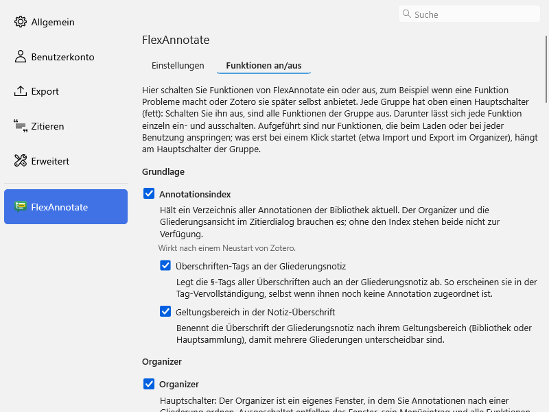

# FlexAnnotate

[](https://www.zotero.org)
[](https://www.zotero.org)
[](https://www.zotero.org)
[](https://www.zotero.org)
[](https://github.com/windingwind/zotero-plugin-template)

**Deutsch · [English](#english)**

FlexAnnotate gibt Annotationen in Zotero mehr Spielraum. Das Plugin überarbeitet den Umgang mit Annotationen: Locator, Seitenzahl und Kommentar lassen sich beim Anlegen und nachträglich ändern, ein Organizer ordnet alle Annotationen in einer Gliederung, der Zitierdialog aus Word arbeitet mit dieser Gliederung, und auch Bücher ohne Datei bekommen Annotationen. Läuft mit Zotero 7.0 bis 10.

_More room to work with annotations in Zotero: edit locators and comments afterwards, organise every annotation in an outline, cite from Word by that outline, and annotate books without a file. Works with Zotero 7.0 to 10_


## Deutsch

### Wozu das Ganze

Zotero speichert Annotationen, aber danach bleibt wenig Spielraum. Der Locator steht nach dem Anlegen fest, Annotationen lassen sich nicht ordnen, und ein gedrucktes Buch hat keine Datei, an die man sie hängen könnte. Word und LibreOffice fügen außerdem immer den Zitattext mit ein.

FlexAnnotate nimmt sich genau das vor. Es ist im Kern eine Überarbeitung der Annotationen, mit vier Teilen, die ineinandergreifen.

### Was es kann

**1. Annotationen nachträglich bearbeiten**

Das gilt für alle Annotationen, auch für die aus PDF, EPUB und Snapshot.

- **Im Reader:** Rechtsklick auf eine Annotation, dann _Annotation bearbeiten…_. Im Seitenzahl-Popup lässt sich der Locator-Typ wählen und für das ganze Dokument merken.
- **Im Zotero-Fenster:** Rechtsklick auf eine Annotation, _Annotation bearbeiten…_. Die Eingabemaske ändert Seitenangabe, Locator, Tags (als Chips), Kommentar und Farbe.
- **Sprung in den Reader (↗):** Annotationen mit Textstelle haben in der Annotationsliste des Item-Bereichs oben rechts einen Pfeil `↗`, der den Reader direkt an der Stelle öffnet.
- **Locator nach Wahl:** Seite, Kapitel, Abschnitt, Absatz, Spalte und die weiteren Locator-Typen, die Zotero selbst kennt. Der Typ wandert in den Zitiernachweis.
- **Tag-Vorschläge in Gliederungsreihenfolge:** Tippt man im Tag-Feld (Reader-Popup oder Print-Maske) ein `§`, erscheinen die Überschriften der Hauptsammlung in Gliederungsreihenfolge mit Gliederungsnummer (z. B. `(1.1)`).

**2. Organizer**

- **Gliederung.** Überschriften beliebig verschachteln und Annotationen oder Werke per Drag and Drop darunter einsortieren. Es gibt eine Ansicht für Annotationen („Wissen“) und eine für Werke („Titel“).
- **Eine Gliederung je Sammlung.** Jede Hauptsammlung kann ihren eigenen Baum haben.
- **Word und LibreOffice.** Eine Gliederung aus einem `.docx` oder `.odt` importieren, oder die eigene Gliederung als Dokument mit nummerierten Überschriften exportieren und dort weiterschreiben.
- **Notiz-Export.** Die Gliederung mit allen zugeordneten Zitaten wird auf Wunsch zu einer Zotero-Notiz.


**3. Zitieren aus Word und LibreOffice (ab Zotero 9)**

Im Zitierdialog gibt es die Option „Nach Gliederung anordnen“ – sowohl für Annotationen als auch für Werke („Titel“).

- **Gliederung im Dialog:** Links stehen die Überschriften mit Anzahl, in der Mitte die Einträge.
- **Schnelles Einfügen per Doppelklick:** Ein Doppelklick auf eine Annotation oder ein Werk fügt den Eintrag direkt zur Zitation hinzu (wie das „+“).
- **Präfix und Suffix:** Beim Klick auf eine hinzugefügte Annotation in der oberen Zitierleiste (`#bubble-input`) lassen sich im Detail-Popup Präfix und Suffix vergeben.
- **Zitier-Tracking & Fußnotensprung:** Schon zitierte Annotationen tragen einen grünen Haken und zeigen die konkreten Fußnotennummern im Dokument (`[ Fn. 3 ]`, `[ Fn. 12 ]` bzw. `[ Text ]`). Ein Klick auf den Badge in der Vorschau springt direkt zur Fußnote in Word/LibreOffice und holt das Dokument nach vorn (Details in [Dokumentation](docs/cited-tracking.md)).
- **Nur-Nachweis-Zitieren:** Wer den Zitattext nicht im Dokument will, fügt nur die Zitation mit Fundstelle ein, im Dialog oder dauerhaft in den Einstellungen.
- **Suche & Fundstelle:** Die Suche oben filtert die Gliederung mit, und „Zitatstelle anzeigen“ öffnet den Reader an der richtigen Stelle.


**Zitierfenster offen halten (Option)**

Mit „Als Aufgabenleiste geöffnet halten“ (Einstellungen → FlexAnnotate, oder Schalter im Gliederungsbereich des Dialogs) bleibt das Zitierfenster nach dem Einfügen stehen, und Sie können die nächste Annotation auswählen, ohne Word zu verlassen.

- Nach dem Einfügen schließt der Dialog kurz, damit Word die Fußnote übernimmt, und öffnet sich an derselben Stelle neu: wieder die normale Ansicht mit Sammlungen, allen Annotationen und Suche. Dort wählen Sie die nächste Annotation und klicken auf „Einfügen“. Die Fußnote landet an der Cursorposition in Word.
- Eine neue Anfrage aus Word (Annotation hinzufügen) ersetzt das Fenster durch den Dialog an derselben Stelle. Schließen Sie das Fenster mit dem X, endet das Offenhalten bis zur nächsten Anfrage.
- Zotero lädt einen offenen Dialog nicht mit einem neuen Auftrag neu. Deshalb wird das Fenster nach jedem Einfügen neu geöffnet; ein angedocktes Fenster muss danach neu angedockt werden.
- Unter 750 px Breite stehen die beiden Schalter im Einstellungsmenü (Zahnrad unten rechts) statt in der Zeile, damit die Liste mehr Platz hat.
- Das Fenster lässt sich wie ein normales andocken (etwa an den Rand unter Windows). Die Mindesthöhe liegt bei rund 590 px, weil Zotero sie erzwingt. Unter 750 px Breite liegt der Baum oben, die Liste darunter und die Details unten.
- Ausschalten schließt ein offenes Blätterfenster nicht sofort, sondern erst mit dem nächsten Einfügen (dann wie in Vanilla-Zotero). Einschalten wirkt auch auf einem bereits geöffneten Zitierfenster: das nächste Einfügen dort hält es wieder offen.
- Das Blätterfenster nach dem Einfügen öffnet sich bei Word für Windows, LibreOffice Writer und Word für Mac (freigeschaltet, realer Mac-Test steht aus). Bei Google Docs nicht. Zotero 7 und 8 haben den nötigen Befehl nicht; dort gibt es die Option nicht.
- Der erste Dialog nach einem Neustart öffnet an der zuletzt benutzten Stelle und Größe, sofern sie noch auf dem Bildschirm liegt; sonst nur mit der Größe, die Position bestimmt das System.
- Geprüft mit Zotero 10.0.6 (installierte Version) und 9.0.6 (Testsuite grün). 7.0.32 und 8.0.4 haben keinen Annotationsmodus; dort fehlt die Option. In echtem Word für Windows und in echtem LibreOffice Writer bestätigt; nicht geprüft: Word für Mac, macOS, Linux und der dunkle Modus.
- Warum ein dauerhaft angedocktes Zitierfenster mit Zoteros Word-Integration nicht möglich ist (Englisch): [docs/persistent-window-limits.md](docs/persistent-window-limits.md).

**4. Bücher ohne Datei: Print-Annotationen**

Rechtsklick auf einen Titel oder dessen Anhang, _Print-Annotation hinzufügen…_ (bzw. _Annotation hinzufügen…_ bei echtem Anhang), Text, Tags, Kommentar und Seite eintragen. Im Hintergrund legt das Plugin einen Platzhalter-Anhang an, die Annotation verhält sich wie jede andere: Sie lässt sich ordnen, durchsuchen und aus Word zitieren.

**Außerdem: Citavi-Import**

Zitate ohne Dateianhang, die Zoteros Citavi-Import verwirft, bleiben erhalten und werden zu Print-Annotationen. Außerdem lässt sich einstellen, welchem Zotero-Locator die Seitentypen aus Citavi (Seite, Spalte, Absatz, Randnummer, Andere) entsprechen. Standardmäßig wird eine Citavi-Randnummer zum Locator „Absatz“. Das Plugin selbst führt keinen eigenen Locator „Randnummer“ ein: Es nutzt die Locator-Typen von Zotero.

**Funktionen einzeln ein- und ausschalten**

In den Einstellungen gibt es neben „Einstellungen“ den Tab „Funktionen an/aus“. Dort lässt sich jede Funktion von FlexAnnotate mit einer Checkbox abschalten, etwa wenn sie Probleme macht oder Zotero sie später selbst anbietet. Jede Gruppe hat einen Hauptschalter. Einzelheiten stehen im [Handbuch](docs/handbuch.md).



### Installation

**Über die Release-Seite**

1. Die `.xpi`-Datei von der [Release-Seite](https://github.com/justanotherjurastudent/zotero_FlexAnnotate/releases) laden.
2. In Zotero _Werkzeuge → Plugins_ öffnen, auf das Zahnrad klicken und _Plugin aus Datei installieren…_ wählen.
3. Zotero neu starten, falls es danach fragt.

**Über den Add-on Market**

FlexAnnotate steht auch im [Add-on Market for Zotero](https://github.com/syt2/zotero-addons), einem Plugin, mit dem man andere Plugins direkt in Zotero durchsuchen und installieren kann.

1. Den Add-on Market selbst installieren: [`zotero-addons.xpi`](https://github.com/syt2/zotero-addons/releases/latest/download/zotero-addons.xpi) laden und in Zotero wie oben über _Werkzeuge → Plugins → Zahnrad → Plugin aus Datei installieren…_ einspielen.
2. Den Market über das Symbol in der Werkzeugleiste oder den Eintrag _Add-on market_ im Menü _Werkzeuge_ öffnen.
3. Nach „FlexAnnotate“ suchen und installieren.

Selbst bauen (Node.js 24):

```bash
npm install
npm run build    # Ergebnis: .scaffold/build/flex-annotate.xpi
```

### Erste Schritte

1. **Print-Annotation anlegen:** Rechtsklick auf einen Titel ohne Datei, _Print-Annotation hinzufügen…_.
2. **Organizer öffnen:** der grüne Button links neben dem Sync-Button oben rechts, oder _Werkzeuge → FlexAnnotate: Organizer_.
3. **Gliederung füllen:** im Organizer mit dem Plus-Symbol Überschriften anlegen, dann Annotationen darauf ziehen.
4. **Aus Word zitieren:** in Word auf _Anmerkung hinzufügen_ klicken. Im Zitierdialog „Einfügen als“ wählen, wenn nur der Nachweis erscheinen soll.
5. **Nach Gliederung zitieren:** Im Annotationsbereich des Zitierdialogs den Schalter „Nach Gliederung anordnen“ umlegen. Dann zeigt der Dialog die Überschriften aus dem Organizer mit ihren Annotationen statt der normalen Liste. Schalter wieder aus, und die gewohnte Ansicht ist zurück. (Ab Zotero 9.)

Eine Gliederung aus einer Word-Datei zu holen ist ebenfalls kurz:


Im Organizer das Dokument-Symbol anklicken, die Datei wählen, in der Vorschau prüfen und _Importieren_ drücken. Es wird nur angehängt, nichts gelöscht.

### Mit welchen Zotero-Versionen

Das Plugin läuft mit Zotero 7.0 bis 10. Die Hauptfunktionen stehen auf allen Versionen bereit:

| Funktion                                                       |       Zotero 7       |       Zotero 8       |       Zotero 9       |    Zotero 10    |
| :------------------------------------------------------------- | :------------------: | :------------------: | :------------------: | :-------------: |
| Organizer (Gliederungsansicht, Word-/ODT-Import & Export)      |          ✓           |          ✓           |          ✓           |        ✓        |
| Print-Annotationen (Bücher ohne Datei) & Citavi-Import         | ✓ (8 Standardfarben) | ✓ (8 Standardfarben) | ✓ (8 Standardfarben) | ✓ (alle Farben) |
| Nur-Nachweis-Zitieren (Fundstelle ohne Zitattext einfügen)     |          ✓           |          ✓           |          ✓           |        ✓        |
| Gliederungsvorschläge bei Eingabe von § im PDF-Reader          |          ✓           |          ✓           |          ✓           |        ✓        |
| Verbesserte Annotationszeilen (Locator-Titel, Sprungpfeil ↗)   |          ✓           |          ✓           |          ✓           |        ✓        |
| Zitierdialog mit Gliederung, Nachweis-Modus & Schnell-Einfügen |          —           |          —           |          ✓           |        ✓        |
| Zitierfenster als Aufgabenleiste offen halten                  |          —           |          —           |          ✓           |        ✓        |

- **Vor Zotero 10 (Zotero 7 bis 9):** Die Farbauswahl für Print-Annotationen nutzt Zoteros acht Standardfarben (die erweiterte Farbpalette gibt es erst ab Zotero 10).
- **Vor Zotero 9 (Zotero 7 und 8):** In Word gab es noch keine Möglichkeit, Annotationen direkt zu zitieren; alle Erweiterungen des Zitierdialogs und das Offenhalten als Aufgabenleiste setzen Zotero 9 oder neuer voraus. Einzelheiten im [Handbuch](docs/handbuch.md).

### Weiterlesen

- [Handbuch](docs/handbuch.md): Bedienung im Detail, Import und Export der Gliederung, Einstellungen, Versionsmatrix, Datenformat, bekannte Punkte
- [CHANGELOG](CHANGELOG.md)
- [Aufbau und Fallstricke](docs/architecture.md) und [Tests](docs/testing.md) für Entwickler, dazu [AGENTS.md](AGENTS.md)
- [KI-Anbindung](docs/ai-integration.md) (englisch): wie Werkzeuge, die eine KI mit Zotero verbinden (MCP-Server, Plugins), Annotationen der Gliederung zuordnen können

### Lizenz und Herkunft

[AGPL-3.0-or-later](LICENSE). Der Organizer geht auf [Lattice](https://github.com/birugit/zotero-grounded-qa) von birugit zurück (AGPL-3.0-or-later). Print-Annotationen, Nur-Nachweis-Zitieren und Citavi-Import stammen vom Projektautor. Details in [NOTICE.md](NOTICE.md).

### Support

Unterstütze meinen freien Content:

<a href="https://www.buymeacoffee.com/justanotherjurastudent" target="_blank"></a>

---

## English

### What it is for

Zotero stores annotations, but after that there is little room to work with them. The locator is fixed once created, annotations cannot be organised, and a printed book has no file to attach them to. Word and LibreOffice also always insert the quoted text.

FlexAnnotate goes after exactly that. At its core it is an overhaul of annotations, in four parts that work together.

### What it does

**1. Edit annotations afterwards**

This applies to every annotation, including those from PDF, EPUB and snapshots.

- **In the reader:** right-click an annotation, then _Edit annotation…_. The page-number popup lets you pick the locator type and remember it for the whole document.
- **In the Zotero window:** right-click an annotation, _Edit annotation…_. The input panel changes page, locator, tags (as chips), comment and colour.
- **Reader jump (↗):** annotation rows with an excerpt in the item pane have an arrow `↗` at the top right that opens the reader directly at the passage.
- **Locator of your choice:** page, chapter, section, paragraph, column and the other locator types Zotero itself knows. The type goes into the citation.
- **Tag suggestions in outline order:** typing `§` in the tag box (reader popup or print dialog) lists headings in outline order with numbering (e.g. `(1.1)`).

**2. Organizer**

- **Outline.** Nest headings as deeply as you like and drag annotations or works under them. One view lists annotations ("Wissen"), another lists works ("Titel").
- **One outline per collection.** Every top-level collection can have its own tree.
- **Word and LibreOffice.** Import an outline from a `.docx` or `.odt`, or export your outline as a document with numbered headings and keep writing there.
- **Note export.** On request the outline with all assigned quotes becomes a Zotero note.

**3. Citing from Word and LibreOffice (Zotero 9 and later)**

The citation dialog gets the option "Nach Gliederung anordnen" (arrange by outline) – both for annotations and for works ("Titel").

- **Outline in the dialog:** headings with counts are on the left, entries in the middle.
- **Quick double-click insert:** double-clicking an annotation or a work adds the entry directly to the citation (just like clicking "+").
- **Prefix and suffix:** clicking an added annotation bubble in the top citation input (`#bubble-input`) lets you set prefix and suffix in the detail popup.
- **Citation tracking & footnote jump:** cited annotations carry a green check and display concrete footnote numbers (`[ Fn. 3 ]`, `[ Fn. 12 ]` or `[ Text ]`). Clicking the badge in the preview jumps directly to the footnote in Word/LibreOffice and focuses the document (details in [documentation](docs/cited-tracking.md)).
- **Citation-only insertion:** if you do not want the quoted text in the document, insert only the citation with its pinpoint, per dialog or permanently in the settings.
- **Search & show place:** the search bar at the top filters the outline list too, and "Zitatstelle anzeigen" (show place) opens the reader at the passage.

**Keep the citation window open (option)**

With "Keep citation window open as a persistent task pane" (Settings → FlexAnnotate, or the checkbox in the outline area of the dialog) the citation window stays on screen after inserting, so you can select the next annotation without leaving Word.

- After inserting, the dialog closes briefly so that Word takes the footnote, then reopens at the same position: the normal view with collections, all annotations and search. Select the next annotation and click Insert; the footnote goes to the cursor position in Word.
- A new request from Word (Add Annotation) replaces the window with the dialog at the same position. Close the window with the X and the persistence ends until the next request.
- Zotero does not reload an open dialog with a new request, so the window is opened again after each insert. A docked window therefore has to be docked again after each insert.
- Below 750 px width the two switches are in the settings menu (gear at the bottom right) instead of the row, so the list has more room.
- The window can be docked like any other (e.g. to a screen edge on Windows). The minimum height is about 590 px because Zotero enforces it. Below 750 px width the tree is on top, the list below it and the details at the bottom.
- Switching off does not close an open browse window immediately, but on the next insert (then behaving like stock Zotero). Switching on takes effect even on an already-open citation window: the next insert there keeps it open again.
- The browse window after inserting opens with Word for Windows, LibreOffice Writer and Word for Mac (enabled, real Mac verification pending). Not with Google Docs. Zotero 7 and 8 lack the needed command; the option is not offered there.
- The first dialog after a restart opens at the last used position and size, if the position is still on the screen; otherwise only the size is kept and the system places the window.
- Checked with Zotero 10.0.6 (the installed version) and 9.0.6 (test suite green). 7.0.32 and 8.0.4 have no annotations mode, so the option is absent there. Confirmed in real Word for Windows and real LibreOffice Writer; not checked: Word for Mac, macOS, Linux and dark mode.
- Why a permanently docked citation window is not possible with Zotero's Word integration: [docs/persistent-window-limits.md](docs/persistent-window-limits.md).

**4. Books without a file: print annotations**

Right-click an item or its attachment, _Add print annotation…_ (or _Add annotation…_ if it has a real attachment), then enter text, tags, comment and page. In the background the plugin creates a placeholder attachment, and the annotation behaves like any other: you can organise it, search it and cite it from Word.

**Also: Citavi import**

Quotes without a file attachment, which Zotero's Citavi import discards, are kept and become print annotations. You can also set which Zotero locator each Citavi page type (page, column, paragraph, margin number, other) maps to. By default a Citavi margin number becomes the locator "paragraph". The plugin does not add a locator "margin number" of its own: it uses Zotero's locator types.

**Switching features on and off**

Next to "Einstellungen" (settings) the preferences have a tab "Funktionen an/aus" (features on/off). There every FlexAnnotate feature can be switched off with a checkbox, for example when it causes trouble or Zotero later offers it itself. Each group has a main switch. Details are in the [user guide](docs/guide.md).


The plugin's labels are in German and English, following Zotero's language.

### Install

**From the Releases page**

1. Download the `.xpi` from the [Releases page](https://github.com/justanotherjurastudent/zotero_FlexAnnotate/releases).
2. In Zotero open _Tools → Plugins_, click the gear and choose _Install Plugin From File…_.
3. Restart Zotero if it asks.

**From the Add-on Market**

FlexAnnotate is also listed in the [Add-on Market for Zotero](https://github.com/syt2/zotero-addons), a plugin that lets you browse and install other plugins from inside Zotero.

1. Install the Add-on Market itself: download [`zotero-addons.xpi`](https://github.com/syt2/zotero-addons/releases/latest/download/zotero-addons.xpi) and install it as above via _Tools → Plugins → gear → Install Plugin From File…_.
2. Open the market from its toolbar icon or the _Add-on market_ entry in the _Tools_ menu.
3. Search for "FlexAnnotate" and install it.

To build it yourself (Node.js 24):

```bash
npm install
npm run build    # result: .scaffold/build/flex-annotate.xpi
```

### Getting started

1. **Create a print annotation:** right-click an item without a file, _Add print annotation…_.
2. **Open the Organizer:** the green button left of the Sync button at the top right, or _Tools → FlexAnnotate: Organizer_.
3. **Build an outline:** add headings with the plus icon, then drag annotations onto them.
4. **Cite from Word:** click _Add Note_ in Word. In the citation dialog pick "Insert as" if you want only the citation.
5. **Cite by outline:** in the annotations view of the citation dialog, switch on "Nach Gliederung anordnen" (arrange by outline). The dialog then shows the headings from the Organizer with their annotations instead of the normal list. Switch it off and the usual view is back. (Zotero 9 and later.)

Getting an outline out of a Word file is short too. Click the document icon in the Organizer, choose the file, check the preview and press _Import_. It only appends and deletes nothing.

### Supported Zotero versions

FlexAnnotate works with Zotero 7.0 to 10. Core features are available across versions:

| Feature                                                         |        Zotero 7        |        Zotero 8        |        Zotero 9        |    Zotero 10    |
| :-------------------------------------------------------------- | :--------------------: | :--------------------: | :--------------------: | :-------------: |
| Organizer (outline view, Word/ODT import & export)              |           ✓            |           ✓            |           ✓            |        ✓        |
| Print annotations (books without a file) & Citavi import        | ✓ (8 standard colours) | ✓ (8 standard colours) | ✓ (8 standard colours) | ✓ (all colours) |
| Citation-only citing (insert citation without quote text)       |           ✓            |           ✓            |           ✓            |        ✓        |
| Outline tag suggestions when typing § in the PDF reader         |           ✓            |           ✓            |           ✓            |        ✓        |
| Enhanced annotation rows (locator title, jump button ↗)         |           ✓            |           ✓            |           ✓            |        ✓        |
| Word citation dialog with outline, citation-only & quick insert |           —            |           —            |           ✓            |        ✓        |
| Keep citation window open as a companion panel                  |           —            |           —            |           ✓            |        ✓        |

- **Before Zotero 10 (Zotero 7 to 9):** Colour choice for print annotations uses Zotero's 8 standard colours (the full colour palette requires Zotero 10).
- **Before Zotero 9 (Zotero 7 and 8):** Word integration does not natively support citing annotations directly; citation dialog enhancements and the companion window require Zotero 9 or later. Details in the [user guide](docs/guide.md).

### Further reading

- [User guide](docs/guide.md): detailed usage, outline import and export, settings, version matrix, data format, known issues
- [CHANGELOG](CHANGELOG.md)
- [Architecture and pitfalls](docs/architecture.md) and [testing](docs/testing.md) for developers, plus [AGENTS.md](AGENTS.md)
- [AI integration](docs/ai-integration.md): how tools that connect an AI to Zotero (MCP servers, plugins) can assign annotations to the outline

### License and origin

[AGPL-3.0-or-later](LICENSE). The Organizer derives from [Lattice](https://github.com/birugit/zotero-grounded-qa) by birugit (AGPL-3.0-or-later). Print annotations, citation-only insertion and the Citavi import are by the project author. Details in [NOTICE.md](NOTICE.md).

### Support

Support my free content:

<a href="https://www.buymeacoffee.com/justanotherjurastudent" target="_blank"></a>
