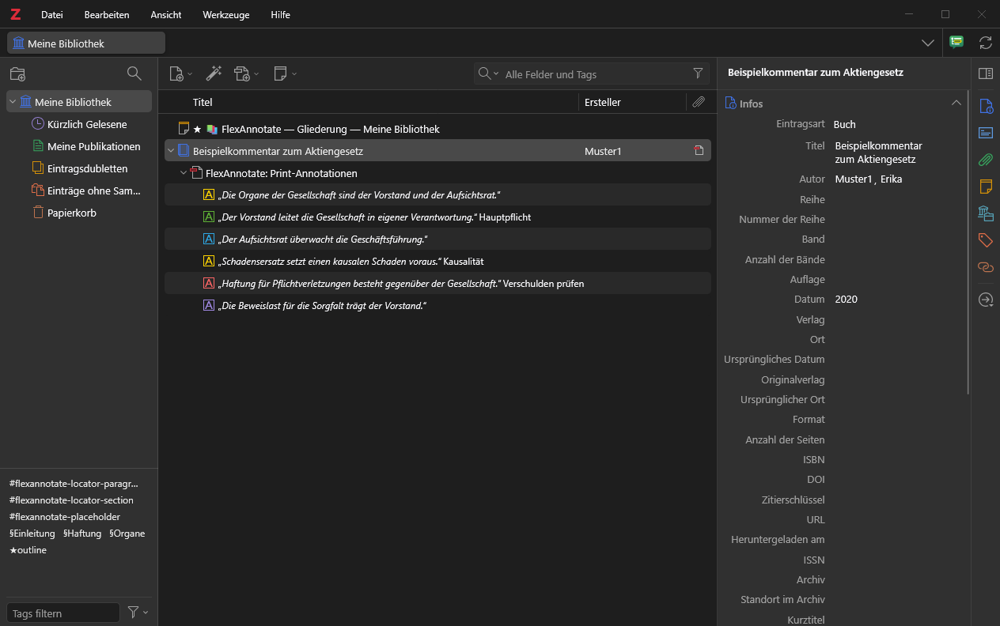
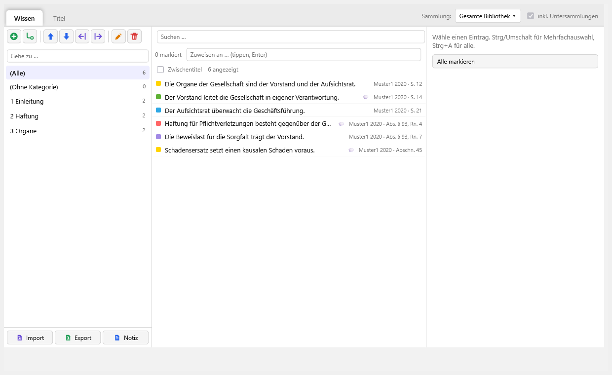
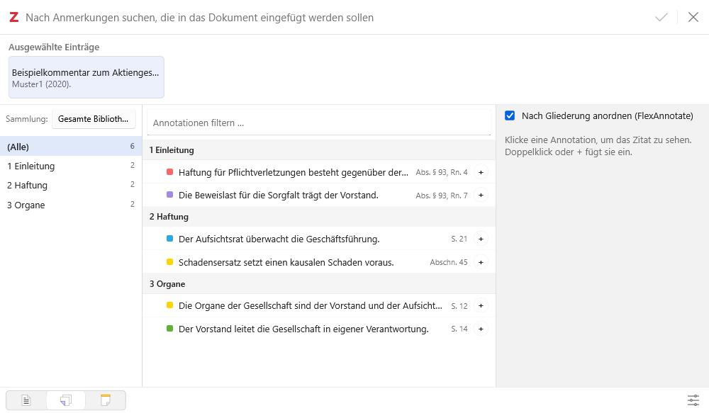
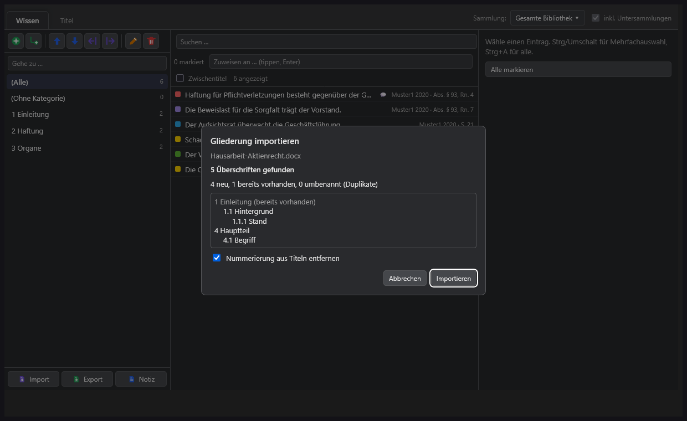

# FlexAnnotate

[](https://www.zotero.org)
[](https://www.zotero.org)
[](https://www.zotero.org)
[](https://www.zotero.org)
[](https://github.com/windingwind/zotero-plugin-template)

**Deutsch · [English](#english)**

Annotationen in Zotero auf das nächste Level. FlexAnnotate überarbeitet den Umgang mit Annotationen von Grund auf: Locator, Seitenzahl und Kommentar lassen sich nachträglich ändern, ein Organizer ordnet alle Annotationen in einer Gliederung, der Zitierdialog aus Word arbeitet mit dieser Gliederung, und auch Bücher ohne Datei bekommen Annotationen. Läuft mit Zotero 7.0 bis 10, Version 2.0.0.

_Annotations in Zotero, taken to the next level: edit locators and comments afterwards, organise every annotation in an outline, cite from Word by that outline, and annotate books without a file. Works with Zotero 7.0 to 10, version 2.0.0._



## Deutsch

### Wozu das Ganze

Zotero speichert Annotationen, aber danach bleibt wenig Spielraum. Der Locator steht nach dem Anlegen fest, Annotationen lassen sich nicht ordnen, und ein gedrucktes Buch hat keine Datei, an die man sie hängen könnte. Word und LibreOffice fügen außerdem immer den Zitattext mit ein.

FlexAnnotate nimmt sich genau das vor. Es ist im Kern eine Überarbeitung der Annotationen, mit vier Teilen, die ineinandergreifen.

### Was es kann

**1. Annotationen nachträglich bearbeiten**

Das gilt für alle Annotationen, auch für die aus PDF, EPUB und Snapshot.

- **Im Reader:** Rechtsklick auf eine Annotation, dann _Kommentar hinzufügen…_ oder _Locator festlegen…_. Im Seitenzahl-Popup lässt sich der Locator-Typ wählen und für das ganze Dokument merken.
- **Im Zotero-Fenster:** Rechtsklick auf eine Annotation, _Annotation bearbeiten…_. Die Eingabemaske ändert Seitenangabe, Locator, Kommentar und Farbe.
- **Locator nach Wahl:** Seite, Randnummer, Absatz, Spalte, Kapitel und weitere. Der Typ wandert in den Zitiernachweis.

**2. Organizer**

- **Gliederung.** Überschriften beliebig verschachteln und Annotationen oder Werke per Drag and Drop darunter einsortieren. Es gibt eine Ansicht für Annotationen („Wissen“) und eine für Werke („Titel“).
- **Eine Gliederung je Sammlung.** Jede Hauptsammlung kann ihren eigenen Baum haben.
- **Word und LibreOffice.** Eine Gliederung aus einem `.docx` oder `.odt` importieren, oder die eigene Gliederung als Dokument mit nummerierten Überschriften exportieren und dort weiterschreiben.
- **Notiz-Export.** Die Gliederung mit allen zugeordneten Zitaten wird auf Wunsch zu einer Zotero-Notiz.



**3. Zitieren aus Word und LibreOffice (ab Zotero 9)**

Im Zitierdialog gibt es die Option „Nach Gliederung anordnen“. Links stehen die Überschriften mit Anzahl, in der Mitte die Annotationen. Schon zitierte Annotationen tragen einen grünen Haken. Die Suche oben filtert mit, und „Zitatstelle anzeigen“ öffnet den Reader an der richtigen Stelle. Dazu kommt das **Nur-Nachweis-Zitieren**: Wer den Zitattext nicht im Dokument will, fügt nur die Zitation mit Fundstelle ein, im Dialog oder dauerhaft in den Einstellungen.



**4. Bücher ohne Datei: Print-Annotationen**

Rechtsklick auf einen Titel, _Print-Annotation hinzufügen…_, Text, Kommentar und Seite eintragen. Im Hintergrund legt das Plugin einen Platzhalter-Anhang an, die Annotation verhält sich wie jede andere: Sie lässt sich ordnen, durchsuchen und aus Word zitieren.

**Außerdem: Citavi-Import**

Zitate ohne Dateianhang, die Zoteros Citavi-Import verwirft, bleiben erhalten und werden zu Print-Annotationen. Ein zweiter Import desselben Exports legt keine Doubletten an.

### Installation

1. Die `.xpi`-Datei von der [Release-Seite](https://github.com/justanotherjurastudent/zotero_FlexAnnotate/releases) laden.
2. In Zotero _Werkzeuge → Plugins_ öffnen, auf das Zahnrad klicken und _Plugin aus Datei installieren…_ wählen.
3. Zotero neu starten, falls es danach fragt.

Selbst bauen (Node.js 24):

```bash
npm install
npm run build    # Ergebnis: .scaffold/build/flex-annotate.xpi
```

### Erste Schritte

1. **Print-Annotation anlegen:** Rechtsklick auf einen Titel ohne Datei, _Print-Annotation hinzufügen…_.
2. **Organizer öffnen:** der grüne Button links neben dem Sync-Button oben rechts, oder _Werkzeuge → FlexAnnotate: Organizer_.
3. **Gliederung füllen:** im Organizer mit dem Plus-Symbol Überschriften anlegen, dann Annotationen darauf ziehen.
4. **Aus Word zitieren:** in Word auf _Anmerkung hinzufügen_ klicken. Im Zitierdialog „Einfügen als“ wählen, wenn nur der Nachweis erscheinen soll.

Eine Gliederung aus einer Word-Datei zu holen ist ebenfalls kurz:



Im Organizer das Dokument-Symbol anklicken, die Datei wählen, in der Vorschau prüfen und _Importieren_ drücken. Es wird nur angehängt, nichts gelöscht.

### Mit welchen Zotero-Versionen

Getestet sind 7.0.32, 8.0.4, 9.0.6 und 10.0.5/10.0.6. Alles Wichtige läuft auf allen vier. Kleine Abweichungen:

- Vor Zotero 10 hat das Farbmenü der Eingabemaske nur Zoteros acht Standardfarben.
- Unter 7.x liegt der Menüeintrag direkt im Menü _Werkzeuge_ und nicht über Zoteros Menü-Verwaltung.
- Den Annotationsmodus im Zitierdialog gibt es erst ab Zotero 9. Auf 7 und 8 tut das Plugin dort nichts.

### Weiterlesen

- [Handbuch](docs/handbuch.md): Bedienung im Detail, Import und Export der Gliederung, Einstellungen, Versionsmatrix, Datenformat, bekannte Punkte
- [CHANGELOG](CHANGELOG.md)
- [Aufbau und Fallstricke](docs/architecture.md) und [Tests](docs/testing.md) für Entwickler, dazu [AGENTS.md](AGENTS.md)

### Lizenz und Herkunft

[AGPL-3.0-or-later](LICENSE). Der Organizer geht auf [Lattice](https://github.com/birugit/zotero-grounded-qa) von birugit zurück (AGPL-3.0-or-later). Print-Annotationen, Nur-Nachweis-Zitieren und Citavi-Import stammen vom Projektautor. Details in [NOTICE.md](NOTICE.md).

---

## English

### What it is for

Zotero stores annotations, but after that there is little room to work with them. The locator is fixed once created, annotations cannot be organised, and a printed book has no file to attach them to. Word and LibreOffice also always insert the quoted text.

FlexAnnotate goes after exactly that. At its core it is an overhaul of annotations, in four parts that work together.

### What it does

**1. Edit annotations afterwards**

This applies to every annotation, including those from PDF, EPUB and snapshots.

- **In the reader:** right-click an annotation, then _Add comment…_ or _Set locator…_. The page-number popup lets you pick the locator type and remember it for the whole document.
- **In the Zotero window:** right-click an annotation, _Edit annotation…_. The input panel changes page, locator, comment and colour.
- **Locator of your choice:** page, margin number, paragraph, column, chapter and more. The type goes into the citation.

**2. Organizer**

- **Outline.** Nest headings as deeply as you like and drag annotations or works under them. One view lists annotations ("Wissen"), another lists works ("Titel").
- **One outline per collection.** Every top-level collection can have its own tree.
- **Word and LibreOffice.** Import an outline from a `.docx` or `.odt`, or export your outline as a document with numbered headings and keep writing there.
- **Note export.** On request the outline with all assigned quotes becomes a Zotero note.

**3. Citing from Word and LibreOffice (Zotero 9 and later)**

The citation dialog gets the option "Nach Gliederung anordnen" (arrange by outline). Headings with counts are on the left, annotations in the middle. Annotations you have already cited carry a green check. The search bar at the top filters the list too, and "Zitatstelle anzeigen" (show place) opens the reader at the passage. On top of that comes **citation-only insertion**: if you do not want the quoted text in the document, insert only the citation with its pinpoint, per dialog or permanently in the settings.

**4. Books without a file: print annotations**

Right-click an item, _Add print annotation…_, then enter text, comment and page. In the background the plugin creates a placeholder attachment, and the annotation behaves like any other: you can organise it, search it and cite it from Word.

**Also: Citavi import**

Quotes without a file attachment, which Zotero's Citavi import discards, are kept and become print annotations. Importing the same export again creates no duplicates.

The plugin's labels are in German and English, following Zotero's language.

### Install

1. Download the `.xpi` from the [Releases page](https://github.com/justanotherjurastudent/zotero_FlexAnnotate/releases).
2. In Zotero open _Tools → Plugins_, click the gear and choose _Install Plugin From File…_.
3. Restart Zotero if it asks.

To build it yourself (Node.js 24):

```bash
npm install
npm run build    # result: .scaffold/build/flex-annotate.xpi
```

### Getting started

1. **Create a print annotation:** right-click an item without a file, _Add print annotation…_.
2. **Open the Organizer:** the green button left of the Sync button at the top right, or _Tools → FlexAnnotate: Organizer_.
3. **Build an outline:** add headings with the plus icon, then drag annotations onto them.
4. **Cite from Word:** click _Add Note_ in Word. In the citation dialog pick "Insert as" if you want only the citation.

Getting an outline out of a Word file is short too. Click the document icon in the Organizer, choose the file, check the preview and press _Import_. It only appends and deletes nothing.

### Supported Zotero versions

Tested: 7.0.32, 8.0.4, 9.0.6 and 10.0.5/10.0.6. All the main features work on all four. Small differences:

- Before Zotero 10 the colour menu of the input panel has only Zotero's eight standard colours.
- On 7.x the menu entry goes straight into the _Tools_ menu instead of through Zotero's menu manager.
- The annotations mode in the citation dialog exists only from Zotero 9. On 7 and 8 the plugin does nothing there.

### Further reading

- [User guide](docs/guide.md): detailed usage, outline import and export, settings, version matrix, data format, known issues
- [CHANGELOG](CHANGELOG.md)
- [Architecture and pitfalls](docs/architecture.md) and [testing](docs/testing.md) for developers, plus [AGENTS.md](AGENTS.md)

### License and origin

[AGPL-3.0-or-later](LICENSE). The Organizer derives from [Lattice](https://github.com/birugit/zotero-grounded-qa) by birugit (AGPL-3.0-or-later). Print annotations, citation-only insertion and the Citavi import are by the project author. Details in [NOTICE.md](NOTICE.md).
