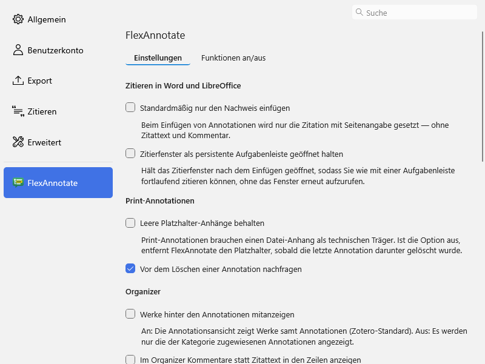

# FlexAnnotate – User guide

[Deutsch](handbuch.md) · English

Detailed usage and reference. The overview is in the [README](../README.md).

## Where to find things

| Where                                           | What                                                                              |
| ----------------------------------------------- | --------------------------------------------------------------------------------- |
| Right-click an item                             | _Add print annotation…_                                                           |
| Right-click an annotation (item tree)           | _Edit annotation…_; for print annotations also _Delete print annotation_          |
| Right-click an annotation (right-hand pane)     | the same entries                                                                  |
| Reader: right-click an annotation               | _Add/edit comment…_, _Set locator…_                                               |
| Reader: edit the page number                    | locator choice and "Use this locator for this document from now on"               |
| Toolbar button, next to the Sync button         | opens the Organizer (or focuses an open window)                                   |
| _Tools → FlexAnnotate: Organizer_               | opens the Organizer (or focuses an open window)                                   |
| Organizer, document icon in the outline toolbar | import an outline from Word/LibreOffice                                           |
| Organizer, export icon in the outline toolbar   | export the outline as Word/ODT                                                    |
| Citation dialog from Word/LibreOffice           | "Insert as" (full citation / citation only); in the annotations view, the outline |
| _Edit → Settings → FlexAnnotate_                | settings                                                                          |

### Import an outline from Word/LibreOffice

1. Open the Organizer and click the document icon in the outline toolbar (_Import outline from Word/ODT document…_).
2. Choose a `.docx` or `.odt` file.
3. Check the preview: the counters (new, existing, renamed), the multilevel numbering (`1`, `1.1` …) and the indented list. The option "Strip numbering from titles" only appears if manual numbering was detected (forms like `1.`, `1.2`, `1)`, `A.`, `I.`, `a)`, `(1)` in at least 80 % of the headings and at least 3 headings).
4. Click _Import_. _Cancel_ leaves everything unchanged.
5. The new headings are in the outline; annotations are assigned as usual.

The importer recognises the paragraph styles "Heading 1/2/3 …" (also the German "Überschrift 1/2/3 …"), custom styles with an outline level (`outlineLvl`) and, in ODT, `text:h`. Levels are made gap-free: the first heading is level 1, and no level jumps by more than one.

The import only appends. Nothing is deleted or moved. A heading with the same title (ignoring case and whitespace) under the same parent is reused; otherwise it becomes the last child. With "Strip numbering" on, existing nodes whose titles still carry manual numbering are matched too; their titles are cleaned and the assigned annotations and works are moved to the cleaned tag automatically. Because every heading is a tag, titles must be unique; duplicates are named "Title (2)", "Title (3)".

Limits:

- Only paragraph styles and `outlineLvl`. Bold body text does not count as a heading.
- Footnotes and deleted tracked changes are not part of a title.
- `.doc` and `.rtf` are not supported (save as `.docx` or `.odt` first).
- Each XML entry (`document.xml`, `styles.xml`, `content.xml`) is limited to 50 MB.
- Text boxes, headers and footers are not handled specially.

If the document is open and locked exclusively in another program, the import says so instead of reporting "not a valid document". Close it there and try again.

### Export the outline as Word/ODT

1. Open the Organizer and click the export icon in the outline toolbar (_Export outline as Word/ODT…_).
2. Choose a location and name. The format drop-down switches between `.docx` (Word) and `.odt` (LibreOffice).
3. The document contains all headings in outline order with the standard styles "Heading 1–9" and an automatic multilevel numbering ("1", "1.1" …). The numbering follows when you move chapters in Word/LibreOffice. You can start writing under the headings right away.

The export changes nothing in the library. An existing target file is overwritten (the file dialog asks first). If the target is open in Word/LibreOffice or read-only, writing fails with a message and the file stays intact. Close it there and export again.

## Settings

Preference keys are under `extensions.flexannotate.`.

| Option                                                                               | Effect                                                                                      | Default                                                                                 |
| ------------------------------------------------------------------------------------ | ------------------------------------------------------------------------------------------- | --------------------------------------------------------------------------------------- |
| Insert only the citation by default (`citationOnly`)                                 | annotations are inserted as a citation with a pinpoint only                                 | off                                                                                     |
| Keep empty placeholder attachments (`keepEmptyPlaceholders`)                         | the placeholder stays even when no annotation hangs under it any more                       | off                                                                                     |
| Also show works behind the annotations (`showWorksInAnnotationView`)                 | Organizer: the annotation view lists the works as well                                      | off                                                                                     |
| Show comments instead of quote text in organizer rows (`showCommentInOrganizerRows`) | Organizer: for annotations with a comment, the row shows the comment instead of the excerpt | off                                                                                     |
| Import quotes without a file as print annotations (`citaviImport`)                   | the Citavi import creates print annotations for quotes Zotero drops                         | on                                                                                      |
| Keep the note on the quote (`citaviKeepNotes`)                                       | off: the note Zotero's translator creates for the quote is removed                          | off                                                                                     |
| Link contributions to their parent work (`citaviLinkContributions`)                  | the Citavi import creates "Related" links                                                   | on                                                                                      |
| Cite pinpoints as (`citaviLocatorPage/Column/Paragraph/Margin/Other`)                | CSL locator per Citavi page type                                                            | page: page, column: column, paragraph: paragraph, margin number: paragraph, other: page |

Internal, without a UI: `dialogOutlineView` (state of the outline option in the citation dialog), `citedAnnotations` (cited annotations per document).

## Zotero versions before 10

The manifest allows Zotero 7.0 to 10.\*. Only the automated Zotero test suite (`npm run test:versions`, see [testing.md](testing.md)) vouches for this, run against Zotero **7.0.32, 8.0.4, 9.0.6** and **10.0.5/10.0.6**. Other patch releases of the same series are untested; differences there are possible.

| Feature                                                                                  | 7.0.x                         | 8.0.x                         | 9.0.x                         | 10.x                   |
| ---------------------------------------------------------------------------------------- | ----------------------------- | ----------------------------- | ----------------------------- | ---------------------- |
| Organizer (window, outline, export), toolbar button                                      | tested                        | tested                        | tested                        | tested                 |
| Outline import from Word/LibreOffice                                                     | tested                        | tested                        | tested                        | tested                 |
| Outline export as Word/ODT (incl. locked-file tests)                                     | tested                        | tested                        | tested                        | tested                 |
| Print annotations incl. input panel                                                      | tested, colour menu: fallback | tested, colour menu: fallback | tested, colour menu: fallback | tested                 |
| Citavi import                                                                            | tested                        | tested                        | tested                        | tested                 |
| Citation-only insertion (patch of `_insertCitingResult`, tested synthetically only)      | tested                        | tested                        | tested                        | tested                 |
| Menu _Tools → FlexAnnotate: Organizer_                                                   | fallback (DOM)                | tested (`MenuManager`)        | tested (`MenuManager`)        | tested (`MenuManager`) |
| Citation dialog with annotations mode: mode selector, outline view, search, "show place" | not available                 | not available                 | tested                        | tested                 |
| Settings pane                                                                            | tested                        | tested                        | tested                        | tested                 |

- **Keep citation window open (option `persistentCitationDialog`, default off):** after inserting, the dialog reopens at the same position in its normal view (collections, all annotations, search), so you can insert the next annotation. Switching on applies at once, even to an already-open dialog: the next insert there makes it live again. Switching off no longer closes the open window immediately; it stays until the next insert (then it behaves like stock Zotero). Tested: the test suite is green on 10.0.6 and 9.0.6; 7.0.32 and 8.0.4 have no annotations mode, so the option is absent there.
- **Colour menu (7.x to 9.x):** `Zotero.Annotations.COLORS` exists only from 10.x. Before that, the input panel uses Zotero's eight standard colours.
- **Tools menu (7.x):** `Zotero.MenuManager` is missing in 7.0.32, so the entry is added to the _Tools_ menu directly. The other menus (right-click on items and annotations) work through the DOM anyway.
- **Citation dialog (7.x, 8.x):** the annotations mode of the citation dialog exists only from Zotero 9. On 7.x and 8.x there is no "Nach Gliederung anordnen" option, no "Insert as" selector and no "Zitatstelle anzeigen". The plugin does nothing in that dialog and stays out of the way.

## Data and compatibility

User data from version 1.x keeps working unchanged. The preference keys `extensions.flexannotate.*` did not change.

- `#flexannotate-locator-<type>`: locator type of an annotation (automatic tag; for "page" without a differing document default there is no tag).
- `#flexannotate-default-locator-<type>`: default locator of an attachment for future annotations.
- `#flexannotate-placeholder`: marks the placeholder attachment of the print annotations.
- `§Title`: an outline heading as a tag on assigned annotations and works (Lattice-compatible). The organizer also anchors a `§`-tag for every heading on the `★outline` note (fairly on save **and** on load, so headings of existing notes are tagged retroactively), so each heading's tag exists even with nothing filed: type `§` in the tag box of the annotation popup in the PDF reader and the headings of that tree are suggested. Rename/delete of a heading moves/removes its tag automatically. Zotero's tag suggestions are library-wide, so `§`-tags from other main collections with their own tree appear there as well.
- `★outline` and `LATTICE-OUTLINE-V1`: note holding the outline tree as JSON (Lattice-compatible). The additional tag `#flexannotate-outline-<collectionKey>` ties the note to the tree of that collection. Its heading shows the scope — the library name for the whole-library tree or the name of the main collection — so several outline notes are distinguishable in the item list.

Version 1.2.0 is available at the Git tag `pre-merge`.

## Known issues

- Do not open the `★outline` note in Zotero's note editor and edit it there. The editor can overwrite it later with its own state (background: [architecture.md](architecture.md), pitfall 14). FlexAnnotate creates it in a way that keeps Zotero from opening it by itself.
- Keep citation window open: the minimum height is about 590 px because Zotero enforces it. After inserting, the dialog reopens at the same position in its normal view, so you can insert the next annotation; a new request from Word replaces it. Inserting from the open window is not yet checked in real Word. Window position was measured only on Windows at 125 % scaling. macOS, Linux and dark mode are not checked.
- The `PageRange` format (`<os>`/`<nt>`) is only tested against synthetic fixtures.
- The reader popup, the reader menu and the toolbar and menu icons in dark mode were reviewed in code only, not visually and not automatically.
- The toolbar icon is 16 px; Zotero's own icons are 20 px.
- Edit and delete for annotations in the item tree go through the DOM, not `MenuManager`: Zotero applies no plugin menus when an annotation is selected (`zoteroPane.js:4680` in 10.0.5).
- Not tested automatically: reader windows, a real Word run, the real Citavi translator (see [testing.md](testing.md)).
