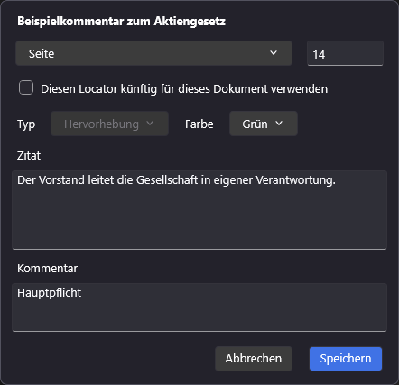
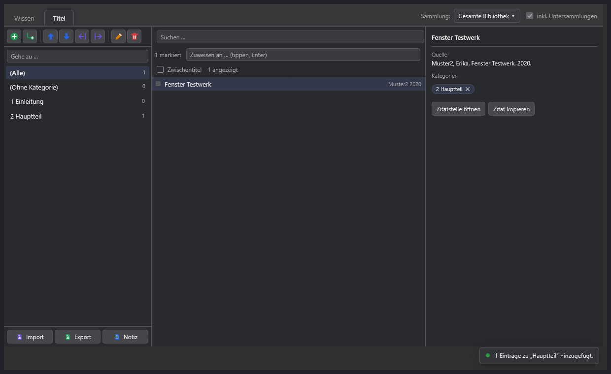
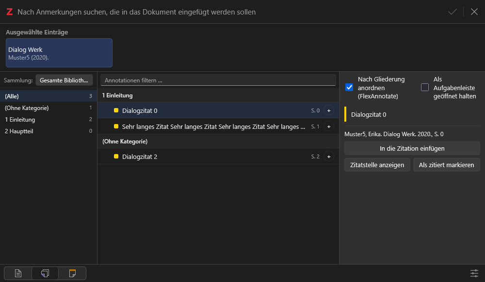
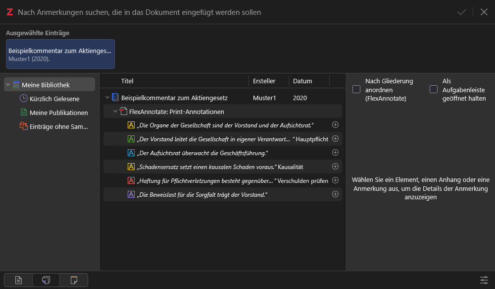
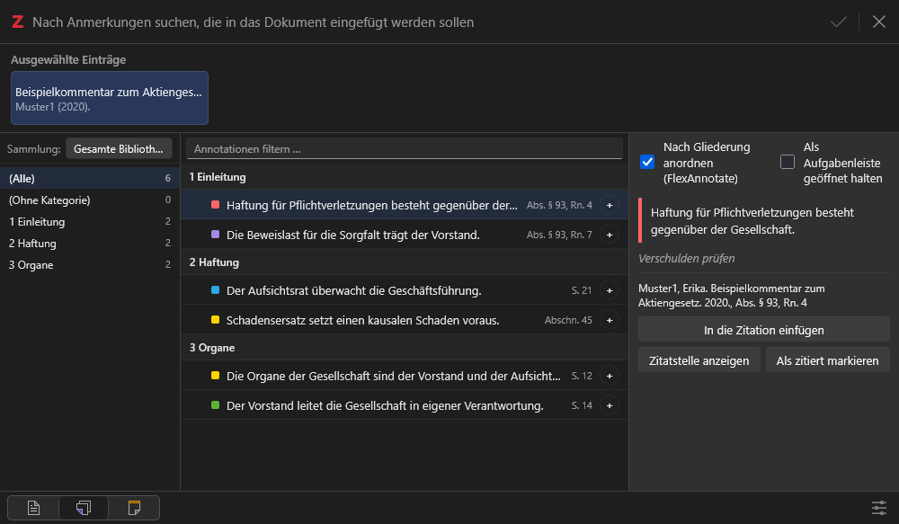
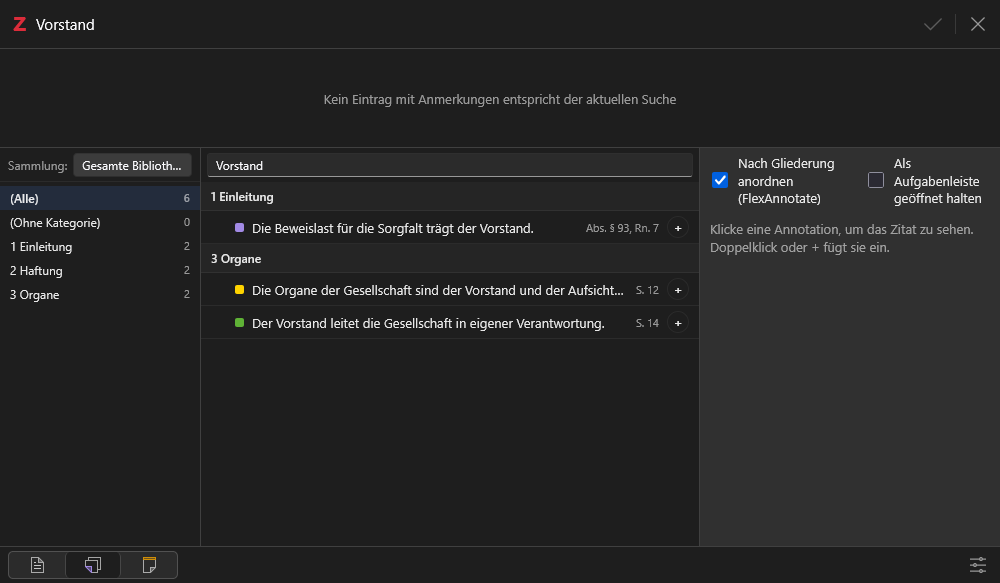
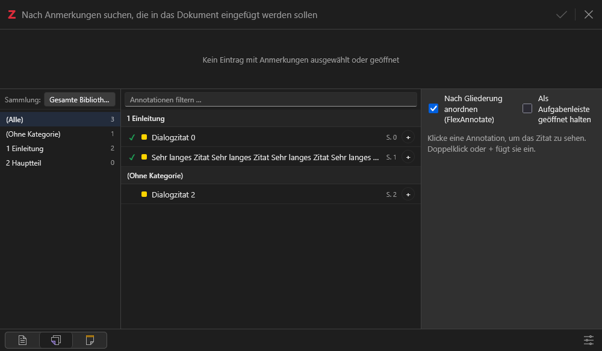
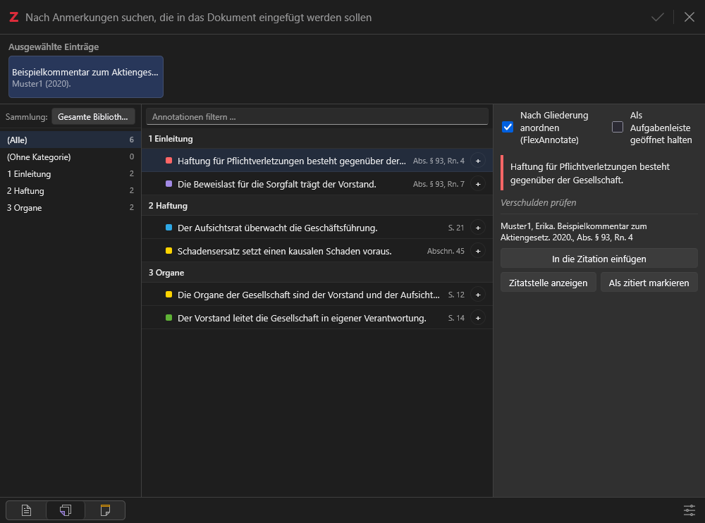

# FlexAnnotate – Handbuch

Deutsch · [English](guide.md)

Ausführliche Bedienung und Nachschlagewerk mit Bildschirmfotos zu allen wichtigen Funktionen. Der kompakte Überblick steht in der [README](../README.md).

---

## Schnelleinstieg & Übersicht

| Wo                                                | Was                                                                                |
| ------------------------------------------------- | ---------------------------------------------------------------------------------- |
| Rechtsklick auf einen Titel                       | _Print-Annotation hinzufügen…_                                                     |
| Rechtsklick auf eine Annotation (Item-Baum)       | _Annotation bearbeiten…_, bei Print-Annotationen auch _Print-Annotation löschen_   |
| Rechtsklick auf eine Annotation (rechter Bereich) | dieselben Einträge                                                                 |
| Reader: Rechtsklick auf eine Annotation           | _Kommentar hinzufügen…/bearbeiten…_, _Locator festlegen…_                          |
| Reader: Seitenzahl bearbeiten                     | Locator-Auswahl und „Diesen Locator künftig für dieses Dokument verwenden“         |
| Toolbar-Button oben rechts, neben dem Sync-Button | öffnet den Organizer (bzw. fokussiert ein offenes Fenster)                         |
| _Werkzeuge → FlexAnnotate: Organizer_             | öffnet den Organizer (bzw. fokussiert ein offenes Fenster)                         |
| Organizer, Dokument-Symbol der Gliederungsleiste  | Gliederung aus Word/LibreOffice importieren                                        |
| Organizer, Export-Symbol der Gliederungsleiste    | Gliederung als Word/ODT exportieren                                                |
| Zitierdialog aus Word/LibreOffice                 | „Einfügen als“ (Vollnachweis / Nur Nachweis); im Annotationsbereich die Gliederung |
| _Bearbeiten → Einstellungen → FlexAnnotate_       | Einstellungen                                                                      |

---

## 1. Hauptfenster & Print-Annotationen

FlexAnnotate erweitert Zoteros Eintragsliste um Print-Annotationen für Bücher ohne Digitalisat und stellt benutzerdefinierte Locators direkt in den Zeilentiteln dar.

### Print-Annotationen anlegen und bearbeiten

- **Anlegen:** Rechtsklick auf einen beliebigen Titel ohne Dateianhang → _Print-Annotation hinzufügen…_.
- **Bearbeiten:** Rechtsklick auf eine beliebige Annotation (im Item-Baum, in der rechten Seitenleiste oder im PDF-Reader) → _Annotation bearbeiten…_.
- Es öffnet sich die universelle FlexAnnotate-Eingabemaske:

- **Fundstelle & Locator-Typ:** Freie Auswahl des passenden Locator-Typs (z. B. Seite, Randnummer/Absatz, Spalte, Kapitel) und Eingabe der genauen Ziffer.
- **Dokument-Standard:** Mit „Diesen Locator künftig für dieses Dokument verwenden“ merkt sich FlexAnnotate den Standard für alle weiteren Zitate dieses Titels.
- **Typ & Farbe:** Auswahl zwischen Texthervorhebung und Unterstreichung sowie Farbauswahl aus Zoteros Farbpalette.
- **Zitat & Kommentar:** Vollständiger Zitattext und eigener Arbeitskommentar.
- **Zeilentitel im Item-Baum:** Der gewählte Locator-Typ (z. B. `paragraph` für Randnummern) wird automatisch als Präfix in der Annotationen-Liste angezeigt (z. B. „Absatz § 93, Rn. 4“).
- **Hintergrund:** Bei Büchern ohne Datei erstellt FlexAnnotate einen unsichtbaren Platzhalter-Anhang (`#flexannotate-placeholder`). Die Annotation verhält sich in Suchläufen, im Organizer und im Word-Zitierdialog exakt wie eine native PDF-Annotation.

### Organizer öffnen

Über das Icon in der Titelleiste direkt links neben Zoteros Sync-Button lässt sich der Organizer jederzeit mit einem Klick öffnen oder in den Vordergrund holen:

Alternativ steht der Befehl unter _Werkzeuge → FlexAnnotate: Organizer_ zur Verfügung.

---

## 2. Der Organizer

Der Organizer ist das Herzstück zur inhaltlichen Strukturierung wissenschaftlicher Arbeiten. Er bietet eine hierarchische Gliederung, die mit Zoteros Schlagwörtern (`§...`) synchronisiert wird.

### Wissensansicht („Wissen“-Tab)

Hier werden Zitate und Exzerpte per Drag & Drop den Gliederungspunkten zugeordnet:

- **Dreispaltiger Aufbau:**
  - **Links (Gliederung):** Beliebig tief verschachtelbare Gliederungsebenen. Die Zahlen in Klammern zeigen an, wie viele Zitate dem jeweiligen Abschnitt zugeordnet sind. Die Suchleiste filtert den Baum in Echtzeit.
  - **Mitte (Annotationsliste):** Zeigt alle Annotationen des ausgewählten Gliederungspunkts oder der Sammlung. Farbbalken visualisieren Zotero-Farben; Fundstelle und Werkstitel sind sofort lesbar. Mit Shift/Strg lassen sich mehrere Annotationen markieren und gemeinsam verschieben.
  - **Rechts (Detailbereich):** Vollständiges Zitat, Locator, Quellennachweis und editierbarer Kommentar.

### Titelansicht („Titel“-Tab)

Neben einzelnen Zitaten können auch ganze Werke (Bücher, Aufsätze, Urteile) Gliederungspunkten zugeordnet werden:

- Über den Reiter **Titel** in der Leiste wechselt die Ansicht zu den übergeordneten Werken.
- Ideal zur Literaturübersicht und Vorstrukturierung: Welche Monografien und Aufsätze gehören zu welchem Kapitel?

### §-Tags und Vorschläge im PDF-Reader

- Jeder Gliederungspunkt verankert automatisch ein entsprechendes Tag (`§Kapiteltitel`) an der Gliederungsnotiz der Sammlung.
- Beim Lesen einer PDF im Zotero-Reader genügt es, im Tag-Feld einer Anmerkung `§` einzugeben: FlexAnnotate schlägt sofort die Überschriften der Gliederung in exakter Gliederungsreihenfolge und mit vorangestellter Nummerierung vor!
- Wird eine Überschrift im Organizer umbenannt oder gelöscht, aktualisiert FlexAnnotate automatisch alle zugehörigen Tags.

### Gliederung aus Word/LibreOffice importieren

Bereits bestehende Gliederungen aus Seminar-, Bachelor- oder Doktorarbeiten können direkt übernommen werden:

1. Organizer öffnen und in der Gliederungsleiste das Dokument-Symbol anklicken (_Gliederung aus Word/ODT-Dokument importieren…_).
2. Ein `.docx`- oder `.odt`-Dokument wählen.
3. In der Vorschau die Zähler (neu, vorhanden, umbenannt), die mehrstufige Nummerierung (`1`, `1.1` …) und die eingerückte Liste prüfen.
4. **Nummerierung aus Titeln entfernen:** Erscheint automatisch bei manuell nummerierten Überschriften (`1.`, `A.`, `I.`, `(1)` usw.). Aktiviert bereinigt FlexAnnotate die Titel und hängt bestehende Annotationen automatisch auf das bereinigte Tag um.
5. _Importieren_ klicken. Der Import arbeitet rein additiv: Es wird nichts gelöscht oder überschrieben.

### Gliederung als Word/ODT exportieren

1. In der Gliederungsleiste auf das Export-Symbol klicken (_Gliederung als Word/ODT exportieren…_).
2. Format wählen (`.docx` für Word oder `.odt` für LibreOffice Writer).
3. Das exportierte Dokument enthält alle Überschriften mit echten Formatvorlagen („Überschrift 1–9“) und nativer mehrstufiger Nummerierung (`1`, `1.1`, `1.1.1`...).

---

## 3. Zitieren in Word und LibreOffice

Beim Schreiben in Word oder LibreOffice bietet FlexAnnotate eine vollständige Integration in Zoteros Zitierdialog (ab Zotero 9).

### Gliederungsansicht im Zitierdialog

Über den Schalter **„Nach Gliederung anordnen“** schaltet der Zitierdialog auf die Struktur des Organizers um:

- Links stehen die Gliederungspunkte inklusive Zähler, in der Mitte die zugeordneten Annotationen und rechts die Zitatvorschau.
- **Standardansicht:** Schaltet man die Option ab, erscheint sofort wieder Zoteros gewohnter Standard-Zitierdialog:

### Zitatstelle direkt im Reader aufschlagen

Möchte man beim Zitieren den Gesamtkontext des Zitats noch einmal prüfen, markiert man die Annotation und klickt auf **„Zitatstelle anzeigen“**:

Zotero öffnet automatisch den internen PDF-Reader und springt exakt an die markierte Textstelle!

### Blitzschnelle Volltextsuche

Die Suchleiste filtert simultan Gliederungsüberschriften, Zitattexte und Fundstellen:

### Bereits zitierte Annotationen im Blick

Um versehentliche Doppelzitate zu vermeiden, markiert FlexAnnotate bereits im aktuellen Dokument verwendete Zitate mit einem grünen Haken (`✓`):

- **Sitzungs- und rechnerübergreifend:** Der Status wird direkt in den Dokumentvariablen der `.docx`- bzw. `.odt`-Datei gespeichert (`session.data.prefs`). Er bleibt auch nach einem Zotero-Neustart, beim Rechnerwechsel oder bei der Weitergabe der Datei an Co-Autoren zuverlässig erhalten.
- **Automatisches Verschwinden wie bei Citavi:** Wird eine Fußnote im Word- oder LibreOffice-Dokument gelöscht, gleicht FlexAnnotate die Zitationen beim nächsten Öffnen des Dialogs (oder bei „Aktualisieren“) automatisch ab. Der grüne Haken erlischt sofort, sobald keine verbleibende Fußnote mehr auf diese Annotation verweist.
- **Manuelle Korrektur:** Ein Klick auf das Häkchen kann die Markierung bei Bedarf manuell entfernen oder wieder setzen.

Ausführliche Details zur Architektur und Performance bei großen Dokumenten finden sich in [Dokumentenweites Zitier-Tracking](cited-tracking.md).

### Nur-Nachweis-Zitieren

Über das Menü **„Einfügen als“** kann gewählt werden:

- **Vollnachweis:** Fügt das Zitat samt Zitation ein (Standard in Zotero).
- **Nur Nachweis:** Fügt ausschließlich die Fundstelle/Zitation in die Fußnote ein (z. B. „Muster, S. 42“), ohne den Zitattext selbst zu übernehmen. Ideal für Paraphrasen und indirekte Zitate.

### Zitierfenster als Aufgabenleiste offen halten (Begleitmodus)

Mit _„Als Aufgabenleiste geöffnet halten“_ (im Zahnrad-Menü unten rechts oder in den Einstellungen) bleibt das Zitierfenster nach dem Einfügen stehen:

- **Nahtloser Schreibfluss:** Nach dem Klick auf „Einfügen“ schließt der Dialog kurz, damit Word die Fußnote übernehmen kann, und öffnet sich sofort wieder an exakt derselben Stelle. Sie können direkt das nächste Zitat wählen, ohne in Word erneut auf _Zitation einfügen_ klicken zu müssen.
- **Docken & schmales Layout:** Das Fenster lässt sich wie eine native Aufgabenleiste an den Bildschirmrand neben Word docken. Bei einer Breite unter 750 px passt sich das Layout automatisch vertikal an:

- **Vertikaler Aufbau unter 750 px:**
  - **Oben:** Der Gliederungsbaum mit Abschnittszählern als kompakter Streifen.
  - **Mitte:** Die Liste der Annotationen des ausgewählten Kapitels.
  - **Unten:** Die Vorschau der aktuell ausgewählten Annotation samt Volltext und Button „Zitatstelle anzeigen“.
  - **Menü-Verlagerung:** Um der Liste maximale Höhe zu geben, wandern die Schalter („Nach Gliederung anordnen“ und „Als Aufgabenleiste geöffnet halten“) platzsparend in das Einstellungsmenü (Zahnrad unten rechts).

---

## 4. Einstellungen

Die Einstellungen erreichen Sie über _Bearbeiten → Einstellungen → FlexAnnotate_ (bzw. unter macOS _Zotero → Einstellungen_):

| Option                                                                                        | Wirkung                                                                                    | Standard                                                                            |
| --------------------------------------------------------------------------------------------- | ------------------------------------------------------------------------------------------ | ----------------------------------------------------------------------------------- |
| Standardmäßig nur den Nachweis einfügen (`citationOnly`)                                      | Annotationen werden immer nur als Zitation mit Seitenangabe eingefügt                      | aus                                                                                 |
| Leere Platzhalter-Anhänge behalten (`keepEmptyPlaceholders`)                                  | Platzhalter bleibt erhalten, auch wenn alle Annotationen gelöscht wurden                   | aus                                                                                 |
| Werke hinter den Annotationen mitanzeigen (`showWorksInAnnotationView`)                       | Organizer: Annotationsansicht zeigt auch die zugehörigen Werke                             | aus                                                                                 |
| Im Organizer Kommentare statt Zitattext in den Zeilen anzeigen (`showCommentInOrganizerRows`) | Organizer: Bei Annotationen mit Kommentar zeigt die Zeile den Kommentar statt des Exzerpts | aus                                                                                 |
| Zitate ohne Dateianhang als Print-Annotationen übernehmen (`citaviImport`)                    | Citavi-Import legt Print-Annotationen für Zitate an, die Zotero sonst verwirft             | an                                                                                  |
| Notiz zum Zitat behalten (`citaviKeepNotes`)                                                  | Aus: die Notiz, die Zoteros Übersetzer zum Zitat anlegt, wird entfernt                     | aus                                                                                 |
| Beiträge mit ihrem Hauptwerk verknüpfen (`citaviLinkContributions`)                           | Citavi-Import legt „Verwandte“-Verknüpfungen an                                            | an                                                                                  |
| Fundstellen zitieren als (`citaviLocatorPage/Column/Paragraph/Margin/Other`)                  | CSL-Locator je Citavi-Seitentyp (Seite, Spalte, Absatz, Randnummer, Andere)                | Seite: page, Spalte: column, Absatz: paragraph, Randnummer: paragraph, Andere: page |

---

## 5. Zotero-Versionen & Kompatibilität

Das Manifest verlangt Zotero 7.0 bis 10.\*. Die Kompatibilität wird mit der Testsuite (`npm run test:versions`) kontinuierlich gegen **7.0.32, 8.0.4, 9.0.6** und **10.0.5/10.0.6** geprüft.

| Funktion                                                                      | 7.0.x                       | 8.0.x                       | 9.0.x                       | 10.x                    |
| ----------------------------------------------------------------------------- | --------------------------- | --------------------------- | --------------------------- | ----------------------- |
| Organizer (Fenster, Gliederung, Export), Toolbar-Button                       | geprüft                     | geprüft                     | geprüft                     | geprüft                 |
| Gliederungsimport aus Word/LibreOffice                                        | geprüft                     | geprüft                     | geprüft                     | geprüft                 |
| Gliederungsexport als Word/ODT                                                | geprüft                     | geprüft                     | geprüft                     | geprüft                 |
| Print-Annotationen inkl. Eingabemaske                                         | geprüft (Farbmenü-Rückfall) | geprüft (Farbmenü-Rückfall) | geprüft (Farbmenü-Rückfall) | geprüft                 |
| Citavi-Import                                                                 | geprüft                     | geprüft                     | geprüft                     | geprüft                 |
| Nur-Nachweis-Zitieren                                                         | geprüft                     | geprüft                     | geprüft                     | geprüft                 |
| Menü _Werkzeuge → FlexAnnotate: Organizer_                                    | Rückfall (DOM)              | geprüft (`MenuManager`)     | geprüft (`MenuManager`)     | geprüft (`MenuManager`) |
| Zitierdialog mit Annotationsmodus (Gliederung, Suche, „Zitatstelle anzeigen“) | nicht verfügbar             | nicht verfügbar             | geprüft                     | geprüft                 |
| Zitierfenster offen halten (`persistentCitationDialog`)                       | nicht verfügbar             | nicht verfügbar             | geprüft                     | geprüft                 |
| Einstellungsfenster                                                           | geprüft                     | geprüft                     | geprüft                     | geprüft                 |

### Datenformat

- `#flexannotate-locator-<typ>`: Locator-Typ einer Annotation (automatischer Tag).
- `#flexannotate-placeholder`: Kennzeichnet den Platzhalter-Anhang von Print-Annotationen.
- `§Titel`: Überschrift der Gliederung als Tag an Annotationen und Werken.
- `★outline`: Notiz mit dem Gliederungsbaum im JSON-Format (kompatibel mit Lattice).

---

## 6. Häufige Fragen & Bekannte Punkte

- **Kann ich die Gliederungsnotiz `★outline` manuell bearbeiten?**
  Nein. Bearbeiten Sie die Gliederungsnotiz nicht im Zotero-Notizeditor, da unbedachte manuelle Änderungen den Baum beschädigen könnten. Nutzen Sie stets das Organizer-Fenster.
- **Warum öffnet sich das persistente Zitierfenster nach dem Einfügen kurz neu?**
  Word bzw. LibreOffice übernimmt das Zitat erst, wenn die Schnittstelle den Dialog beendet. FlexAnnotate öffnet das Blätterfenster daher nahtlos an exakt derselben Bildschirmposition neu.
- **Werden Randnummern als echter Randnummern-Locator zitiert?**
  Zotero und der CSL-Standard kennen standardmäßig keinen Locator-Typ „Randnummer“. FlexAnnotate verwendet dafür den typischen Standard `paragraph` (Absatz), der in fast allen juristischen und akademischen Zitierstilen für Randnummern verwendet wird („Rn.“).
- **Wie synchronisiere ich Gliederungen zwischen verschiedenen Rechnern?**
  Da alle Gliederungsdaten und Print-Annotationen als Zotero-Standardelemente (Notizen, Tags, Anhänge) gespeichert werden, übernimmt Zoteros integrierter Cloud-Sync alle Daten automatisch auf Ihre weiteren Geräte.
