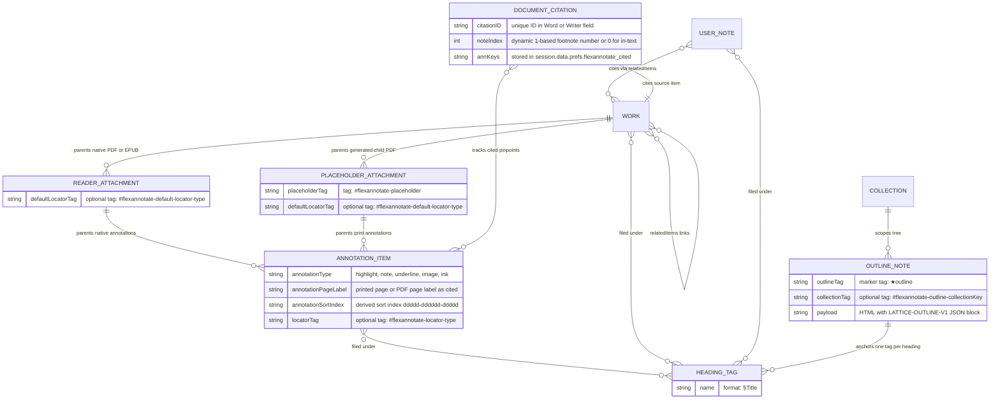
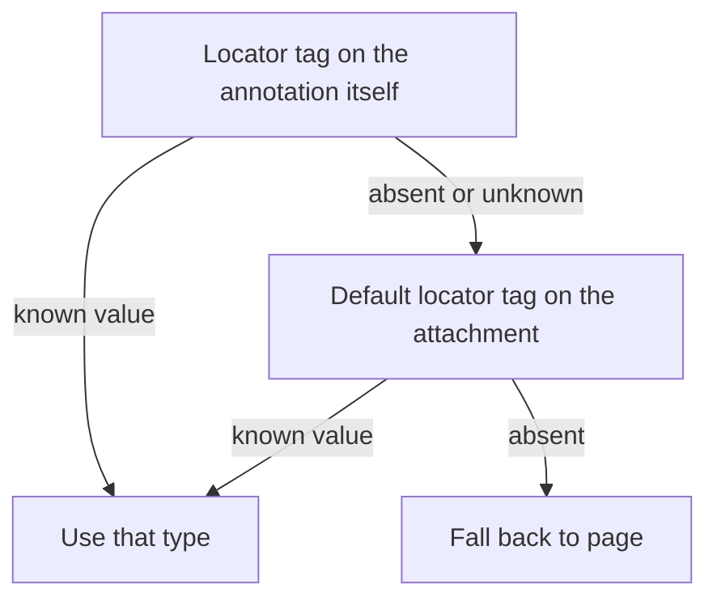

All persistence in FlexAnnotate lives directly inside standard storage structures: Zotero's own database (item tags, child attachments, standalone notes, child annotation items, and Zotero preferences) and word-processor document variables embedded in Microsoft Word (`.docx`) and LibreOffice Writer (`.odt`) documents. Because the plugin maintains no proprietary database or standalone disk storage engine, user data syncs natively across devices via Zotero sync or document sharing, and survives plugin removal without data loss.

The only cross-item data layer maintained outside persistent storage is the in-memory [AnnotationIndex](../../src/features/organizer/annotationIndex.ts), which is lifted from Zotero items on demand, patched incrementally from Notifier events, and never written back to disk. The outline note format and its backing tags remain fully compatible with Lattice, the organizer's predecessor.

For an overarching view of how these storage patterns fit into the broader system, see [Architecture Overview](overview.md). For feature workflows operating on these models, see [Organizer](../features/organizer.md), [Print Annotations](../features/print-annotations.md), [Citavi Import](../features/citavi-import.md), and [External API Integration](../integrations/external-api.md).

---

## What Is Stored Where



_Entity relationship diagram of items, attachments, annotations, outline notes, section tags, and word processor document citations._

| Datum | Where stored | Meaning |
| --------------------------------------- | ---------------------------------------------------------------------------------------------------------------- | ------------------------------------------------------------------------------------------------------------------------------------------------------------------------- |
| `#flexannotate-placeholder` | Automatic tag (type 1) on a file attachment | Marks the generated one-page PDF carrying print annotations for a physical print source. Detection is strictly by tag, never by title. |
| `#flexannotate-locator-<type>` | Automatic tag (type 1) on an annotation | CSL locator type of the citation place (e.g., `paragraph`, `column`, `margin`). Absent for `page` unless document default differs. |
| `#flexannotate-default-locator-<type>` | Automatic tag (type 1) on a file attachment | Default locator for annotations created later under that document. `page` is the ground state and is never tagged. |
| `§Title` (or localized `§Titel`) | Tag on annotations, works, notes, and the outline note | Files the item under the outline heading *Title* (tag is `§` + trimmed title). Library-wide, no collection segment. The outline note anchors each heading's tag. |
| `★outline` | Tag on a standalone note | Marks the note holding one outline tree as JSON following the sentinel `LATTICE-OUTLINE-V1`. |
| `#flexannotate-outline-<collectionKey>` | Additional tag on an outline note | Scopes the outline note to a specific collection tree (using the persistent collection key, not internal database ID). The library-wide tree is the note *without* this tag. |
| `flexannotate_cited` | Word/LibreOffice document variable (`session.data.prefs`) | JSON string mapping `citationID -> annKey[]` and `manual: annKey[]`; travels inside `.docx`/`.odt` files across computers and reconciles against active document fields. |
| `citedAnnotations` | Preference in `Zotero.Prefs` (fallback) | Legacy per-document session ID storage (`sessionID -> annotationID -> workID`), holding up to 50 document sessions. |
| Item relations (`relatedItems`) | Zotero `seeAlso` relations on regular items and notes | Connects Citavi contributions with parent works and siblings; links filed standalone notes to source works for draft citation resolution. |
| Annotation fields (`annotationType`, `annotationText`, `annotationComment`, `annotationColor`, `annotationPageLabel`, `annotationSortIndex`, `annotationPosition`) | Fields on Zotero child items of type `annotation` | Content, colour, pinpoint, and sort ordering of an annotation. Governed by Zotero core validation rules in `xpcom/data/item.js`. |
| `extensions.flexannotate.*` | Zotero preferences (defaults in [addon/prefs.js](../../addon/prefs.js)) | Plugin configuration, dialog state, and two JSON blobs: `citedAnnotations` and `persistentWindowRect`. |

Two stored values are consumed downstream as citations: an annotation's `annotationPageLabel` represents the printed page *as it should be cited*, and its locator tag represents the CSL label for that pinpoint. Citation-only insertion ([src/features/citeOnly/logic/citeOnly.ts](../../src/features/citeOnly/logic/citeOnly.ts)) maps `annotationPageLabel` to `locator` and the locator tag to `label`, while organizer rows resolve the same pair via `locatorOf()`.

---

## Modeling Annotations Across PDF Readers and Print Media

Zotero natively models annotations as child items parented to file attachments. FlexAnnotate supports two distinct workflows that converge into identical downstream representations: native reader annotations from digital files (PDF, EPUB) and user-authored annotations from physical print sources.

### Native PDF/EPUB Annotations

Native annotations are created by Zotero's built-in PDF reader. Zotero stores them as first-class items (`itemType === "annotation"`) parented to the document's file attachment (`attachmentReaderType` of `pdf` or `epub`). They contain:
- `annotationType`: `"highlight"`, `"underline"`, `"note"`, `"image"`, or `"ink"`.
- `annotationText`: The highlighted or underlined quote text extracted from the document.
- `annotationComment`: User comments or analysis.
- `annotationPageLabel`: The page number or label defined in the PDF/EPUB pagination.
- `annotationColor`: Six-digit lowercase hex color string.
- `annotationPosition`: The bounding boxes, rects, and page index within the PDF.
- `annotationSortIndex`: A 16-character string (`\d{5}|\d{6}|\d{5}`) encoding physical placement in the PDF.

### Print Media Annotations and the Blank PDF Placeholder

Zotero accepts annotation items only under a file attachment with an `attachmentReaderType` (`pdf`, `epub`, `snapshot`); saving an annotation item directly under a regular bibliographic work or a linked URL throws an exception in `xpcom/data/item.js`. Because printed sources have no physical digital file, [src/features/print/placeholder.ts](../../src/features/print/placeholder.ts) dynamically creates a child file attachment to host the annotations:

1. **Runtime PDF generation**: Rather than shipping a static asset in the XPI (which resolves to a `jar:` URI that `Zotero.Attachments.importFromFile()` cannot consume), `buildPlaceholderPDF()` in [src/features/print/logic/printAnnotation.ts](../../src/features/print/logic/printAnnotation.ts) dynamically constructs a minimal, valid single-page A4 PDF (PDF-1.4 with precomputed xref offsets) in memory and writes it to a temporary file via `IOUtils.write()`:
   ```text
   %PDF-1.4
   << /Type /Catalog /Pages 2 0 R >>
   << /Type /Pages /Kids [3 0 R] /Count 1 >>
   << /Type /Page /Parent 2 0 R /MediaBox [0 0 595 842] /Resources << >> >>
   xref ...
   trailer << /Size 4 /Root 1 0 R >>
   startxref ... %%EOF
   ```
2. **Import and tagging**: `Zotero.Attachments.importFromFile()` imports this temporary file as a child of the regular bibliographic item, titles it from the localized `placeholder-title` string, and marks it with the automatic tag `#flexannotate-placeholder` (type 1). The temporary file is immediately removed.
3. **Identification**: `isPlaceholder()` inspects the `#flexannotate-placeholder` tag, never the title string, ensuring that UI language changes or title edits do not break attachment detection.
4. **Lifecycle and deletion sweep**:
   - `cleanUpIfEmpty()` removes the placeholder attachment once its last child annotation is gone, unless `getPref("keepEmptyPlaceholders")` is `true`.
   - `placeholderCleanup` registers a `Zotero.Notifier` observer for `delete` events on items, running `sweepEmpty()` (debounced by 500 ms) to clean orphaned placeholders after bulk annotation deletions in Zotero's main UI.
   - To prevent premature deletion of newly allocated placeholders before annotations are saved, `placeholder.ts` maintains a `recentlyUsed` map with a grace window (`GRACE_MS = 3000`), and a `creating` in-flight counter that delays sweep runs.

### Zotero Field Constraints Enforced on Save

Zotero strictly validates annotation fields on save (`xpcom/data/item.js`). FlexAnnotate adheres to these rules across both print creation and reader updates:

| Rule | Implementation in FlexAnnotate |
| ---------------------------------------------------- | -------------------------------------------------------------------------------------------- |
| `annotationType` must be set before any other annotation field | `printAnnotations.create()` assigns `annotationType` before setting any other property, preventing save aborts in `xpcom/data/item.js:4511`. |
| Type changes only allowed between `highlight` and `underline` | Print annotation editing restricts type mutations to valid pairs (`:4518-4520`). |
| `annotationText` only permitted on `highlight` and `underline` | For print annotations of type `note`, quoted text is automatically folded into `annotationComment` (`[data.text, comment].filter(Boolean).join("\n\n")`). |
| `annotationColor` must match `/#[a-f0-9]{6}/` (lowercase) | `normalizeColor()` trims, lowercases, and falls back to `#ffd400` if invalid. |
| `annotationSortIndex` must match `/^\d{5}\|\d{6}\|\d{5}$/` for a PDF parent | `buildSortIndex()` extracts the first digit sequence from `annotationPageLabel`, clamps it to 99999, and zero-pads it (`00012\|000000\|00000`). Labels without digits (e.g., `XIV`) receive `99999` to sort last numerically rather than lexicographically. |
| `annotationPageLabel` is saved as `pageLabel \|\| null` and reads back as `null` when empty | An empty label round-trips as `null`; logging logic guards against stringification of `"null"`. |
| `annotationPosition` is required by PDF parents | Because physical print has no digital geometry, `create()` supplies a fixed dummy zero-rect position (`pageIndex: 0`, `rects: [[0, 0, 0, 0]]`). |

When modifying annotations, `printAnnotations.update()` recalculates `annotationSortIndex` from the page label **only** when `isPlaceholder(annotation.parentItem)` is true. For native PDF annotations, `annotationSortIndex` encodes actual spatial layout within the file and is left untouched.

---

## Locator Types and Resolution Order

Because Zotero annotations store page labels but lack a native field for the CSL locator type (such as `paragraph`, `section`, `column`, or `margin`), locator semantics are stored via automatic tags.

[src/core/locator.ts](../../src/core/locator.ts) resolves the citation locator in a strict three-tier hierarchy:



_Resolution order of locatorOf(): own tag, then the document default, then page._

The stability of locator resolution is guaranteed by four invariants:
1. **Sparse tag storage**: `locatorTagChanges()` writes an explicit `#flexannotate-locator-<type>` tag only when the selected type differs from `page` or when the document default differs from `page`. If the locator is `page` and the document default is also `page`, no tag is stored. Writing a new locator always strips all previous `#flexannotate-locator-*` tags.
2. **Known value filter**: `knownLocatorTags` permits only official CSL citation labels recognized by Zotero (`Zotero.Cite.labels`) plus `margin` (German *Randnummer*, which has no native CSL equivalent). Legacy or malformed locator tags are stripped rather than propagated.
3. **Default locator freezing**: Calling `setDefaultLocator()` on an attachment first scans all existing child annotations lacking explicit locator tags and freezes them by tagging them with `#flexannotate-locator-<previousDefault>`. Consequently, altering a document's default locator never mutates the meaning of existing citations.
4. **Ground state**: `page` is the ground state. Resetting an attachment's default locator to `page` deletes the `#flexannotate-default-locator-*` tag entirely.

---

## The Outline Note, Section Tags, and Scope-Aware Naming

Outline trees are persisted in standalone Zotero notes. The pure tree model is implemented in [src/features/organizer/logic/outline.ts](../../src/features/organizer/logic/outline.ts), while the Zotero persistence integration lives in [src/features/organizer/outlineModel.ts](../../src/features/organizer/outlineModel.ts).

### Outline Note Structure

A single standalone Zotero note stores the complete hierarchical tree:
1. **Title heading (`<h1>`)**: `📚 FlexAnnotate — <label> — <scope name>`.
   - The label is localized via `tr("outlineTitle")`: `"Gliederung"` in German or `"Outline"` in English.
   - For a collection tree, `<scope name>` is the name of the top-level collection (`col.name`); for the library tree, it is the name of the library (`lib.name`).
   - Example German heading: `📚 FlexAnnotate — Gliederung — Dissertation`.
   - Because Zotero derives an item's list title from the first line of note HTML (`getNoteTitle` / `noteToTitle`), this heading makes multiple outline notes readily distinguishable in the main Zotero item list.
2. **Human-readable preview (`<ul>`)**: An HTML nested unordered list representing the tree for display if a user opens the note in Zotero's default editor.
3. **Machine payload (`<pre><code>`)**:
   ```html
   <pre><code>LATTICE-OUTLINE-V1
   {"v":1,"roots":[{"id":"k3x90","title":"Introduction","children":[]},{"id":"k3x9a","title":"Main Part","children":[{"id":"k3x9b","title":"Background","children":[]}]}]}</code></pre>
   ```

### Tree Serialization and Robust Deserialization

- **Tagging**: Every outline note carries the marker tag `★outline`. A collection-specific tree carries an additional tag `#flexannotate-outline-<collectionKey>` (using the persistent collection key, not internal database ID). The library-wide tree is the note *without* any collection tag.
- **Parsing**: `parseOutline()` isolates the payload using the regex `LATTICE-OUTLINE-V1\s*([\s\S]*?)</(?:code|pre)>`. Both `</code>` and `</pre>` closings are accepted because Zotero rewrites `<pre><code>` blocks to `<pre>` on subsequent note saves.
- **Defensive sanitization**: `sanitizeTree()` recursively coerces parsed JSON, assigning fresh IDs via `genId()` if IDs are missing, dropping malformed titles, and enforcing child array invariants.
- **Note editor conflict prevention**: `OutlineModel.save()` saves the note with `saveTx({ skipSelect: true })`. This prevents Zotero's native note editor from opening the note, which would otherwise write stale HTML back over organizer saves.
- **Conflict resolution**: If multiple notes carry `★outline` for the same scope (e.g., after an external sync collision), `findNote()` resolves the conflict using `pickNewest()`: highest `dateModified` wins, with ties broken by the higher item ID.
- **Scope title synchronization**: `OutlineModel.load()` calls `syncNoteHeading()`, which rewrites only the first `<h1>` when the scope name or locale changes, preserving the underlying JSON payload without triggering data migrations.

### Derived Decimal Numbering

Outline numbering (e.g., `1`, `1.1`, `1.2.3`) is **never stored** in the database or JSON.
- `numbering(roots)` in `src/features/organizer/logic/outline.ts` traverses the tree and calculates decimal numbers dynamically based on sibling index and depth.
- All consumers—the Organizer tree panel, Citation Dialog outline views, flat heading APIs, and Word/ODT exporters—recompute numbering on render. Reordering, promoting, or indenting headings requires zero data migrations.

### Section Tags (`§ Tags`), Anchor Tags, and Scopes

A heading is represented in Zotero by the tag `§<Title>` (using `HEADING_PREFIX = "§"`):
- **Library-wide tags**: Zotero tags are inherently flat and library-wide. Filed annotations, regular works, and notes carry the heading's tag.
- **Anchor tag synchronization**: If a heading has no filed items, Zotero's tag store would not know it exists. To ensure Zotero's PDF reader autocomplete suggests headings as soon as a user types `§`, `OutlineModel.save()` and `load()` run `syncAnchorTags()`. This attaches a `§`-tag for every heading in the tree **onto the outline note itself**, and removes obsolete tags from renamed or deleted headings.
- **Self-exclusion**: Because the outline note carries every heading's tag, `gather()` and `buildCountMap()` explicitly skip items where `isOutlineNote(item)` is true, preventing the outline note from counting as a filed item.
- **Scoped operations**: When renaming (`renameTag`) or deleting (`purgeTag`) headings, operations require a `TagScope` (the set of work IDs in the tree's collection and subcollections, or `null` for the library tree). This ensures that modifying a heading in one collection tree does not affect a heading with the same name in another collection.

---

## Word Processor Cited Tracking & Document Variables

FlexAnnotate tracks which annotations have already been cited in a manuscript, displaying green checkmarks (`✓`) in the citation dialog to prevent accidental duplicate citations.

### Storage Location: Word Document Variables (`session.data.prefs.flexannotate_cited`)

Older versions stored tracking status in local Zotero preferences (`citedAnnotations`), keyed by `session.sessionID`. This suffered from three major limitations: `session.sessionID` in Zotero is a random in-memory string recreated on restart (orphaning entries), `prefs.js` exists only on the local machine (preventing multi-device sync), and deleting footnotes in Word left orphaned checkmarks.

FlexAnnotate persists citation tracking directly in Microsoft Word and LibreOffice Writer document variables (`session.data.prefs`) under the key `flexannotate_cited` ([docs/cited-tracking.md](../../docs/cited-tracking.md), [src/features/organizer/citationDialog/citedTracking.ts](../../src/features/organizer/citationDialog/citedTracking.ts)):

```json
{
  "citations": {
    "c_K8X29PLA": ["ANN_KEY_1"],
    "c_M4B11ZZR": ["ANN_KEY_2", "ANN_KEY_3"]
  },
  "manual": ["ANN_KEY_4"]
}
```

#### Properties of this Store
1. **Document-bound**: The tracking data travels directly inside the `.docx` or `.odt` file via email, cloud drives (OneDrive, Dropbox, Nextcloud), or USB storage.
2. **Device-independent keys**: Keys stored are Zotero's global 8-character sync keys (`item.key`), not local SQLite IDs (`item.id`), guaranteeing identical resolution across different machines.
3. **Co-author safety**: Stock Zotero integration code serializes document preferences as `<pref name="..." value="..."/>` elements (`xpcom/integration.js:2706-2722`) and passes unknown `<pref>` entries through untouched, preventing data loss when co-authors lack FlexAnnotate.
4. **Fallback store**: If a document has no document preferences yet (`readDocCitedData() === null`), the system transparently falls back to the local preference store `extensions.flexannotate.citedAnnotations`.

### Citation Lifecycle and Reconciliation

- **Pre-generated `citationID`**: In [src/features/citeOnly/integrationPatch.ts](../../src/features/citeOnly/integrationPatch.ts), `citation.citationID` is pre-populated with `Zotero.Utilities.randomString()` before insertion. Because the ID is already set, Zotero writes that exact identifier into the word-processor field, linking `citationID -> [annKey, ...]` in `session.data.prefs.flexannotate_cited`.
- **Automatic cleanup on footnote deletion**: When the citation dialog opens or "Refresh" is clicked in Word, Zotero runs `updateFromDocument()`, refilling `session.documentCitationIDs`. FlexAnnotate's `reconcileDocData()` compares stored citation IDs against `session.documentCitationIDs`:
  - If a `citationID` is no longer present in `session.documentCitationIDs`, the footnote was deleted and is removed from `docData.citations`.
  - If an annotation was cited only in that footnote, its key disappears from active citations and the green checkmark turns off automatically.
  - The reconciled data is written back to `session.data.prefs.flexannotate_cited`.
- **Live footnote index extraction**: Footnote numbers are dynamic. FlexAnnotate extracts them live from `session.citationsByIndex`, matching `citation.properties.noteIndex` (1-based footnote number, or `0` for in-text citations) to display footnote preview chips (e.g., `[ Fn. 2 ]`, `[ Fn. 15 ]`) and enable direct navigation via `jumpToCitation`.

---

## Citavi Knowledge Item Links and Quote Metadata Mapping

FlexAnnotate provides an automated secondary import pass for Citavi exports ([src/features/citavi/citaviPrintQuotes.ts](../../src/features/citavi/citaviPrintQuotes.ts), [src/features/citavi/citaviLinks.ts](../../src/features/citavi/citaviLinks.ts), [src/features/citavi/logic/citavi.ts](../../src/features/citavi/logic/citavi.ts)).

### Contribution Linking via `relatedItems`

Zotero's stock Citavi translator does not process `ReferenceReferences`. In [src/features/citavi/citaviLinks.ts](../../src/features/citavi/citaviLinks.ts), `linkContributions()` parses `//ReferenceReferences/OnetoN` nodes formatted as `ParentID;ChildID1;ChildID2...`:
- Resolves parent and child IDs using Zotero's translation `_IDMap`.
- Establishes bidirectional Zotero relations (`relatedItems` / `seeAlso`):
  - Parent work ↔ contribution children.
  - Sibling contribution ↔ sibling contribution within the collected volume.
- Saves all relations in a single database transaction using `skipDateModifiedUpdate: true`.

### KnowledgeItem Metadata to Print Annotation Mapping

For Citavi quotes lacking PDF attachments, `importPrintQuotes()` constructs print annotations parented to blank PDF placeholders:

1. **QuotationType to Color and Layout Mapping**:
   `QUOTATION_TYPES` maps Citavi's `QuotationType` to reader colors and text/comment placement:
   - `1` (Direct quotation): Color `#2ea8e5` (blue); text = quote, comment = core statement.
   - `2` (Indirect quotation): Color `#a6507b` (purple); `swap = true` (core statement becomes quote text; original text becomes comment).
   - `3` (Summary): Color `#5fb236` (green); text = quote, comment = core statement.
   - `4` (Comment): Color `#ff8c19` (orange); text = quote, comment = core statement.
   - `5` (Highlight): Color `#ffd400` (yellow); `dropComment = true`.
   - `6` (Idea): Color `#ff6666` (red); `dropComment = true`.
   - Unknown values fall back to type `1`.
2. **Page Range Parsing**:
   `parsePageRange()` inspects `<PageRange>` text:
   - `<os>` defines the formatted display string (e.g., `12-15`). If absent, `PageRangeNumber` is used unless it is `"-1"` (Citavi sentinel for uncaptured page).
   - `<nt>` defines the numbering type (`Column`, `Paragraph`, `Margin`, `Other`).
3. **CSL Locator Resolution**:
   `createLocatorResolver()` maps `<nt>` types to CSL locators using preference settings:
   - `<nt>Column` → `citaviLocatorColumn` (default: `"column"`)
   - `<nt>Paragraph` → `citaviLocatorParagraph` (default: `"paragraph"`)
   - `<nt>Margin` → `citaviLocatorMargin` (default: `"paragraph"`, since CSL has no margin locator)
   - Unrecognized `<nt>` → `citaviLocatorOther` (default: `"page"`)
   - No `<nt>` → `citaviLocatorPage` (default: `"page"`)
4. **Keywords to Tags**:
   `//KnowledgeItemKeywords/OnetoN` is parsed via `splitOnetoN()` to extract keyword IDs associated with the KnowledgeItem, resolved via `Keyword[@id]/Name`, and added as annotation tags.
5. **Deduplication and Note Cleanup**:
   - `isDuplicateAnnotation()` compares candidate page labels, normalized quote texts, and comments against existing placeholder annotations, preventing duplicate creation during re-imports.
   - When `getPref("citaviKeepNotes")` is `false`, `removeQuoteNote()` searches child notes on the work matching the core statement and quote (`isQuoteNote()`) and deletes the redundant standalone note created by Zotero's translator.

---

## In-Memory Indexing: AnnotationIndex

Native Zotero reader APIs expose annotations only for a single open attachment at a time. To enable library-wide browsing, filtering, search, and outline association across thousands of sources, FlexAnnotate lifts all annotations into the in-memory [AnnotationIndex](../../src/features/organizer/annotationIndex.ts).

### Unified Annotation Record (`AnnRecord`)

Regardless of whether an annotation originates from a digital PDF or a print placeholder, `AnnotationIndex.toRecord()` maps it into a uniform `AnnRecord`:

```typescript
export interface AnnRecord {
  id: number;
  key: string;
  type: string;             // "highlight" | "note" | "underline" | "image" | "ink" | "text"
  color: string;            // normalized lowercase hex
  text: string;             // annotationText (quote)
  comment: string;          // annotationComment (reader note)
  pageLabel: string;        // annotationPageLabel
  tags: string[];
  dateModified: string;
  attachmentID: number;     // PDF/EPUB or placeholder attachment ID
  attachmentKey: string;    // for deep link generation
  parentItemID: number;     // regular bibliographic work ID
  parentTitle: string;
  libraryID: number;
  libraryPrefix: string;    // "library" or "groups/<id>"
}
```

The parent bibliographic item is resolved identically for both types:
```typescript
const attachment = item.parentItem as Zotero.Item | undefined;
const paper = attachment ? (attachment.parentItem as Zotero.Item | undefined) : undefined;
const source = paper ?? attachment;
```

### Index Lifecycle and Incremental Notifier Updates

1. **Demand-driven build**: `AnnotationIndex.ensureBuilt(libraryID)` runs on demand when the Organizer or Citation Dialog opens. It uses `Zotero.Items.getAll(lib, false, false, true)` to fetch IDs in bulk, minimizing memory overhead, before hydrating items in batches.
2. **Reactive synchronization**: `AnnotationIndex.init()` registers a persistent observer with `Zotero.Notifier` for `"item"` events:
   - `"delete"` / `"trash"`: Deletes records from the `records` map by ID.
   - `"add"` / `"modify"`: Inspects modified items; if an item is an active annotation in the current library, `toRecord(item)` updates or inserts it; if it is no longer an annotation or moved to trash, it is deleted from the index.
3. **Zero disk writeback**: The index is purely volatile. It reads from Zotero's database and reflects state in memory, guaranteeing that crashing or disabling the plugin leaves no inconsistent index files on disk.

---

## Item Relation Markers

FlexAnnotate uses Zotero's native `relatedItems` (relations / `seeAlso`) mechanism to model semantic relationships between items without inventing proprietary link tables:

1. **Citavi contribution linking**: In [src/features/citavi/citaviLinks.ts](../../src/features/citavi/citaviLinks.ts), `linkContributions()` processes Citavi `ReferenceReferences/OnetoN` elements (`ParentID;ChildID1;ChildID2...`). It establishes bidirectional Zotero relations:
   - Parent work ↔ contribution children.
   - Sibling contribution ↔ sibling contribution.
   These are written via `itemA.addRelatedItem(itemB)` in a single database transaction with `skipDateModifiedUpdate: true`.
2. **Note citation resolution**: When a standalone user note is filed under an outline heading, `OutlineModel.noteToFiled()` in [src/features/organizer/outlineModel.ts](../../src/features/organizer/outlineModel.ts) inspects `item.relatedItems`. It resolves the first related regular bibliographic item to generate a formatted citation (`citationFor(rel)`), allowing draft exports to cite the source work behind the note.

---

## Persistent Preferences

All plugin preferences are stored under the `extensions.flexannotate.` prefix defined by `prefsPrefix` in [package.json](../../package.json). The helper functions `getPref()` and `setPref()` in [src/utils/prefs.ts](../../src/utils/prefs.ts) wrap `Zotero.Prefs.get()` and `Zotero.Prefs.set()` with `global = true`, ensuring preferences persist globally across windows in Zotero's preference database.

Default values are registered in [addon/prefs.js](../../addon/prefs.js):

| Preference Key | Type | Default | Semantic Purpose |
| ------------------------------ | ------- | --------- | ------------------------------------------------------------------------------------------------------------------------------------------------------------------ |
| `citationOnly` | boolean | `false` | When true, citation insertions inject only the citation (Nachweis) with locator pinpoint rather than the full quote. |
| `persistentCitationDialog` | boolean | `false` | Keeps the citation dialog open in browse mode after insertion for rapid consecutive citing. |
| `persistentWindowRect` | string | `""` | JSON string storing `left`, `top`, `width`, and `height` of the persistent citation dialog across restarts; debounced on window move/resize. |
| `keepEmptyPlaceholders` | boolean | `false` | When false, placeholder attachments are deleted when their last annotation is removed. When true, empty placeholders remain attached. |
| `confirmDeleteAnnotation` | boolean | `true` | Asks for user confirmation before deleting an annotation from the context menu. |
| `showWorksInAnnotationView` | boolean | `false` | Organizer annotation panel displays bibliographic parent works above annotations. |
| `showCommentInOrganizerRows` | boolean | `false` | Organizer rows display user comments rather than quoted text when a comment exists. |
| `dialogOutlineView` | boolean | `false` | Remembers whether "Nach Gliederung anordnen" was checked in the citation dialog. |
| `dialogOutlineCollection` | number | `0` | Remembers the collection ID chosen in the citation dialog outline view (`0` = entire library). Falls back to `0` if the collection was deleted. |
| `outlineTagSuggest` | string | `"all"` | Strategy for §-tag autocomplete suggestions in tag inputs (`all`, `typed`, `tree`, `off`). |
| `citedAnnotations` | string | `""` | Legacy JSON map tracking cited annotations per document session (`sessionID -> annotationID -> workID`). |
| `citaviImport` | boolean | `true` | When true, imports Citavi quotes lacking PDF attachments as print annotations. |
| `citaviKeepNotes` | boolean | `false` | When false, removes the redundant standalone note created by Zotero's Citavi translator for imported quotes. |
| `citaviLinkContributions` | boolean | `true` | Establishes bidirectional Zotero relations between contribution items and parent collected works. |
| `citaviLocatorPage` | string | `"page"` | CSL locator type mapped for Citavi page ranges without `<nt>`. |
| `citaviLocatorColumn` | string | `"column"` | CSL locator type mapped for Citavi `<nt>Column`. |
| `citaviLocatorParagraph` | string | `"paragraph"` | CSL locator type mapped for Citavi `<nt>Paragraph`. |
| `citaviLocatorMargin` | string | `"paragraph"` | CSL locator type mapped for Citavi margin numbers (*Randnummern*). |
| `citaviLocatorOther` | string | `"page"` | Fallback CSL locator type for unrecognized Citavi `<nt>` types. |

---

## Stable Identifiers and Invariants

The following strings represent **stable user data contracts**. They are written directly into users' Zotero libraries, Word/Writer manuscripts, and preference stores:

- **Tag identifiers**:
  - `#flexannotate-placeholder`
  - `#flexannotate-locator-<type>`
  - `#flexannotate-default-locator-<type>`
  - `#flexannotate-outline-<collectionKey>`
  - `§<Title>`
  - `★outline`
- **Document variables**:
  - `flexannotate_cited` (inside `session.data.prefs`)
- **Payload sentinels**:
  - `LATTICE-OUTLINE-V1`
- **Preference paths**:
  - `extensions.flexannotate.*`

These identifiers must not be renamed or altered in format. Modifying any of these constants would orphan existing user annotations, break outline tree recovery, invalidate Word/LibreOffice manuscript tracking, and break compatibility with external tooling and earlier versions. New preferences or new locator types may be introduced safely as backward-compatible additions.
