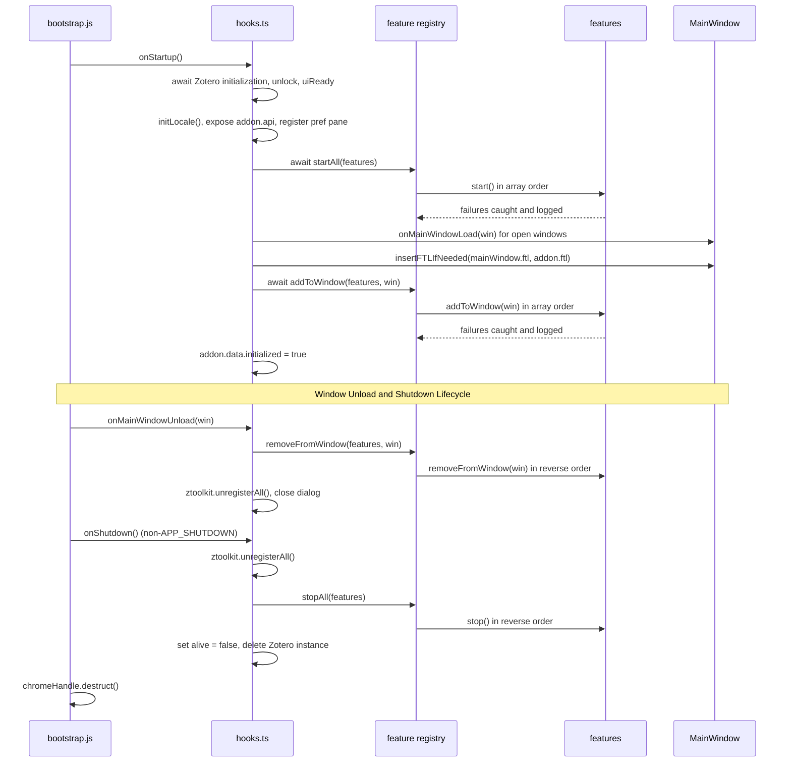

Every capability FlexAnnotate adds to Zotero is a **feature**: a small object with a `name` and up to four optional lifecycle hooks. One registry ([src/shared/feature.ts](../../src/shared/feature.ts)) invokes those hooks, and a single ordered array in [src/hooks.ts](../../src/hooks.ts) lists every feature — it is the only place that knows them all. In parallel, citation dialog capabilities are managed via dialog injectors registered with [src/shared/citationDialog.ts](../../src/shared/citationDialog.ts). The design goals are that a failing feature never breaks the others, that starting and stopping are exactly symmetric, and that every hook is idempotent, because hooks routinely run more than once (tests re-run them, and every Zotero window load calls `addToWindow` again).

## The Feature contract

[src/shared/feature.ts](../../src/shared/feature.ts) defines the contract:

```ts
export interface Feature {
  name: string;
  start?(): void | Promise<void>;
  stop?(): void;
  addToWindow?(win: _ZoteroTypes.MainWindow): void | Promise<void>;
  removeFromWindow?(win: _ZoteroTypes.MainWindow): void;
}
```

| Hook | Scope | Typical work |
| ---- | ----- | ------------ |
| `start` / `stop` | global, once per session | prototype patches, Notifier observers, `Zotero.MenuManager` menus, APIs on the shared `Zotero` object |
| `addToWindow` / `removeFromWindow` | once per main window | toolbar button, menu entries, popups, per-window prototype patches, per-window listeners |

All hooks are optional; a feature with only a `name` is valid and the registry skips the missing hooks. `stop` and `removeFromWindow` are synchronous by contract, so teardown never has to await anything. The `name` exists purely for log lines (`feature <name>.<hook> failed: …`).

## Ordering and error isolation

The four registry helpers — `startAll`, `stopAll`, `addToWindow`, `removeFromWindow` — share one `invoke()` helper with fixed semantics:

- **Order.** `startAll` and `addToWindow` invoke their hook for every feature in array order, collect the returned promises, and `await Promise.all(...)` at the end — async hooks run concurrently, and the helper resolves only when all of them have settled. `stopAll` and `removeFromWindow` walk the array in **reverse order**, so teardown unwinds startup symmetrically.
- **Error isolation.** `invoke()` calls the hook inside `try`/`catch`; a synchronous throw is logged immediately, and an async hook's rejection is converted into a log call on the returned promise (`result.then(() => undefined, (e) => log(feature.name, hook, e))`). Nothing ever rethrows, so one broken feature can neither abort the others nor make `startAll`, `stopAll`, `addToWindow` or `removeFromWindow` reject.
- **Safe logging.** `defaultLogger` reads the `ztoolkit` global lazily at call time and wraps both `ztoolkit.log` and `Zotero.logError` in `try`/`catch`, so logging itself never disturbs the caller and the module stays importable in Node without any Zotero globals.

All four properties are pinned by [test-unit/feature.test.ts](../../test-unit/feature.test.ts): `stopAll` stops in reverse order, a throwing (sync or async) `start` does not prevent later features from starting, a throwing `stop` does not prevent earlier features from stopping, bare features without hooks are fine, and `defaultLogger` neither throws nor requires globals.

## The ordered feature array

[src/hooks.ts](../../src/hooks.ts) holds the `features: Feature[]`. Array order is start order; stop runs in reverse. The hooks are deliberately independent of each other, so the order matters only where resources could conflict (e.g. the organizer's `MenuManager` menu is registered first and unregistered last).

| # | Feature | `start` / `stop` (global) | `addToWindow` / `removeFromWindow` (per window) |
| - | ------- | ------------------------- | ----------------------------------------------- |
| 1 | `organizer` | registers the `Zotero.MenuManager` entry *Tools → FlexAnnotate: Organizer*; stop unregisters all plugin menus by key and closes the organizer window | — |
| 2 | `organizerToolbarButton` | — | toolbar button in `#zotero-tabs-toolbar` before `#zotero-tb-sync` |
| 3 | `toolsMenuFallback` | — | Tools-menu item, only when `Zotero.MenuManager.registerMenu` is missing (Zotero 7.x) |
| 4 | `collectionMenu` | — | item in `#zotero-collectionmenu`, visibility managed on `popupshowing` |
| 5 | `citationDialog` | starts/stops the `Services.wm` watcher of [src/shared/citationDialog.ts](../../src/shared/citationDialog.ts) | — |
| 6 | `persistentDialogPatch` | patches `Zotero.Integration.displayDialog`, `execCommand` and the progress bar (only when Zotero has the `addAnnotation` command) | — |
| 7 | `citeOnlyPatch` | patches `Zotero.Integration.Session.prototype._insertCitingResult` via `assignChecked` | — |
| 8 | `readerMenu` | registers reader event listeners, a Notifier observer and the `Zotero.Reader.open` wrapper | — |
| 9 | `citaviImport` | wraps `Zotero.Translate.Import.prototype.translate`; per-window `Zotero_File_Interface` patches in its window hooks | patches `importFile` / `importFromClipboard` of each window's own `Zotero_File_Interface` |
| 10 | `annotationIndex` | registers the Notifier observer; stop unregisters it and clears the in-memory index | — |
| 11 | `externalApi` | installs/removes the public `Zotero.FlexAnnotate` interface | — |
| 12 | `printMenus` | — | separator + three entries in `#zotero-itemmenu`, toggled on `popupshowing` |
| 13 | `annotationRowMenu` | — | popup for `annotation-row` elements, one capture-phase `contextmenu` listener |
| 14 | `annotationRowPatch` | — | patches `AnnotationRow.prototype.render` via `assignChecked` to show custom locators; restores native render and refreshes rows on unload |

Registering a new feature means adding a `Feature` object to this array — nothing else wires it up. See [Conventions](../conventions.md) for the full checklist (patch evidence, unit test, `addon.api` export).

## Citation dialog injectors

The Word and LibreOffice integration opens Zotero's citation dialog in a separate window (`chrome://zotero/content/integration/citationDialog.xhtml`). Because this dialog is not a `_ZoteroTypes.MainWindow`, it is not governed by the `addToWindow`/`removeFromWindow` pass of `features`. Instead, [src/shared/citationDialog.ts](../../src/shared/citationDialog.ts) defines a dedicated injector contract:

```ts
export interface DialogInjector {
  name: string;
  inject(win: Window): void;
  detach(win: Window): void;
}
```

A `Services.wm` listener watches for citation dialog windows. Once `(win as any).DIALOG_STATE?.loaded` is true, the manager iterates over all registered injectors in insertion order. When the dialog window unloads or the `citationDialog` feature stops, each injector's `detach(win)` runs. Any thrown error during `inject` or `detach` is caught and logged via `ztoolkit.log`, protecting other injectors from failure.

In [src/hooks.ts](../../src/hooks.ts), three dialog injectors are registered in strict order:

1. `modeSelector`: injects mode selection radio buttons (`injectModeSelector` / `removeModeSelector`).
2. `outlineView`: injects the FlexAnnotate outline view and checkbox (`outlineView.inject` / `outlineView.detach`).
3. `annotationRowPatch`: patches `AnnotationRow.prototype.render` in the citation dialog (`patchAnnotationRow` / `unpatchAnnotationRow`).

### Dual attachment of `annotationRowPatch`

The `annotationRowPatch` capability ([src/features/print/annotationRowPatch.ts](../../src/features/print/annotationRowPatch.ts)) is registered in **both** lifecycle registries:

- As a **dialog injector** via `citationDialog.registerDialogInjector({ name: "annotationRowPatch", inject: patchAnnotationRow, detach: unpatchAnnotationRow })` for the Word/integration citation dialog.
- As a **window feature** in `features` (#14) via `addToWindow: (win) => patchAnnotationRow(win)` and `removeFromWindow: (win) => unpatchAnnotationRow(win)` for main Zotero windows.

This dual registration is required because custom `<annotation-row>` elements are rendered both in main windows (such as reader sidebars and note editors) and within the citation dialog. In both contexts, `patchAnnotationRow(win)`:

1. Checks `installed.has(win)` to guarantee idempotent attachment.
2. Ensures the `annotation-row` custom element is defined (creating a dummy element via `doc.createXULElement("annotation-row")` if needed).
3. Wraps `AnnotationRow.prototype.render` with [`assignChecked`](patching.md). The patched method executes the native render first, then calls `updateAnnotationRowTitle(this)`, substituting fixed labels like "Seite 318" with custom locator labels (e.g. "Randnummer 318" or Opus).
4. Stores the native render method in module-scoped `installed = new WeakMap<Window, () => void>()`.
5. Immediately iterates over all existing `annotation-row` elements in `win.document` to update their titles.

When detached or unmounted (`unpatchAnnotationRow(win)`), it retrieves the native method from the `WeakMap`, restores `AnnotationRow.prototype.render` via `assignChecked`, and re-invokes `.render?.()` on existing rows.

## Where work belongs, and idempotency

The split is strict and follows one question: *does the work exist once per session or once per window?*

- **`start`/`stop` own global state.** Prototype patches (always through [`assignChecked`](patching.md) — check the target, read the result back, restore on stop), `Zotero.Notifier` observers, `Zotero.MenuManager` menus and anything installed on the shared `Zotero` object.
- **`addToWindow`/`removeFromWindow` own per-window DOM.** Every element the plugin adds to a main window, plus the listeners that go with it.

Both halves must be **idempotent**:

- **DOM insertion guard.** Window hooks check for their own element IDs before inserting (`organizerToolbarButton` skips when `#flexannotate-tb-organizer` exists; `collectionMenu` skips when `#flexannotate-collectionmenu-organizer` exists; `annotationRowMenu` skips when `#flexannotate-annotation-popup` exists). Calling `addToWindow` multiple times on the same window never creates duplicate DOM nodes or duplicate event listeners.
- **Exact unmount.** `removeFromWindow` removes exactly what `addToWindow` added, using per-window listeners stored in a `WeakMap`. The Zotero test [test/toolbarButton.test.ts](../../test/toolbarButton.test.ts) asserts that a second `addToWindow` does not duplicate the button and that `removeFromWindow` removes both the button and its listener.
- **Patch installation guard.** Patches guard against double installation (`citeOnlyPatch` returns early when already installed, `CitaviImport.patch()` refuses to wrap twice so `unpatch()` only peels one layer), hold the original function so `stop` restores it, and features that keep state reset it on stop (`AnnotationIndex.init()` is a no-op while its observer id is set; `unload()` unregisters the observer and clears the index).
- **Per-window patching.** Some features patch per window from their window hooks because the target is not a singleton: the `citaviImport` feature wraps `Zotero.Translate.Import.prototype.translate` once in `start`, and in `addToWindow` patches `importFile` and `importFromClipboard` of each window's own `Zotero_File_Interface` (every window loading `fileInterface.js` gets its own object), removing those per-window patches in `removeFromWindow`. Similarly, `annotationRowPatch` wraps `AnnotationRow.prototype.render` on the window's own custom element registry.

## Per-window DOM mounting and memory leak prevention

In Gecko/Zotero, main windows (`_ZoteroTypes.MainWindow`) can open, close, and reload during a session. Module singletons exist once per session. Storing window DOM nodes, window references, or closures that reference window documents in module-level variables (such as an array or object dictionary) roots the entire window DOM tree in memory, causing severe memory leaks (zombie windows).

FlexAnnotate enforces two architectural rules to prevent DOM and window leaks:

### 1. The WeakMap listener rule

Module-level state never holds strong references to windows or per-window event handlers. Per-window event listeners and native functions are kept in private module-scoped `WeakMap<MainWindow, Listener>` instances:

- In [src/features/organizer/toolbarButton.ts](../../src/features/organizer/toolbarButton.ts):
  ```ts
  const listeners = new WeakMap<MainWin, () => void>();
  ```
  `addToWindow(win)` registers the command listener and stores it: `listeners.set(win, listener)`. `removeFromWindow(win)` retrieves it with `listeners.get(win)`, calls `button.removeEventListener("command", listener)`, and executes `listeners.delete(win)`.
- In [src/features/organizer/collectionMenu.ts](../../src/features/organizer/collectionMenu.ts):
  ```ts
  const listeners = new WeakMap<MainWin, { show: () => void; cmd: () => void }>();
  ```
  Both `popupshowing` on the menu and `command` on the item are stored in the WeakMap and detached in `removeFromWindow`.
- In [src/features/print/annotationRowMenu.ts](../../src/features/print/annotationRowMenu.ts):
  ```ts
  const listeners = new WeakMap<MainWin, (event: MouseEvent) => void>();
  ```
  The capture-phase `contextmenu` listener on `win.document` is stored and detached in `removeFromWindow`.
- In [src/features/print/annotationRowPatch.ts](../../src/features/print/annotationRowPatch.ts):
  ```ts
  const installed = new WeakMap<Window, () => void>();
  ```
  The native `render` function of `AnnotationRow.prototype` is tracked weakly per window and detached during unpatch.

Because keys in a `WeakMap` are held weakly, even if `removeFromWindow` failed to run before a window closed, the entries do not prevent JavaScript garbage collection of the closed `MainWindow`.

### 2. The DOM-element window state rule

When a feature needs to associate transient state with a UI interaction within a window (such as which annotation was right-clicked in a context menu), the state is attached directly to the DOM element via data attributes rather than stored in a module-level variable:

- In `annotationRowMenu`, the target annotation ID is stored on the popup element itself via `popup.setAttribute("data-flexannotate-annotation-id", String(annotation.id))`.
- This ensures that a right-click interaction in one window never overwrites state in another window, and the state lifecycle is bound directly to the lifetime of that window's DOM element.

## Startup and teardown sequence

Zotero's bootstrap ([addon/bootstrap.js](../../addon/bootstrap.js)) registers the chrome mapping, loads the bundle into the plugin sandbox with `ignoreCache: true` (avoiding stale startup cache copies), and forwards its lifecycle callbacks to the `hooks` object stored on `Zotero.FlexAnnotate`.

The instance itself is wired in [src/index.ts](../../src/index.ts): it creates the `Addon` singleton ([src/addon.ts](../../src/addon.ts)), defines the `ztoolkit` global as a getter over `addon.data.ztoolkit`, and registers the instance as `Zotero[config.addonInstance]` — that global is what bootstrap and the tests use to reach the plugin. `Addon` bundles `data` (`alive`, `config`, `env`, `initialized`, `ztoolkit`, …), `hooks` and the `api` map.


*Startup runs startAll before the per-window addToWindow pass; teardown mirrors it with removeFromWindow per window and stopAll in reverse.*

Startup in detail (`onStartup` in [src/hooks.ts](../../src/hooks.ts)):

1. Await `Zotero.initializationPromise`, `Zotero.unlockPromise` and `Zotero.uiReadyPromise` — no feature runs before Zotero is usable.
2. `initLocale()` loads the Fluent bundle.
3. Build `addon.api` (see below).
4. Register the preference pane (see below).
5. `await startAll(features)`.
6. `await Promise.all(Zotero.getMainWindows().map((win) => onMainWindowLoad(win)))` — every open main window gets the window pass.
7. Set `addon.data.initialized = true`. This flag is the last step, so it doubles as a "fully started" signal (see [testing](#addonapi-the-surface-for-zotero-tests)).

`onMainWindowLoad(win)` creates a fresh `ZToolkit` for the window, inserts the two Fluent files (`flexannotate-mainWindow.ftl`, `flexannotate-addon.ftl`) and awaits `addToWindow(features, win)`.

`onMainWindowUnload(win)` runs `removeFromWindow(features, win)`, `ztoolkit.unregisterAll()` and closes a plugin dialog window if one is open.

Teardown (`onShutdown`): `ztoolkit.unregisterAll()`, then `stopAll(features)` in reverse order — patches restored through `assignChecked`, the citation-dialog watcher detaches every injector including those in still-open dialogs, `MenuManager` menus unregistered by key, the annotation index unloads its observer, the external API is removed from the `Zotero` namespace, the organizer window closes — then `addon.data.alive = false` and `delete Zotero[config.addonInstance]`. Bootstrap calls `hooks.onShutdown()` only for non-`APP_SHUTDOWN` reasons (at app shutdown Zotero tears everything down anyway) and finally destructs the chrome handle.

## `addon.api`: the surface for Zotero tests

`onStartup` builds `addon.api`, a flat map over otherwise-internal modules: `organizerData`, `outline`, `flatHeadings`, `outlineModel`, `organizerStrings`, `OrganizerFactory`, `docImport`, `docExport`, `docOutline`, `organizerToolbar`, `toolsMenu`, `openTarget`, `cited`, `modeSelector`, plus grouped entries (`externalApi`, `persistentDialog`, `citeOnly`, `reader`, `citavi`, `print`, `CitationDialogPatch`). Several groups expose lifecycle controls for tests: `citeOnly.patch` / `citeOnly.isPatched`, `persistentDialog.feature` with `readPref` / `writePref` / `rememberCommand` / `openBrowse` / `activateOnOpenDialog` / `supported`, `print.annotationRowPatch` with `patch` / `unpatch`, and `externalApi.install` / `uninstall`.

This map is the **only legal entry point for the Zotero integration tests** ([test/](../../test/)): test files reach it via `(Zotero as any)[config.addonInstance].api` and must **not import plugin modules directly**. The reason is the `ztoolkit` global: feature modules call `ztoolkit.log(...)`, which is defined as a getter over `addon.data.ztoolkit` and therefore only exists inside the running plugin instance — an imported module copy in the test bundle would run without it. The rule is stated in [AGENTS.md](../../AGENTS.md) and [docs/testing.md](../../docs/testing.md), and every test file follows it.

Because `addon.data.initialized` is set only after `startAll` and all window passes have finished, the test runner gates on it: `zotero-plugin.config.ts` sets `test.waitForPlugin` to `() => Zotero.FlexAnnotate.data.initialized`, so no test observes a half-started plugin.

Two start hooks use the registry's logging instead of failing silently:

- `citeOnlyPatch.start()` **throws** when the patch of `_insertCitingResult` did not take effect — the registry logs the error and the feature disables itself, which makes a silently failed patch visible ([test/citeOnly.test.ts](../../test/citeOnly.test.ts) additionally verifies start/second-start/stop semantics and that `stop` restores the original function).
- `persistentDialogPatch.start()` is the opposite case: when Zotero lacks the `Interface.prototype.addAnnotation` command (Zotero 7.x/8.x) it skips patching entirely — feature detection instead of version comparison, so the absence of the feature is expected, not an error. If installed, it rolls back both `displayDialog` and `execCommand` patches if either cannot be installed.

## Preference-pane registration

`onStartup` registers the pane declaratively:

```ts
Zotero.PreferencePanes.register({
  pluginID: addon.data.config.addonID,
  src: `chrome://${addon.data.config.addonRef}/content/preferences.xhtml`,
  scripts: [
    `chrome://${addon.data.config.addonRef}/content/scripts/preferences.js`,
  ],
  label: addon.data.config.addonName,
  image: `chrome://${addon.data.config.addonRef}/content/icons/icon.svg`,
});
```

`onPrefsEvent` stays a no-op because the checkboxes are bound to preference keys directly in `preferences.xhtml`; the fill script is the separately bundled [src/prefs/preferences.ts](../../src/prefs/preferences.ts) (its own esbuild entry in `zotero-plugin.config.ts`). Zotero loads pane scripts in a sandbox scope without plugin globals, so that script may only use `Zotero.*`, `window` and `document` — it listens for pane `load` events in the capture phase to fill the Citavi locator menulists and hides the persistent-dialog option when `Zotero.Integration` lacks the `addAnnotation` command (mirroring `persistentSupported()`). [test/preferences.test.ts](../../test/preferences.test.ts) asserts the pane is registered with its markup and script, that every bound preference exists with a default, and the menu layout.

## Focused tests

- [test-unit/feature.test.ts](../../test-unit/feature.test.ts) — registry semantics: reverse-order stop, error isolation for sync and async hooks, hook-free features, `defaultLogger` without globals.
- [test/toolbarButton.test.ts](../../test/toolbarButton.test.ts) — window-hook idempotency and removal.
- [test/annotationRowPatch.test.ts](../../test/annotationRowPatch.test.ts) — title updates to custom locators (Randnummer/Opus vs standard page) and attachment lifecycle.
- [test/citeOnly.test.ts](../../test/citeOnly.test.ts) — patch start/stop round-trip in a real Zotero, reached through `addon.api`.
- [test/readerMenu.test.ts](../../test/readerMenu.test.ts) — a start/stop pair verified against Zotero's own listener registry.
- [test/toolsMenu.test.ts](../../test/toolsMenu.test.ts) — the `MenuManager`-fallback feature detection per Zotero version.
- [test/preferences.test.ts](../../test/preferences.test.ts) — pane registration and bindings.
- [test/startup.test.ts](../../test/startup.test.ts) — the plugin instance is defined on `Zotero` (smoke test for the wiring above).

## Related pages

- [Architecture Overview](overview.md) — where the registry sits in the module layout.
- [Patching](patching.md) — `assignChecked`, the mechanism behind every start/stop patch pair.
- [External API](../integrations/external-api.md) — public plugin interface registered in the feature lifecycle.
- [Testing Strategy](../testing/strategy.md) — how the two test tiers map to the lifecycle (unit tests for the registry, Zotero tests over `addon.api`).
