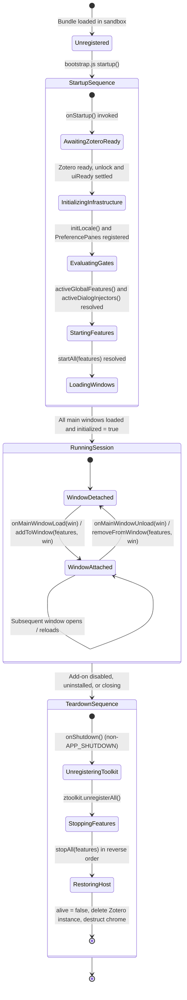
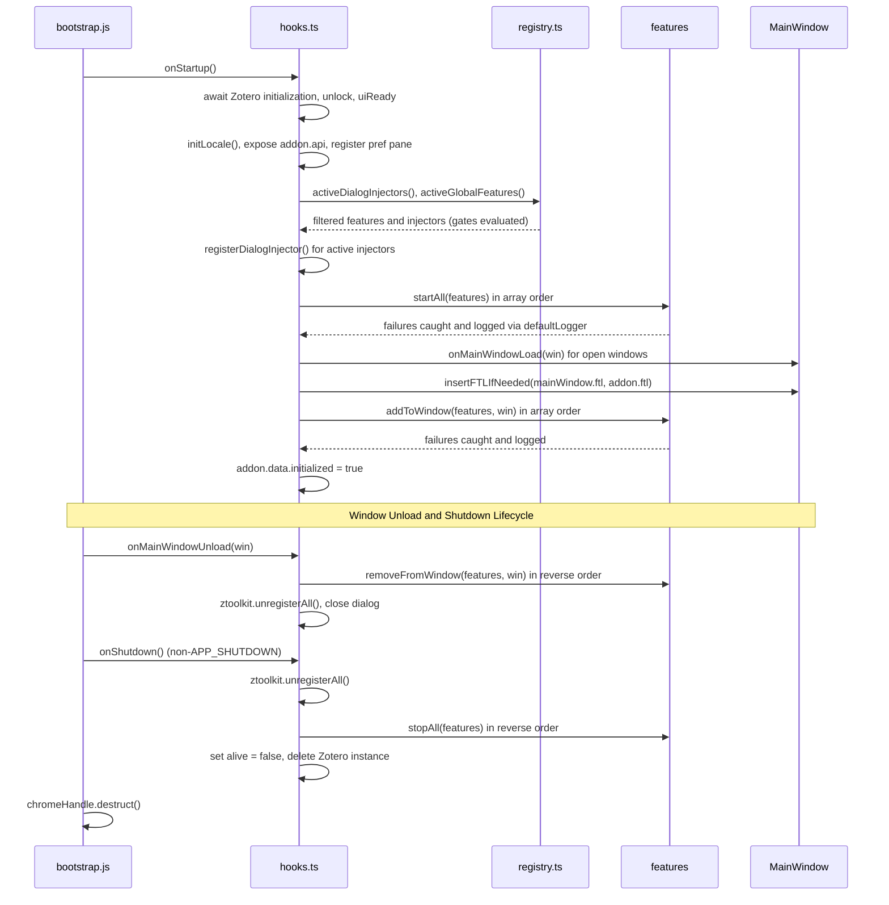

Every capability FlexAnnotate adds to Zotero is managed as a **feature** or **dialog injector** governed by a unified lifecycle contract ([src/shared/feature.ts](../../src/shared/feature.ts)) and filtered through a central feature gate system ([src/features/gates.ts](../../src/features/gates.ts), [src/features/registry.ts](../../src/features/registry.ts)).

The lifecycle architecture is designed around four core requirements:
1. **Predictable startup and teardown sequencing.** Session-wide state initializes before per-window DOM injection, and teardown unwinds startup in exact reverse order.
2. **Robust error isolation.** A failing lifecycle hook in one feature never aborts subsequent features or crashes Zotero host processes.
3. **Strict window scoping and memory safety.** Per-window DOM nodes and event listeners are decoupled from session singletons using `WeakMap` references to prevent zombie-window memory leaks.
4. **Fine-grained feature gating and emergency hotfixing.** Every feature and runtime sub-feature can be disabled in source or overridden dynamically via `about:config` preferences (`extensions.flexannotate.gate.<Name>`), automatically cascading down dependency chains (`requires`) and gracefully hiding corresponding UI elements and preference sections.

## The Feature contract & lifecycle methods

[src/shared/feature.ts](../../src/shared/feature.ts) defines the base contract for session and window features:

```ts
export interface Feature {
  name: string;
  start?(): void | Promise<void>;
  stop?(): void;
  addToWindow?(win: _ZoteroTypes.MainWindow): void | Promise<void>;
  removeFromWindow?(win: _ZoteroTypes.MainWindow): void;
}
```

FlexAnnotate features progress through six distinct lifecycle stages:

| Stage | Method / Entry Point | Execution Scope | Responsibilities & Invariants |
| ----- | -------------------- | --------------- | ----------------------------- |
| **1. Registration** | `registry.ts` declarations | Build / module load | Features and dialog injectors declare identity, lifecycle methods, and gate mappings. |
| **2. Init** | `onStartup` in `src/hooks.ts` | Session startup | Awaits Zotero readiness promises (`initializationPromise`, `unlockPromise`, `uiReadyPromise`), initializes Fluent locales, populates `addon.api`, registers the preference pane, and queries gates to filter active features. |
| **3. Start** | `startAll(features)` | Session-wide global | Invokes `start()` in array order; sets up prototype patches via [`assignChecked`](patching.md), registers `Zotero.Notifier` observers, mounts `Zotero.MenuManager` entries, and starts background watchers. Can be asynchronous. |
| **4. Window Attachment** | `addToWindow(features, win)` | Per main window | Invoked for each open window during startup (`onMainWindowLoad`), and for every window opened thereafter. Mounts toolbar buttons, window-specific menus, context popups, and per-window prototype patches. Must be idempotent. |
| **5. Window Detachment** | `removeFromWindow(features, win)` | Per main window | Invoked when a window closes (`onMainWindowUnload`). Executes in **reverse array order** to cleanly detach listeners from WeakMaps, remove DOM nodes, and restore per-window patched methods. Synchronous by contract. |
| **6. Stop** | `stopAll(features)` | Session shutdown | Invoked on plugin shutdown or disable (`onShutdown`). Executes in **reverse array order** to restore native prototype methods, detach global observers, unregister menus, close auxiliary windows, and clear background caches. Synchronous by contract. |

All hooks are optional; a feature defining only `name` is valid and skipped by missing hooks. The `name` property is required and forms the prefix for feature log entries (`feature <name>.<hook> failed: ...`).

### Ordering and error isolation

The four registry helpers — `startAll`, `stopAll`, `addToWindow`, and `removeFromWindow` — execute through an internal `invoke()` wrapper with strict isolation rules:

- **Startup order:** `startAll` and `addToWindow` invoke their respective hook for every feature in declared array order, collect all returned promises, and resolve via `await Promise.all(...)`.
- **Teardown symmetry:** `stopAll` and `removeFromWindow` iterate through the features array in **reverse order**, unwinding resources in the exact opposite order of creation.
- **Fail-safe execution:** `invoke()` wraps every hook in a `try`/`catch` block. Synchronous errors are captured immediately, and asynchronous rejections are converted into log statements via `.then(() => undefined, (e) => log(feature.name, hook, e))`. No helper function ever rethrows or rejects. A thrown error in one feature cannot abort other features or halt Zotero's bootstrap process.
- **Safe logging:** The `defaultLogger` resolves the `ztoolkit` global lazily at runtime and wraps both `ztoolkit.log` and `Zotero.logError` in `try`/`catch`. This guarantees that logging failures never disturb caller execution and permits importing `src/shared/feature.ts` into Node.js test runners without Zotero runtime globals (verified by [test-unit/feature.test.ts](../../test-unit/feature.test.ts)).

## Feature gates and dependency chaining

Central feature gating is defined in [src/features/gates.ts](../../src/features/gates.ts). Every capability and sub-capability is registered as a `FeatureGate`:

```ts
export interface FeatureGate {
  name: GateName;
  description: string;
  enabled: boolean;
  requires?: readonly GateName[];
}
```

Two categories of gates exist:
1. **Lifecycle & dialog-injector gates (`RESTART_GATES`):** Evaluated at startup in `src/features/registry.ts` via `activeGlobalFeatures()` and `activeDialogInjectors()`. Changing their state requires a Zotero restart to take effect.
2. **Runtime sub-feature gates:** Evaluated dynamically at render or interaction time via `isFeatureEnabled(name)` (e.g. `docImport`, `docExport`, `noteExport`, `orphanTags`, `citedTracking`, `footnoteJump`, `narrowDialogLayout`, `dialogShowPlace`, `readerLabelPopup`, `citaviPrintQuotes`, `citaviLinks`, `citeprocResetFix`). Changes take effect immediately on the next render or action without restarting.

### Dependency chaining via `requires`

Coupled features declare prerequisite base gates via `requires`. The dependency resolver (`resolveFeatureEnabled`) recursively verifies all required gates:

```ts
export function resolveFeatureEnabled(
  name: string,
  lookup: ReadonlyMap<string, FeatureGate> = gateByName,
  visited: Set<string> = new Set(),
): boolean {
  if (visited.has(name)) return true;
  const gate = lookup.get(name);
  if (!gate) return true;
  if (!gate.enabled || readOverride(name) === false) return false;
  if (gate.requires) {
    visited.add(name);
    for (const req of gate.requires) {
      if (!resolveFeatureEnabled(req, lookup, visited)) return false;
    }
  }
  return true;
}
```

Cascading rules:
- **Automatic cascading:** Disabling a base gate automatically disables all features that depend on it. For example, disabling `organizer` automatically disables `organizerToolbarButton`, `toolsMenuFallback`, `collectionMenu`, `docImport`, `docExport`, `noteExport`, and `orphanTags`. Disabling `citationDialog` disables `persistentDialogPatch`, `modeSelector`, `outlineView`, `citedTracking`, and `footnoteJump`.
- **Cycle safety:** A `visited` set prevents infinite recursion if circular dependencies are mistakenly introduced.
- **Fail-open on unknown keys:** If a gate name is not present in the lookup map, `resolveFeatureEnabled` returns `true`. This prevents accidental typos in new code from silently breaking feature activation. Consistency is guarded by unit tests.

### Runtime overrides in `about:config`

In emergency hotfix scenarios (e.g., an upstream Zotero update introduces a breaking internal API change), any feature gate can be disabled without releasing a new plugin version.

- **Preference format:** Setting the hidden boolean preference `extensions.flexannotate.gate.<Name>` to `false` in `about:config` disables the gate.
- **Fail-safe reader:** `prefOverride` reads `Zotero.Prefs.get("extensions.flexannotate.gate." + name, true)` lazily inside a `try`/`catch` block. If Zotero globals are missing or throwing, it fails open.
- **One-way restriction:** Overrides can **only turn features off, never on**. If a gate has `enabled: false` in source code, setting `extensions.flexannotate.gate.<Name>` to `true` has no effect (`if (!gate.enabled || readOverride(name) === false) return false`).
- **Test isolation:** Test suites swap the override reader via `setGateOverrideReader(...)` to test cascading behavior in isolation without mutating global preferences ([test-unit/gateOverrides.test.ts](../../test-unit/gateOverrides.test.ts), [test/gates.test.ts](../../test/gates.test.ts)).

## Graceful UI degradation

When a feature or sub-feature is disabled (either in source or via runtime preference override), FlexAnnotate guarantees that UI controls and preference sections degrade cleanly without leaving broken or orphaned elements:

```
[Feature Gate: Disabled]
       │
       ├─► Lifecycle Feature ────────► Omitted from activeGlobalFeatures()
       │                               └─► addToWindow() never runs: no toolbar button, no menu items
       │
       ├─► Dialog Injector ──────────► Omitted from activeDialogInjectors()
       │                               └─► never injected into Word/LibreOffice citation dialog
       │
       ├─► Runtime Sub-Feature ──────► Checked via isFeatureEnabled(name) during render
       │                               ├─► Organizer tree footer buttons (docImport, docExport, noteExport) omitted
       │                               ├─► Citation dialog: green checks (citedTracking) & badges (footnoteJump) hidden
       │                               ├─► Preview pane: "Show citation place" button (dialogShowPlace) omitted
       │                               └─► Reader locator type popup (readerLabelPopup) omitted
       │
       └─► Preferences Pane ─────────► applyFeatureVisibility() in preferences.ts
                                       ├─► Options tab: .hidden set on checkboxes and parent <groupbox> elements
                                       └─► Features tab: checkbox disabled with localized note showing missing dependencies
```

1. **Window toolbar buttons and menus:**
   - In `src/features/registry.ts`, `activeGlobalFeatures()` filters `globalFeatureEntries` by `isFeatureEnabled(f.name)`.
   - If `organizerToolbarButton` is disabled, its `addToWindow` hook is never executed, and `#flexannotate-tb-organizer` is never added to `#zotero-tabs-toolbar`.
   - If `collectionMenu`, `toolsMenuFallback`, `readerMenu`, `printMenus`, or `annotationRowMenu` are disabled, their respective context menu items and popups are not registered in the DOM.
2. **Citation dialog capabilities:**
   - In `src/features/registry.ts`, `activeDialogInjectors()` filters `dialogInjectorEntries` by `isFeatureEnabled(i.name)`.
   - If `modeSelector` or `outlineView` is disabled, its injector is not registered with `citationDialog.registerDialogInjector`, leaving the vanilla Zotero citation dialog layout intact.
   - For `persistentDialogPatch`, `persistentSupported()` checks `isFeatureEnabled("persistentDialogPatch")` alongside runtime feature detection of `Interface.prototype.addAnnotation`. If disabled, integration patches are skipped entirely.
3. **Organizer actions and sub-panels:**
   - In `src/features/organizer/panel/organizerTree.ts`, action buttons in the organizer footer are wrapped in runtime guards:
     ```ts
     if (isFeatureEnabled("docImport")) { /* add Import Word/LibreOffice button */ }
     if (isFeatureEnabled("docExport")) { /* add Export Word/LibreOffice button */ }
     if (isFeatureEnabled("noteExport")) { /* add Export Note button */ }
     if (isFeatureEnabled("orphanTags") && s.orphans.length) { /* render orphan tag warning */ }
     ```
   - In `src/features/organizer/citationDialog/dialogOutlineRender.ts`, cited indicators (`citedTracking`), footnote jump badges (`footnoteJump`), and the locator jump button (`dialogShowPlace`) query `isFeatureEnabled` before rendering DOM elements or attaching click handlers.
4. **Preferences window degradation:**
   - In [src/prefs/preferences.ts](../../src/prefs/preferences.ts), `applyFeatureVisibility()` runs on load and after every gate change:
     - Sets `.hidden` on individual preference controls (`flexannotate-pref-citation-only`, `flexannotate-pref-persistent-citation-dialog`, `flexannotate-pref-tag-suggest`, Citavi options).
     - Hides entire `<groupbox>` sections when all child options are disabled (e.g. citation groupbox hidden if both `citeOnlyPatch` and `persistentSupported` are false; Citavi groupbox hidden if `citaviImport` is off or neither quotes nor links are enabled; placeholders groupbox hidden if `printMenus` is off).
   - In the "Features" tab, `syncFeatureRows()` and `refreshFeatureNotes()` inspect gate requirements:
     - Checkboxes for features whose `requires` prerequisites are disabled become disabled (`checkbox.disabled = true`).
     - A localized note (`prefs-features-needs`) displays the names of the missing parent features.
     - For gates in `RESTART_GATES`, a note (`prefs-features-restart`) indicates that changes take effect after restarting Zotero.

## The central registry

[src/features/registry.ts](../../src/features/registry.ts) acts as the central switchboard for the plugin, maintaining the declared lists of global features and dialog injectors:

```ts
export const globalFeatureEntries: Feature[] = [
  organizerFeature,
  organizerToolbarButton,
  toolsMenuFallback,
  collectionMenu,
  citationDialogFeature,
  persistentDialogPatch,
  citeOnlyPatch,
  readerMenu,
  citaviImport,
  annotationIndexFeature,
  externalApiFeature,
  tagSuggest.feature,
  printMenus,
  placeholderCleanup,
  annotationRowMenu,
  annotationRowPatchFeature,
];
```

| # | Feature Gate | `start` / `stop` (Session) | `addToWindow` / `removeFromWindow` (Per Window) | Gate Prerequisite (`requires`) |
| - | ------------ | -------------------------- | ----------------------------------------------- | ------------------------------ |
| 1 | `organizer` | Registers `Zotero.MenuManager` menu entry; stop closes organizer window and unregisters menus. | — | `annotationIndex` |
| 2 | `organizerToolbarButton` | — | Mounts `#flexannotate-tb-organizer` before `#zotero-tb-sync`. | `organizer` |
| 3 | `toolsMenuFallback` | — | Adds item in Tools menu when `MenuManager.registerMenu` is unavailable (Zotero 7). | `organizer` |
| 4 | `collectionMenu` | — | Adds "Organizer for this collection" in `#zotero-collectionmenu`. | `organizer` |
| 5 | `citationDialog` | Starts/stops `Services.wm` citation dialog window watcher. | — | — |
| 6 | `persistentDialogPatch` | Patches `displayDialog`, `execCommand`, interface methods, progress bar. | — | `citationDialog` |
| 7 | `citeOnlyPatch` | Patches `Session.prototype._insertCitingResult` via `assignChecked`. | — | — |
| 8 | `readerMenu` | Registers reader event listeners, Notifier observer, `Reader.open` wrapper. | — | — |
| 9 | `citaviImport` | Wraps `Translate.Import.prototype.translate`; watches import windows. | Patches `importFile` and `importFromClipboard` on window's `Zotero_File_Interface`. | — |
| 10 | `annotationIndex` | Initializes library-wide annotation index and Notifier observer. | — | — |
| 11 | `externalApi` | Installs/removes public `Zotero.FlexAnnotate` API object. | — | `annotationIndex` |
| 12 | `tagSuggest` | Registers item and tab listeners for §-tag autocomplete suggestions. | — | — |
| 13 | `printMenus` | — | Inserts separator and menu items into `#zotero-itemmenu`. | — |
| 14 | `placeholderCleanup` | Observes annotation deletes to clean empty print placeholder attachments. | — | — |
| 15 | `annotationRowMenu` | — | Mounts context menu popup for `<annotation-row>` item tree elements. | `printMenus` |
| 16 | `annotationRowPatch` | — | Patches `AnnotationRow.prototype.render` to display custom locator labels. | — |

Adding a new capability to FlexAnnotate requires two steps:
1. Declare a `FeatureGate` entry in `src/features/gates.ts` with its default enabled state and any prerequisite gates.
2. Add the `Feature` or `DialogInjector` to `globalFeatureEntries` or `dialogInjectorEntries` in `src/features/registry.ts`.

## Citation dialog injectors

The Word and LibreOffice integration opens Zotero's citation dialog in a separate window (`chrome://zotero/content/integration/citationDialog.xhtml`). Because this dialog is not a `_ZoteroTypes.MainWindow`, it is not governed by the `addToWindow`/`removeFromWindow` pass of `globalFeatureEntries`.

Instead, [src/shared/citationDialog.ts](../../src/shared/citationDialog.ts) defines a dedicated injector contract:

```ts
export interface DialogInjector {
  name: string;
  inject(win: Window): void;
  detach(win: Window): void;
}
```

In `src/features/registry.ts`, three dialog injectors are registered in strict order:
1. `modeSelector`: Injects citation-only vs standard citation mode radio buttons (`injectModeSelector` / `removeModeSelector`). Requires `["citationDialog", "citeOnlyPatch"]`.
2. `outlineView`: Injects the outline view panel and tabs (`outlineView.inject` / `outlineView.detach`). Requires `["citationDialog", "annotationIndex"]`.
3. `annotationRowPatch`: Patches `AnnotationRow.prototype.render` in the citation dialog (`patchAnnotationRow` / `unpatchAnnotationRow`).

A `Services.wm` listener watches for citation dialog windows. Once `(win as any).DIALOG_STATE?.loaded` is true, injectors execute in insertion order. When the dialog window unloads or the `citationDialog` feature stops, each injector's `detach(win)` runs. Any thrown error during `inject` or `detach` is caught and logged via `ztoolkit.log`.

### Dual attachment of `annotationRowPatch`

The `annotationRowPatch` capability ([src/features/print/annotationRowPatch.ts](../../src/features/print/annotationRowPatch.ts)) is registered in **both** lifecycle registries:
- As a **dialog injector** in `dialogInjectorEntries` for the Word/integration citation dialog window.
- As a **window feature** in `globalFeatureEntries` for main Zotero windows (reader sidebars and note editors).

In both contexts, `patchAnnotationRow(win)`:
1. Checks `installed.has(win)` to guarantee idempotent attachment.
2. Ensures the `annotation-row` custom element is registered (creating a dummy element via `doc.createXULElement("annotation-row")` if necessary).
3. Wraps `AnnotationRow.prototype.render` using [`assignChecked`](patching.md). The wrapper executes native render first, then runs `updateAnnotationRowTitle(this)` and `updateGotoButton(this)`, substituting fixed labels like "Seite 318" with custom locators (e.g. "Randnummer 318" or Opus) and adding locator navigation buttons.
4. Stores `{ native, patched }` in module-scoped `installed = new WeakMap<Window, { native, patched }>()`.
5. Updates already rendered `<annotation-row>` elements in `win.document`.

When unpatched (`unpatchAnnotationRow(win)`), it verifies that another plugin has not wrapped `render` subsequently (`proto.render === entry.patched`), restores native `render` via `assignChecked`, removes jump buttons, and re-invokes `.render?.()` on existing rows.

## Per-window DOM mounting and memory leak prevention

In Gecko/Zotero, main windows (`_ZoteroTypes.MainWindow`) can open, close, and reload during a session. Module singletons exist once per session. Storing window DOM nodes, window references, or closures that reference window documents in module-level variables (such as an array or object dictionary) roots the entire window DOM tree in memory, causing severe memory leaks (zombie windows).

FlexAnnotate enforces two architectural rules to prevent DOM and window leaks:

### 1. The WeakMap listener rule

Module-level state never holds strong references to windows or per-window event handlers. Per-window event listeners and native functions are kept in private module-scoped `WeakMap<MainWindow, Listener>` instances:

- In [src/features/organizer/toolbarButton.ts](../../src/features/organizer/toolbarButton.ts):
  ```ts
  const listeners = new WeakMap<MainWin, () => void>();
  ```
  `addToWindow(win)` registers the command listener and stores it: `listeners.set(win, listener)`. `removeFromWindow(win)` retrieves it with `listeners.get(win)`, calls `button.removeEventListener("command", listener)`, and executes `listeners.delete(win)`.
- In [src/features/organizer/collectionMenu.ts](../../src/features/organizer/collectionMenu.ts):
  ```ts
  const listeners = new WeakMap<MainWin, { show: () => void; cmd: () => void }>();
  ```
  Both `popupshowing` on the menu and `command` on the item are stored in the WeakMap and detached in `removeFromWindow`.
- In [src/features/print/annotationRowMenu.ts](../../src/features/print/annotationRowMenu.ts):
  ```ts
  const listeners = new WeakMap<MainWin, (event: MouseEvent) => void>();
  ```
  The capture-phase `contextmenu` listener on `win.document` is stored and detached in `removeFromWindow`.
- In [src/features/print/annotationRowPatch.ts](../../src/features/print/annotationRowPatch.ts):
  ```ts
  const installed = new WeakMap<Window, { native: () => void; patched: () => void }>();
  ```
  The native `render` function of `AnnotationRow.prototype` is tracked weakly per window and detached during unpatch.

Because keys in a `WeakMap` are held weakly, even if `removeFromWindow` failed to run before a window closed, the entries do not prevent JavaScript garbage collection of the closed `MainWindow`.

### 2. The DOM-element window state rule

When a feature needs to associate transient state with a UI interaction within a window (such as which annotation was right-clicked in a context menu), the state is attached directly to the DOM element via data attributes rather than stored in a module-level variable:
- In `annotationRowMenu`, the target annotation ID is stored on the popup element itself via `popup.setAttribute("data-flexannotate-annotation-id", String(annotation.id))`.
- This ensures that a right-click interaction in one window never overwrites state in another window, and the state lifecycle is bound directly to the lifetime of that window's DOM element.

## Lifecycle state machine

The full lifecycle across registration, startup sequencing, window attachment, and graceful teardown is illustrated below:


*Lifecycle state machine: bootstrap startup sequencing, per-window attachment and detachment, and reverse-order teardown.*

## Startup and teardown sequence

Zotero's bootstrap ([addon/bootstrap.js](../../addon/bootstrap.js)) registers the chrome mapping, loads the bundle into the plugin sandbox with `ignoreCache: true` (avoiding stale startup cache copies), and forwards its lifecycle callbacks to the `hooks` object stored on `Zotero.FlexAnnotate`.

The instance itself is wired in [src/index.ts](../../src/index.ts): it creates the `Addon` singleton ([src/addon.ts](../../src/addon.ts)), defines the `ztoolkit` global as a getter over `addon.data.ztoolkit`, and registers the instance as `Zotero[config.addonInstance]`. `Addon` bundles `data` (`alive`, `config`, `env`, `initialized`, `ztoolkit`, …), `hooks`, and the `api` map.


*Startup filters active features via gates and runs startAll before per-window addToWindow; teardown mirrors it with removeFromWindow per window and stopAll in reverse order.*

### Startup in detail (`onStartup` in [src/hooks.ts](../../src/hooks.ts))

1. Await `Zotero.initializationPromise`, `Zotero.unlockPromise`, and `Zotero.uiReadyPromise` — no feature runs before Zotero is usable.
2. `initLocale()` loads the Fluent bundle.
3. Build `addon.api` (exposing internal modules and test controls).
4. Register the preference pane via `Zotero.PreferencePanes.register`.
5. Register active citation dialog injectors from `registry.activeDialogInjectors()`.
6. Retrieve active global features via `features = registry.activeGlobalFeatures()`.
7. `await startAll(features)`.
8. `await Promise.all(Zotero.getMainWindows().map((win) => onMainWindowLoad(win)))` — every open main window receives the window pass.
9. Set `addon.data.initialized = true`. This flag is set as the final step, doubling as a "fully started" signal for the test runner.

`onMainWindowLoad(win)` creates a fresh `ZToolkit` instance for the window, inserts the two Fluent localization files (`flexannotate-mainWindow.ftl`, `flexannotate-addon.ftl`), and awaits `addToWindow(features, win)`.

`onMainWindowUnload(win)` runs `removeFromWindow(features, win)` in reverse order, calls `ztoolkit.unregisterAll()`, and closes any open plugin dialog window.

### Teardown in detail (`onShutdown`)

Teardown is triggered by `bootstrap.js` only for non-`APP_SHUTDOWN` reasons (during application exit, Zotero tears down process memory directly):
1. Calls `ztoolkit.unregisterAll()`.
2. Invokes `stopAll(features)` in reverse order:
   - Patches restored through [`assignChecked`](patching.md) (verifying that third-party plugins haven't overwritten them).
   - The citation-dialog watcher detaches every injector, including those in still-open dialogs.
   - `MenuManager` menus are unregistered by key.
   - The annotation index unloads its Notifier observer and clears its in-memory map.
   - Auxiliary organizer windows close.
   - Public external APIs are removed from the `Zotero` namespace.
3. Closes any open plugin dialogs.
4. Sets `addon.data.alive = false` and executes `delete Zotero[config.addonInstance]`.
5. `bootstrap.js` destructs `chromeHandle`.

## `addon.api`: the surface for Zotero tests

`onStartup` builds `addon.api`, exposing internal modules and lifecycle controls:
- **Internal modules:** `organizerData`, `outline`, `flatHeadings`, `outlineModel`, `organizerStrings`, `OrganizerFactory`, `organizerView`, `docImport`, `docExport`, `docOutline`, `organizerToolbar`, `toolsMenu`, `openTarget`, `tagSuggest`, `cited`, `dialogCited`, `modeSelector`, `registry`, `gates`.
- **Lifecycle controls:** `featureLifecycle` (`startAll`, `stopAll`, `addToWindow`, `removeFromWindow`), `citeOnly` (`patch`, `isPatched`), `persistentDialog` (`feature`, `readPref`, `writePref`, `getWindow`, `supported`, `patchExec`, `unpatchExec`, `patchInterface`, `unpatchInterface`), `print.annotationRowPatch` (`patch`, `unpatch`), `externalApi` (`install`, `uninstall`).

This map is the **only legal entry point for the Zotero integration tests** ([test/](../../test/)): test files reach it via `(Zotero as any)[config.addonInstance].api` and must **not import plugin modules directly**. The reason is the `ztoolkit` global: feature modules call `ztoolkit.log(...)`, which is defined as a getter over `addon.data.ztoolkit` and therefore only exists inside the running plugin instance — an imported module copy in the test bundle would execute without it.

Because `addon.data.initialized` is set only after `startAll` and all window passes have finished, the test runner gates on it: `zotero-plugin.config.ts` sets `test.waitForPlugin` to `() => Zotero.FlexAnnotate.data.initialized`, so no test observes a half-started plugin.

### Feature detection vs loud failures

Start hooks handle environment variations deliberately:
- **Loud failure on unexpected patch failure:** `citeOnlyPatch.start()` **throws** if `_insertCitingResult` cannot be patched (`throw new Error("citeOnlyPatch: _insertCitingResult patch not active")`). The feature registry catches and logs the error, ensuring that broken core functionality is immediately visible in test and console logs rather than silently ignored ([test/citeOnly.test.ts](../../test/citeOnly.test.ts)).
- **Feature detection for version differences:** `persistentDialogPatch.start()` checks `persistentSupported()`, verifying whether Zotero's integration layer provides `Interface.prototype.addAnnotation`. In Zotero versions lacking this method (Zotero 7.x/8.x), patching is skipped cleanly without throwing. If patching begins but any component (`displayDialog`, `execCommand`, or `Interface` methods) fails, it rolls back all companion patches.

## Preference-pane registration

`onStartup` registers the preference pane declaratively:

```ts
Zotero.PreferencePanes.register({
  pluginID: addon.data.config.addonID,
  src: `chrome://${addon.data.config.addonRef}/content/preferences.xhtml`,
  scripts: [
    `chrome://${addon.data.config.addonRef}/content/scripts/preferences.js`,
  ],
  label: addon.data.config.addonName,
  image: `chrome://${addon.data.config.addonRef}/content/icons/icon.svg`,
});
```

`onPrefsEvent` in `src/hooks.ts` is a no-op because the preference controls bind to preference keys directly in markup. The fill script [src/prefs/preferences.ts](../../src/prefs/preferences.ts) is bundled independently as an esbuild entry point (`zotero-plugin.config.ts`). Zotero loads pane scripts in an isolated sandbox scope without plugin globals, so that script accesses only `Zotero.*`, `window`, and `document`. It manages the two-tab layout ("Options" and "Features"), fills Citavi locator drop-downs, dynamically manages groupbox visibility, and binds gate override checkboxes.

## Focused tests

- [test-unit/feature.test.ts](../../test-unit/feature.test.ts) — registry semantics: reverse-order stop, error isolation for sync and async hooks, hook-free features, `defaultLogger` without globals.
- [test-unit/gateOverrides.test.ts](../../test-unit/gateOverrides.test.ts) — feature gates unit tests: explicit false overrides, dependency cascading via `requires`, non-escalation (cannot enable disabled features), fail-open on unknown gates, error tolerance without Zotero globals.
- [test/gates.test.ts](../../test/gates.test.ts) — integration gate testing in a live Zotero instance: toggling every gate in turn, verifying that start/stop/addToWindow/removeFromWindow lifecycle and organizer opening survive emergency hotfix switches without error.
- [test/toolbarButton.test.ts](../../test/toolbarButton.test.ts) — window-hook idempotency and complete removal.
- [test/annotationRowPatch.test.ts](../../test/annotationRowPatch.test.ts) — title updates to custom locators (Randnummer/Opus vs standard page) and attachment lifecycle.
- [test/citeOnly.test.ts](../../test/citeOnly.test.ts) — patch start/stop round-trip in a real Zotero, reached through `addon.api`.
- [test/readerMenu.test.ts](../../test/readerMenu.test.ts) — reader start/stop pair verified against Zotero's listener registry.
- [test/toolsMenu.test.ts](../../test/toolsMenu.test.ts) — `MenuManager` fallback feature detection per Zotero version.
- [test/preferences.test.ts](../../test/preferences.test.ts) — pane registration, default bindings, and menu layout.
- [test/startup.test.ts](../../test/startup.test.ts) — smoke test verifying plugin instance creation on `Zotero`.

## Related pages

- [Architecture Overview](overview.md) — system structure, module layers, and how the registry fits into the runtime.
- [Patching](patching.md) — `assignChecked` and prototype patching patterns used in `start`/`stop` hooks.
- [Build and Release](../operations/build-and-release.md) — bundling multiple entrypoints (`src/index.ts` and `src/prefs/preferences.ts`) via esbuild.
