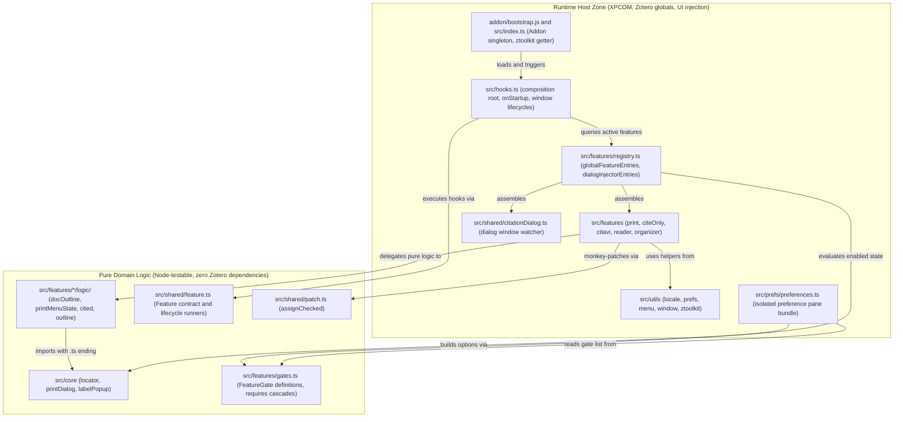
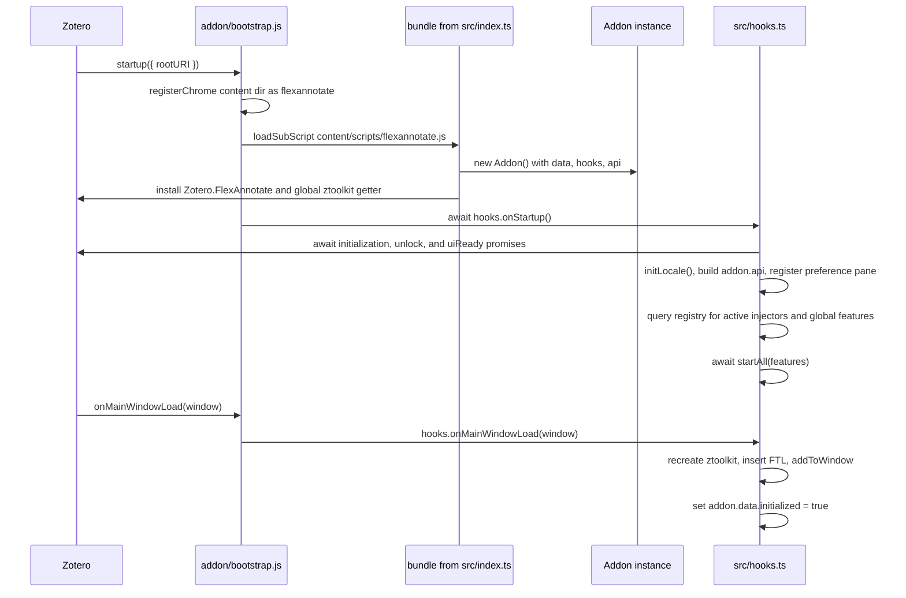

FlexAnnotate's `src/` codebase is strictly layered to separate pure domain logic from Zotero runtime hooks. Pure algorithmic rules remain independent of Gecko or Zotero host globals and run directly under Node's native test runner (`node --test`), while Zotero-facing capabilities are partitioned into modular, individually disablable features. The central feature list and injector registry ([src/features/registry.ts](../../src/features/registry.ts)) and gate switchboard ([src/features/gates.ts](../../src/features/gates.ts)) govern feature activation and dialog injection. A single composition root ([src/hooks.ts](../../src/hooks.ts)) coordinates startup and window lifecycles across five support layers: [src/core](../../src/core/locator.ts) (pure logic shared across features), [src/shared](../../src/shared/feature.ts) (lifecycle execution, checked monkey-patching, and citation dialog watching), per-feature `logic/` subdirectories, [src/prefs](../../src/prefs/preferences.ts) (preference pane controller), and [src/utils](../../src/utils/ztoolkit.ts) (runtime wrappers).

The entrypoint [src/index.ts](../../src/index.ts) installs a singleton `Addon` instance at `Zotero.FlexAnnotate` before any other plugin code executes. The low-level loader [addon/bootstrap.js](../../addon/bootstrap.js) registers the Gecko chrome mapping, loads the main script bundle with cache bypassing, and forwards Zotero lifecycle events into the hooks engine.

## Layer map

| Layer | Responsibility | Key files |
| ----- | -------------- | --------- |
| `src/core` | Pure business logic shared across several features; zero Zotero dependencies | [locator.ts](../../src/core/locator.ts), [printDialog.ts](../../src/core/printDialog.ts), [labelPopup.ts](../../src/core/labelPopup.ts) |
| `src/features/<feature>/logic/` | Pure business logic scoped to a single feature; zero Zotero dependencies, runnable under `node --test` | [docOutline.ts](../../src/features/organizer/logic/docOutline.ts), [printMenuState.ts](../../src/features/print/logic/printMenuState.ts), [readerLocator.ts](../../src/features/reader/logic/readerLocator.ts), [cited.ts](../../src/features/organizer/logic/cited.ts), [outline.ts](../../src/features/organizer/logic/outline.ts) |
| `src/features/gates.ts` | Pure feature switches with dependency cascade (`requires`) and hotfix pref overrides; zero Zotero imports | [gates.ts](../../src/features/gates.ts) |
| `src/features/registry.ts` | Central registry defining ordered global lifecycle features and citation dialog injectors filtered by feature gates | [registry.ts](../../src/features/registry.ts) |
| `src/shared` | Shared session-wide helpers and contracts: lifecycle runner, checked prototype patching, citation dialog watcher | [feature.ts](../../src/shared/feature.ts), [patch.ts](../../src/shared/patch.ts), [citationDialog.ts](../../src/shared/citationDialog.ts) |
| `src/features/<feature>` | Feature implementations interfacing with Zotero; UI injection, listeners, and integration glue | `print`, `citeOnly`, `citavi`, `reader`, `organizer` |
| `src/prefs` | Preference-pane controller; compiled into a separate bundle running in the pane's dialog sandbox | [preferences.ts](../../src/prefs/preferences.ts), [featureGroups.ts](../../src/prefs/featureGroups.ts) |
| `src/utils` | Common utilities: Fluent localization, preferences, menu management, window checking, toolkit factory | [locale.ts](../../src/utils/locale.ts), [prefs.ts](../../src/utils/prefs.ts), [menu.ts](../../src/utils/menu.ts), [window.ts](../../src/utils/window.ts), [ztoolkit.ts](../../src/utils/ztoolkit.ts) |
| `src/hooks.ts` | Composition root: initializes locale, exposes `addon.api`, registers the preference pane, and executes startup and window lifecycles | [hooks.ts](../../src/hooks.ts) |
| `addon/` | Extension assets: manifest, `bootstrap.js`, default preferences, preference pane XHTML, Fluent FTL files (`de`, `en-US`), icons | [bootstrap.js](../../addon/bootstrap.js), [manifest.json](../../addon/manifest.json), [preferences.xhtml](../../addon/content/preferences.xhtml) |

The five features provide distinct capabilities:
- **`print`**: Physical book annotation workflow, generating placeholder PDF attachments, creating print annotations with custom locators, opening the annotation input panel, injecting item context menus, and patching `<annotation-row>` rendering.
- **`citeOnly`**: Citation-only insertion bypassing citation quote text via monkey-patching `Zotero.Integration`, with an inline mode selector in the citation dialog.
- **`citavi`**: Second-pass importer for Citavi XML backups capturing knowledge item quotes on printed works and establishing contribution relationships.
- **`reader`**: Reader context menu integrations and locator configuration within the page-number popup.
- **`organizer`**: Tree outline organizer window, outline notes, document outline import/export, citation dialog view, cross-paper annotation index, and external plugin API.

All persistent plugin state is stored directly in native Zotero entities (tags, attachments, standalone notes, and preferences); see [Data model](data-model.md).



*Component dependency and boundary layer architecture: pure domain logic remains strictly isolated and testable under Node, while host layers interface with Zotero and XPCOM.*

## The strict dependency rule

Module interactions must follow three architectural invariants:

1. **Features import downwards into `core`, `shared`, and `utils`.** For example, [src/features/print/menus.ts](../../src/features/print/menus.ts) imports `../../utils/locale`, `../../shared/feature`, and its internal `./logic/printMenuState`. Helper modules never import from feature modules.
2. **`logic/` subdirectories, `core/`, and `gates.ts` are strictly Zotero-free and never import another feature.** [src/core/locator.ts](../../src/core/locator.ts) imports nothing and contains no reference to `Zotero`. A feature's `logic/` directory imports only sibling files in the same directory (such as [src/features/organizer/logic/docOutline.ts](../../src/features/organizer/logic/docOutline.ts) importing `./outline.ts`) or utilities from `src/core/` (such as [src/features/reader/logic/readerLocator.ts](../../src/features/reader/logic/readerLocator.ts) importing `../../../core/locator.ts`). Crucially, these imports carry an explicit `.ts` file extension so `node --test` can resolve and load them without transpilation or bundler interception.
3. **The central switchboard ([src/features/registry.ts](../../src/features/registry.ts) and [src/features/gates.ts](../../src/features/gates.ts)) governs feature membership and activation.** `src/features/registry.ts` defines the canonical ordered lists of global lifecycle features and citation dialog injectors, filtered dynamically via `src/features/gates.ts`. `src/hooks.ts` is the runtime composition root that queries these active sets in `onStartup()` and coordinates startup, window injection, and shutdown. Individual features never import or invoke another feature's lifecycle methods.

This strict layering delivers three essential guarantees:
- Pure business logic remains instantly testable under native Node.js without mocking complex Gecko, XPCOM, DOM, or Zotero globals.
- Features are decoupled and can be toggled or disabled by adjusting a single entry in `src/features/gates.ts` or setting an override preference.
- Shared logic has a single, unambiguous home in `src/core/` rather than sprawling across ad-hoc cross-feature imports.

### The print domain exception

There is one deliberate exception at the Zotero-facing layer: `reader`, `citavi`, and `citeOnly` import modules directly from `print`:
- [src/features/reader/readerMenu.ts](../../src/features/reader/readerMenu.ts) imports `../print/dialog` and `../print/printAnnotations`.
- [src/features/citavi/citaviPrintQuotes.ts](../../src/features/citavi/citaviPrintQuotes.ts) imports `../print/printAnnotations` and `../print/placeholder`.
- [src/features/citeOnly/integrationPatch.ts](../../src/features/citeOnly/integrationPatch.ts) imports `getLocator` from `../print/printAnnotations`.

This exception exists because `print` serves as the domain authority for physical placeholders and print annotations across FlexAnnotate. These dependencies are strictly unidirectional towards `print`, and no `logic/` or `core/` file ever crosses feature boundaries.

## The feature switchboard: registry.ts and gates.ts

FlexAnnotate decouples feature declaration from lifecycle orchestration through two specialized modules in `src/features/`:

```
src/features/gates.ts       (pure switchboard, dependency trees, pref override logic)
        ▲
        │ evaluated by isFeatureEnabled()
        │
src/features/registry.ts    (globalFeatureEntries, dialogInjectorEntries)
        ▲
        │ queried at onStartup()
        │
src/hooks.ts                (startAll(features), registerDialogInjector())
```

### Feature gates and dependency cascading (gates.ts)

[src/features/gates.ts](../../src/features/gates.ts) is a pure, Node-testable module defining every feature and sub-feature as a `FeatureGate`:

```typescript
export interface FeatureGate {
  name: GateName;
  description: string;
  enabled: boolean;
  requires?: readonly GateName[];
}
```

Gates are divided into two operational classes:
1. **Lifecycle features and dialog injectors**: Evaluated once during startup by `registry.ts` (`activeGlobalFeatures()` and `activeDialogInjectors()`). Changing these gates requires a Zotero restart; they are enumerated in `RESTART_GATES`.
2. **Runtime sub-features**: Evaluated dynamically at render and action call sites via `isFeatureEnabled(name)` (e.g., `citedTracking`, `footnoteJump`, `narrowDialogLayout`, `dialogShowPlace`, `outlineAnchorTags`, `outlineScopeHeading`, `docImport`, `docExport`, `noteExport`, `orphanTags`, `readerLabelPopup`, `citaviPrintQuotes`, `citaviLinks`, `citeprocResetFix`). Changes take effect on the next UI render or user action without restarting.

Coupled features declare base dependencies through `requires`. For example, `footnoteJump` requires `citedTracking`, which in turn requires `outlineView`, which requires `citationDialog` and `annotationIndex`. The recursive function `resolveFeatureEnabled` ensures that disabling a base feature automatically cascades down the dependency graph, cleanly disabling all dependent features and UI controls. Unknown gate names fail open (`true`), preventing newly added features from silently disappearing if a gate registration is omitted.

#### Hidden preference overrides (hotfix switches)

Every gate can be switched off at runtime without releasing a new plugin version by creating a hidden boolean preference:

$$\text{Key: } \texttt{extensions.flexannotate.gate.<name>}$$

The default override reader in `gates.ts` resolves `Zotero.Prefs.get` lazily inside `try/catch` (preserving importability under Node) and applies three strict rules:
- Only an explicit `false` disables a feature; an unset or non-boolean value leaves the source `enabled` flag in control.
- An override can only turn a feature *off*, never *on* if `enabled: false` is set in source code.
- Disabling a gate via preference cascades recursively through all dependent gates declared in `requires`.

In unit tests, `setGateOverrideReader` allows injecting custom mock readers. In the preferences window, the "Features on/off" tab dynamically renders checkboxes for each gate from `gates.ts` (grouped via [src/prefs/featureGroups.ts](../../src/prefs/featureGroups.ts)), writing `false` to the gate preference when unchecked and clearing the preference when checked.

### Central feature registry (registry.ts)

[src/features/registry.ts](../../src/features/registry.ts) imports the feature implementations and defines the canonical lists of plugin capabilities:

- **`globalFeatureEntries: Feature[]`**: The 16 lifecycle features started sequentially at startup and stopped in reverse order on shutdown:
  1. `organizerFeature` (registers tools/item menus; closes window on stop)
  2. `organizerToolbarButton` (adds toolbar button in main windows)
  3. `toolsMenuFallback` (fallback menu item for Zotero 7)
  4. `collectionMenu` (collection context menu item)
  5. `citationDialogFeature` (starts and stops the `citationDialog` window watcher)
  6. `persistentDialogPatch` (word processor companion window patches)
  7. `citeOnlyPatch` (Zotero.Integration monkey-patch)
  8. `readerMenu` (PDF reader context menus and locator selection)
  9. `citaviImport` (second-pass XML quote and relationship importer)
  10. `annotationIndexFeature` (notifier observer indexing annotations)
  11. `externalApiFeature` (installs `Zotero.FlexAnnotate` inter-plugin API)
  12. `tagSuggest.feature` (heading-ordered tag suggestions)
  13. `printMenus` (context menus for physical book annotations)
  14. `placeholderCleanup` (removes empty placeholder attachments after deletions)
  15. `annotationRowMenu` (context menu on annotation rows)
  16. `annotationRowPatchFeature` (custom element renderer patch in main windows)
- **`activeGlobalFeatures(): Feature[]`**: Evaluates `isFeatureEnabled(f.name)` on call, returning only enabled lifecycle features. `src/hooks.ts` calls this inside `onStartup()`, ensuring all preference overrides are readable before starting features.
- **`dialogInjectorEntries: DialogInjector[]`**: The three citation dialog injectors in strict order:
  1. `modeSelector` (adds quote/cite-only dropdown and item controls)
  2. `outlineView` (adds tree/list outline layout and Word jump navigation)
  3. `annotationRowPatch` (custom locator rendering in citation search rows)
- **`activeDialogInjectors(): DialogInjector[]`**: Filters `dialogInjectorEntries` via `isFeatureEnabled(i.name)`. In `src/hooks.ts:onStartup()`, each active injector is registered with `citationDialog.registerDialogInjector()`.

## Core, shared, and UI patching layers

### core/ — pure logic shared across features

Modules in `src/core` contain zero references to Zotero globals:
- [locator.ts](../../src/core/locator.ts): Computes the active locator type (e.g., `page`, `section`) by inspecting an annotation's tags, falling back to the parent attachment's default locator tag, and defaulting to `page`. It also calculates the tag mutations required when updating locator assignments.
- [printDialog.ts](../../src/core/printDialog.ts): Pure view logic and geometric calculations for the print annotation input panel (focus handling, view modes, window dimension limits).
- [labelPopup.ts](../../src/core/labelPopup.ts): Pure construction and validation of locator options for the page-number popup and preference pane.

### features/<feature>/logic/ — pure feature-scoped logic

Each feature isolates its pure algorithmic rules within a dedicated `logic/` folder:
- `src/features/organizer/logic/`: Implements outline tree navigation, numbering, heading flattening, cited item extraction, and document outline serialization ([docOutline.ts](../../src/features/organizer/logic/docOutline.ts), [outline.ts](../../src/features/organizer/logic/outline.ts), [cited.ts](../../src/features/organizer/logic/cited.ts)).
- `src/features/print/logic/`: Determines item context menu visibility and actions ([printMenuState.ts](../../src/features/print/logic/printMenuState.ts)) based on library selection state.
- `src/features/reader/logic/`: Formats custom locator titles and resolves locator label text ([readerLocator.ts](../../src/features/reader/logic/readerLocator.ts)).

All files in `logic/` import siblings or `src/core` with explicit `.ts` extensions, allowing the `node --test` runner to execute unit tests without bundling or runtime polyfills.

### shared/ — lifecycle, checked patching, and dialog tracking contracts

- [feature.ts](../../src/shared/feature.ts): Defines the `Feature` interface (`name`, `start`, `stop`, `addToWindow`, `removeFromWindow`) and provides the execution orchestrators `startAll`, `stopAll`, `addToWindow`, and `removeFromWindow`. `startAll` iterates in forward array order awaiting asynchronous hooks. `stopAll` and `removeFromWindow` run in reverse order. Exceptions thrown by hooks are caught, logged, and isolated so a failure in one feature cannot break other features. The internal `defaultLogger` accesses the global `ztoolkit` lazily within a `try/catch` block, ensuring `shared/feature.ts` remains directly importable by Node.js unit tests. For complete lifecycle semantics, see [Feature lifecycle & registry](feature-lifecycle.md).
- [patch.ts](../../src/shared/patch.ts): Exports `assignChecked(target, name, value)`, the mandatory mechanism for monkey-patching Zotero prototypes. It performs property assignment inside `try/catch`, immediately reads the property back, and verifies referential identity (`obj[name] === value`). This guards against silent assignment failures: non-writable targets under strict mode (which throw) and Gecko Xray expandos (which accept writes into a temporary expando that disappears on read-back). For patching rules and pitfalls, see [Patching](patching.md).
- [citationDialog.ts](../../src/shared/citationDialog.ts): Coordinates UI injectors for Zotero's citation dialog. A single `Services.wm` listener watches for windows matching `chrome://zotero/content/integration/citationDialog.xhtml`. It polls until `DIALOG_STATE.loaded` becomes true (checking every 200 ms up to 150 attempts) before invoking each registered injector's `inject(win)` once in registration order. When a citation dialog unloads or `citationDialog.stop()` is triggered, `detach(win)` runs on every injector. In `src/features/registry.ts`, injectors are configured in strict sequence: `modeSelector`, `outlineView`, and `annotationRowPatch`.

### The role of annotationRowPatch in UI patching

Zotero renders annotation items across multiple UI contexts—the right-hand item pane/sidebar, note editors, reader panels, and search lists inside the Word/LibreOffice citation dialog—using the `<annotation-row>` custom element. Natively in Zotero 10 (`elements/annotationRow.js`), `AnnotationRow.prototype.render` rigidly sets the row's title element to `Zotero.getString('pdfReader.page') + ' ' + pageLabel` (e.g., "Seite 318"), ignoring non-page locators.

The [annotationRowPatch](../../src/features/print/annotationRowPatch.ts) capability resolves this by intercepting custom element rendering:

1. **Checked prototype patching**: It uses `assignChecked` to monkey-patch `AnnotationRow.prototype.render` on the window's custom element registry. The wrapper invokes the native `render.call(this)` method and immediately executes `updateAnnotationRowTitle(this)`.
2. **Locator substitution**: `updateAnnotationRowTitle` inspects the row's underlying annotation (`row._annotation`). If `getLocator(ann)` reveals a non-default locator (such as `margin` / Randnummer or `opus`), it resolves the localized label text and updates `titleEl.textContent` to reflect the custom locator (e.g., "Randnummer 318" instead of "Seite 318").
3. **Dual attachment architecture**: Because `<annotation-row>` elements exist in both main Zotero windows and the citation dialog, `annotationRowPatch` is wired into both channels:
   - **Main-window feature**: Declared as `annotationRowPatchFeature` in `src/features/registry.ts` with `addToWindow: (win) => patchAnnotationRow(win)` and `removeFromWindow: (win) => unpatchAnnotationRow(win)`. This covers all main windows loaded during `onMainWindowLoad`.
   - **Citation-dialog injector**: Declared in `dialogInjectorEntries` in `src/features/registry.ts` with `{ name: "annotationRowPatch", inject: patchAnnotationRow, detach: unpatchAnnotationRow }`. This ensures rows in the integration citation dialog (`citationDialog.xhtml`) are patched when the dialog opens.
4. **Idempotency and clean reversal**: Active native render references are tracked per-window using a `WeakMap<Window, () => void>`. Unpatching (`unpatchAnnotationRow(win)`) restores the original `render` method via `assignChecked` and re-invokes `.render?.()` on all existing `<annotation-row>` elements in `win.document`.
5. **Test control surface**: The functions `{ patch: patchAnnotationRow, unpatch: unpatchAnnotationRow }` are exposed on `addon.api.print.annotationRowPatch` so integration tests can assert custom locator titles and test attachment lifecycles directly.

## utils/ — runtime helpers

- [locale.ts](../../src/utils/locale.ts): `initLocale()` initializes a `Localization` instance for `flexannotate-addon.ftl` on `addon.data.locale`. `getString(id)` resolves strings, automatically prefixing identifiers with `flexannotate-`.
- [prefs.ts](../../src/utils/prefs.ts): `getPref` and `setPref` wrap `Zotero.Prefs`, automatically prepending the `extensions.flexannotate.` prefix.
- [menu.ts](../../src/utils/menu.ts): `registerPluginMenu` wraps `Zotero.MenuManager.registerMenu` and retains the returned registration *key*. `unregisterAllPluginMenus` unregisters menus using these stored keys, because calling `unregisterMenu` with raw menu IDs fails to locate the entries.
- [window.ts](../../src/utils/window.ts): Provides window sanity checks (`isWindowAlive` checking for dead wrappers or closed states) and cross-version retrieval of `selectedCollection`.
- [ztoolkit.ts](../../src/utils/ztoolkit.ts): `createZToolkit()` instantiates and configures a `ZoteroToolkit` instance using the compile-time `__env__` definition: sets log prefix `[FlexAnnotate]`, suppresses console logging in production builds, enables DOM/JSON logging in development, binds `api.pluginID`, and supplies the `ProgressWindow` icon.

## The bootstrap chain

The plugin startup sequence connects `addon/bootstrap.js` through `src/index.ts`, `src/addon.ts`, and `src/hooks.ts`:

1. **[bootstrap.js](../../addon/bootstrap.js)**: Zotero's Addon Manager invokes `startup({ rootURI })`. The function registers the Gecko chrome resource mapping (`content/` mapped under `__addonRef__`), creates the sandbox context `ctx` with `ctx._globalThis = ctx`, and loads `${rootURI}/content/scripts/__addonRef__.js` using `Services.scriptloader.loadSubScriptWithOptions` with `{ target: ctx, ignoreCache: true }`. The `ignoreCache: true` option ensures Gecko does not execute a stale copy from the startup cache. It then awaits `Zotero.FlexAnnotate.hooks.onStartup()`.
2. **[src/index.ts](../../src/index.ts)**: Executes immediately as a module side effect during bundle evaluation. Guarded by `if (!basicTool.getGlobal("Zotero")[config.addonInstance])`, it ensures re-execution is a no-op. It instantiates `_globalThis.addon = new Addon()`, sets up the live `ztoolkit` global getter, and assigns `Zotero[config.addonInstance] = addon` (installing `Zotero.FlexAnnotate`).
3. **[src/addon.ts](../../src/addon.ts)**: Defines the singleton instance shape:
   - `data`: Holds `alive: true`, `config` (from `package.json`), `env` (`__env__`), `initialized: false`, and the initial `ztoolkit` from `createZToolkit()`.
   - `hooks`: Bound to the lifecycle methods exported by `src/hooks.ts`.
   - `api`: Initialized as an empty object `{}`.
4. **[src/hooks.ts](../../src/hooks.ts)**: Executes startup, window lifecycle, and shutdown orchestration.



*Startup control flow: module evaluation installs globals before onStartup executes feature initialization.*

### Sandbox globals and window lifecycles

Bundle evaluation creates three key global references:
- `Zotero.FlexAnnotate`: The public `Addon` instance. `bootstrap.js` routes all lifecycle calls through `Zotero.FlexAnnotate.hooks.*`, the scaffold test runner waits on `Zotero.FlexAnnotate.data.initialized`, and public extension APIs attach here.
- `ztoolkit`: Defined on `_globalThis` using `Object.defineProperty` as a live getter returning `_globalThis.addon.data.ztoolkit`. In `hooks.ts:onMainWindowLoad`, `addon.data.ztoolkit` is re-created for every loaded main window (`addon.data.ztoolkit = createZToolkit()`). The global `ztoolkit` therefore always targets the active window context, ensuring `ztoolkit.unregisterAll()` in `onMainWindowUnload` removes exactly that window's DOM and listeners.
- `_globalThis.addon`: Direct reference to the `Addon` instance within the sandbox scope.

### Lifecycle execution in src/hooks.ts

- **`onStartup()`**: Awaits `Zotero.initializationPromise`, `Zotero.unlockPromise`, and `Zotero.uiReadyPromise`. Calls `initLocale()`, constructs the `addon.api` bridge, registers the preference pane via `Zotero.PreferencePanes.register`, registers `activeDialogInjectors()` with `citationDialog`, and awaits `startAll(features)` with `activeGlobalFeatures()`. It then invokes `onMainWindowLoad` for all currently open windows via `Zotero.getMainWindows()`, and finally sets `addon.data.initialized = true`.
- **`onMainWindowLoad(win)`**: Recreates `addon.data.ztoolkit`, injects Fluent localization files (`flexannotate-mainWindow.ftl` and `flexannotate-addon.ftl`) into the window using `win.MozXULElement.insertFTLIfNeeded`, and awaits `addToWindow(features, win)`.
- **`onMainWindowUnload(win)`**: Calls `removeFromWindow(features, win)`, invokes `ztoolkit.unregisterAll()` to clean up injected elements, and closes any associated dialogs.
- **`onShutdown()`**: Calls `ztoolkit.unregisterAll()`, awaits `stopAll(features)` in reverse registration order, closes open dialogs, sets `addon.data.alive = false`, and deletes `Zotero[addon.data.config.addonInstance]`.

## Two esbuild bundles

The build system in [zotero-plugin.config.ts](../../zotero-plugin.config.ts) defines exactly two esbuild bundles, both targeting `firefox140`:

1. **Main extension bundle**: Entrypoint `src/index.ts`, outputting to `.scaffold/build/addon/content/scripts/flexannotate.js`. The define `__env__` is injected from `process.env.NODE_ENV`. This bundle encapsulates the entire feature suite and is loaded by `addon/bootstrap.js`.
2. **Preference pane bundle**: Entrypoint `src/prefs/preferences.ts`, outputting to `.scaffold/build/addon/content/scripts/preferences.js`. Zotero loads preference pane scripts directly into an isolated window sandbox without plugin globals. Consequently, `preferences.ts` must not import or depend on `addon` or `ztoolkit`. It uses only standard `Zotero.*`, `window`, and `document` APIs, hooks a capture-phase `load` event listener on `document` to populate Citavi menulists, awaits `Zotero.Styles.init()` before resolving locator labels, and dynamically renders the "Features on/off" tab from `gates.ts`.

Build configuration copies assets from `addon/**/*.*`, writes preferences under the `extensions.flexannotate` prefix, and specifies `strict_min_version: 7.0` and `strict_max_version: 10.*` in [addon/manifest.json](../../addon/manifest.json). The upper bound is mandatory for Zotero 10; without it, the application drops the plugin during manifest parsing.

## Testing architecture: bridging tests and runtime via addon.api

FlexAnnotate enforces a two-tier testing strategy that directly mirrors its module layout:

```
Unit Tests (test-unit/*.test.ts)           Integration Tests (test/*.test.ts)
   Runner: node --test                        Runner: Mocha inside real Zotero
   Target: src/core/, logic/, gates.ts        Target: Zotero.FlexAnnotate.api
   Globals: None (pure JS/TS)                 Globals: Live Zotero runtime
```

### Why integration tests must not import modules directly

Integration test files running under Mocha must never import feature files (such as `src/features/print/menus.ts` or `src/features/citeOnly/integrationPatch.ts`) directly. Direct imports cause two fatal problems:

1. **Missing runtime globals**: Feature modules depend on `ztoolkit`, which is exposed as a live getter on `_globalThis` only inside the plugin's sandbox environment. In the test runner's context, that global is undefined unless reached through the initialized addon instance.
2. **State duplication**: Importing feature modules inside test bundles creates duplicate module singletons (independent WeakMaps, unregistration arrays, and state flags), testing isolated copies rather than the active extension running in Zotero.

### How addon.api bridges the tiers

To bridge integration tests with internal features cleanly, `src/hooks.ts:onStartup()` constructs `addon.api`, assembling internal modules, controllers, and lifecycle patches into a unified interface:

```typescript
addon.api = {
  organizerData,
  outline: outlineCore,
  flatHeadings: flatHeadingsCore,
  outlineModel: outlineModelModule,
  organizerStrings,
  externalApi: {
    install: installExternalApi,
    uninstall: uninstallExternalApi,
  },
  OrganizerFactory,
  organizerView,
  docImport,
  docExport,
  docOutline: docOutlineCore,
  organizerToolbar: organizerToolbarButton,
  toolsMenu: toolsMenuFallback,
  openTarget,
  tagSuggest,
  cited: citedCore,
  dialogCited: dialogCitedModule,
  CitationDialogPatch: { viewOf: outlineView.viewOf },
  persistentDialog: {
    feature: persistentDialogPatch,
    readPref: readPersistentPref,
    writePref: writePersistentPref,
    getWindow: getPersistentWindow,
    normalizeOptions: normalizePersistentOptions,
    rememberCommand: rememberCommandForTest,
    lastCommand: lastCommandForTest,
    setPendingInsert: setPendingInsertForTest,
    patchExec: patchExecCommand,
    unpatchExec: unpatchExecCommand,
    openBrowse: openBrowseForTest,
    makeBrowseIo: makeBrowseIoForTest,
    activateOnOpenDialog: activatePersistentOnOpenDialog,
    supported: persistentSupported,
    patchInterface: patchInterfaceMethods,
    unpatchInterface: unpatchInterfaceMethods,
    rememberCollection,
  },
  modeSelector,
  registry,
  gates,
  featureLifecycle: { startAll, stopAll, addToWindow, removeFromWindow },
  citeOnly: { patch: citeOnlyPatch, isPatched: citeOnlyIsPatched },
  reader: { readerMenu: readerMenuModule },
  citavi: {
    importer: CitaviImport,
    feature: citaviImport,
    importPrintQuotes,
    linkContributions,
  },
  print: {
    placeholder: printPlaceholder,
    printAnnotations,
    dialog: printDialog,
    menus: { printMenus, updateVisibility: updatePrintMenus },
    annotationRowPatch: {
      patch: patchAnnotationRow,
      unpatch: unpatchAnnotationRow,
    },
  },
};
```

Integration tests retrieve this surface via `const api = () => (Zotero as any)[config.addonInstance].api`. The scaffold's `waitForPlugin` setting polls `() => Zotero.FlexAnnotate.data.initialized` before test suites execute. Tests can then trigger feature operations, exercise monkey-patches (`api().citeOnly.patch.start()`, `api().citeOnly.patch.stop()`, `api().print.annotationRowPatch.patch()`), and inspect internal structures directly on the live extension instance.

Meanwhile, `npm run test:unit` runs `node --test "test-unit/*.test.ts"` completely outside Zotero, importing pure files like `src/core/locator.ts`, `src/features/gates.ts`, and `src/features/organizer/logic/outline.ts` directly. This verification is made possible solely by the strict dependency rule keeping pure logic free from host globals.

## Where to read next

- [Feature lifecycle & registry](feature-lifecycle.md) — The `Feature` interface, registration ordering, error isolation, and idempotency requirements.
- [Data model](data-model.md) — Storage representation across tags, placeholder attachments, outline notes, and preference keys.
- [Patching](patching.md) — Monkey-patching mechanics with `assignChecked` and Zotero prototype targets.
- [Coding Conventions](../conventions.md) — Architectural patterns, commenting guidelines, and Fluent localization standards.
- [Build & Release Pipeline](../operations/build-and-release.md) — Packaging pipelines, esbuild bundling, and multi-version automated verification.
