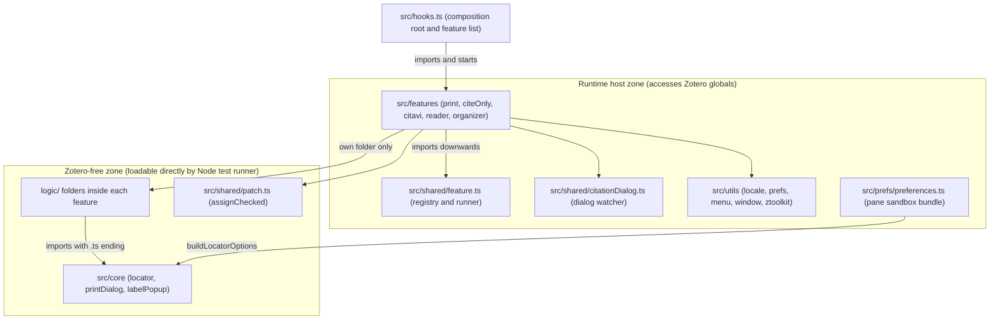
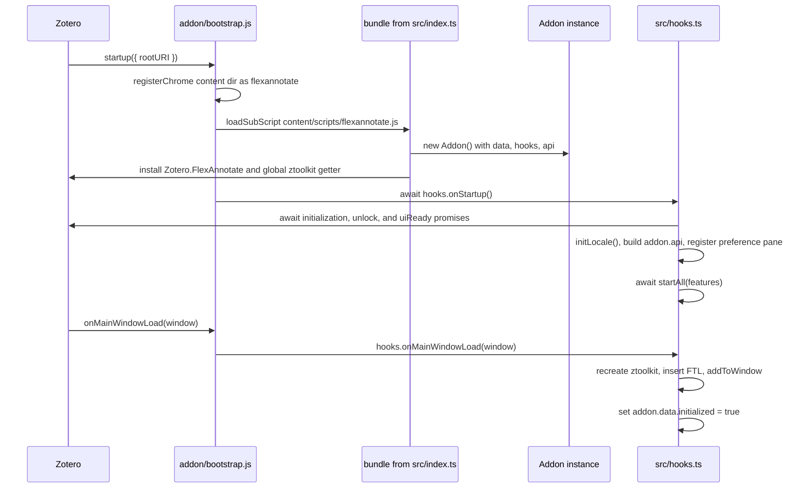

FlexAnnotate's `src/` codebase is strictly layered so that pure logic remains independent of Zotero and runnable by `node --test`, while Zotero-facing capabilities are partitioned into modular, individually disableable features. A single composition root ([src/hooks.ts](../../src/hooks.ts)) coordinates startup and window lifecycles. Beneath it sit four support layers: [src/core](../../src/core/locator.ts) (pure logic shared across features), [src/shared](../../src/shared/feature.ts) (the feature registry, prototype monkey-patching, and the citation dialog watcher), per-feature `logic/` subdirectories, and [src/utils](../../src/utils/ztoolkit.ts).

The entrypoint [src/index.ts](../../src/index.ts) installs a singleton `Addon` instance at `Zotero.FlexAnnotate` before any other plugin code executes. The low-level loader [addon/bootstrap.js](../../addon/bootstrap.js) registers the Gecko chrome mapping, loads the main script bundle with cache bypassing, and forwards Zotero lifecycle events into the hooks engine.

## Layer map

| Layer | Responsibility | Key files |
| ----- | -------------- | --------- |
| `src/core` | Pure business logic shared across several features; zero Zotero dependencies | [locator.ts](../../src/core/locator.ts), [printDialog.ts](../../src/core/printDialog.ts), [labelPopup.ts](../../src/core/labelPopup.ts) |
| `src/shared` | Shared session-wide helpers: lifecycle registry, checked patching, citation-dialog tracking | [feature.ts](../../src/shared/feature.ts), [patch.ts](../../src/shared/patch.ts), [citationDialog.ts](../../src/shared/citationDialog.ts) |
| `src/features/<feature>` | Feature implementations interfacing with Zotero; pure logic isolated in `<feature>/logic/` | `print`, `citeOnly`, `citavi`, `reader`, `organizer` |
| `src/prefs` | Preference-pane controller; compiled into a separate bundle running in the pane's dialog sandbox | [preferences.ts](../../src/prefs/preferences.ts) |
| `src/utils` | Common utilities: Fluent localization, preferences, menu management, window checking, toolkit factory | [locale.ts](../../src/utils/locale.ts), [prefs.ts](../../src/utils/prefs.ts), [menu.ts](../../src/utils/menu.ts), [window.ts](../../src/utils/window.ts), [ztoolkit.ts](../../src/utils/ztoolkit.ts) |
| `src/hooks.ts` | Composition root: maintains the ordered feature registry and executes Zotero lifecycle hooks | [hooks.ts](../../src/hooks.ts) |
| `addon/` | Extension assets: manifest, `bootstrap.js`, default preferences, preference pane XHTML, Fluent FTL files (`de`, `en-US`), icons | [bootstrap.js](../../addon/bootstrap.js), [manifest.json](../../addon/manifest.json) |

The five features provide distinct capabilities:
- **`print`**: Physical book annotation workflow, generating placeholder PDF attachments, creating print annotations with custom locators, opening the annotation input panel, and injecting item context menus.
- **`citeOnly`**: Citation-only insertion bypassing citation quote text via monkey-patching `Zotero.Integration`, with an inline mode selector in the citation dialog.
- **`citavi`**: Second-pass importer for Citavi XML backups capturing knowledge item quotes on printed works and establishing contribution relationships.
- **`reader`**: Reader context menu integrations and locator configuration within the page-number popup.
- **`organizer`**: Tree outline organizer window, outline notes, document outline import/export, citation dialog view, cross-paper annotation index, and external plugin API.

All persistent plugin state is stored directly in native Zotero entities (tags, attachments, standalone notes, and preferences); see [Data model](data-model.md).



*Module dependency layers: arrows point from importer to imported; pure logic remains completely decoupled from Zotero globals.*

## The strict dependency rule

Module interactions must follow three architectural invariants:

1. **Features import downwards into `core`, `shared`, and `utils`.** For example, [src/features/print/menus.ts](../../src/features/print/menus.ts) imports `../../utils/locale`, `../../shared/feature`, and its internal `./logic/printMenuState`. Helper modules never import from feature modules.
2. **`logic/` subdirectories and `core/` are strictly Zotero-free and never import another feature.** [src/core/locator.ts](../../src/core/locator.ts) imports nothing and contains no reference to `Zotero`. A feature's `logic/` directory imports only sibling files in the same directory (such as [src/features/organizer/logic/docOutline.ts](../../src/features/organizer/logic/docOutline.ts) importing `./outline.ts`) or utilities from `src/core/` (such as [src/features/reader/logic/readerLocator.ts](../../src/features/reader/logic/readerLocator.ts) importing `../../../core/locator.ts`). Crucially, these imports carry an explicit `.ts` file extension so `node --test` can resolve and load them without transpilation or bundler interception.
3. **[src/hooks.ts](../../src/hooks.ts) is the single composition root that knows all features.** It imports every feature module and holds the canonical ordered array of `Feature` objects. Individual features never import or invoke another feature's lifecycle methods.

This strict layering delivers three essential guarantees:
- Pure business logic remains instantly testable under native Node.js without mocking complex browser or Zotero globals.
- Features are decoupled and can be toggled or disabled by adjusting a single entry in `src/hooks.ts`.
- Shared logic has a single, unambiguous home in `src/core/` rather than sprawling across ad-hoc cross-feature imports.

### The print domain exception

There is one deliberate exception at the Zotero-facing layer: `reader`, `citavi`, and `citeOnly` import modules directly from `print`:
- [src/features/reader/readerMenu.ts](../../src/features/reader/readerMenu.ts) imports `../print/dialog` and `../print/printAnnotations`.
- [src/features/citavi/citaviPrintQuotes.ts](../../src/features/citavi/citaviPrintQuotes.ts) imports `../print/printAnnotations` and `../print/placeholder`.
- [src/features/citeOnly/integrationPatch.ts](../../src/features/citeOnly/integrationPatch.ts) imports `getLocator` from `../print/printAnnotations`.

This exception exists because `print` serves as the domain authority for physical placeholders and print annotations across FlexAnnotate. These dependencies are strictly unidirectional towards `print`, and no `logic/` or `core/` file ever crosses feature boundaries.

## Core and shared layers

### core/ — pure logic shared across features

Modules in `src/core` contain zero references to Zotero globals:
- [locator.ts](../../src/core/locator.ts): Computes the active locator type (e.g., `page`, `section`) by inspecting an annotation's tags, falling back to the parent attachment's default locator tag, and defaulting to `page`. It also calculates the tag mutations required when updating locator assignments.
- [printDialog.ts](../../src/core/printDialog.ts): Pure view logic and geometric calculations for the print annotation input panel (focus handling, view modes, window dimension limits).
- [labelPopup.ts](../../src/core/labelPopup.ts): Pure construction and validation of locator options for the page-number popup and preference pane.

### shared/ — registry, checked patching, and dialog tracking

- [feature.ts](../../src/shared/feature.ts): Defines the `Feature` interface (`name`, `start`, `stop`, `addToWindow`, `removeFromWindow`) and provides the execution orchestrators `startAll`, `stopAll`, `addToWindow`, and `removeFromWindow`. `startAll` iterates in forward array order awaiting asynchronous hooks. `stopAll` and `removeFromWindow` run in reverse order. Exceptions thrown by hooks are caught, logged, and isolated so a failure in one feature cannot break other features. The internal `defaultLogger` accesses the global `ztoolkit` lazily within a `try/catch` block, ensuring `shared/feature.ts` remains directly importable by Node.js unit tests. For complete lifecycle semantics, see [Feature lifecycle & registry](feature-lifecycle.md).
- [patch.ts](../../src/shared/patch.ts): Exports `assignChecked(target, name, value)`, the mandatory mechanism for monkey-patching Zotero prototypes. It performs property assignment inside `try/catch`, immediately reads the property back, and verifies referential identity (`obj[name] === value`). This guards against silent assignment failures: non-writable targets under strict mode (which throw) and Gecko Xray expandos (which accept writes into a temporary expando that disappears on read-back). For patching rules and pitfalls, see [Patching](patching.md).
- [citationDialog.ts](../../src/shared/citationDialog.ts): Coordinates UI injectors for Zotero's citation dialog. A single `Services.wm` listener watches for windows matching `chrome://zotero/content/integration/citationDialog.xhtml`. It polls until `DIALOG_STATE.loaded` becomes true (checking every 200 ms up to 150 attempts) before invoking each registered injector's `inject(win)` once in registration order. When a citation dialog unloads or `citationDialog.stop()` is triggered, `detach(win)` runs on every injector. In [src/hooks.ts](../../src/hooks.ts), `modeSelector` is registered before `outlineView`, enforcing injection order.

## utils/ — runtime helpers

- [locale.ts](../../src/utils/locale.ts): `initLocale()` initializes a `Localization` instance for `flexannotate-addon.ftl` on `addon.data.locale`. `getString(id)` resolves strings, automatically prefixing identifiers with `flexannotate-`.
- [prefs.ts](../../src/utils/prefs.ts): `getPref` and `setPref` wrap `Zotero.Prefs`, automatically prepending the `extensions.flexannotate.` prefix.
- [menu.ts](../../src/utils/menu.ts): `registerPluginMenu` wraps `Zotero.MenuManager.registerMenu` and retains the returned registration *key*. `unregisterAllPluginMenus` unregisters menus using these stored keys, because calling `unregisterMenu` with raw menu IDs fails to locate the entries.
- [window.ts](../../src/utils/window.ts): Provides window sanity checks (`isWindowAlive` checking for dead wrappers or closed states) and cross-version retrieval of `selectedCollection`.
- [ztoolkit.ts](../../src/utils/ztoolkit.ts): `createZToolkit()` instantiates and configures a `ZoteroToolkit` instance using the compile-time `__env__` definition: sets log prefix `[FlexAnnotate]`, suppresses console logging in production builds, enables DOM/JSON logging in development, binds `api.pluginID`, and supplies the `ProgressWindow` icon.

## The bootstrap chain

The plugin startup sequence connects `addon/bootstrap.js` through `src/index.ts`, `src/addon.ts`, and `src/hooks.ts`:

1. **[bootstrap.js](../../addon/bootstrap.js)**: Zotero's Addon Manager invokes `startup({ rootURI })`. The function registers the Gecko chrome resource mapping (`content/` mapped under `__addonRef__`), creates the sandbox context `ctx` with `ctx._globalThis = ctx`, and loads `${rootURI}/content/scripts/__addonRef__.js` using `Services.scriptloader.loadSubScriptWithOptions` with `{ target: ctx, ignoreCache: true }`. The `ignoreCache: true` option ensures Gecko does not execute a stale copy from the startup cache. It then awaits `Zotero.FlexAnnotate.hooks.onStartup()`.
2. **[src/index.ts](../../src/index.ts)**: Executes immediately as a module side effect during bundle evaluation. Guarded by `if (!basicTool.getGlobal("Zotero")[config.addonInstance])`, it ensures re-execution is a no-op. It instantiates `_globalThis.addon = new Addon()`, sets up the live `ztoolkit` global getter, and assigns `Zotero[config.addonInstance] = addon` (installing `Zotero.FlexAnnotate`).
3. **[src/addon.ts](../../src/addon.ts)**: Defines the singleton instance shape:
   - `data`: Holds `alive: true`, `config` (from `package.json`), `env` (`__env__`), `initialized: false`, and the initial `ztoolkit` from `createZToolkit()`.
   - `hooks`: Bound to the lifecycle methods exported by `src/hooks.ts`.
   - `api`: Initialized as an empty object `{}`.
4. **[src/hooks.ts](../../src/hooks.ts)**: Executes startup, window lifecycle, and shutdown orchestration.



*Startup control flow: module evaluation installs globals before onStartup executes feature initialization.*

### Sandbox globals and window lifecycles

Bundle evaluation creates three key global references:
- `Zotero.FlexAnnotate`: The public `Addon` instance. `bootstrap.js` routes all lifecycle calls through `Zotero.FlexAnnotate.hooks.*`, the scaffold test runner waits on `Zotero.FlexAnnotate.data.initialized`, and public extension APIs attach here.
- `ztoolkit`: Defined on `_globalThis` using `Object.defineProperty` as a live getter returning `_globalThis.addon.data.ztoolkit`. In `hooks.ts:onMainWindowLoad`, `addon.data.ztoolkit` is re-created for every loaded main window (`addon.data.ztoolkit = createZToolkit()`). The global `ztoolkit` therefore always targets the active window context, ensuring `ztoolkit.unregisterAll()` in `onMainWindowUnload` removes exactly that window's DOM and listeners.
- `_globalThis.addon`: Direct reference to the `Addon` instance within the sandbox scope.

### Lifecycle execution in src/hooks.ts

- **`onStartup()`**: Awaits `Zotero.initializationPromise`, `Zotero.unlockPromise`, and `Zotero.uiReadyPromise`. Calls `initLocale()`, constructs the `addon.api` bridge, registers the preference pane via `Zotero.PreferencePanes.register`, and awaits `startAll(features)`. It then invokes `onMainWindowLoad` for all currently open windows via `Zotero.getMainWindows()`, and finally sets `addon.data.initialized = true`.
- **`onMainWindowLoad(win)`**: Recreates `addon.data.ztoolkit`, injects Fluent localization files (`flexannotate-mainWindow.ftl` and `flexannotate-addon.ftl`) into the window using `win.MozXULElement.insertFTLIfNeeded`, and awaits `addToWindow(features, win)`.
- **`onMainWindowUnload(win)`**: Calls `removeFromWindow(features, win)`, invokes `ztoolkit.unregisterAll()` to clean up injected elements, and closes any associated dialogs.
- **`onShutdown()`**: Calls `ztoolkit.unregisterAll()`, awaits `stopAll(features)` in reverse registration order, closes open dialogs, sets `addon.data.alive = false`, and deletes `Zotero[addon.data.config.addonInstance]`.

## Two esbuild bundles

The build system in [zotero-plugin.config.ts](../../zotero-plugin.config.ts) defines exactly two esbuild bundles, both targeting `firefox140`:

1. **Main extension bundle**: Entrypoint `src/index.ts`, outputting to `.scaffold/build/addon/content/scripts/flexannotate.js`. The define `__env__` is injected from `process.env.NODE_ENV`. This bundle encapsulates the entire feature suite and is loaded by `addon/bootstrap.js`.
2. **Preference pane bundle**: Entrypoint `src/prefs/preferences.ts`, outputting to `.scaffold/build/addon/content/scripts/preferences.js`. Zotero loads preference pane scripts directly into an isolated window sandbox without plugin globals. Consequently, `preferences.ts` must not import or depend on `addon` or `ztoolkit`. It uses only standard `Zotero.*`, `window`, and `document` APIs, hooks a capture-phase `load` event listener on `document` to populate Citavi menulists, awaits `Zotero.Styles.init()` before resolving locator labels, and conditionally hides persistent-citation options if `Zotero.Integration` lacks `Interface.prototype.addAnnotation`.

Build configuration copies assets from `addon/**/*.*`, writes preferences under the `extensions.flexannotate` prefix, and specifies `strict_min_version: 7.0` and `strict_max_version: 10.*` in [addon/manifest.json](../../addon/manifest.json). The upper bound is mandatory for Zotero 10; without it, the application drops the plugin during manifest parsing.

## Testing architecture: bridging tests and runtime via addon.api

FlexAnnotate enforces a two-tier testing strategy that directly mirrors its module layout:

```
Unit Tests (test-unit/*.test.ts)           Integration Tests (test/*.test.ts)
   Runner: node --test                        Runner: Mocha inside real Zotero
   Target: src/core/ & logic/                 Target: Zotero.FlexAnnotate.api
   Globals: None (pure JS/TS)                 Globals: Live Zotero runtime
```

### Why integration tests must not import modules directly

Integration test files running under Mocha must never import feature files (such as `src/features/print/menus.ts` or `src/features/citeOnly/integrationPatch.ts`) directly. Direct imports cause two fatal problems:

1. **Missing runtime globals**: Feature modules depend on `ztoolkit`, which is exposed as a live getter on `_globalThis` only inside the plugin's sandbox environment. In the test runner's context, that global is undefined unless reached through the initialized addon instance.
2. **State duplication**: Importing feature modules inside test bundles creates duplicate module singletons (independent WeakMaps, unregistration arrays, and state flags), testing isolated copies rather than the active extension running in Zotero.

### How addon.api bridges the tiers

To bridge integration tests with internal features cleanly, `src/hooks.ts:onStartup()` constructs `addon.api`, assembling internal modules, controllers, and lifecycle patches into a unified interface:

```typescript
addon.api = {
  organizerData,
  outline: outlineCore,
  flatHeadings: flatHeadingsCore,
  outlineModel: outlineModelModule,
  organizerStrings,
  externalApi: { install, uninstall },
  OrganizerFactory,
  docImport,
  docExport,
  docOutline: docOutlineCore,
  organizerToolbar: organizerToolbarButton,
  toolsMenu: toolsMenuFallback,
  openTarget,
  cited: citedCore,
  CitationDialogPatch: { viewOf: outlineView.viewOf },
  persistentDialog: {
    feature: persistentDialogPatch,
    readPref: readPersistentPref,
    writePref: writePersistentPref,
    getWindow: getPersistentWindow,
    // ...
  },
  modeSelector,
  citeOnly: { patch: citeOnlyPatch, isPatched: citeOnlyIsPatched },
  reader: { readerMenu: readerMenuModule },
  citavi: { importer: CitaviImport, feature: citaviImport, importPrintQuotes, linkContributions },
  print: { placeholder: printPlaceholder, printAnnotations, dialog: printDialog, menus: { printMenus, updateVisibility } },
};
```

Integration tests retrieve this surface via `const api = () => (Zotero as any)[config.addonInstance].api`. The scaffold's `waitForPlugin` setting polls `() => Zotero.FlexAnnotate.data.initialized` before test suites execute. Tests can then trigger feature operations, exercise monkey-patches (`api().citeOnly.patch.start()` and `stop()`), and inspect internal structures directly on the live extension instance.

Meanwhile, `npm run test:unit` runs `node --test "test-unit/*.test.ts"` completely outside Zotero, importing pure files like `src/core/locator.ts` and `src/features/organizer/logic/outline.ts` directly. This verification is made possible solely by the strict dependency rule keeping pure logic free from host globals.

## Where to read next

- [Feature lifecycle & registry](feature-lifecycle.md) — The `Feature` interface, registration ordering, error isolation, and idempotency requirements.
- [Data model](data-model.md) — Storage representation across tags, placeholder attachments, outline notes, and preference keys.
- [Patching](patching.md) — Monkey-patching mechanics with `assignChecked` and Zotero prototype targets.
- [Conventions](../conventions.md) — Coding conventions, commenting requirements, and Fluent localization standards.
- [Build & release](../operations/build-and-release.md) — Packaging pipelines, esbuild bundling, and multi-version automated verification.
