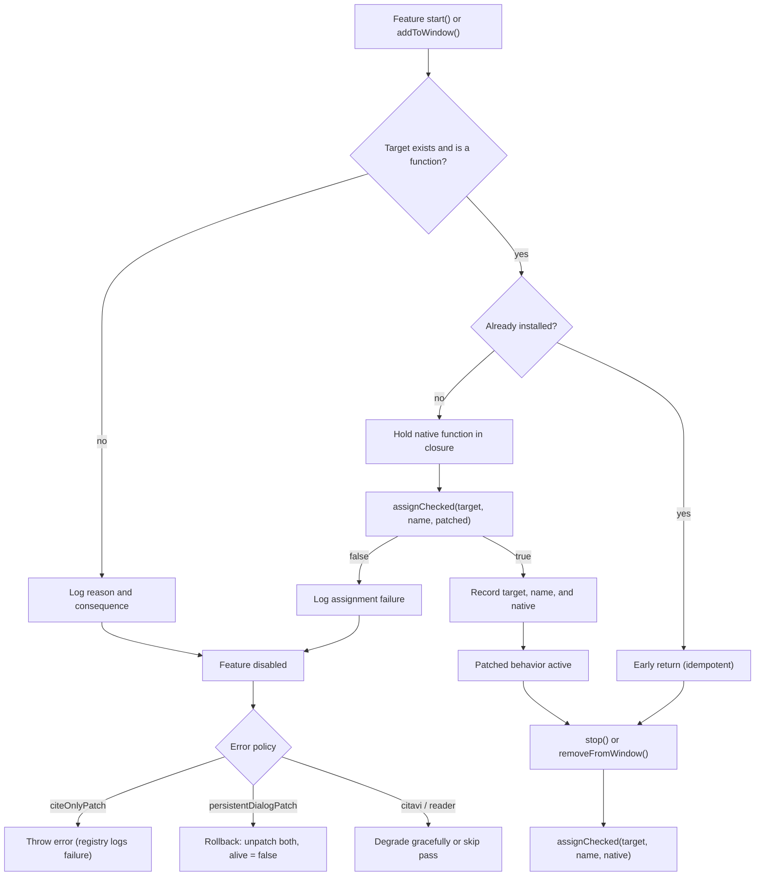
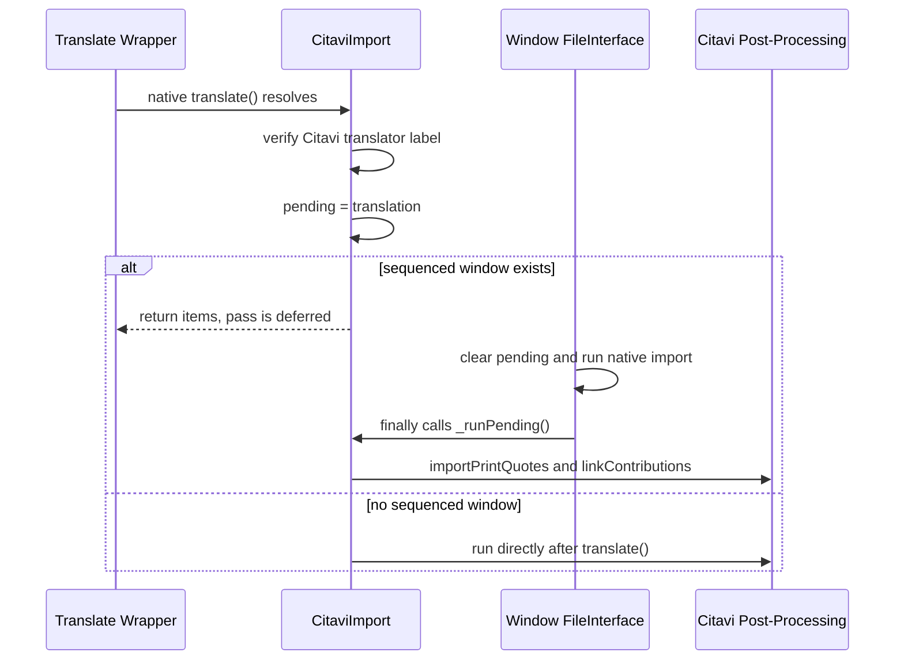
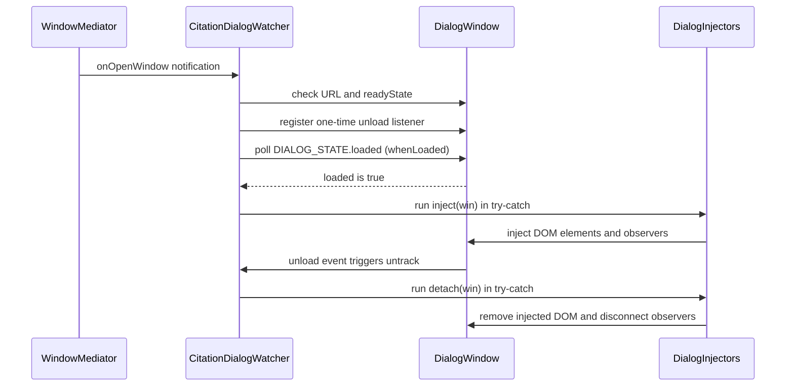

Zotero exposes no public extension API for the critical interception points required by FlexAnnotate: citation-only item rewriting in the Word integration session, the post-translation pass for Citavi attachments, window-specific import sequencing, and persistent dialog window management. FlexAnnotate must therefore replace or wrap methods on Zotero's live objects.

Because a monkey-patch that silently fails or half-installs can silently corrupt user documents or leave lingering mutations, every patch in FlexAnnotate adheres to a strict contract:
1. **Target pre-checking** via runtime feature detection before wrapping.
2. **Atomic installation and verification** via [`assignChecked`](../../src/shared/patch.ts), reading back property values to guard against frozen objects and Xray expando swallows.
3. **Explicit failure policies** (loud exceptions or atomic rollbacks) with diagnostic logging.
4. **Guaranteed restoration** in `stop` or `removeFromWindow`.
5. **Strict environmental isolation** ensuring that live user databases and unmanaged Word processes are never mutated or destabilized.

This architecture is governed by repo conventions in [AGENTS.md](../../AGENTS.md) and backed by verified source anchors in [docs/anchors.md](../../docs/anchors.md).

## The `assignChecked` primitive

The foundation for all prototype and object monkey-patching in FlexAnnotate is `assignChecked` in [src/shared/patch.ts](../../src/shared/patch.ts):

```ts
export function assignChecked(
  target: object,
  name: string,
  value: unknown,
): boolean {
  const obj = target as Record<string, unknown>;
  try {
    obj[name] = value;
  } catch {
    return false;
  }
  return obj[name] === value;
}
```

This single primitive neutralizes the two primary failure modes of Mozilla/Gecko object patching:

- **Non-writable or frozen targets:** In JavaScript strict mode, writing to a non-writable or frozen property throws a `TypeError`; outside strict mode, the assignment fails silently without mutating the property. The `try`/`catch` block absorbs the throw and yields `false` without crashing the caller. For example, CommonJS modules imported via `require()` execute in an isolated sandbox with frozen `exports` (`resource/require.js`, `resource/loader.sys.mjs`; anchor in [docs/anchors.md](../../docs/anchors.md)) and are strictly excluded as patch targets.
- **Swallowed writes via Xray expandos:** In Firefox/Gecko privileged chrome contexts, assigning to a property across an Xray wrapper boundary can silently place the property into an expando store rather than updating the underlying native object. The assignment appears to succeed, but subsequent reads by native code or other contexts never see the new value. The identity comparison (`obj[name] === value`) immediately reads back the property; if the read-back value differs from the assigned value, `assignChecked` returns `false`.

`assignChecked` is intentionally minimal and contains no logging statements or Zotero global dependencies. It can be safely imported in both runtime and Node unit test contexts. Callers retain full responsibility for evaluating the boolean return value and executing their respective failure policies.

## Pre-checking, verification, and rollback lifecycle

Every patch site in the codebase follows a structured four-stage lifecycle:


_Lifecycle of a FlexAnnotate patch: pre-checking target presence, applying and reading back via assignChecked, executing failure policies, and restoring original functions on teardown._

### 1. Target pre-checking
Before attempting to wrap a method, the caller checks whether the host object exists and whether the member is a function. FlexAnnotate uses runtime feature detection rather than version sniffing. For instance:
- `citeOnlyPatch` verifies that both `Integration.Session.prototype._insertCitingResult` and `_insertItemsIntoDocument` exist and are functions ([src/features/citeOnly/integrationPatch.ts](../../src/features/citeOnly/integrationPatch.ts)).
- `CitaviImport.patch` verifies `Zotero.Translate.Import.prototype.translate` ([src/features/citavi/citaviImport.ts](../../src/features/citavi/citaviImport.ts)).
- `persistentDialogPatch` executes `persistentSupported()`, verifying that `Zotero.Integration.Interface.prototype.addAnnotation` exists before touching anything; in Zotero 7.x and 8.x where that command is absent, persistence is skipped altogether ([src/features/organizer/dialog/dialogPersistent.ts](../../src/features/organizer/dialog/dialogPersistent.ts)).

### 2. Closure capture and idempotent application
When installing, the native function reference is captured in a closure and stored in module state or a per-window collection (`{ target, name, native }`). Idempotency guards prevent double-patching:
- If a patch is already marked installed, calling `start` or `addToWindow` again exits immediately without re-wrapping.
- `CitaviImport.patch` explicitly refuses to wrap `translate` twice. This guarantees that unpatching removes exactly one layer, restoring the clean native function rather than leaving an intermediate wrapper in place.

### 3. Divergent failure semantics
If target pre-checking fails or `assignChecked` returns `false`, callers handle the failure according to the criticality of the feature:
- **Loud failure (throw):** `citeOnlyPatch.start()` throws an explicit `Error("citeOnlyPatch: _insertCitingResult patch not active")`. The central feature registry (`src/shared/feature.ts`) catches and logs the failure with `ztoolkit.log` and `Zotero.logError`, allowing other features to continue while ensuring the broken patch is not silently ignored.
- **Atomic rollback:** `persistentDialogPatch.start()` requires both `displayDialog` and `execCommand` to operate correctly. If either assignment fails, it calls `unpatchDisplayDialog()` and `unpatchExecCommand()`, resets its state (`alive = false`), and returns cleanly. A partially patched integration subsystem would swallow citation dialogs; complete rollback leaves Zotero in a working vanilla state.

### 4. Restoration on stop or window unload
Teardown symmetry is mandatory. During shutdown or window close, original functions are restored using `assignChecked(target, name, native)`. The native reference is retrieved from stored module or window records, never read dynamically from the target (which would return the wrapper itself). `citeOnlyPatch.unpatch()` clears its `installed` pointer before restoring, ensuring that concurrent invocations cannot dereference a partially torn-down state.

## The inventory of patched symbols

FlexAnnotate maintains a strict inventory of all monkey-patched symbols across the application. Global patches run in feature `start`/`stop`; per-window patches run in `addToWindow`/`removeFromWindow`.

| Patched Symbol | Source File | Purpose | Restore Hook | State Storage |
| -------------- | ----------- | ------- | ------------ | ------------- |
| `Zotero.Integration.Session.prototype._insertCitingResult` | [src/features/citeOnly/integrationPatch.ts](../../src/features/citeOnly/integrationPatch.ts) | Intercepts citation insertion in Word/LibreOffice. When `citationOnly` pref is active and items are annotations, rewrites to parent item citations and forwards to `_insertItemsIntoDocument`. All other citations or errors fall through to native. | `unpatch()` in `stop` | Module `installed` record |
| `Zotero.Translate.Import.prototype.translate` | [src/features/citavi/citaviImport.ts](../../src/features/citavi/citaviImport.ts) | Detects Citavi XML exports after translation completes and caches the translation instance (`_itemSaver._IDMap`, `_io`) for post-processing. | `unpatch()` in `stop` | Module `translatePatch` record |
| `Zotero_File_Interface.importFile` & `importFromClipboard` | [src/features/citavi/citaviImport.ts](../../src/features/citavi/citaviImport.ts) | Wraps window-specific file import functions to execute the deferred Citavi pass in `finally`, guaranteeing it runs after Zotero attaches PDF files. | `removeFromWindow(win)` | `windowPatches` `WeakMap<Window, Patch[]>` |
| `Zotero.Reader.open` | [src/features/reader/readerMenu.ts](../../src/features/reader/readerMenu.ts) | Intercepts reader opening to attach a `MutationObserver` to reader iframes for page-number popup enhancement. | `unpatch()` in `stop` | Module `origOpen` record |
| `Zotero.Integration.displayDialog` | [src/features/organizer/dialog/dialogPersistent.ts](../../src/features/organizer/dialog/dialogPersistent.ts) | Replaces native modal citation dialog opening with a pinned, persistent modeless window; maintains `Zotero.Integration.currentWindow`. | `unpatchDisplayDialog()` in `stop` | Module `installed` record |
| `Zotero.Integration.Progress.prototype.show` | [src/features/organizer/dialog/dialogPersistent.ts](../../src/features/organizer/dialog/dialogPersistent.ts) | Suppresses the orphan progress dialog that appears when no integration transaction is active (`!currentDoc`). | `unpatchProgressBar()` in `stop` | Module `installedProgress` record |
| `Zotero.Integration.execCommand` | [src/features/organizer/dialog/dialogPersistent.ts](../../src/features/organizer/dialog/dialogPersistent.ts) | Captures integration command arguments (`agent`, `docId`, `templateVersion`) so persistent browse windows can replay insertions. | `unpatchExecCommand()` in `stop` | Module `installedExec` record |
| `win.resizeTo` & `win.moveTo` (dialog instances) | [src/features/organizer/dialog/dialogPersistent.ts](../../src/features/organizer/dialog/dialogPersistent.ts) | Temporarily clamps native dialog resizing and positioning during window initialization while the persistent rect settles. | Released via pin timer (max 1.5s), not `stop` | Wrapped on window instance |

### Non-patch extension mechanisms
Certain interactions that might appear to be monkey-patches are deliberately implemented without prototype mutation:
- **Reader context menus:** Implemented via Zotero's official `Zotero.Reader.registerEventListener` / `unregisterEventListener` APIs ([src/features/reader/readerMenu.ts](../../src/features/reader/readerMenu.ts)).
- **Citation dialog UI:** The citation dialog window (`citationDialog.xhtml`) receives no prototype patches. UI modifications are performed entirely via DOM injection and DOM event listeners managed by `CitationDialogWatcher`.
- **Persistent dialog layout:** Layout constraints are relaxed using injected CSS `<style>` elements and the root attribute `flexannotate-persistent` ([src/features/organizer/dialog/dialogPersistent.ts](../../src/features/organizer/dialog/dialogPersistent.ts)).

## Per-window patches and WeakMap isolation

A critical structural pitfall in Zotero extensions is assuming that subsystem objects are global singletons.

**`Zotero_File_Interface` is not a singleton.** Every window that loads `fileInterface.js` instantiates its own copy (`fileInterface.js:179`). This includes the main library window, secondary main windows, and the import wizard (`import/importWizard.xhtml:22`). A prototype patch applied to the main window's instance never affects the import wizard, causing imports initiated via the wizard to run completely unpatched.

To resolve this, Citavi import sequencing uses per-window patching:
- `CitaviImport.addToWindow(win)` inspects `win.Zotero_File_Interface` and wraps `importFile` and `importFromClipboard` directly on that window's instance.
- Patch records are stored in a `WeakMap<Window, { target, name, original }[]>`. When a window closes, its patch records are automatically garbage-collected. `removeFromWindow(win)` looks up the window in the `WeakMap` and restores its specific originals.
- Late-opening windows are handled via `Services.ww.registerNotification`, observing `domwindowopened` and attaching to the window's `load` event so the import wizard is patched as soon as it opens.
- The sequencing tracker uses a `Set<Window>` (`sequencedWindows`) rather than a boolean flag. When all patched windows close, the set empties, allowing `_afterTranslate` to safely fall back to immediate execution while logging a diagnostic warning.


_Two-entrypoint sequencing: translate wraps what is processed; window FileInterface determines when it runs in finally, ensuring parent attachments exist before annotations are created._

This WeakMap/WeakSet pattern is applied across all window-bound state in accordance with repo conventions ([AGENTS.md](../../AGENTS.md)):
- `dialogPersistent.ts`: `liveRects` (`WeakMap<Window, Rect>`) and `browseWindows` (`WeakSet<Window>`).
- `readerMenu.ts`: `watchedReaders` (`WeakSet<ReaderInstance>`).

## The citation dialog watcher pattern

Zotero's Word integration citation dialog (`chrome://zotero/content/integration/citationDialog.xhtml`) is a standalone XUL/XHTML window opened when the user inserts or edits citations. Rather than monkey-patching dialog prototypes or scripts, FlexAnnotate manages dialog extensions through a centralized watcher: `CitationDialogWatcher` in [src/shared/citationDialog.ts](../../src/shared/citationDialog.ts).


_CitationDialogWatcher lifecycle: detecting citationDialog.xhtml windows, polling DIALOG_STATE.loaded, executing isolated injectors, and tearing down on unload or stop._

### The `DialogInjector` interface
Injectors register with the watcher via `registerDialogInjector`:

```ts
export interface DialogInjector {
  name: string;
  inject(win: Window): void;
  detach(win: Window): void;
}
```

Registered injectors execute sequentially in the exact order they were registered. During teardown, their `detach` methods execute in the same order.

### Window discovery and initialization polling
1. **Window detection:** When `citationDialog.start()` runs, it registers an `nsIWindowMediatorListener` via `Services.wm.addListener` and immediately enumerates all currently open windows using `Services.wm.getEnumerator("")`.
2. **URL validation:** When a window is encountered, `track(win)` verifies that `win.location?.href === "chrome://zotero/content/integration/citationDialog.xhtml"` and that the window has not already been added to the `tracked: Set<Window>`.
3. **Unload binding:** A one-time listener (`unload`, `{ once: true }`) is attached to call `untrack(win)`, ensuring complete cleanup even if the window is closed abnormally.
4. **Readiness polling (`whenLoaded`):** The dialog scripts take several event-loop ticks to initialize their data models and DOM. `whenLoaded(win, tries = 0)` checks `(win as any).DIALOG_STATE?.loaded`. If false, it reschedules itself via `win.setTimeout` every 200 ms up to 150 times (a 30-second ceiling). Once `loaded` is true, injection begins.
5. **Error-isolated execution:** `run(win, "inject")` loops through registered injectors. Each injector runs inside an individual `try`/`catch` block. If an injector throws, the error is logged via `ztoolkit.log`, and subsequent injectors continue running uninterrupted.
6. **Teardown on shutdown:** Calling `citationDialog.stop()` unregisters the `Services.wm` listener, resets internal state, snapshots the `tracked` set, and executes `untrack(win)` across all remaining windows, running `detach` on each injector.

## Safe hook injection: cite-only and outline dialogs

Two feature injectors register with the citation dialog watcher in [src/hooks.ts](../../src/hooks.ts): `modeSelector` (from cite-only) and `outlineView` (from the organizer). Both demonstrate how to safely extend complex native interfaces without prototype mutation.

### 1. `modeSelector` injection
In [src/features/citeOnly/modeSelector.ts](../../src/features/citeOnly/modeSelector.ts), `injectModeSelector(win)` adds the "Full citation / Citation only" dropdown to the dialog:
- **Idempotency:** Checks for existing `.${ROW_CLASS}` in the document and returns immediately if present.
- **Graceful degradation:** Checks for `#annotations-sidebar`. In Zotero 8 (which lacks annotation support in the citation dialog), the function returns silently without error.
- **Targeted insertion:** Injects custom row elements into `#settings-popup .popup` and `#itemDetails .popup .buttons`.
- **Dynamic synchronization:** Zotero toggles elements with `[data-dialog-type]` based on the active tab. `modeSelector` attaches a `MutationObserver` to `win.document.documentElement` watching `dialog-type` attribute changes, adjusting row visibility accordingly.
- **Detachment:** `removeModeSelector(win)` disconnects the observer stored in a `WeakMap<Window, MutationObserver>`, removes the injected DOM rows and style elements, and unbinds listeners.

### 2. `outlineView` injection
In [src/features/organizer/dialog/dialogOutline.ts](../../src/features/organizer/dialog/dialogOutline.ts), `outlineView` provides outline-based annotation browsing:
- **Non-destructive layout swap:** Leaves Zotero's native views untouched. It adds a "Nach Gliederung anordnen" checkbox into the annotations view. When toggled on, it replaces the three dialog columns (`#collections-tree-container`, `#item-tree-container`, `#annotations-sidebar`) with the outline tree, section list, and preview pane.
- **Preserving Zotero's citation pipeline:** To insert an annotation from the outline, the plugin **does not** invoke private Word integration methods. Instead, it creates a hidden native `<annotation-row>` inside the native `#annotations-list` element, configures its item reference, and programmatically clicks its native `+` button (`citationDialog.js:812-818`). This triggers Zotero's own bubbling click handler and standard citation insertion pipeline, ensuring all native Word integration logic executes unmodified.
- **Accept tracking:** In [src/features/organizer/dialog/dialogCited.ts](../../src/features/organizer/dialog/dialogCited.ts), `hookAccept` wraps `io.accept` on the dialog's edit interface to record cited annotation keys against the document's session ID (`session.sessionID`).
- **Clean restoration:** `detach(win)` restores the native layout: removes keydown and search listeners, removes injected containers (`TREE_ID`, `LIST_ID`, `PREVIEW_ID`, `STYLE_ID`), clears items in `annotations-list`, and calls `clearSelection()` on Zotero's `libraryLayout.itemsView.selection` so native views recalculate cleanly.

## Environment isolation safeguards: databases and Word processes

A foundational safety rule governs all FlexAnnotate development ([AGENTS.md](../../AGENTS.md)): **never touch the user's production Zotero database or unmanaged Word processes.**

### 1. Protection of production databases
FlexAnnotate never executes raw SQL against Zotero's SQLite database (`zotero.sqlite`) or directly manipulates database storage files:
- All data persistence strictly uses Zotero's official XPCOM data layer (`Zotero.Items`, `item.saveTx()`, `Zotero.Tags`).
- Note creation uses `saveTx({ skipSelect: true })`, preventing the note from being auto-selected in the UI and overwritten by Zotero's active note editor (pitfall 14 in [docs/architecture.md](../../docs/architecture.md)).
- All metadata is stored using standardized, namespaced tags (`#flexannotate-*`, `§Title`, `★outline`) and child attachments. If the plugin is uninstalled, all annotations and citations remain valid native Zotero items, preventing database corruption or orphaned schema artifacts.

### 2. Protection of live Word processes
Zotero communicates with Microsoft Word on Windows via a native COM and ctypes bridge: `libzoteroWinWordIntegration.dll` (`xpcom/integration/word-for-windows/components/zoteroWinWordIntegration.mjs:225-420`). Word documents contain complex integration field codes and bookmarks (`ZOTERO_BREF`, `ZOTERO_ITEM`).

Directly invoking Word COM automation or ctypes methods outside Zotero's synchronization pipeline risks corrupting Word field structures, hanging the Word UI thread, leaving orphan COM locks, or crashing Word:
- **No external COM automation:** FlexAnnotate never opens, modifies, or closes live Word documents via direct COM scripts during runtime.
- **In-memory payload rewriting:** In `citeOnlyPatch`, the patched `_insertCitingResult` only transforms the in-memory `citation` data object passed to `_insertItemsIntoDocument`. It does not interact with the Word process directly. If any validation or transformation error occurs, it catches the exception and immediately defers to native `_insertCitingResult`, ensuring Word never receives an invalid or stalled RPC call.
- **Session lock integrity:** When `persistentDialogPatch` replaces `displayDialog`, it ensures `Zotero.Integration.currentWindow = win` remains set. In native Zotero, `Zotero.Integration.execCommand` contains a `finally` block (`if (currentWindow && !currentWindow.closed) currentWindow.close()`). By keeping `currentWindow` assigned to the persistent dialog, Zotero cleanly closes the window and releases Word integration session locks even if command execution fails.

### 3. Automated test isolation
Testing monkey-patches against live environments presents severe risks of polluting production libraries or killing user applications:
- **Isolated test profile:** All automated tests run inside a dedicated profile directory under `.scaffold/test/` using non-standard scaffold port 23124. Multi-version testing (`npm run test:versions`) wipes `.scaffold/test/profile/` before every run, ensuring no shared state or cache artifacts bleed between versions. The user's production profile under `%LOCALAPPDATA%\Zotero` or `%APPDATA%\Zotero` is never touched.
- **Safe process termination:** `scripts/kill-test-zotero.ps1` (used as `ZOTERO_PLUGIN_KILL_COMMAND`) inspects the command line of running `zotero.exe` processes and terminates **only** processes whose command line explicitly contains the `.scaffold\test` marker. Running user instances of Zotero are completely ignored.
- **Strict Word smoke test isolation:** The standalone Word verification script ([scripts/word-smoke.ps1](../../scripts/word-smoke.ps1)) verifies add-in availability without touching running user instances. It snapshots active `WINWORD` process IDs before launch, spawns a private, hidden COM instance, verifies that Word did not reuse an existing instance (`$mine.Count -eq 0 throw "Word reused an existing instance"`), opens zero documents, and forcefully terminates only the private PID upon completion.
- **Mocked dialog execution in integration tests:** Integration tests in `test/features.test.ts` and `test/modeSelector.test.ts` instantiate synthetic `CitationEditInterface` (`io`) objects and open `citationDialog.xhtml` directly within Zotero, validating all UI injection and citation rewriting without launching Microsoft Word.

## Teardown and cleanup invariants

Teardown symmetry is enforced during plugin shutdown (`onShutdown` in `src/hooks.ts`):
1. **Reverse-order feature shutdown:** `stopAll(features)` iterates backwards through the feature array. Features that depend on underlying subsystems are stopped before those subsystems are dismantled.
2. **Checked unpatching:** Every patched method is restored using `assignChecked`. If restoring a method fails, the failure is logged (`citeOnly` logs `"FlexAnnotate: restore of _insertCitingResult did not take effect."`).
3. **Watcher detachment:** `citationDialog.stop()` unregisters its `Services.wm` listener and detaches all injectors from any open dialog windows.
4. **Observer disconnection:** Window and document observers (such as reader `MutationObserver` instances and window notification listeners) are explicitly disconnected.
5. **Window closure:** Any open organizer windows are closed via `OrganizerFactory.close()`.

## Pitfalls and failure modes

- **Silent patch failure (Pitfall 1):** Overwriting a method without verifying identity comparison allows Xray expandos or frozen targets to drop changes silently. `assignChecked`'s read-back identity check prevents this.
- **Non-singleton window scopes (Pitfall 2):** Patching `Zotero_File_Interface` on `window` misses secondary windows and the import wizard. Per-window patching with `WeakMap` state tracking is required.
- **Teardown asymmetry:** Failing to restore a patched prototype leaves monkey-patches active after plugin disabling. All patches must restore their captured original functions during `stop`.
- **Dialog argument loss on reload (Pitfall 18):** In `citationDialog.xhtml`, `window.arguments` is populated only once during initial chrome load. Calling `location.reload()` clears `window.arguments`, causing `onLoad` to throw. Persistent dialogs must never attempt to refresh an existing window; each new citation request requires a fresh window instance.
- **Dialog window dimension clamping (Pitfall 20):** Zotero enforces minimum dialog dimensions (`LibraryLayout.MIN_WIDTH = 1000`, `minHeight ~ 583px`). Narrowing the persistent window requires both overriding `LibraryLayout.MIN_WIDTH = 360` in JS and injecting CSS `min-width: 0` rules to prevent the layout engine from snapping the window back to 1000 px.

## Focused tests

The monkey-patching and dialog injection lifecycle is thoroughly validated across unit and Zotero integration suites:

- [test/citeOnly.test.ts](../../test/citeOnly.test.ts):
  - Verifies that `start` replaces `Session.prototype._insertCitingResult` on the live prototype (`notStrictEqual`).
  - Verifies idempotency: a second `start` call does not wrap again (`strictEqual`).
  - Verifies full restore: `stop` restores the exact original native function (`strictEqual`).
  - Verifies citation-only insertion rewriting parent items and locators when `citationOnly` pref is active.
- [test/citavi.test.ts](../../test/citavi.test.ts):
  - Verifies that `Translate.Import.prototype.translate` is wrapped once, tolerates duplicate `start` calls, and is fully restored on `stop`.
  - Verifies that `Zotero_File_Interface.importFile` is patched per-window in `addToWindow` and restored in `removeFromWindow`.
- [test/features.test.ts](../../test/features.test.ts):
  - Verifies `persistentDialogPatch.stop()` restores `displayDialog`, `Progress.prototype.show`, and `execCommand`, and that a subsequent `start()` re-patches them.
  - Verifies that `Zotero.Integration.currentWindow` remains set on the dialog so `execCommand`'s native `finally` block closes it.
- [test/modeSelector.test.ts](../../test/modeSelector.test.ts):
  - Opens `citationDialog.xhtml` with synthetic `CitationEditInterface`.
  - Waits for `CitationDialogWatcher` to detect initialization and inject `modeSelector`.
  - Verifies injection of dropdown rows into dialog popups and clean removal on teardown.
- [test/readerMenu.test.ts](../../test/readerMenu.test.ts):
  - Validates that `readerMenu` wraps and unwraps `Zotero.Reader.open` via `assignChecked` and registers listeners with Zotero's listener registry.
- Pure logic unit tests in [test-unit/](../../test-unit/):
  - Tests citation rewriting logic, rect calculations, and outline formatting in Node without Zotero dependencies.

## Related pages

- [Architecture Overview](overview.md) — System boundaries, layered module structure, and global design principles.
- [Feature Lifecycle & Registry](feature-lifecycle.md) — The `Feature` interface, startup/shutdown ordering, and error isolation mechanics.
- [Conventions & Repository Rules](../conventions.md) — Coding conventions, evidence requirements, and per-window WeakMap rules.
- [Cite-Only Insertion](../features/cite-only.md) — End-to-end operation of citation-only insertion and mode selector integration.
- [Organizer & Outline Navigation](../features/organizer.md) — Details on the three-column outline arrangement and citation dialog injection.
- [Zotero Internals & Source Anchors](../integrations/zotero-internals.md) — Comprehensive reference table of internal Zotero anchor points across versions.
