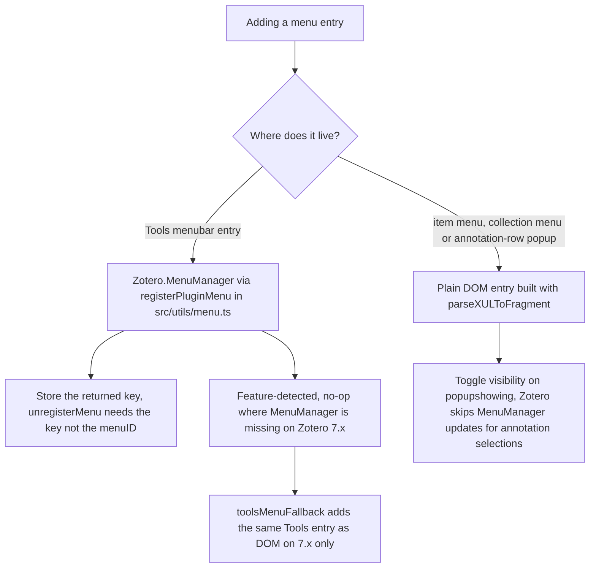

These rules come from [AGENTS.md](../AGENTS.md) and the pitfall list in
[docs/architecture.md](../docs/architecture.md). They are constraints, not
preferences — most exist because Zotero's own behavior (silent patch failures,
menu rebuilds, sandboxed pane scripts, a session-wide plugin scope) makes the
naive version fail. For how the layers themselves are wired, see
[Architecture & module layout](architecture/overview.md) and
[Feature lifecycle & registry](architecture/feature-lifecycle.md). For testing
architecture and runner execution, see
[Testing strategy](testing/strategy.md).

## Pure logic placement and imports

- Rules that must run without Zotero live in `src/features/<feature>/logic/`;
  logic needed by several features moves up to `src/core/`
  (`locator.ts`, `printDialog.ts`, `labelPopup.ts`). These modules reference no
  Zotero globals (`ztoolkit`, `addon`, `Zotero`), so they run under the Node
  test runner — [src/features/organizer/logic/outline.ts](../src/features/organizer/logic/outline.ts)
  states this in its header ("pure outline logic (no Zotero imports,
  unit-testable in Node)").
- Import style differs by zone: **Zotero-free imports carry an explicit `.ts`
  ending** so `node --test` can load them without a bundler, while
  Zotero-facing files import extensionless (esbuild resolves it). Example:
  [reader/logic/readerLocator.ts](../src/features/reader/logic/readerLocator.ts)
  imports `../../../core/locator.ts`, and
  [organizer/logic/docOutline.ts](../src/features/organizer/logic/docOutline.ts)
  imports `./outline.ts`, whereas
  [print/menus.ts](../src/features/print/menus.ts) imports `./logic/printMenuState`
  and `../../utils/locale` without a suffix.
- Every pure-logic module gets a Node test in `test-unit/`. `npm run test:unit`
  runs `node --test "test-unit/*.test.ts"`; the test files import the modules
  with the same `.ts` suffix
  ([test-unit/outline.test.ts](../test-unit/outline.test.ts)).
- Zotero tests (`test/`, Mocha in a real Zotero) reach feature modules **only
  through `addon.api`** — never by direct import, because the modules need the
  global `ztoolkit`. [src/hooks.ts](../src/hooks.ts) builds the `addon.api`
  surface in `onStartup`, and tests read it as
  `(Zotero as any)[config.addonInstance].api`
  ([test/toolsMenu.test.ts](../test/toolsMenu.test.ts)).

## Language split

The repository maintains an explicit linguistic division across documentation,
user-facing strings, and code:

- **German** is used for inline code comments in source files (`src/`),
  user-facing interface text, repository rules in `AGENTS.md`, and the user
  manual (`docs/handbuch.md`).
- **English** is used for code identifiers (function, variable, interface, class,
  and property names), log outputs (such as `ztoolkit.log` and console calls),
  and technical documentation — including
  [docs/architecture.md](../docs/architecture.md), `docs/testing.md`,
  `docs/anchors.md`, `docs/guide.md`, and wiki documentation. Log lines such as
  `menu ${opts.menuID} rejected by Zotero.MenuManager`
  ([src/utils/menu.ts](../src/utils/menu.ts)) and
  `flexannotate loadScope failed:`
  ([src/features/organizer/panel/organizerState.ts](../src/features/organizer/panel/organizerState.ts))
  follow this.
- **Fluent localization**: User-facing UI strings for menus and the preference
  pane are localized simultaneously in German (`addon/locale/de/`) and English
  (`addon/locale/en-US/`).
- **Organizer strings exception**: The organizer window constructs its DOM in
  code rather than via XUL/XHTML templates; its UI texts live in
  [src/features/organizer/strings.ts](../src/features/organizer/strings.ts) with
  explicit German and English string dictionaries instead of Fluent files.

## Window state: elements and WeakMaps

The plugin scope is global, windows are not: module objects exist once per
session, elements once per window (pitfall 11). Therefore:

- State of one interaction belongs **on the element** — an expando on the
  panel, an attribute on the popup. [src/features/print/annotationRowMenu.ts](../src/features/print/annotationRowMenu.ts)
  stores the annotation id as `data-flexannotate-annotation-id` on the popup so
  a right-click in another window cannot overwrite it.
- Per-window bookkeeping lives in a **`WeakMap` keyed by window**: the
  `popupshowing` listener of the item menu
  ([src/features/print/menus.ts](../src/features/print/menus.ts)) and the `Ctx` of each open
  organizer window ([src/features/organizer/panel/organizer.ts](../src/features/organizer/panel/organizer.ts))
  both use `WeakMap`s.
- Never use a "some window is set up" module flag; collect windows and test for
  empty.

## Menus: MenuManager keys vs DOM entries

Two mechanisms exist, and the choice is not stylistic:

1. **`Zotero.MenuManager`** via
   [src/utils/menu.ts](../src/utils/menu.ts) (`registerPluginMenu`) — for the
   main-window **menubar** ("Tools"), currently the only entry registered this
   way (the organizer's `registerMenu`). `registerMenu()` returns a **key**;
   the wrapper stores it in a `menuID → key` map and
   `unregisterAllPluginMenus()` unregisters **by that key**, because
   unregistering with the raw `menuID` finds nothing (pitfall 12). The wrapper
   feature-detects `MenuManager.registerMenu`, so on Zotero versions without it
   (7.x) the call is a silent no-op, and its `onShowing` fallback fills
   `menuElem.label` from `getString` when Fluent only set `textContent`.
2. **Plain DOM entries** built with `MozXULElement.parseXULToFragment` — for
   the **item menu** (`#zotero-itemmenu`), the **collection menu**
   (`#zotero-collectionmenu`) and the **annotation-row popup**. The reason:
   Zotero's `buildItemContextMenu()` returns for annotation selections
   *before* `Zotero.MenuManager.updateMenuPopup`, so `MenuManager` entries
   never update there, while plugin-appended DOM entries persist Zotero's menu
   rebuild (pitfall 10). Each feature therefore manages its own visibility on
   `popupshowing` — [src/features/print/menus.ts](../src/features/print/menus.ts) toggles
   its four elements from the pure `printMenuState` decision, and
   [src/features/organizer/collectionMenu.ts](../src/features/organizer/collectionMenu.ts) hides its
   item unless a collection is selected.
   [src/features/organizer/toolsMenuFallback.ts](../src/features/organizer/toolsMenuFallback.ts)
   adds the Tools entry as DOM **only** when `MenuManager.registerMenu` is
   missing (Zotero 7.x) — otherwise the entry would exist twice — and sets the
   label via the `label` attribute because Fluent sets `textContent`, which a
   XUL `menuitem` does not display (pitfall 8).

*Menu entry decision: `MenuManager` for the menubar (key-based unregistration),
DOM entries with `popupshowing` visibility for context menus, and a DOM
fallback for Zotero 7.x.*

## Fluent locale handling

- Fluent files are maintained in `addon/locale/de` **and**
  `addon/locale/en-US` at the same time; the three files (`addon.ftl`,
  `mainWindow.ftl`, `preferences.ftl`) exist in both with matching keys
  ([addon/locale/de/addon.ftl](../addon/locale/de/addon.ftl),
  [addon/locale/en-US/addon.ftl](../addon/locale/en-US/addon.ftl)).
- [src/utils/locale.ts](../src/utils/locale.ts) creates a `Localization` for
  `flexannotate-addon.ftl` in `initLocale()`, and `getString`/`getLocaleID`
  prefix every Fluent id with `flexannotate-` (`config.addonRef`); a missing
  pattern returns the prefixed id instead of throwing.
- `onMainWindowLoad` inserts `mainWindow.ftl` and `addon.ftl` into each main
  window via `MozXULElement.insertFTLIfNeeded`
  ([src/hooks.ts](../src/hooks.ts)); the preference pane needs its own
  `<linkset>` with the plugin FTL (pitfall 7).
- For color names and XUL `label` attributes use `Zotero.getString()` / the
  `label` attribute, because `data-l10n-id` sets `textContent` and a
  `<menuitem>` shows `label` (pitfall 8).

## Stable names: preferences, tags, manifest

- Preference keys live under `extensions.flexannotate.` —
  [src/utils/prefs.ts](../src/utils/prefs.ts) prefixes every key with
  `config.prefsPrefix` — and defaults are declared in
  [addon/prefs.js](../addon/prefs.js). These keys hold user data and are
  **never renamed**. The same applies to the plugin's tags: `#flexannotate-*`
  (placeholder, locator and default-locator tags), the `§` heading prefix
  (`§Title`), `★outline`, and the collection-tree tag
  `#flexannotate-outline-<collectionKey>`, which is based on the collection
  key rather than the id because the key survives sync
  ([src/features/organizer/outlineModel.ts](../src/features/organizer/outlineModel.ts)).
- `strict_max_version` in [addon/manifest.json](../addon/manifest.json) is
  mandatory on Zotero 10 — without it the plugin is dropped silently at
  manifest parsing (pitfall 9). It is currently `"10.*"`; on a new Zotero major
  it is raised and re-verified.

## Formatting, linting and commits

- **Prettier** is configured in [package.json](../package.json): 80 columns,
  2-space indent, LF line endings, and an `.xhtml` override with
  `htmlWhitespaceSensitivity: "css"`. **ESLint** comes from
  `@zotero-plugin/eslint-config` ([eslint.config.mjs](../eslint.config.mjs)),
  with `no-unused-vars` off for `*.ts` because the template ships unused
  examples. Run `npm run lint:check` before finishing; `npm run verify` runs
  lint, build, unit tests and Zotero tests in one gate.
- Commits follow **Conventional Commits** (`feat:`, `fix:`, `docs:`,
  `refactor:`, `test:`, `chore:`) and are made only on instruction. No push,
  release or tag without an explicit order.

## Documentation in the same changeset

Documentation ships with the code, not after it: changes update `README.md` and
[CHANGELOG.md](../CHANGELOG.md) in the same changeset; a change that hooks a new Zotero internal
adds the anchor to [docs/anchors.md](../docs/anchors.md); a newly discovered
pitfall goes into [docs/architecture.md](../docs/architecture.md). The README
feature matrix for Zotero before 10 is derived only from test-runner output
(`npm run test:versions`) and is refreshed after every change to a fallback.

## Docs images

`docs/img/` is produced **only** via `npm run screenshots:docs` — never edited
or added by hand; the README embeds these images. The script
([scripts/docs-screenshots.mjs](../scripts/docs-screenshots.mjs)) runs the
Zotero test suite with window captures and copies a curated list of nine PNGs
(`organizer.png`, `citation-dialog.png`, `main-window.png`, …) into `docs/img/`,
failing when the run fails or a curated file is missing.

## Patches, evidence and test isolation

- **Never touch the user's productive Zotero or Word.** Tests run in the
  isolated profile `.scaffold/test/` (`test:versions` deletes its `profile/`
  per version); no script may modify the user's Zotero, its library, or a
  running Word.
- **Prototype patches only via `assignChecked`**
  ([src/shared/patch.ts](../src/shared/patch.ts)): assign in `try`/`catch`,
  read the property back and compare identity — a silent no-op (frozen target,
  Xray expando) is otherwise indistinguishable from a successful patch. Check
  the target before patching, log a failure, and revert in `stop` /
  `removeFromWindow`. Every patch needs evidence: a test or a source anchor.
- **Zotero internals are verified only against source**, not memory: extract
  the running version's `omni.ja` into `.zotero-reference/<version>/`, and log
  every new anchor with file, lines and version in
  [docs/anchors.md](../docs/anchors.md), marking version-specific lookups as
  such.

## Registering a feature

A new feature is a `Feature` object
([src/shared/feature.ts](../src/shared/feature.ts)) added to the ordered array
in [src/hooks.ts](../src/hooks.ts): global work (patches, observers,
`MenuManager` menus, APIs on `Zotero`) in `start`/`stop`, per-window DOM in
`addToWindow`/`removeFromWindow`, both **idempotent** (check for own element
IDs; remove exactly what was added). Nothing else wires it up. Export the
module through `addon.api` so the Zotero tests can reach it.

## Lattice provenance

The organizer is a fork of **Lattice** (birugit, AGPL-3.0-or-later; base
version 4.1.0). Organizer files derived from Lattice carry the header
`Derived from Lattice (birugit, AGPL-3.0-or-later); see NOTICE.md`
([src/features/organizer/logic/outline.ts](../src/features/organizer/logic/outline.ts),
[src/features/organizer/panel/organizer.ts](../src/features/organizer/panel/organizer.ts)), and
provenance is maintained in [NOTICE.md](../NOTICE.md): keep license and
attribution notices, never invent license statements. FlexAnnotate is
AGPL-3.0-or-later unchanged; the full license text is in [LICENSE](../LICENSE).
