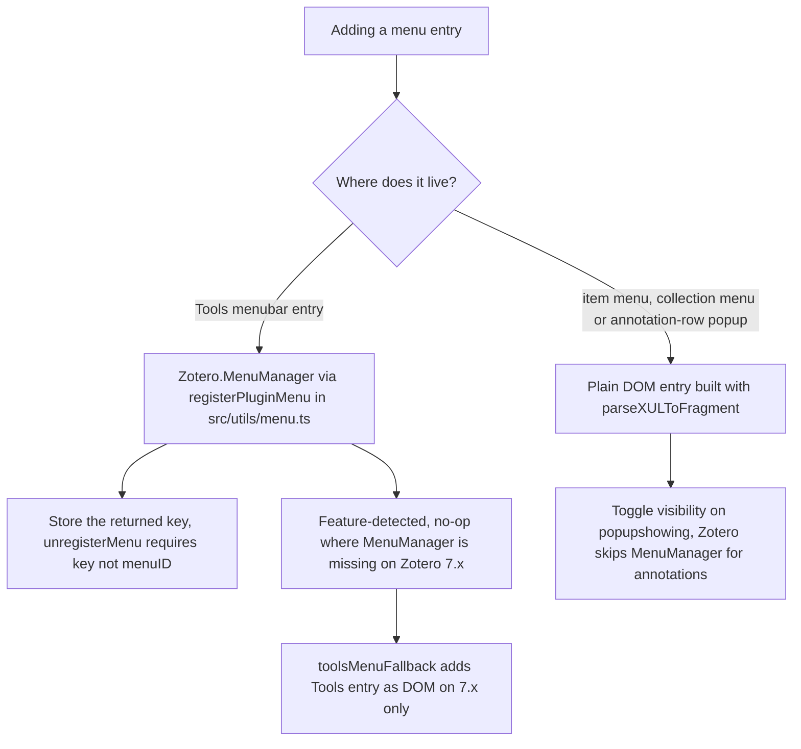

These development rules originate from [AGENTS.md](../AGENTS.md) and the architectural pitfall registry in [docs/architecture.md](../docs/architecture.md). They represent mandatory constraints rather than stylistic preferences: most exist because host quirks in Mozilla and Zotero — silent patch failures on frozen objects or Xray expandos, context-menu rebuilding that drops dynamic entries, sandboxed preference panels, and a session-wide plugin scope across multiple windows — break naive implementations.

For related architectural patterns, see [Feature Lifecycle & Registry](architecture/feature-lifecycle.md), [Monkey Patching Architecture](architecture/patching.md), [Zotero Internals](integrations/zotero-internals.md), and [Testing Strategy](testing/strategy.md).

## Testing Boundaries and Pure Logic Placement

FlexAnnotate enforces a strict boundary between host-independent business logic and Zotero runtime integration:

1. **Pure logic isolation**: Algorithms that do not require Zotero APIs live in `src/features/<feature>/logic/`. Logic shared across multiple features moves up to `src/core/` (such as `locator.ts`, `printDialog.ts`, and `labelPopup.ts`). These modules must never reference Zotero runtime globals (`ztoolkit`, `addon`, `Zotero`), ensuring they execute cleanly under the standard Node.js test runner. For example, [src/features/organizer/logic/outline.ts](../src/features/organizer/logic/outline.ts) documents this contract explicitly ("pure outline logic (no Zotero imports, unit-testable in Node)").
2. **Import style by runtime zone**:
   - **Zotero-free modules carry an explicit `.ts` extension**: Node's native ESM loader requires file extensions to load modules without a bundler. For instance, [readerLocator.ts](../src/features/reader/logic/readerLocator.ts) imports `../../../core/locator.ts`, and [docOutline.ts](../src/features/organizer/logic/docOutline.ts) imports `./outline.ts`.
   - **Zotero-facing files omit extensions**: Modules bundled by esbuild for the Zotero host import without extensions (e.g., [print/menus.ts](../src/features/print/menus.ts) imports `./logic/printMenuState` and `../../utils/locale`).
3. **Unit testing in Node**: Pure-logic modules are covered by unit tests in `test-unit/`. Running `npm run test:unit` executes `node --test "test-unit/*.test.ts"`. Unit tests import target modules using the explicit `.ts` extension ([test-unit/outline.test.ts](../test-unit/outline.test.ts)).
4. **Host integration testing through `addon.api`**: Integration tests in `test/` run Mocha inside a real Zotero process. Because feature modules depend on the global `ztoolkit` instantiated on startup, test files **must never import feature modules directly**. Instead, [src/hooks.ts](../src/hooks.ts) exposes initialized feature modules on `addon.api` during `onStartup()`, and integration tests read them as `(Zotero as any)[config.addonInstance].api` ([test/toolsMenu.test.ts](../test/toolsMenu.test.ts)).
5. **Profile isolation**: Tests must never touch the user's productive Zotero or Word installations. Test runners launch with an isolated profile in `.scaffold/test/`, and multi-version test runs (`npm run test:versions`) purge the `profile/` folder before launching each target version.

```mermaid
flowchart TD
    subgraph NODE["Pure Logic (Node Test Runner)"]
        SRC_LOGIC["src/core/ and src/features/*/logic/"]
        NODE_TEST["test-unit/*.test.ts"]
        SRC_LOGIC -->|"explicit .ts import suffixes"| NODE_TEST
        NODE_TEST -->|"npm run test:unit"| NODE_RUN["Fast isolated test execution"]
    end

    subgraph HOST["Host Integrations (Zotero Runner)"]
        SRC_HOST["src/features/*/ and src/shared/"]
        HOOKS["src/hooks.ts exports addon.api"]
        ZOTERO_TEST["test/*.test.ts inside isolated profile"]
        SRC_HOST --> HOOKS
        HOOKS -->|"consumed via addon.api only"| ZOTERO_TEST
        ZOTERO_TEST -->|"npm run test:zotero"| MOCHA_RUN["Real Zotero runtime with ztoolkit"]
    end
```

*Dual testing boundaries: Node runs pure logic with explicit `.ts` imports, while Mocha in Zotero accesses modules exclusively via `addon.api`.*

## Prototype Patching Discipline and Unpatching Invariants

Modifying runtime behavior across Zotero internals requires defensive monkey-patching:

- **`assignChecked` safety**: All prototype and host object patches must pass through `assignChecked` in [src/shared/patch.ts](../src/shared/patch.ts). In Firefox/Gecko environments, assigning a property to a frozen target fails silently outside strict mode and throws inside it; furthermore, an assignment can inadvertently land in a privileged Xray expando and vanish upon subsequent reads. `assignChecked` wraps the assignment in `try...catch`, reads the property back immediately, and verifies identity (`obj[name] === value`). If the write fails or the value does not persist, it returns `false`.
- **Target verification and error logging**: Before attempting a patch, target objects and method signatures must be checked. Any failure must be logged (via `ztoolkit.log` or `Zotero.logError`) rather than silently swallowed.
- **Strict unpatching invariants**: Every patched property or method must be cleanly reverted to its original state when the plugin stops (`stop()` on shutdown) or when a window closes (`removeFromWindow()` on window unload). Leaving patched prototypes behind breaks subsequent plugin lifecycles and tests.
- **Evidence requirement**: No internal API may be patched without concrete evidence — either an automated test proving the necessity or a verified source anchor in [docs/anchors.md](../docs/anchors.md).

For deep architectural patterns of patched subsystems, see [Monkey Patching Architecture](architecture/patching.md).

## Runtime State Containment: Elements and WeakMaps

Zotero loads the plugin script once per session, establishing a single global module scope. However, main windows, reader tabs, and citation dialogs open and close dynamically. Managing window state in module-level variables leads to cross-window pollution, stale references, and memory leaks (Pitfall 11):

- **Interaction state belongs on DOM elements**: Transient state specific to a single user interaction must be stored directly on DOM elements using element expandos or custom attributes. For example, [src/features/print/annotationRowMenu.ts](../src/features/print/annotationRowMenu.ts) sets `data-flexannotate-annotation-id` on `#flexannotate-annotation-popup` so that opening the context menu in one window cannot overwrite the target annotation in another window.
- **Per-window bookkeeping lives in `WeakMap`s**: Data structures or event listeners associated with a window must be stored in a `WeakMap<Window, T>` or `WeakMap<MainWindow, T>`. The `popupshowing` listeners in [src/features/print/menus.ts](../src/features/print/menus.ts) and the organizer window controller context (`Ctx`) in [src/features/organizer/panel/organizer.ts](../src/features/organizer/panel/organizer.ts) both use window-keyed `WeakMap`s. When a window unloads, its associated state is automatically garbage collected without manual teardown.
- **No global window flags**: Never maintain a module-level boolean flag (such as `isWindowSetup`). When checking window state, inspect `Zotero.getMainWindows()` or query element existence directly.

## Zotero Internal API Anchors and Source Verification

Because Zotero does not expose official public extension APIs for citation dialog internals, reader page mapping, or translator passes, FlexAnnotate interfaces with undocumented internals:

- **Source verification against extracted `omni.ja`**: Developers and agents must never verify Zotero internals against memory, assumption, or third-party documentation. The exact implementation must be inspected directly in `.zotero-reference/<version>/` (e.g., `7.0.32`, `8.0.4`, `9.0.6`, `10.0.1`, `10.0.5`), produced by extracting `omni.ja` from the installed application.
- **Anchor logging rules in `docs/anchors.md`**: Every undocumented internal entrypoint, DOM selector, or XPCOM property accessed by FlexAnnotate must be documented in [docs/anchors.md](../docs/anchors.md). Entries must detail:
  1. The semantic invariant or anchor behavior,
  2. The exact file path and line numbers within `chrome/content/zotero/` of `omni.ja`,
  3. The consuming FlexAnnotate file,
  4. The exact Zotero version(s) against which the code was verified, explicitly noting if an anchor was verified on one version and not yet re-checked on newer releases.
- **Function detection over version sniffing**: When interacting with APIs that changed between Zotero 7.x, 8.x, 9.x, and 10.x, code must use feature detection (e.g., checking `typeof Zotero.MenuManager?.registerMenu === "function"`) rather than brittle version comparison strings.

For reference tables of all hooked host points, see [Zotero Internals](integrations/zotero-internals.md).

## Feature and Gate Registry Architecture

Modularity and runtime safety are enforced through a declarative registry and central feature gates:

1. **Feature interface contract**: All global and window-facing capabilities implement the `Feature` interface ([src/shared/feature.ts](../src/shared/feature.ts)) with optional lifecycle hooks:
   - `start()`: Global process-level setup (registering Menus, indexes, or global observers).
   - `stop()`: Global process-level teardown (removing menus, unpatching prototypes, closing windows).
   - `addToWindow(win)`: Window-specific DOM injection and listener registration.
   - `removeFromWindow(win)`: Window-specific DOM cleanup and listener detachment.
   Both `addToWindow` and `removeFromWindow` must be strictly idempotent: they verify element existence before appending and remove only their own created elements.
2. **Central switchboard in `registry.ts`**: New features are registered as `Feature` objects in `globalFeatureEntries` or `DialogInjector` objects in `dialogInjectorEntries` in [src/features/registry.ts](../src/features/registry.ts) — **not directly in `src/hooks.ts`**. `hooks.ts` calls `activeGlobalFeatures()` and `activeDialogInjectors()` at startup to filter enabled features before invoking `startAll` and `addToWindow`.
3. **Declarative feature gates**: Every feature and runtime sub-feature is declared as a `FeatureGate` in [src/features/gates.ts](../src/features/gates.ts). Dependent features declare their prerequisite parent gates in `requires`, ensuring that disabling a parent automatically cascades to disable dependent sub-features.
4. **Hotfix overrides via preferences**: Any gate can be deactivated without a software release by setting the hidden boolean preference `extensions.flexannotate.gate.<name>` to `false` in `about:config`. Lifecycle and injector gates require a Zotero restart, while runtime sub-features take effect on the next UI action. Gate overrides are fail-open (returning `true` for unknown names) and can only turn a feature off, never force an unready feature on.
5. **Gate testing requirements**: The gate registry is guarded by unit tests ([test-unit/featureGates.test.ts](../test-unit/featureGates.test.ts) and [test-unit/featureTexts.test.ts](../test-unit/featureTexts.test.ts)) to verify that all gate names, prerequisites, preferences, and localization strings in `features.ftl` remain consistent. In addition, [test/gates.test.ts](../test/gates.test.ts) validates that every gate can be individually disabled without breaking start, stop, or organizer workflows.

For lifecycle sequencing, see [Feature Lifecycle & Registry](architecture/feature-lifecycle.md).

## Menu Architecture: MenuManager Keys vs. Plain DOM

Adding menu items in Zotero requires selecting the appropriate mechanism based on host menu rebuilding behavior:

1. **`Zotero.MenuManager` (Main-Window Menubar)**:
   - Used for the "Tools" menubar entry via `registerPluginMenu` in [src/utils/menu.ts](../src/utils/menu.ts).
   - `registerMenu()` returns a unique internal string **key**. The wrapper stores this in a `menuID → key` map because `MenuManager.unregisterMenu(key)` **must be called with this key** — attempting to unregister with the original `menuID` fails silently (Pitfall 12).
   - `registerPluginMenu` feature-detects `MenuManager.registerMenu`, remaining an effective no-op on older Zotero releases (7.x) where `MenuManager` does not exist.
2. **Plain DOM entries via `parseXULToFragment` (Context Menus)**:
   - Used for the item context menu (`#zotero-itemmenu`), the collection context menu (`#zotero-collectionmenu`), and the annotation-row context popup (`#flexannotate-annotation-popup`).
   - In Zotero's internal item tree, selecting an annotation causes `buildItemContextMenu()` to return early before calling `MenuManager.updateMenuPopup` (Pitfall 10). Consequently, `MenuManager` entries never update for annotations.
   - Plain DOM elements injected via `parseXULToFragment` persist across Zotero's internal menu rebuilds. Each feature controls its own item visibility dynamically during `popupshowing` (e.g., [src/features/print/menus.ts](../src/features/print/menus.ts) queries `printMenuState` and [src/features/organizer/collectionMenu.ts](../src/features/organizer/collectionMenu.ts) hides its item when no collection is selected).
3. **Tools menu fallback for Zotero 7.x**:
   - [src/features/organizer/toolsMenuFallback.ts](../src/features/organizer/toolsMenuFallback.ts) mounts a plain DOM `<menuitem>` into `#menu_ToolsPopup` **only** when `Zotero.MenuManager.registerMenu` is absent. This prevents duplicate Tools entries on Zotero 8.x–10.x.
   - For XUL `<menuitem>` elements, labels must be set via the `label` attribute (or `getString(id, "label")`), because Fluent's `data-l10n-id` populates `textContent`, which XUL menuitems do not render (Pitfall 8).

*Menu entry decision: MenuManager for menubar registrations, plain DOM entries with popupshowing handlers for context menus, and a DOM fallback for Zotero 7.x.*

## Fluent Localization and Bilingual Conventions

The repository maintains strict linguistic rules across code, documentation, and user interfaces ([AGENTS.md](../AGENTS.md)):

- **Bilingual language split**:
  - **English** is mandatory for code identifiers (function, variable, class, interface names), log outputs (such as `ztoolkit.log` and console calls), source code comments and inline documentation in `src/`, and technical references — including [docs/architecture.md](../docs/architecture.md), `docs/anchors.md`, `docs/testing.md`, `docs/guide.md`, and wiki documentation.
  - **German** is used for user-facing UI text, localized messages, repository instructions in `AGENTS.md`, and the user manual (`docs/handbuch.md`). German is also permitted in user-facing documentation in `docs/` and `README.md`.
- **Dual Fluent locales**: User-facing strings in `addon/locale/de/` and `addon/locale/en-US/` must be maintained simultaneously with matching message keys across all four localization files:
  1. `addon.ftl`: Core plugin dialog and action strings.
  2. `features.ftl`: Descriptions and titles for feature gates and preferences.
  3. `mainWindow.ftl`: Main window menu entries and shortcuts.
  4. `preferences.ftl`: Preference pane tab labels and option descriptions.
- **Prefixing and window injection**:
  - [src/utils/locale.ts](../src/utils/locale.ts) initializes a `Localization` instance for `flexannotate-addon.ftl`. `getString()` and `getLocaleID()` automatically prefix every Fluent identifier with `flexannotate-` (`config.addonRef`).
  - [src/hooks.ts](../src/hooks.ts) injects `mainWindow.ftl` and `addon.ftl` into each main window on load using `win.MozXULElement.insertFTLIfNeeded()`. Preference panes include their own `<linkset>` in `preferences.xhtml`.
- **Organizer strings exception**: The organizer window constructs its DOM dynamically in code rather than loading XUL or XHTML templates. Its user-facing strings live in [src/features/organizer/strings.ts](../src/features/organizer/strings.ts) as paired German and English dictionary objects (`de` and `en`) rather than in Fluent files.

## Stable Names and User Data Invariants

To guarantee backward compatibility and prevent user data loss across upgrades and sync operations:

- **Preference keys**: All configuration settings live under the root prefix `extensions.flexannotate.` (prefixed automatically by [src/utils/prefs.ts](../src/utils/prefs.ts)). Default values are defined in [addon/prefs.js](../addon/prefs.js). Preference keys hold user configuration and **must never be renamed**.
- **Plugin tags**: FlexAnnotate uses specific tag patterns to store metadata on library items. These tag identifiers are stable and must never change:
  - `#flexannotate-*`: Placeholder and locator tags.
  - `§`: Heading prefix (e.g., `§Title`) used by the outline system to track section headings.
  - `★outline`: Identifies outline notes in the item list.
  - `#flexannotate-outline-<collectionKey>`: Extra tag associating an outline note with a specific collection. It uses the collection's **key** rather than its database ID because keys survive Zotero sync and library migration ([src/features/organizer/outlineModel.ts](../src/features/organizer/outlineModel.ts)).
- **Manifest compatibility**: `strict_max_version` in [addon/manifest.json](../addon/manifest.json) is mandatory on Zotero 10; omitting it causes the application to drop the plugin silently during manifest parsing (Pitfall 9). When verifying against a new Zotero major release, `strict_max_version` must be explicitly raised and re-tested.

## Formatting, Linting, and Commits

- **Formatting**: Configured via Prettier in [package.json](../package.json): 80-column print width, 2-space indentation, LF line endings, and an `.xhtml` override with `htmlWhitespaceSensitivity: "css"`.
- **Linting**: ESLint rules are defined in [eslint.config.mjs](../eslint.config.mjs) via `@zotero-plugin/eslint-config` (with `no-unused-vars` disabled for `*.ts` files). Run `npm run lint:check` to verify compliance.
- **Verification gate**: The composite command `npm run verify` runs `lint:check`, `build`, `test:unit`, and `test:zotero`. All four checks must pass before completing work.
- **Commit style**: Commits follow Conventional Commits (`feat:`, `fix:`, `docs:`, `refactor:`, `test:`, `chore:`) and are made only on explicit instruction. Pushing to remote branches, creating releases, and adding Git tags require explicit orders.

## Documentation in the Same Changeset

Documentation is treated as an integral component of the codebase:

- Changes that alter functionality or public behavior must update `README.md` and [CHANGELOG.md](../CHANGELOG.md) in the same changeset.
- Changes that introduce hooks into undocumented Zotero internals must add an anchor entry to [docs/anchors.md](../docs/anchors.md).
- Changes that uncover new host quirks or failure modes must record them in the pitfalls list of [docs/architecture.md](../docs/architecture.md).
- The README compatibility matrix for Zotero releases prior to 10 is derived strictly from test runner results (`npm run test:versions`) and refreshed after any fallback change.

## Documentation Screenshots

Images under `docs/img/` are generated **exclusively** through automated scripts:

- Developers must never edit, crop, or create documentation images by hand.
- Running `npm run screenshots:docs` executes [scripts/docs-screenshots.mjs](../scripts/docs-screenshots.mjs), which boots Zotero in headless test mode, captures window states across tests, and copies a curated list of ten PNG images into `docs/img/`:
  - `organizer.png`
  - `citation-dialog.png`
  - `citation-dialog-native.png`
  - `citation-dialog-place.png`
  - `citation-dialog-search.png`
  - `preferences.png`
  - `preferences-features.png`
  - `main-window.png`
  - `toolbar.png`
  - `import-preview.png`
- If any curated image is missing or the screenshot run fails, the script exits with a non-zero code.

## Lattice Provenance

The FlexAnnotate organizer is derived from **Lattice** (birugit, AGPL-3.0-or-later, base version 4.1.0):

- Files derived from Lattice retain the header notice: `Derived from Lattice (birugit, AGPL-3.0-or-later); see NOTICE.md` ([src/features/organizer/logic/outline.ts](../src/features/organizer/logic/outline.ts), [src/features/organizer/panel/organizer.ts](../src/features/organizer/panel/organizer.ts)).
- Provenance, copyright notices, and license statements are documented in [NOTICE.md](../NOTICE.md). Existing copyright and license headers must be preserved, and no novel legal statements may be invented.
- FlexAnnotate itself is licensed under AGPL-3.0-or-later; the full license text is maintained in [LICENSE](../LICENSE).
