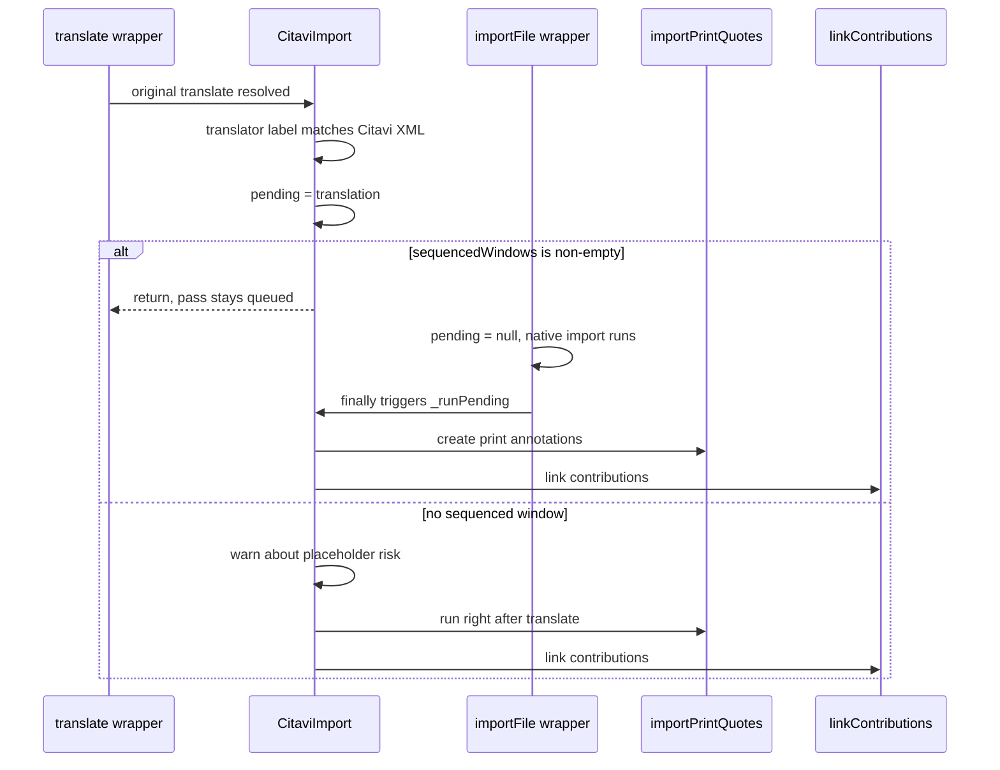
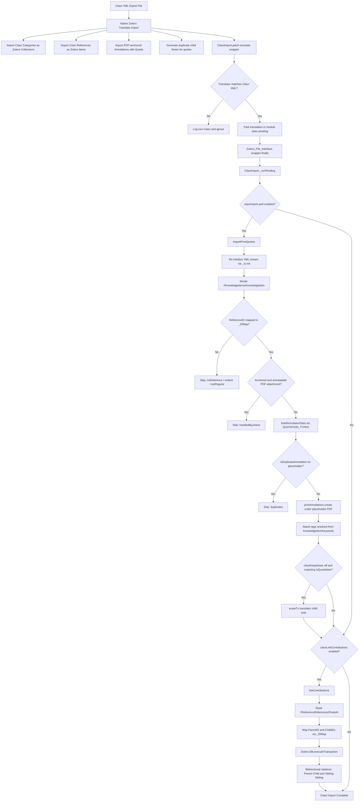

Zotero includes a built-in Citavi XML translator (`Citavi 5 XML.js` and `Citavi 6 XML.js`), but it silently drops a substantial class of quotations: the native importer traverses `//Annotations/Annotation`—nodes carrying PDF coordinates (`Quads`)—and halts processing when a bibliographic reference lacks a digital attachment (Zotero 10.0.5, `import/citavi.js:76-80`). Quotations, summaries, and comments derived from *printed* or physical sources have no `<Annotation>` elements in Citavi exports; they exist exclusively as `<KnowledgeItem>` nodes.

FlexAnnotate bridges this gap with a dedicated second-pass import architecture:
- [importPrintQuotes](../../src/features/citavi/citaviPrintQuotes.ts) converts unanchored and physical KnowledgeItems into [print annotations](print-annotations.md) anchored under a synthetic placeholder PDF attachment.
- [linkContributions](../../src/features/citavi/citaviLinks.ts) restores hierarchical relationships (essays in collections, conference proceedings, commentary contributions) to their host works via bidirectional Zotero relations—links that Zotero's translator leaves unprocessed (`translate_item.js:1081-1090` is commented out in native Zotero code).
- Category trees and keyword taxonomies are mapped into corresponding Zotero collections, tags, and [Organizer](organizer.md) outline structures, while redundant translator child notes are safely purged.

---

## Menu Entrypoints and Import Dialogs

Users import Citavi projects using Zotero's standard interface entrypoints:

1. **Main Menu: `File` → `Import...`** (or keyboard shortcut `Ctrl+Shift+I` / `Cmd+Shift+I`)  
   Launches Zotero's modal Import Wizard (`chrome://zotero/content/importWizard.xhtml`). The wizard displays a screen asking *"Where do you want to import from?"*. Selecting *"A file (BibTeX, RIS, Zotero RDF, etc.)"* advances to the system file picker, where the user selects a Citavi export file (`.xml`, `.ctv5`, or `.ctv6`). The wizard then presents import options (such as placing items and collections into a new collection folder) and proceeds to execute the file import via `Zotero_File_Interface.importFile`.
2. **Main Menu: `Edit` → `Import from Clipboard`**  
   Reads Citavi XML data directly from the system clipboard and triggers `Zotero_File_Interface.importFromClipboard`.

### Multi-Window File Interface Architecture

`Zotero_File_Interface` is not a singleton: every window that loads `fileInterface.js` creates its own independent `Zotero_File_Interface` instance ([src/features/citavi/citaviImport.ts](../../src/features/citavi/citaviImport.ts#L200-L204)). The Import Wizard dialog runs in a separate modal window (`importWizard.xhtml`), meaning patches applied solely to the primary Zotero library window never intercept wizard-driven imports.

To sequence imports across all dialogs reliably:
- `CitaviImport._watchWindows()` registers an `nsIObserver` with Mozilla's `Services.ww` listening to the `domwindowopened` notification.
- When any new window opens, a one-time `load` listener invokes `CitaviImport.addToWindow(win)`.
- `addToWindow(win)` checks for `win.Zotero_File_Interface` and wraps both `importFile` and `importFromClipboard` using the safe identity check [`assignChecked`](../architecture/patching.md).
- Active sequenced windows are tracked in module state using a `Set<Window>` (`sequencedWindows`). Using a `Set` instead of a boolean flag ensures that when the import dialog closes, `removeFromWindow(win)` removes it from the set, returning `sequencedWindows.size` to `0` when no sequenced windows remain.



_The `translate` wrapper parks the Citavi translation context; a window's patched import method redeems it in its `finally` block, falling back to direct execution if no sequenced window is registered._

---

## Entity Translation: Citavi to Zotero

Citavi and Zotero represent bibliographic data, note structures, and hierarchical relations with different data models. During an import, entities are partitioned between native Zotero translation and FlexAnnotate's second pass:

| Citavi Entity | Citavi XML Source Node | Translated Zotero Entity | Handling Subsystem | Description & Data Mapping |
| :--- | :--- | :--- | :--- | :--- |
| **Reference** | `//References/Reference` | Regular `Zotero.Item` | Native Citavi Translator | Citavi bibliographic items mapped to matching Zotero item types. Recorded in `translation._itemSaver._IDMap[CitaviRefID] = ZoteroItemID`. |
| **Category Tree** | `//Categories/Category` | Nested `Zotero.Collection` | Native Citavi Translator | Nested Citavi categories (`<ParentID>`) become a hierarchy of Zotero collections; references are filed into their respective collections. |
| **PDF Annotation** | `//Annotations/Annotation` | Native PDF `annotation` | Native Citavi Translator | Citavi annotations containing PDF coordinate `Quads` attached directly to the source item's first attachment (`getAttachments()[0]`). |
| **Print / Physical Quotation** | `//KnowledgeItems/KnowledgeItem` (unanchored or print source) | [Print Annotation](print-annotations.md) (`highlight`) | FlexAnnotate `importPrintQuotes` | Converted into a Zotero print annotation anchored under a synthetic placeholder PDF attachment with page coordinates and CSL locator tags. |
| **Translator Child Note** | `//KnowledgeItems/KnowledgeItem` | Child `note` Item | Native Citavi Translator / FlexAnnotate | Native translator creates `<h1>CoreStatement</h1><p>Text</p><i>Fundstelle</i>`. FlexAnnotate conditionally removes it if `citaviKeepNotes` is `false`. |
| **Knowledge Item Keywords** | `//KnowledgeItemKeywords/OnetoN` | Annotation `tags` | FlexAnnotate `importPrintQuotes` | Semicolon-delimited `OnetoN` entries resolved to keyword names and attached as tags to the print annotation. |
| **Anthology / Contribution Hierarchy** | `//ReferenceReferences/OnetoN` | Bidirectional `relatedItem` links | FlexAnnotate `linkContributions` | Parent-child and sibling-sibling relations linked between edited collections / commentaries and their constituent chapters. |
| **Project Outline** | Outline categories & thoughts | [Knowledge Organizer](organizer.md) Outlines | FlexAnnotate Organizer | Citavi paper outline structures mapped into outline notes (`★outline`) and section tags (`§Title`). |

---

## The Two Hook Points and Dual Patch Design

Zotero offers no formal extension API for translator post-processing. FlexAnnotate integrates into the import sequence by applying two coordinated prototype patches ([src/features/citavi/citaviImport.ts](../../src/features/citavi/citaviImport.ts)):

1. **`Zotero.Translate.Import.prototype.translate` — "Is this a Citavi import?"**  
   Installed during feature startup by `CitaviImport.patch()`, this wrapper intercepts the completion of `translate()`. After the original translation promise resolves, it checks the translator label against `/^Citavi (?:[56]) XML/i`. On a match, it parks the resolved translation instance in module state as `pending`. This translation object contains all critical context: `_itemSaver._IDMap` (mapping Citavi `ReferenceID` strings to Zotero numeric item IDs), `_io` (the raw XML stream), and `_sandboxZotero` (providing `getXML()` and XPath utilities), typed as `CitaviTranslation` in [citaviLinks.ts](../../src/features/citavi/citaviLinks.ts). Non-Citavi imports log an informational entry and exit immediately without setting `pending`.
2. **`Zotero_File_Interface.importFile` / `importFromClipboard` per window — "When does the pass run?"**  
   `CitaviImport.addToWindow(win)` wraps both methods on the active window's own import interface. Each wrapper zeroes any stale `pending` state before invoking native import logic, and invokes `CitaviImport._runPending()` inside a `finally` block—ensuring execution occurs strictly after Zotero has completed its own item persistence and PDF annotation pass (`fileInterface.js:685-686`).

---

## Why Pass Ordering is Load-Bearing

The temporal sequencing between Zotero's primary translator pass and FlexAnnotate's second pass is strictly load-bearing:

Zotero's native Citavi pass binds PDF-anchored quotations directly to the source item's first attachment via `item.getAttachments()[0]` (`import/citavi.js:82`). If FlexAnnotate were to run earlier and generate a print placeholder PDF for an item before Zotero finished processing, the placeholder could sort into index `0`. As a consequence, Zotero's genuine PDF annotations would attach to the synthetic placeholder PDF rather than the actual document.

Running inside the window import wrapper's `finally` block guarantees that Zotero's native item and attachment passes finish first. When no sequenced window is available (e.g., automated headless imports or unmonitored dialogs), `_afterTranslate` logs a clear fallback warning: *"PDF-Annotationen derselben Quellen können auf dem Platzhalter landen"*.

---

## Pass State and Lifecycle

The feature is registered under the identifier `citaviImport` in [src/hooks.ts](../../src/hooks.ts):
- `start` invokes `CitaviImport.patch()`.
- `stop` invokes `CitaviImport.unpatch()`.
- `addToWindow` and `removeFromWindow` maintain window-level sequencing.
- The interface is surfaced under `addon.api.citavi` (exposing `importer`, `feature`, `importPrintQuotes`, and `linkContributions`), which drives both integration tests and manual automation.

Patch installation enforces the strict [`assignChecked` contract](../architecture/patching.md): the target method is inspected prior to modification, assigned, and read back by identity. If an assignment does not take effect, a warning is logged and the feature remains safely disabled. Furthermore, `patch()` prevents redundant wrapping on repeated `start()` calls, allowing `unpatch()` to peel exactly one wrapper layer.

Module-level state is maintained across four structures in [citaviImport.ts](../../src/features/citavi/citaviImport.ts):

- **`pending`**: Holds the parked `CitaviTranslation` object from the most recent Citavi import. Consumed exactly once by `_runPending()`, which nulls it immediately upon entry.
- **`sequencedWindows` (`Set<Window>`)**: Tracks active windows that have wrapped `Zotero_File_Interface`. Using a `Set` rather than a boolean flag ensures that closing the last sequenced window resets the state to empty, correctly re-enabling the direct-after-translate fallback path.
- **`windowPatches` (`WeakMap<Window, {target, name, original, patched}[]>`)**: Maps each window to its replaced methods. Cleaned up automatically upon window garbage collection, and utilized by `removeFromWindow(win)` to restore original methods idempotently.
- **`translatePatch` (`{ proto, original, patched } | null`)**: Holds the original reference of `Zotero.Translate.Import.prototype.translate`.

### Execution Isolation

Inside `_runPending()`, sub-passes are decoupled and independently gated by preferences and feature gates ([src/features/gates.ts](../../src/features/gates.ts)):
- `importPrintQuotes` executes under `isFeatureEnabled("citaviPrintQuotes") && getPref("citaviImport")`.
- `linkContributions` executes under `isFeatureEnabled("citaviLinks") && getPref("citaviLinkContributions")`.

Each sub-pass runs within its own `try/catch` block. A failure in quote conversion or relation linking logs an error via `Zotero.logError` without aborting the sibling sub-pass or interrupting Zotero's already-persisted items.

---

## End-to-End Import Pipeline

The following flow diagram illustrates the end-to-end processing pipeline, showing how Citavi XML exports are ingested, split between Zotero's primary translator and FlexAnnotate's second pass, and transformed into Zotero entities:



_The end-to-end Citavi import pipeline, detailing Zotero's primary translation pass, FlexAnnotate's parked interceptor, print quote conversion, note cleanup, and contribution relation linking._

---

## Knowledge Items to Print Annotations

When `importPrintQuotes` runs ([src/features/citavi/citaviPrintQuotes.ts](../../src/features/citavi/citaviPrintQuotes.ts)):

1. Because Zotero's first pass consumed the incoming XML stream (`import/citavi.js:14`), FlexAnnotate re-initializes it by invoking `translation._io.init("xml/dom")`.
2. The parsed DOM document is retrieved from `translation._sandboxZotero.getXML()`, allowing XPath queries through `ZU.xpath` and `ZU.xpathText`.
3. The set of *anchored* knowledge item IDs is compiled from `//EntityLinks/EntityLink/SourceID`.
4. The helper `hasAnnotatableAttachment(item)` checks if the source item possesses an annotatable attachment (`attachmentReaderType && !isPlaceholder(attachment)`).
5. Unanchored quotes or quotes belonging to print works (items lacking genuine annotatable attachments) are processed through `readKnowledgeItem` and `buildAnnotationData`.

Every KnowledgeItem evaluated is categorized into explicit counters (`noReference`, `noItem`, `notRegular`, `handledByZotero`, `empty`, `duplicates`) so that a summary log line indicating `created 0` remains transparent and debuggable.

### Placeholder Attachment Creation

In Zotero's architecture, an annotation item (`type: "annotation"`) cannot exist as a direct child of a top-level bibliographic item; its parent must be an attachment item (`annotation.parentID = attachment.id`).

When creating a print annotation for an unanchored quote:
1. `importPrintQuotes` calls `printAnnotations.create(item, data)` ([src/features/print/printAnnotations.ts](../../src/features/print/printAnnotations.ts#L47-L52)).
2. `printAnnotations.create()` invokes `placeholder.ensure(item)` ([src/features/print/placeholder.ts](../../src/features/print/placeholder.ts#L47-L70)), which searches for an existing placeholder attachment using `findPlaceholder(item)`.
3. If no placeholder exists, `placeholder.create(item)` creates a synthetic single-page PDF attachment (pointing to `chrome://flexannotate/content/blank.pdf`), labeled with a localized placeholder name and tagged `#flexannotate-print-placeholder`.
4. The new annotation item is persisted under this placeholder attachment (`annotation.parentID = attachment.id`), configuring highlight type, color, page label, sort index, bounding rects (`[[0, 0, 0, 0]]`), and the locator tag (`#flexannotate-loc-<locator>`).

**The Placeholder Exclusion Check:**  
Because synthetic placeholders are valid PDF files recognized by Zotero's PDF reader, a source item that already has a placeholder attachment returns a truthy `attachmentReaderType`. In `hasAnnotatableAttachment(item)`, the condition `!isPlaceholder(attachment)` is essential. Without it, any subsequent import into an item that already owns a placeholder would mistakenly treat its quotes as handled by Zotero and skip them.

### Quotation Types and Color Mapping

`QUOTATION_TYPES` in [src/features/citavi/logic/citavi.ts](../../src/features/citavi/logic/citavi.ts#L49-L59) maps Citavi numeric `QuotationType` identifiers to Zotero annotation highlight colors and field assignments (aligned with Zotero's native color definitions in `import/citavi.js:112-140`):

| QuotationType | Citavi Semantic Type | Highlight Color | Field & Comment Distribution |
| :--- | :--- | :--- | :--- |
| **`1`** | Direct Quotation (*Wörtliches Zitat*) | `#2ea8e5` (Blue) | `<Text>` becomes annotation `text`; `<CoreStatement>` becomes annotation `comment`. |
| **`2`** | Indirect Quotation (*Indirektes Zitat*) | `#a6507b` (Purple) | **Swapped**: `<CoreStatement>` becomes annotation `text`; original `<Text>` becomes `comment`. |
| **`3`** | Summary (*Zusammenfassung*) | `#5fb236` (Green) | Identical to Type 1: quote as `text`, core statement as `comment`. |
| **`4`** | Comment (*Kommentar*) | `#ff8c19` (Orange) | Identical to Type 1: quote as `text`, core statement as `comment`. |
| **`5`** | Highlight (*Hervorhebung*) | `#ffd400` (Yellow) | Quote as `text`; `comment` dropped (`dropComment: true`). |
| **`6`** | Thought / Idea (*Kernaussage / Idee*) | `#ff6666` (Red) | Quote as `text`; `comment` dropped (`dropComment: true`). |
| *missing / unknown* | Unspecified | `#2ea8e5` (Blue) | Falls back to QuotationType 1 rules. |

If a quotation's `<Text>` element is completely empty, FlexAnnotate falls back to populating annotation `text` with `<CoreStatement>` (leaving `comment` blank). This intentional deviation from Zotero's native translator prevents the silent loss of thoughts and core statements recorded without verbatim quotes.

### PageRange: `<os>`, `<nt>`, and Locator Preferences

Citavi exports `<PageRange>` elements containing escaped XML markup: `<os>` represents the formatted display label (e.g., `12`, `12-14`, `S. 12 f.`, `XIV`), while `<nt>` specifies the numbering scheme. Raw string content reaches `parsePageRange(raw, pageRangeNumber, locatorFor)`:

- **Page Label**: Extracted from the `<os>` tag. If omitted, `PageRangeNumber` is utilized unless it equals `"-1"` (Citavi's internal sentinel indicating no page was recorded), in which case the label is set to `""` (stored by Zotero as `annotationPageLabel = null`).
- **Locator Type**: Resolved from `<nt>` using `LOCATOR_PREF_BY_NUMBER_TYPE`:

| Citavi `<nt>` Value | Configured Preference | Default CSL Locator |
| :--- | :--- | :--- |
| *(missing)* | `citaviLocatorPage` | `page` |
| `Column` | `citaviLocatorColumn` | `column` |
| `Paragraph` | `citaviLocatorParagraph` | `paragraph` |
| `Margin` | `citaviLocatorMargin` | `paragraph` |
| `Other` or unknown | `citaviLocatorOther` | `page` |

Because citation styles lack a universal CSL equivalent for margin numbers (*Randnummern*), users can configure preferences directly via the settings pane. `createLocatorResolver`:
1. Reads preference values dynamically on each invocation, ensuring configuration changes take effect without requiring a Zotero restart.
2. Falls back to `"page"` if a preference string is empty.
3. Maps unlisted `<nt>` types to `citaviLocatorOther`, logging unknown types exactly once per session to alert users without flooding console logs.

### Keyword Resolution via Exact ID Matching

Keywords associated with a KnowledgeItem are serialized in `//KnowledgeItemKeywords/OnetoN` nodes with semicolon-delimited values: `ID:…;KeywordID1:…;KeywordID2:…`. The first token represents the KnowledgeItem ID, while trailing tokens correspond to Citavi keyword IDs.

FlexAnnotate enforces exact JavaScript string equality (`splitOnetoN(text).ownerId === id`). This addresses a known bug in early translator iterations that used XPath `starts-with(@id, ...)`, which inadvertently caused item `K1` to match `K10` and attach invalid tags. Keyword names are fetched from `//Keywords/Keyword[@id=…]/Name` using `xpathLiteral(keywordId)` (which safely handles single and double quotes via XPath `concat()`). The resolved keyword names are added as tags directly on the created annotation.

### Duplicate Detection Against Placeholders

Before persisting an annotation, `importPrintQuotes` invokes `isDuplicateAnnotation(existing, candidate)` against all annotations already present on the parent item's placeholder PDF:

- An existing annotation matches if it shares the **identical page label and normalized quote text** (collapsed whitespace, stripped HTML tags, and resolved entities).
- If quote text is empty, the normalized comment is compared instead.
- If quote text is populated, differences in comments are ignored—ensuring user edits made to annotation comments after import do not cause duplicate creation upon subsequent imports.
- Created keys are pushed into `existingByItem` in memory, deduplicating identical quotes within the same XML export.

Consequently, re-importing an identical Citavi XML export creates zero duplicate annotations (`created: 0, duplicates: N`). However, if an existing quotation's page number is altered in Citavi, re-importing creates a new annotation reflecting the updated page coordinate.

### Conditional Translator Note Removal

For quotations it processes, Zotero's translator creates a redundant child note formatted as:
```html
<h1>CoreStatement</h1>
<p>Text</p>
<i>Fundstelle</i>
```
When `extensions.flexannotate.citaviKeepNotes` is set to `false` (the default), FlexAnnotate deletes this duplicate note via `note.eraseTx()`. To prevent accidental data loss:
- `isQuoteNote(noteHtml, item)` requires the normalized plain text of the note to begin strictly with `CoreStatement + Text`.
- The trailing portion of the note must satisfy `isPageTail(tail)`: it must not exceed `MAX_NOTE_TAIL = 60` characters and must consist exclusively of digits, whitespace, and hyphens (`^[\s\d–-]*$`). Notes containing alphabetical text in the tail represent user comments and are left untouched.
- Deletion is performed only when an annotation is newly created, never when skipped as a duplicate.

---

## Categories and Category Trees

Citavi projects organize knowledge hierarchically using two core structures:
1. **Bibliographic Categories (`<Categories>`)**: A nested category tree structuring topics and works (`<Category id="...">...<ParentID>...</Categories>`).
2. **Knowledge Categories and Keywords**: Associating knowledge items with topics and index tags.

### Mapping to Zotero Collections and Tags

During an import, Citavi structural elements are apportioned between native Zotero entities and FlexAnnotate layers:

- **Category Trees → Zotero Collections**: Zotero's primary translator converts Citavi's category hierarchy directly into nested Zotero collections. Citavi references assigned to a category are placed into the corresponding collection.
- **Keywords → Annotation Tags**: Citavi keywords linked to individual quotations are resolved by FlexAnnotate and attached as tags to the resulting print annotations (and Zotero items).
- **Idea Layers → [Organizer](organizer.md) Outlines**: Citavi's characteristic workflow of organizing thoughts and quotations into paper outlines is supported in FlexAnnotate through the Knowledge Organizer. Rather than forcing outline hierarchies into rigid folder collections, the Organizer uses dedicated outline notes (tagged with `★outline` and `#flexannotate-outline-<collectionKey>`) where sections correspond to item tags prefixed with `§Title`.

---

## Contribution Linking via `ReferenceReferences`

Citavi projects frequently contain multi-part works such as essay collections, conference proceedings, edited volumes, and legal commentaries, where individual contributions (`Contribution`, `ContributionInLegalCommentary`) belong to a parent container work.

Citavi encodes these groupings in `//ReferenceReferences/OnetoN` elements formatted as:
```
ParentCitaviID;ChildCitaviID1;ChildCitaviID2;ChildCitaviID3
```
Because the native Zotero translator comments out contribution linking (`translate_item.js:1081-1090`), imported chapters remain disconnected from their host works.

[linkContributions](../../src/features/citavi/citaviLinks.ts) processes these records:
1. Re-initializes the XML stream via `translation._io.init("xml/dom")`.
2. Resolves Citavi IDs to Zotero numeric IDs using `translation._itemSaver._IDMap`.
3. Validates that parent and child items exist as regular Zotero items.
4. Generates bidirectional `relatedItem` links:
   - Between the parent host work and each child contribution.
   - Among all sibling contributions within the same group.
5. Persists all relationship updates within a single `Zotero.DB.executeTransaction` using `skipDateModifiedUpdate: true`.
6. Skips pairs that are already related (`item.addRelatedItem()` returning `false`), logging unresolved parent or child counts (`noParent`, `noChild`, `sameItem`).

---

## Pure Logic in `logic/citavi.ts`

To maintain clean separation between DOM/database operations and parsing routines, all pure algorithms reside in [src/features/citavi/logic/citavi.ts](../../src/features/citavi/logic/citavi.ts):

- **Constants**: `QUOTATION_TYPES`, `LOCATOR_PREF_BY_NUMBER_TYPE`, and `MAX_NOTE_TAIL`.
- **Text Normalization**: `normalizeText()` (whitespace collapsing) and `stripMarkup()` (stripping tags and decoding XML/HTML entities, with `&amp;` resolved last so sequences like `&amp;lt;` decode correctly).
- **Note Validation**: `isPageTail()` and `isQuoteNote()`.
- **Page & Locator Parsing**: `parsePageRange()` and `createLocatorResolver()`.
- **OnetoN Splitting & Keyword Resolution**: `splitOnetoN()`, `resolveKeywords()`, and `xpathLiteral()`.
- **Deduplication & Data Shaping**: `isDuplicateAnnotation()` and `buildAnnotationData()`.

External dependencies are injected via interfaces (`PrefGetter` for reading preferences, callback functions for resolving keyword names and reporting unknown number types). Consequently, `logic/citavi.ts` executes in standalone Node.js environments and is thoroughly tested by [test-unit/citavi.test.ts](../../test-unit/citavi.test.ts) without requiring an active Zotero runtime.

---

## Configuration Preferences

Citavi import behavior is governed by preferences under `extensions.flexannotate.` in [addon/prefs.js](../../addon/prefs.js):

| Preference Key | Default | Function and Operational Effect |
| :--- | :--- | :--- |
| `citaviImport` | `true` | Enables the second import pass (`importPrintQuotes`) converting physical KnowledgeItems into print annotations. |
| `citaviLinkContributions` | `true` | Enables `linkContributions`, creating bidirectional Zotero relations between host works and contributions. |
| `citaviKeepNotes` | `false` | When `false`, deletes redundant translator child notes for newly imported print annotations. When `true`, preserves notes. |
| `citaviLocatorPage` | `"page"` | Fallback CSL locator used when `<nt>` is missing from `<PageRange>`. |
| `citaviLocatorColumn` | `"column"` | CSL locator assigned to Citavi `<nt>Column</nt>`. |
| `citaviLocatorParagraph` | `"paragraph"` | CSL locator assigned to Citavi `<nt>Paragraph</nt>`. |
| `citaviLocatorMargin` | `"paragraph"` | CSL locator assigned to Citavi `<nt>Margin</nt>` (margin numbers / *Randnummern*). |
| `citaviLocatorOther` | `"page"` | CSL locator assigned to unknown `<nt>` numbering types. |

If both `citaviImport` and `citaviLinkContributions` are set to `false`, `_afterTranslate` terminates early before inspecting the translator label, eliminating overhead for non-Citavi operations.

---

## Verification and Testing

Citavi import logic is verified across both unit and integration suites:

- **Unit Suite ([test-unit/citavi.test.ts](../../test-unit/citavi.test.ts))**: Tests pure logic in isolation under Node.js:
  - `parsePageRange`: Evaluates single pages, page ranges, display strings (`S. 12 f.`, `XIV`), missing `<os>` fallback, `-1` suppression, locator overrides, and unknown-type reporting.
  - `isPageTail` & `isQuoteNote`: Validates note acceptance and boundary criteria.
  - `buildAnnotationData`: Confirms field swapping for indirect quotes, comment suppression for types 5/6, and fallback for empty quotes.
  - `splitOnetoN` & `resolveKeywords`: Guarantees exact owner ID matching, testing specifically against `K1`/`K10` collision edge cases.
  - `xpathLiteral`: Verifies escaping for strings containing single, double, or mixed quotes.
  - `isDuplicateAnnotation`: Tests page label matching, text normalization, comment fallback, and post-import comment edit tolerance.

- **Integration Suite ([test/citavi.test.ts](../../test/citavi.test.ts))**: Runs inside a real Zotero runtime using synthetic Citavi XML fixtures (`FIXTURE`) and a mock translation object (`fakeTranslation`):
  - Confirms print annotation creation for unanchored quotes and verifies skip counters (`handledByZotero`, `noItem`, `empty`).
  - Tests duplicate suppression across consecutive import runs (`created: 0, duplicates: 2`).
  - Validates that modifying a page number creates a new annotation on the updated page.
  - Checks conditional translator note deletion when `citaviKeepNotes` is toggled.
  - Verifies contribution linking across host and sibling items (asserting 3 bidirectional relations across a 2-child group).
  - Verifies patch idempotency (`patch()` tolerates double `start()` calls; `stop()` cleanly restores originals).
  - Asserts window sequencing registration and cleanup on `addToWindow` and `removeFromWindow`.

---

## Related Pages

- [Data Model](../architecture/data-model.md) — Zotero item hierarchies, relation links, and attachment data structures.
- [Print Annotations](print-annotations.md) — The placeholder PDF attachment and custom annotation locator mechanisms utilized by print quotes.
- [Knowledge Organizer](organizer.md) — The Citavi-style outline view, heading tags (`§Title`), and outline notes.
- [Prototype Patching](../architecture/patching.md) — The `assignChecked` contract and safe monkey-patching conventions.
- [Testing Strategy](../testing/strategy.md) — The separation between pure Node.js unit tests and full Zotero integration suites.
