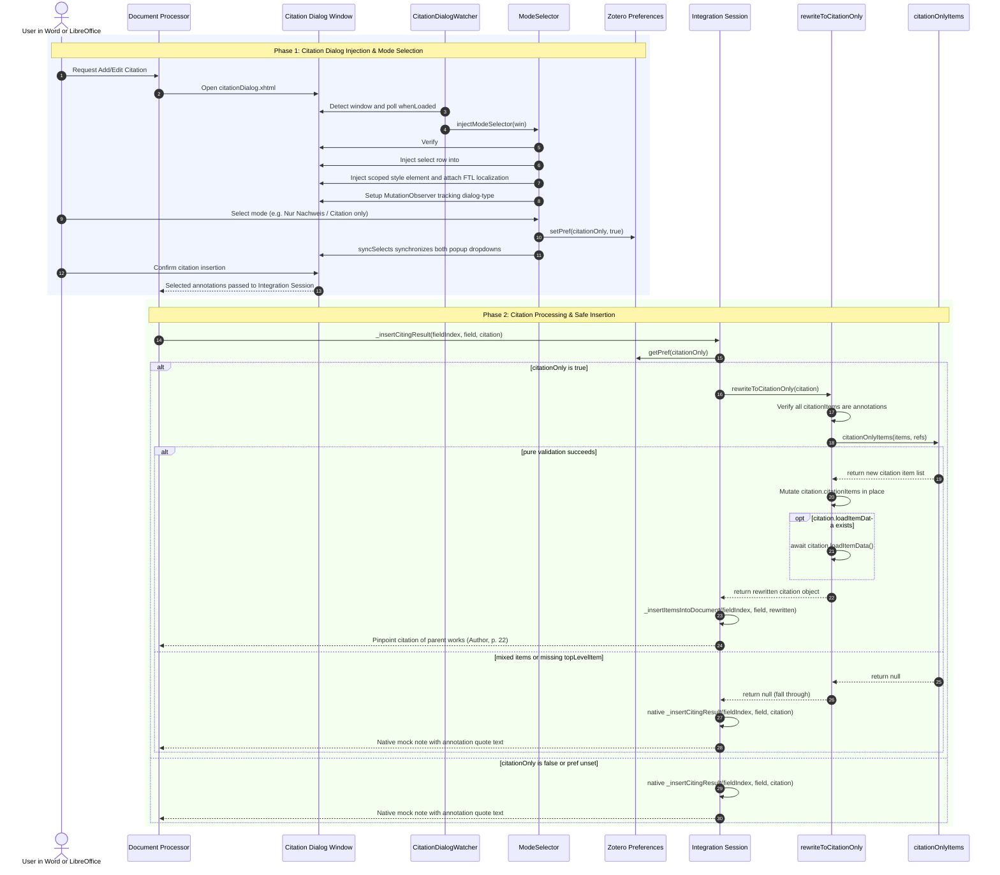
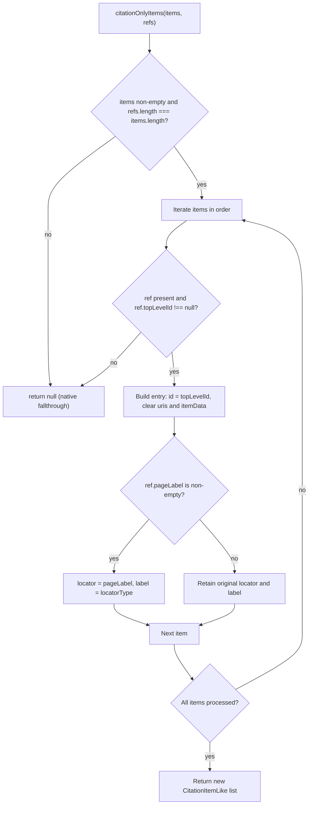

In Zotero's Word and LibreOffice integration, inserting cited annotations natively diverts execution into a mock note via `_insertCitingResult` (`xpcom/integration.js:1678–1701`, verified against Zotero 10.0.5 in [docs/anchors.md](../../docs/anchors.md)) — pasting the annotation's quote text directly into the word processor document. 

Cite-only mode ("Nur-Nachweis-Zitieren") provides academic citation without text quotations: when every cited item is an annotation with a valid, citable top-level work and the `citationOnly` preference is enabled, the plugin rewrites the citation payload in place to reference each annotation's parent item (the work) and passes the annotation's page label as the pinpoint locator. The document receives a standard reference citation (e.g., "Author 2024, p. 22") through Zotero's normal insertion pipeline `_insertItemsIntoDocument()` (`xpcom/integration.js:1778–1785`), bypassing note creation entirely.

The feature is organized across three primary components:

- [integrationPatch.ts](../../src/features/citeOnly/integrationPatch.ts) — the safe prototype patch on `Zotero.Integration.Session.prototype`, runtime feature detection, and Zotero-facing in-place citation rewriting;
- [logic/citeOnly.ts](../../src/features/citeOnly/logic/citeOnly.ts) — the pure, zero-dependency decision function `citationOnlyItems` (Node unit-testable);
- [modeSelector.ts](../../src/features/citeOnly/modeSelector.ts) — the UI injection adding the "Full annotation / Citation only" ("Vollnachweis / Nur Nachweis") selector dropdown into the Word/LibreOffice citation picker dialog.

## Citation Dialog Injection and Citation Processing

The end-to-end citation lifecycle spans two distinct phases: UI injection and mode selection in the citation dialog window, followed by execution of the patched citation insertion pipeline in the active integration session.


_End-to-end sequence of citation dialog injection, preference persistence, and safe insertion processing in Word and LibreOffice integration._

## The Mode Selector in the Citation Dialog

The citation mode selector in [src/features/citeOnly/modeSelector.ts](../../src/features/citeOnly/modeSelector.ts) is implemented purely via DOM injection into the integration dialog window (`chrome://zotero/content/integration/citationDialog.xhtml`), never by modifying or monkey-patching dialog JavaScript prototypes.

### Injection Points and Dialog Structure

Registration occurs in [src/hooks.ts](../../src/hooks.ts), where `modeSelector` is registered as a dialog injector before the outline view:

```ts
citationDialog.registerDialogInjector({
  name: "modeSelector",
  inject: modeSelector.injectModeSelector,
  detach: modeSelector.removeModeSelector,
});
```

The shared citation dialog watcher in [src/shared/citationDialog.ts](../../src/shared/citationDialog.ts) monitors window creation using `Services.wm`. Once `(win as any).DIALOG_STATE?.loaded` evaluates to true, the watcher executes `injectModeSelector(win)`.

`injectModeSelector` targets two injection points provided by the citation dialog DOM:

1. **The settings popup (`#settings-popup .popup`):** inserted next to Zotero's native "include comments" checkbox.
2. **The item-details popup (`#itemDetails .popup`):** inserted immediately before the `.buttons` container using `detailsPopup.insertBefore(row, buttons)` so that standard actions ("Remove", "Show in library", "Done") remain pinned to the bottom of the popup.

Each injection point receives an `.hbox.flexannotate-citation-mode-row` containing a localized label and a `<select>` with options `"full"` (`flexannotate-dialog-mode-full`) and `"citation"` (`flexannotate-dialog-mode-citation`).

### State Persistence and Synchronization

Selection state is backed by the boolean preference `extensions.flexannotate.citationOnly`:

- When the row is built, `select.value` initializes from `getPref("citationOnly") ? "citation" : "full"`.
- A `change` event listener on each `<select>` invokes `setPref("citationOnly", select.value === "citation")`.
- `syncSelects(doc, select.value)` iterates over all `select.flexannotate-citation-mode` elements in the document and mirrors the new value, keeping both the settings popup and the item-details popup synchronized.
- Changes update the central preference store immediately, synchronizing seamlessly with the settings pane in [addon/content/preferences.xhtml](../../addon/content/preferences.xhtml).

### Idempotency, Styling, and Localization

- **Idempotency:** Before creating rows, `injectModeSelector` checks `doc.querySelector(".flexannotate-citation-mode-row")`. If elements already exist, injection aborts immediately.
- **Styling:** Injected elements receive styling via a single `<style id="flexannotate-citation-dialog-style">` appended to `doc.head`. CSS styles conform to Zotero's design tokens (`var(--material-button)`, `var(--material-border)`, `var(--fill-primary)`, `var(--fill-quinary)`) and use `appearance: none` with custom padding to ensure cross-platform visual consistency in dark and light themes.
- **Localization:** The dialog document does not inherently load plugin Fluent bundles. `localize(doc, rows)` attaches the plugin's Fluent resource via `doc.l10n.addResourceIds(["flexannotate-addon.ftl"])` and translates rows using `l10n.translateFragment(row)`. If localization fails, an inline German/English fallback dictionary configures row text directly (`"Vollnachweis"` / `"Full annotation"`, `"Nur Nachweis"` / `"Citation only"`).

### Dynamic Visibility and Zotero 9+ Gating

- **Zotero 9+ Gating:** Zotero 8 and earlier lack an annotation mode in the citation dialog (on Zotero 7.x, the file is named `addCitationDialog.xhtml`). `injectModeSelector` immediately checks `doc.getElementById("annotations-sidebar")`; if absent, injection is skipped. Integration tests verify this boundary via `hasAnnotationDialog()` ([test/helpers.ts](../../test/helpers.ts)).
- **Tracking `dialog-type` Changes:** Zotero's `citationDialog.js` adjusts `[data-dialog-type]` visibility only during internal mode-switching routines. Because the plugin injects after initial dialog load, `trackDialogType(win, rows)` sets `row.hidden = !isAnnotations` based on `doc.documentElement.getAttribute("dialog-type") === "annotations"`. It then attaches a `MutationObserver` filtering for the `dialog-type` attribute. Observers are stored in a `WeakMap<Window, MutationObserver>()`.
- **Teardown:** `removeModeSelector(win)` disconnects and deletes the window's `MutationObserver`, removes all `.flexannotate-citation-mode-row` elements, and deletes the injected `<style>` tag.

## Safe Prototype Patching in `integrationPatch.ts`

To intercept citation generation from Word and LibreOffice, FlexAnnotate patches the integration session prototype in [src/features/citeOnly/integrationPatch.ts](../../src/features/citeOnly/integrationPatch.ts).

### The Hook Point: `_insertCitingResult`

In native Zotero, `Zotero.Integration.Session.prototype._insertCitingResult` handles citations containing annotations by creating a mock note and passing the note content into the document. In cite-only mode, the plugin intercepts this call and routes the rewritten citation to the normal reference insertion method `_insertItemsIntoDocument(fieldIndex, field, citation)`.

`insertAnnotations` is deliberately **not** a patch point: in Zotero's architecture, it exists only on `Zotero.EditorInstance` (the note editor), never on `Integration.Session`.

### Safe Installation via `assignChecked`

The patch conforms to FlexAnnotate's strict [patching contract](../architecture/patching.md):

1. **Target Pre-Checking:** `patch()` verifies that both `_insertCitingResult` and `_insertItemsIntoDocument` exist as functions on `Zotero.Integration.Session.prototype`. If either is missing, it logs a descriptive warning (`"Nur-Nachweis-Zitieren (citeOnly) bleibt deaktiviert"`) and returns `false`.
2. **Closure Capture:** The original function `native = proto._insertCitingResult` is captured in the wrapper's lexical closure. It is not read dynamically from module state at call time, preventing null-dereference crashes if `unpatch()` runs during an active invocation.
3. **Atomic Assignment & Verification:** `assignChecked(proto, "_insertCitingResult", patched)` writes the wrapper and immediately reads back the property. If the write fails or is swallowed by Gecko Xray expandos, the patch aborts and returns `false`.
4. **Idempotency Guard:** A module-level `installed: { proto, native } | null` pointer tracks installation. A repeated call to `patch()` exits early without wrapping twice.
5. **Restoration on Teardown:** `unpatch()` clears `installed = null` *before* calling `assignChecked(proto, "_insertCitingResult", native)` to restore the original method safely.
6. **Loud Failure Policy:** Registered as `citeOnlyPatch` in [src/hooks.ts](../../src/hooks.ts), its `start()` method throws an error if `patch()` fails:
   ```ts
   if (!patch()) {
     throw new Error("citeOnlyPatch: _insertCitingResult patch not active");
   }
   ```
   This ensures failed patches are logged loudly by the [feature lifecycle](../architecture/feature-lifecycle.md) registry rather than silently leaving citations broken.

### Live Preference Checking and Fault-Tolerant Fallback

The patched wrapper re-evaluates `getPref("citationOnly")` on **every call**. Changing the preference in the citation dialog or preferences window takes effect immediately on the next citation without re-patching.

The wrapper executes within a `try / catch` boundary:

```ts
try {
  if (getPref("citationOnly")) {
    const rewritten = await rewriteToCitationOnly(citation);
    if (rewritten) {
      return [
        await this._insertItemsIntoDocument(fieldIndex, field, rewritten),
      ];
    }
  }
} catch (e) {
  Zotero.logError(e as Error);
}
return native.call(this, fieldIndex, field, citation);
```

If an unhandled error occurs during rewriting or insertion, it is logged via `Zotero.logError` and execution falls through to the native implementation. The user's word processor insertion is never halted or crashed.

### In-Place Mutation vs. Cloning

`rewriteToCitationOnly(citation)` mutates `citation.citationItems` in place and returns the original citation instance. 

The citation object **must not be cloned**: cloning creates a plain JavaScript object that loses `Zotero.Integration.Citation.prototype`, causing subsequent calls like `citation.serialize()` to fail inside the integration session.

Because mutating the live citation object affects downstream consumers, mutation occurs only after complete validation:
1. `citation.citationItems` is verified as a non-empty array.
2. Every item resolves via `Zotero.Cite.getItem(ci.id)` to an item where `item.isAnnotation()` is true.
3. The pure decision function `citationOnlyItems` returns a valid, non-null list.

Once `citation.citationItems = items` is assigned, `if (typeof citation.loadItemData === "function") await citation.loadItemData();` is awaited to ensure parent metadata is fully loaded before the session serializes the field.

## The Pure Decision Engine: `citationOnlyItems`

The core data transformation in [src/features/citeOnly/logic/citeOnly.ts](../../src/features/citeOnly/logic/citeOnly.ts) is isolated into a pure decision function:

```ts
export function citationOnlyItems(
  items: CitationItemLike[],
  refs: (AnnotationRef | null)[],
): CitationItemLike[] | null
```

By decoupling data transformation from Zotero XPCOM globals, the decision logic is tested under the standard Node test runner in [test-unit/citeOnly.test.ts](../../test-unit/citeOnly.test.ts).


_Decision flow in citationOnlyItems: any condition violation returns null, falling back to vanilla Zotero citation behavior._

### Decision Rules and Rejection Cases

`citationOnlyItems` returns `null` (triggering fallback to native `_insertCitingResult`) under any of the following conditions:

| Condition | Cause and Architectural Behavior |
| --------- | -------------------------------- |
| `items.length === 0` | Empty citation payload; nothing to rewrite. |
| `refs.length !== items.length` | Mismatched reference array; caller resolution defect. |
| Any `refs[i] === null` | Mixed selection containing non-annotation items (regular works or notes). |
| Any `refs[i].topLevelId === null` | Annotation has no citable top-level work (e.g., orphan attachment or standalone note). |

### Output Entry Construction

When all conditions are met, `citationOnlyItems` returns a **new array** without mutating its input items:

1. **Top-Level Reference:** `id` is replaced with `ref.topLevelId`.
2. **Metadata Cleared:** `uris` and `itemData` are explicitly cleared (`undefined`) because they described the annotation rather than the cited parent work.
3. **Pinpoint Locators:** If `ref.pageLabel` is non-empty, `locator` is assigned `ref.pageLabel` and `label` is set to `ref.locatorType`. If `ref.pageLabel` is empty, the original `locator` and `label` properties are retained without modification.
4. **Ordering & Multi-Work Preservation:** Original array ordering is maintained, correctly mapping multiple annotations from different parent works to their respective parents.

### Building `AnnotationRef` and Resolving Locators

The caller ([integrationPatch.ts](../../src/features/citeOnly/integrationPatch.ts)) constructs an `AnnotationRef` for each annotation via `refOf(annotation)`:

- `topLevelId`: Derived from `annotation.topLevelItem`. If `top.isRegularItem()` is false or missing, `topLevelId` is set to `null` and logged via `ztoolkit.log`.
- `pageLabel`: Extracted from `annotation.annotationPageLabel`.
- `locatorType`: Resolved via [`getLocator(annotation)`](../../src/features/print/printAnnotations.ts) only when `pageLabel` is present (a locator type is meaningless without a pinpoint value).

As documented in [Print Annotations](print-annotations.md) and the [Data Model](../architecture/data-model.md), `getLocator` evaluates locator tags in priority order:
1. Annotation tag: `#flexannotate-locator-<type>`.
2. Attachment default tag: `#flexannotate-default-locator-<type>`.
3. Fallback: `"page"`.

For non-standard print sources (such as legal commentaries or classical texts), the locator may resolve to CSL types such as `paragraph`, `section`, or `column`.

## Configuration and Preferences

The feature's configuration is managed through a single preference:

- **Key:** `extensions.flexannotate.citationOnly`
- **Default:** `false` (declared in [addon/prefs.js](../../addon/prefs.js))
- **Preferences UI:** Bound declaratively in [addon/content/preferences.xhtml](../../addon/content/preferences.xhtml):
  ```xml
  <checkbox
    id="flexannotate-pref-citation-only"
    data-l10n-id="prefs-citation-only"
    preference="extensions.__addonRef__.citationOnly"
    native="true"
  />
  ```
- **Live Access:** Read dynamically via `getPref("citationOnly")` in [src/utils/prefs.ts](../../src/utils/prefs.ts) on every invocation of `_insertCitingResult`. Written directly via `setPref("citationOnly", boolean)` by the citation dialog mode selector.

## Verification and Testing

Testing spans unit, integration, and UI layers:

- **Pure Decision Unit Tests ([test-unit/citeOnly.test.ts](../../test-unit/citeOnly.test.ts)):**
  - Asserts `citationOnlyItems` returns `null` for empty inputs, length mismatches, mixed selections, and missing `topLevelId`.
  - Verifies parent item rewriting, clearing of `uris` and `itemData`, and setting `locator` to `"22"` and `label` to `"page"`.
  - Verifies tag resolution priority (`locatorOf`) using document defaults and annotation overrides.
  - Verifies empty `pageLabel` handling, mixed page labels across multiple works, and input immutability.
- **Integration Patch Tests ([test/citeOnly.test.ts](../../test/citeOnly.test.ts)):**
  - Driven via `addon.api.citeOnly` (with `patch` and `isPatched`) in a live Zotero instance.
  - Asserts `patch.start()` replaces `_insertCitingResult`, repeated `patch.start()` avoids duplicate wrapping, and `patch.stop()` restores the original function identity.
  - Executes a synthetic insertion with `citationOnly` set to `true`, verifying that the output cites the parent work with `locator: "22"` and `label: "page"`.
- **Mode Selector UI Tests ([test/modeSelector.test.ts](../../test/modeSelector.test.ts)):**
  - Gated to Zotero 9+ via `hasAnnotationDialog()`.
  - Verifies injection of one row per injection point (`#settings-popup` and `#itemDetails`), removal via `removeModeSelector`, and idempotent re-injection.
  - Asserts that changing the `<select>` triggers the `citationOnly` preference round-trip and synchronizes all dialog selects.
