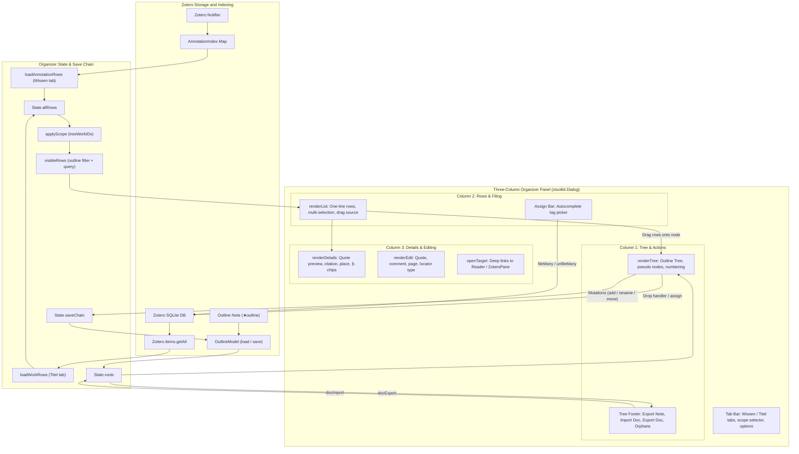
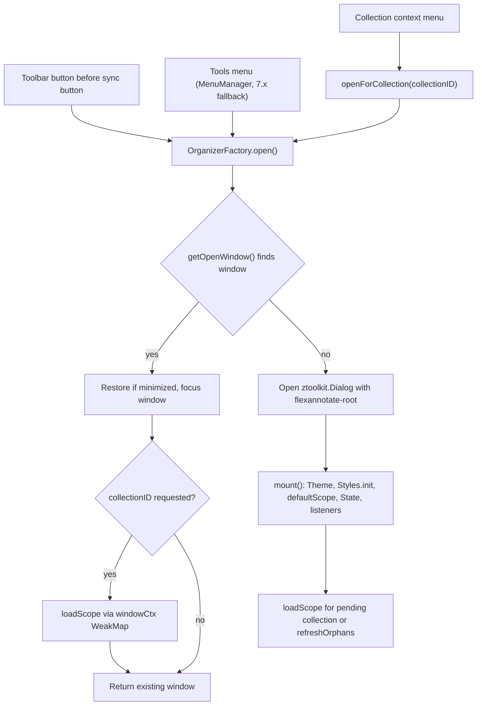
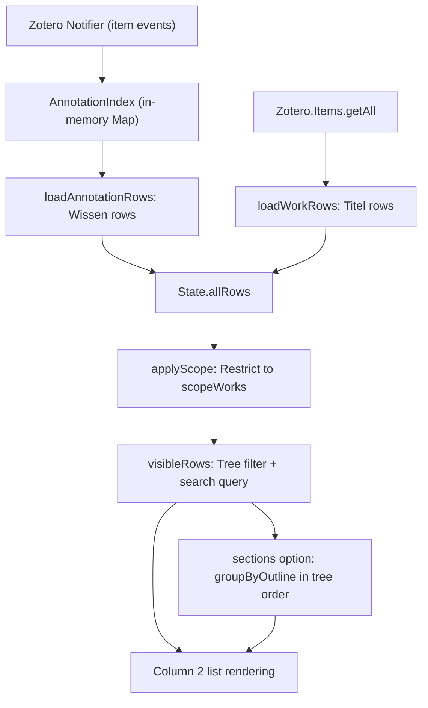
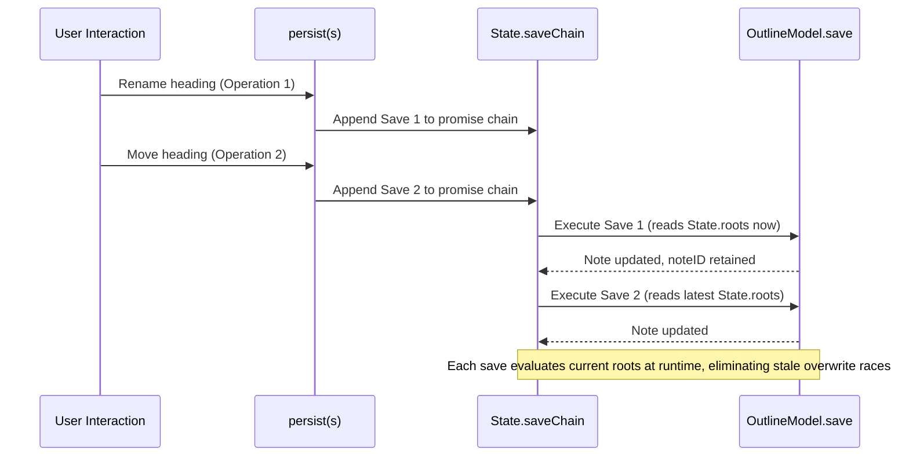
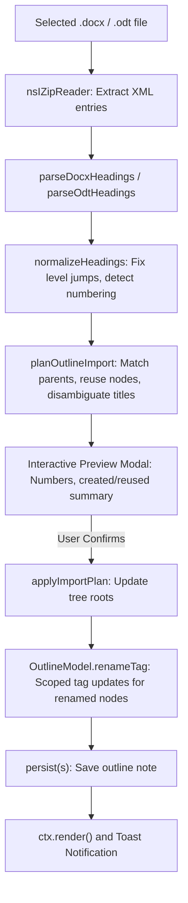
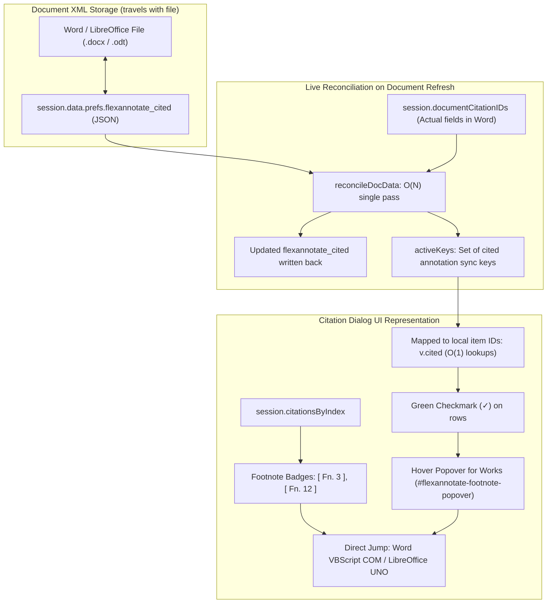
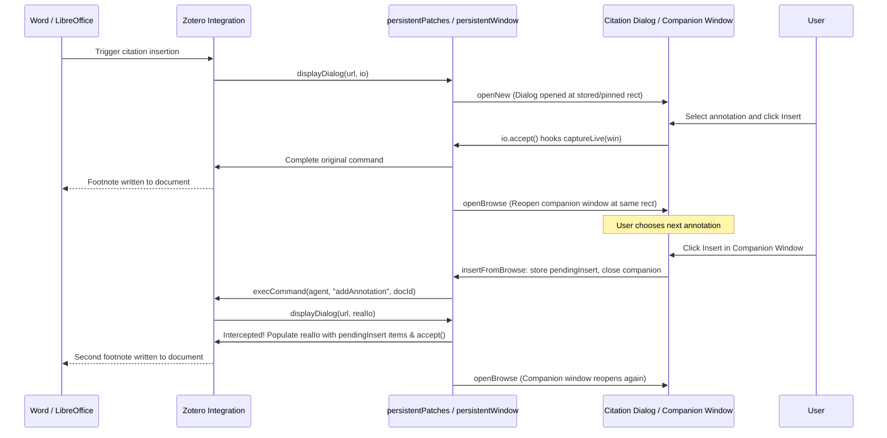

The Organizer is FlexAnnotate's three-column window for structuring document outlines and filing library items under each heading: column 1 displays the outline tree (with the pseudo-nodes `(Alle)` and `(Ohne Kategorie)`), column 2 lists one-line rows — annotations or whole works — with a permanent assign bar, and column 3 presents the selected row's details, citation formatting, category chips, and inline editor. Two tabs switch the row kind: **Wissen** (annotations) and **Titel** (works). A heading *is* a Zotero tag (`§` + title) and the outline tree persists as JSON in a standalone Zotero note, ensuring that filing is tagging and all organization syncs seamlessly across devices (see [Data Model](../architecture/data-model.md)).

The window is constructed entirely in code (`ztoolkit.Dialog` and DOM builders in [organizerDom.ts](../../src/features/organizer/panel/organizerDom.ts)). Its user-facing strings live in [strings.ts](../../src/features/organizer/strings.ts) with dual German and English dictionaries rather than Fluent files — the sole deliberate exception to the repository's Fluent localization split.

Beyond the standalone window, the organizer subsystem encompasses an injected outline view in Zotero's citation dialog, a persistent companion window ("Blätterfenster") for side-by-side writing in Microsoft Word and LibreOffice Writer, cross-session document-bound citation tracking with live footnote badges and direct field jumps, and bidirectional outline import/export for `.docx` and `.odt` files.

## Provenance: Lattice Fork and AGPL-3.0 Attribution

The Organizer descends from the Zotero plugin **Lattice** (`zotero-grounded-qa` by birugit), forked at version 4.1.0 (commit `8d75041`) under the **GNU Affero General Public License, version 3 or later (AGPL-3.0-or-later)**. FlexAnnotate maintains this license unchanged. Attribution details and upstream provenance are recorded in [NOTICE.md](../../NOTICE.md), and the complete Git history of Lattice is retained in the repository under the `upstream` remote.

From Lattice, the module inherited:
- The **knowledge-organizer concept**: section headings represented as `§`-prefixed Zotero tags, and outline trees stored as JSON inside a note tagged `★outline`.
- The cross-paper **annotation index** and "all annotations" retrieval patterns.
- Annotation citation and export helpers.

FlexAnnotate deliberately made major architectural changes:
- **Removed**: Lattice's AI question-answering features over PDFs (LLM API integrations) and the ideas layer (`★idea` notes).
- **Added**: The three-column desktop window layout, unified filing of both works and annotations via multi-selection and drag-and-drop, the preference to show works in the annotation view, collection-scoped outline trees with orphaned tag reconciliation, document import and export (`.docx`/`.odt`), the citation dialog outline view for both annotations and works/items tabs, the persistent taskbar companion dialog ("Blätterfenster"), and document-wide cited-tracking with live footnote badges and direct jumps.
- **Attribution & Compatibility**: Files derived from Lattice carry the header `Derived from Lattice (birugit, AGPL-3.0-or-later)`. The persisted format (`§` tags, `★outline` notes, and the `LATTICE-OUTLINE-V1` sentinel) remains backwards-compatible so outline data can be read by both systems.

## Component Architecture and Data Flow

The Organizer panel coordinates multiple stateful and stateless components spanning database persistence, in-memory caches, UI columns, and external document workflows.



## Entry Points and Window Management

Four entry points open the Organizer, all funneling into `OrganizerFactory.open()` in [organizer.ts](../../src/features/organizer/panel/organizer.ts):

1. **Toolbar button** ([toolbarButton.ts](../../src/features/organizer/toolbarButton.ts)): Parsed XUL inserted into `#zotero-tabs-toolbar` immediately *before* Zotero's sync button (`#zotero-tb-sync`), styled using `-moz-context-properties` and `context-fill`. If the sync button is absent, it attaches to the end of the toolbar.
2. **Tools menubar** (`OrganizerFactory.registerMenu()`): Registered through `registerPluginMenu` as `zotero-tools-flexannotate-organizer` on `main/menubar/tools` via `Zotero.MenuManager`.
3. **Tools fallback for Zotero 7.x** ([toolsMenuFallback.ts](../../src/features/organizer/toolsMenuFallback.ts)): If `MenuManager.registerMenu` is unavailable, a plain DOM `menuitem` is added to `#menu_ToolsPopup` with its text assigned via the `label` attribute (because Fluent sets `textContent`, which XUL menuitems ignore).
4. **Collection context menu** ([collectionMenu.ts](../../src/features/organizer/collectionMenu.ts)): An entry in `#zotero-collectionmenu` that is dynamically hidden on `popupshowing` unless an actual collection is selected, opening via `openForCollection(col.id)`.



### Single-Window Enforcement

`OrganizerFactory.open()` guarantees that at most one Organizer window exists per Zotero process. `getOpenWindow()` checks the cached `currentWindow` if alive and holding `#flexannotate-root`, falling back to enumerating windows via `Services.wm.getEnumerator("")`. If found, the window is un-minimized and focused. If a specific `collectionID` was requested, the existing window is re-scoped by looking up its per-window `Ctx` in `OrganizerFactory.windowCtx` (a `WeakMap<Window, Ctx>`). A WeakMap keyed by `Window` is used rather than a module-level variable because plugin scopes are process-global while window objects have independent lifecycles.

### Mounting and Document Listeners

`OrganizerFactory.mount()` initializes window state once during dialog loading:
1. Applies theme styling (`getTheme`) and calls `Zotero.Styles.init()` (CSL locales are needed for citation locators).
2. Establishes `defaultScope()` from the main window's currently selected library and collection (`includeSub: true`).
3. Loads the outline tree (`OutlineModel.load`) and initial rows (`loadAnnotationRows`), constructing the central `State` record.
4. Registers the window's `Ctx` in `windowCtx`.
5. Attaches document-level listeners that survive re-renders: `keydown` for shortcut handling ([organizerKeys.ts](../../src/features/organizer/panel/organizerKeys.ts)), and a capture-phase `mousedown` listener that tracks active column focus (`data-col`), closes dropdown menus (`data-menu`), and commits open inline renames when clicking outside.
6. Calls `renderAll()`, followed by `loadScope()` for pending collections or `refreshOrphans()` for the library outline.

## Window State and Re-Render Lifecycle

Window state is centralized in a single `State` record in [organizerState.ts](../../src/features/organizer/panel/organizerState.ts). It stores `libraryID`, `noteID`, `roots`, `collectionKey`, active tab (`wissen` or `titel`), `allRows` and collection-scoped `rows`, `scope`/`scopeWorks`, current selection (`sel`), node filter, keyword `query`, boolean preferences (`showWorks`, `showCommentsInRows`), `saveChain`, `saveLog`, orphan tags, and transient UI flags (renaming, editing, column focus).

All sub-panels receive a `Ctx` object exposing `doc`, `root`, `s`, and two callback actions:
- `render()`: Redraws the entire interface.
- `confirm(win, title, text)`: Replaceable modal confirmation dialog (swappable during automated testing).

Rendering is a **complete rebuild** executed by `renderAll()` in [organizerView.ts](../../src/features/organizer/panel/organizerView.ts):
1. Snapshots scroll positions for all elements with `data-scroll`.
2. Clears the DOM root and rebuilds the tab bar and the 3-column CSS grid (`300px minmax(300px, 1fr) 360px`).
3. Derives `visibleRows(s)` and prunes invalid selection IDs with `prune()`.
4. Renders tree, list, and details panels into their respective column containers (`c1`, `c2`, `c3`).
5. Appends the orphan tags overlay if `s.orphanOpen` is true, and preserves any active import preview modal.
6. Restores all column scroll positions from the recorded snapshot.

## The Row Pipeline: Indexing, Scoping, and Filtering



### Annotation Index and Work Rows

- **Wissen rows** (annotations): Sourced from [annotationIndex.ts](../../src/features/organizer/annotationIndex.ts). The index lifts all annotations across an entire library into an in-memory `Map<number, AnnRecord>`. `build(libraryID)` retrieves all IDs via `getAll(..., asIDs)` and batch-hydrates them with `getAsync()`. A Zotero `Notifier` observer registered on startup in [registry.ts](../../src/features/registry.ts) keeps the index updated incrementally: `delete` and `trash` drop IDs, while `add` and `modify` re-hydrate annotations belonging to the active library. `loadAnnotationRows()` maps index records into `Row` items, evaluating CSL locators (`locatorOf`), document default tags, and read-only flags (`!item.isEditable()`).
- **Titel rows** (works): Sourced from `Zotero.Items.getAll(libraryID, true, false)` to fetch top-level regular items, sorted by title.
- **Search integration**: `OutlineModel.itemsWithTag`, `gather`, and `buildCountMap` deliberately merge `AnnotationIndex` results into Zotero's native tag queries because native Zotero tag searches omit annotation items.

### Scoping and Filtering

- `applyScope()` restricts rows to `scopeWorks`: `loadScopeWorkIDs()` gathers all item IDs within the selected collection and its subcollections. An annotation belongs to the scope if its parent work is in `scopeWorks`. A `null` scope represents the entire library.
- `visibleRows()` evaluates the active outline tree selection:
  - `(Alle)`: Returns all rows in scope.
  - `(Ohne Kategorie)`: Uses `unassignedItems()` to find rows carrying no `§`-tags matching the current tree.
  - A specific heading: Uses `itemsUnder()` to match items tagged with the heading or any of its subheadings.
- A case-insensitive text query filters across title, quote, comment, and author byline.
- When the "Zwischentitel" (sections) toggle is enabled, `groupByOutline()` arranges rows under section headings matching the outline order.

## Outline-Ordered Tag Suggestions (`tagSuggest`)

In standard Zotero, tag autocomplete in the reader popup or item pane relies on the `@mozilla.org/autocomplete/search;1?name=zotero` service (`ZoteroAutoComplete.prototype.startSearch`), which sorts matching tags strictly alphabetically via SQL (`ORDER BY val COLLATE locale LIMIT 50`).

The `tagSuggest` feature ([tagSuggest.ts](../../src/features/organizer/tagSuggest.ts), [logic/tagSuggest.ts](../../src/features/organizer/logic/tagSuggest.ts)) intercepts autocomplete searches that start with `§`:
1. Non-`§` queries pass through untouched to Zotero's native search implementation.
2. For `§` queries, `candidates()` queries the library database for all `§`-prefixed tags not yet present on the current item.
3. `treeHeadingsOf()` resolves the topmost collection of the active item and loads its outline tree (or falls back to the library outline).
4. `suggestRows()` sorts the candidates matching the user's input strictly according to the hierarchical outline order, appending decimal numbers (e.g. `§Introduction (1)` or `§Background (1.1)`).
5. A search sequence counter (`seq`) ensures that fast keystrokes cancel obsolete searches and never return out-of-order suggestions.

## Tag-Based Filing and Tree Operations

Filing items in the Organizer is synonymous with adding Zotero tags. Section headings correspond to tags with the prefix `§` (e.g., `§Introduction`).

### Assigning and Unassigning

Filing operations in [organizerFiling.ts](../../src/features/organizer/panel/organizerFiling.ts) (`assign`, `unassign`) call `fileMany` and `unfileMany`:
- Batches are executed within a single `Zotero.DB.executeTransaction()`.
- Read-only items (such as annotations created by other members in a group library) and items already carrying the target tag are automatically skipped.
- In-memory rows are patched immediately using the returned set of modified IDs, and a toast reports any skipped items.
- Heading titles must be unique across the entire tree (`titleError` check) because duplicate titles would share the same `§`-tag.

Filing occurs via two interactions:
- **Drag-and-drop**: List rows are draggable. `dragstart` serializes the selection (excluding read-only items) as JSON under the custom MIME type `text/x-flexannotate-ids`. Dropping onto a tree node assigns the heading tag to all items in the payload.
- **Assign bar and multi-selection**: The bar above Column 2 offers an autocompleting heading picker and an unassign button. Click, Ctrl-click, and Shift-click multi-selection is handled purely in [logic/selection.ts](../../src/features/organizer/logic/selection.ts). Pressing `Delete` while focusing the list column unassigns selected rows from the active category.

### Details and Editing

Column 3 ([organizerDetails.ts](../../src/features/organizer/panel/organizerDetails.ts)) displays:
- The full annotation text in a color-coded blockquote, user comments, and citation place (`placeOf`).
- Source citation line (`citationFor`), which formats using the user's Quick Copy style or falls back to standard "Author (Year). Title".
- Category chips displaying calculated decimal numbering, with an "also in tree" hint when a work exists in multiple collection trees.
- Deep links via [openTarget.ts](../../src/features/organizer/openTarget.ts): Double-clicking opens annotations in the PDF reader (`Zotero.Reader.open(attachmentID, { annotationID: key })`) or highlights works in `ZoteroPane.selectItem`.
- Inline editing ([organizerEdit.ts](../../src/features/organizer/panel/organizerEdit.ts)): Modifies an annotation's quote text, comment, page label, and locator type (persisted into the `#flexannotate-locator-*` tag scheme via `locatorTagChanges`).

## Outline Persistence and Tree Synchronization

### Outline Storage Format

The outline tree is stored as a standalone Zotero note tagged `★outline`. The note contains a `<pre><code>` block containing the JSON payload `{ v: 1, roots: [...] }` immediately following the `LATTICE-OUTLINE-V1` sentinel, accompanied by an HTML outline list for human readability:
- `parseOutline()` extracts and parses only the JSON payload, gracefully tolerating both `</code>` and `</pre>` tag terminations.
- Collection-specific outlines reside on separate notes distinguished by an additional tag: `#flexannotate-outline-<collectionKey>`. The sync-stable collection key is used rather than the local integer collection ID.
- When multiple outline notes are found, `pickNewest()` selects the newest by `dateModified`, breaking ties with the highest item ID.
- Notes are created via `saveTx({ skipSelect: true })`, preventing Zotero's built-in note editor from opening the note and inadvertently writing stale content over Organizer changes.

### Serialized Save Chain

To prevent race conditions during rapid user edits (such as renaming a heading immediately followed by moving a node), outline persistence runs through an asynchronous queue on `State.saveChain`:



Every save operation is logged to `State.saveLog` (capped at 30 entries). If a save fails, the error is recorded without breaking the promise chain. Switching scopes via `loadScope()` also queues through `saveChain`, ensuring prior writes finish on the former note before a new note is loaded or created.

### Anchor Tags and Note Heading Synchronization

Whenever an outline note is saved or loaded:
- `syncAnchorTags()`: Every heading title in the tree is tagged on the outline note itself as a `§`-tag. This ensures Zotero's tag autocomplete populates heading tags in the PDF reader even before any item has been filed under them. `anchorTagDiff` makes this operation an idempotent no-op when the tag set is unchanged. Outline notes are excluded from item counts via `isOutlineNote()`.
- `syncNoteHeading()`: Updates the note's leading `<h1>` header to `📚 FlexAnnotate — <label> — <scope name>`, making outline notes identifiable in the main library item list.

### Scoped Tag Boundaries and Scope Handling

Because Zotero tags are library-global, tree-modifying operations (`renameTag`, `purgeTag`) take a `TagScope`:
- For collection trees, the scope is restricted to `treeWorkIDs` (items in the topmost collection and its descendants resolved via `topmostCollection()`).
- For the library tree, the scope is unrestricted (`null`).
This prevents renaming or deleting a heading in one collection tree from accidentally altering items filed under a similarly named heading in another collection tree. When opening a collection for the first time without an existing outline note, `loadScope` prompts the user whether to clone the library outline as a starting point.

### Orphan Tag Reconciliation

If items were tagged or renamed outside FlexAnnotate, orphaned tags may exist. After each `reload` and `loadScope`, `refreshOrphans()` scans for tags matching `§*` within the tree scope that have no corresponding heading in `State.roots`:
- If orphans are detected, an indicator button appears in the Column 1 tree footer.
- Clicking opens `orphanOverlay` ([organizerOrphans.ts](../../src/features/organizer/panel/organizerOrphans.ts)).
- Users can assign an orphaned tag to an existing heading (triggering a scoped `OutlineModel.renameTag`) or purge it from all items (triggering a scoped `purgeTag` after confirming the affected item count).

## Document Import/Export and Outline Synchronization

FlexAnnotate supports importing and exporting document outlines to and from Word (`.docx`) and LibreOffice Writer (`.odt`) files. The parsing and transformation logic is purely functional ([docOutline.ts](../../src/features/organizer/logic/docOutline.ts), [docExport.ts](../../src/features/organizer/logic/docExport.ts)), while Zotero integration, ZIP I/O, file pickers, and UI dialogs live in [docImport.ts](../../src/features/organizer/doc/docImport.ts) and [docExport.ts](../../src/features/organizer/doc/docExport.ts).

### DOCX / ODT Import Pipeline

Importing an outline is an **append-merge** operation: existing headings and filed items are never deleted or moved.



1. **ZIP Extraction and XML Scanning**:
   - `readHeadings()` opens the file via `nsIZipReader`. If the file is locked by Word or Writer, `IOUtils.read` detects that it is in use and reports a clear error.
   - Extracts `word/document.xml` and `word/styles.xml` for DOCX, or `content.xml` for ODT, enforcing a safety limit of `MAX_ENTRY_BYTES = 50 MB`.
   - `parseDocxHeadings()` tokenizes the XML, mapping paragraphs styled with `w:pStyle` (`Heading1`–`Heading9`, `Überschrift1`–`Überschrift9`) or explicit `w:outlineLvl` values to heading levels. Deleted text inside `w:del` or `w:rDel` is excluded.
   - `parseOdtHeadings()` processes `text:h` tags, evaluating `outline-level` attributes while ignoring footnotes (`text:note`) and deletions (`text:deletion`).
2. **Level Normalization & Numbering Detection**:
   - `normalizeHeadings()` guarantees that level hierarchies contain no gaps: the first heading is forced to level 1, and subsequent headings never exceed `previousLevel + 1`.
   - Detects manual numbering prefixes (such as `1.`, `1.1`, `A.`, `I.`, `a)`, `(1)`) using regular expressions. If manual numbering appears in at least 80% of all headings (or 50% of level-1 headings with at least two level-1 entries), `numberingDetected` is set to true.
   - If `stripNumbering` is active, manual prefixes are stripped to avoid redundant numbers when the Organizer dynamically computes decimal numbering.
3. **Planning the Append-Merge**:
   - `planOutlineImport()` computes an `ImportPlan` (`ops`, `created`, `reused`, `renamed`):
   - A heading is reused (`kind: "reuse"`) only if a node with matching normalized title already exists under the *same parent*.
   - If no match exists, a new node is planned (`kind: "create"`). If the title conflicts with a heading elsewhere in the tree, a numerical suffix is appended (e.g., `Title (2)`) to ensure global title uniqueness.
   - If an existing node had a manual number that is now stripped, an update is planned, recording `oldTitle` and `title`.
4. **Preview Overlay and Execution**:
   - `showPreview()` opens an accessible modal dialog in the Organizer displaying the count of headings to create, reuse, and rename, with a live checkbox to toggle numbering removal.
   - `computePlanNumbers()` calculates the projected decimal numbering (e.g. `1.1.2`) for each entry in the preview list.
   - Upon confirmation, `OutlineModel.renameTag` updates all existing `§`-tags for headings whose titles changed, `applyImportPlan()` merges the new nodes into `State.roots`, and `persist(s)` queues saving the outline note.

### DOCX / ODT Export Pipeline

Outline trees can be exported directly into Word or LibreOffice Writer documents:
- **File Picker**: `pickSaveFile()` invokes Zotero's `FilePicker` module in save mode, allowing the user to select either `.docx` or `.odt`.
- **DOCX Generation** (`buildDocxParts`): Creates a complete Open Packaging Conventions (OOXML) package:
  - `word/document.xml`: Paragraphs with style tags `Heading1` through `Heading9`.
  - `word/styles.xml`: Definitions for `Heading1`–`Heading9` inheriting from `Normal`, bound to outline levels 0–8.
  - `word/numbering.xml`: Defines a 9-level multilevel numbering scheme (`%1.%2.%3...`), tying each heading level to dynamic decimal numbering in Word.
  - `[Content_Types].xml`, `_rels/.rels`, and `word/_rels/document.xml.rels`.
- **ODT Generation** (`buildOdtParts`): Creates an OpenDocument package containing `content.xml`, `styles.xml`, and `META-INF/manifest.xml`. The `mimetype` file (`application/vnd.oasis.opendocument.text`) is stored uncompressed (`COMPRESSION_NONE`) as the first ZIP entry, satisfying the ODF specification.
- **ZIP Writing**: `writeZip()` uses `nsIZipWriter` to assemble the archive. After writing, a toast offers an action button that opens the document in the default application via `Zotero.launchFile()`.

## Refactored Citation Dialog Subsystem (`citationDialog/`)

The citation dialog subsystem under `src/features/organizer/citationDialog/` provides deep integration with Zotero's citation insertion interface:

```text
src/features/organizer/citationDialog/
├── citationJump.ts          Direct jump to word processor fields (Word COM / UNO)
├── citationShared.ts        Session helpers and jump execution state
├── citedToggle.ts           Color and styling constants
├── citedTracking.ts         Document-bound cited data persistence & reconciliation
├── dialogCited.ts           Facade re-exporting cited-tracking and jump APIs
├── dialogOutline.ts         Outline view injection, keyboard, search & scope picker
├── dialogOutlineLayout.ts   Three-column CSS, native column hiding, narrow layout
├── dialogOutlineRender.ts   Outline tree, list, preview renderers and insert routine
├── dialogPersistent.ts      Facade re-exporting persistent companion window APIs
├── footnoteChips.ts         Clickable footnote badges and hover popovers
├── persistentFeature.ts     persistentDialogPatch feature lifecycle definition
├── persistentPatches.ts     execCommand, CitationEditInterface, and progress patches
├── persistentPinning.ts     Window geometry pinning, chrome calculation, stored bounds
├── persistentState.ts       Shared companion window state, options, and agents
├── persistentTestHooks.ts   Test helpers and synthetic io factories
└── persistentWindow.ts      Window lifecycle, makeBrowseIo, and insertFromBrowse
```

### Outline View for Works and Annotations

The citation dialog outline view ([dialogOutline.ts](../../src/features/organizer/citationDialog/dialogOutline.ts), [dialogOutlineRender.ts](../../src/features/organizer/citationDialog/dialogOutlineRender.ts), [dialogOutlineLayout.ts](../../src/features/organizer/citationDialog/dialogOutlineLayout.ts)) transforms Zotero's native dialog into an outline browser:

1. **Annotations Mode** (`dialog-type="annotations"`):
   - **Section Grouping**: Grouped via `buildDialogSections()`. If "Werke in Annotationsansicht" is enabled, annotations inherit section tags from their parent works.
   - **Layout**: Left column shows headings with counts, middle column lists items under the heading, and right column (`#flexannotate-preview`) shows quote, comment, and citation preview.
   - **Insertion**: Clicking "+" on an outline row or pressing Enter triggers `insert(win, ids)`. FlexAnnotate creates a temporary native `<annotation-row>` inside `#annotations-list`, triggers its native `.zotero-clicky-plus` click handler, and cleans up the node — ensuring Zotero's standard annotation insertion logic executes untouched.
2. **Works / Items Mode** (`dialog-type="citation"`):
   - **Works Section Grouping**: Grouped via `buildWorkDialogSections()`. Regular items are organized by `§`-tags, with unfiled items in "Ohne Kategorie".
   - **Layout**: The preview column is omitted to maximize space for library items.
   - **Insertion**: `insert(win, ids)` retrieves items with `Zotero.Items.get(id)` and calls `(win as any).IOManager.addItemsToCitation(works)`.
   - **Mode Switching from Quick Copy**: If opened in Quick Copy mode (`currentLayout?.type === "list"`), enabling the outline view automatically switches to classic library mode by awaiting `(win as any).IOManager.toggleDialogMode("library")`.
3. **Collection Scope Picker**: A custom dropdown above the tree column (`#flexannotate-dialog-scope-picker`) allows switching between the whole library and collections (resolved via `topmostCollection`). The selection is saved in `dialogOutlineCollection`.
4. **Search Synchronization**: The native search bar (`#bubble-input`) is mirrored one-way into the outline list: `bubble-input` dispatches `handle-input` (`detail.query`) on every keystroke, which filters outline items without altering native search state.

### Double-Click Insertion and Prefix/Suffix Handling

- **Double-Click Insertion**:
  - In the outline view row list, double-clicking any row (`dialogOutlineRender.ts`) immediately adds the row (or all currently selected rows if part of a multi-selection) to the citation:
    ```ts
    d.addEventListener("dblclick", (e) => {
      e.stopPropagation();
      const ids = v.sel.selected.has(r.id) ? [...v.sel.selected] : [r.id];
      void insert(win, ids);
    });
    ```
  - In the native annotations sidebar (`dialogOutline.ts`), double-clicking an `<annotation-row>` automatically clicks its `.zotero-clicky-plus` button.
- **Prefix / Suffix Handling** ([modeSelector.ts](../../src/features/citeOnly/modeSelector.ts)):
  - In vanilla Zotero, `PopupsHandler.openItemDetails` aborts early when in annotations mode, hiding prefix and suffix fields.
  - FlexAnnotate attaches a `show-details-popup` / `popupshowing` listener: when an annotation bubble is clicked in the search bar, it reveals `#itemDetails`, unhides `#prefix` and `#suffix` inputs (while keeping the locator input hidden, since annotation locators are fixed), and focuses `#prefix`.
  - It patches `Helpers.buildBubbleString` so that custom prefix and suffix values (with romanized punctuation spacing rules) render directly on the annotation bubble.

## Document-Wide Cited-Tracking and Word Processor Field Jump

FlexAnnotate implements Citavi-style document-wide citation tracking that indicates whether an annotation or work has already been cited in the document via green checkmarks (`✓`), live footnote badges, and direct navigation jumps to the word processor field ([docs/cited-tracking.md](../../docs/cited-tracking.md), [citedTracking.ts](../../src/features/organizer/citationDialog/citedTracking.ts), [citationJump.ts](../../src/features/organizer/citationDialog/citationJump.ts), [footnoteChips.ts](../../src/features/organizer/citationDialog/footnoteChips.ts)).



### Storage Location in Word Document Variables

Rather than storing cited state in local preferences (which are volatile and lost across restarts, machines, or co-authors), FlexAnnotate stores cited data directly inside the document XML properties:
- Zotero persists integration preferences as `<pref name="..." value="..."/>` elements inside document properties (`ZOTERO_PREF_1` etc.).
- FlexAnnotate serializes citation data under the key `flexannotate_cited`:
  ```json
  {
    "citations": {
      "c_K8X29PLA": ["ANN_KEY_1"],
      "c_M4B11ZZR": ["ANN_KEY_2", "ANN_KEY_3"]
    }
  }
  ```
- **Sync-Stable Keys**: Uses Zotero's stable 8-character sync keys (`item.key`), ensuring identical tracking across machines even if local SQLite IDs differ.
- **Co-Author Safe**: Native Zotero passes unknown `<pref>` elements through untouched, preventing data loss when co-authors without FlexAnnotate edit the file.
- **Pre-Generated Citation IDs**: In `integrationPatch.ts`, `citation.citationID` is pre-populated with `Zotero.Utilities.randomString()` before insertion, binding the citation ID immutably to the document field.

### Automatic Reconciliation on Footnote Deletion

When footnotes are deleted in Word or LibreOffice:
1. Whenever the citation dialog opens or the document refreshes, Zotero repopulates `session.documentCitationIDs`.
2. `reconcileDocData()` performs a single $\mathcal{O}(N)$ pass over `docData.citations`. If a `citationID` is no longer present in `session.documentCitationIDs`, the footnote was deleted and is removed from the store.
3. If an annotation was only cited in that deleted footnote, its key disappears from the active set and its green checkmark is extinguished.
4. The cleaned data is written back to `session.data.prefs.flexannotate_cited`.

### Live Footnote Badges and Hover Popover

Footnote numbers in academic manuscripts change continuously as earlier citations are inserted or removed. FlexAnnotate extracts footnote numbers live from `session.citationsByIndex` rather than storing static numbers:
- `citation.properties.noteIndex` provides the current 1-based index of the footnote or endnote (`noteIndex === 0` for in-text styles).
- `buildCitationLocationsMap` and `buildWorkCitationLocationsMap` link annotation keys and work IDs to `CitationLocation` objects sorted by footnote number.
- **Annotation Preview Column**: Displays clickable badges under the source line (e.g. `[ Fn. 3 ]`, `[ Fn. 12 ]`, or `[ Text ]`).
- **Work Tab Hover Popover** ([footnoteChips.ts](../../src/features/organizer/citationDialog/footnoteChips.ts)): Because the works tab omits the preview sidebar to preserve space, hovering over the green checkmark renders a fixed-position floating popover (`#flexannotate-footnote-popover`) containing interactive jump chips. It is positioned via `getBoundingClientRect()` to prevent clipping and closes on scroll or mouse exit.

### Direct Field Jump in Word and LibreOffice

Clicking a footnote chip or popover button invokes `jumpToCitation` in [citationJump.ts](../../src/features/organizer/citationDialog/citationJump.ts):

1. **Windows Word COM Script (`flexannotate-jump-word.vbs`)**:
   Zotero's native Windows integration C++ library (`libzoteroWinWordIntegration.dll`) leaves `selectField` as a no-op stub. Furthermore, once an insertion transaction completes in the companion window, Word's C++ COM pointer is released (`complete()` already called). FlexAnnotate executes a minimal VBScript via `wscript.exe`:
   - Connects directly to Word via `GetObject(, "Word.Application")`.
   - Locates the document and selects the footnote range via `targetDoc.Footnotes.Item(noteIndex).Range.Select` (or searches `StoryRanges` for in-text citations).
   - Scrolls the document to the field via `ScrollIntoView` and selects the citation field.
   - Restores Word and brings it to the foreground at the OS level via `ctypes` calling `user32.dll` (`ShowWindow` with `SW_RESTORE`, `SetForegroundWindow`).
2. **Dynamic Re-Acquisition for LibreOffice / macOS**:
   Connects through `Zotero.Integration.getApplication(agent, "jump", docId)`, obtains the active document, searches fields by `citationID`, and invokes `matchedField.select()`, guaranteeing `cleanup()` and `complete()` in `finally` blocks to prevent COM leaks.

## Persistent Taskbar Citation Window ("Blätterfenster")

When inserting citations from Word (`WinWord`, `MacWord`) or LibreOffice Writer (`LibreOffice`), Zotero's default citation dialog closes immediately after an item is selected. FlexAnnotate provides an enhanced **persistent companion browsing window** ("Blätterfenster") in [dialogPersistent.ts](../../src/features/organizer/citationDialog/dialogPersistent.ts) and [persistentWindow.ts](../../src/features/organizer/citationDialog/persistentWindow.ts).

### Motivation and Mechanics

Word processors receive inserted footnotes only after Zotero finishes executing the citation integration command. In vanilla Zotero, inserting multiple citations sequentially requires repeatedly triggering the dialog from Word.

The persistent companion window overcomes this while preserving Zotero's integration invariants:
1. **Initial Invocation**: An integration request from Word triggers `openNew()`. When the user accepts an insertion, the dialog's live screen geometry is captured (`captureLive`), and the command completes, closing the original dialog window.
2. **Reopening the Browse Window**: Immediately after the command finishes, FlexAnnotate opens a fresh companion window (`openBrowse`) at the exact same screen position. A new window is opened rather than keeping the old window alive because Zotero's `citationDialog.js` initializes its `io` object only during `onLoad` from `window.arguments[0]`, and `accept()` permanently dismantles the item list bindings.
3. **Inserting from the Companion Window**: The companion window uses a synthetic `io` created via `makeBrowseIo()` (`new integ.CitationEditInterface(...)`). When the user clicks "Einfügen":
   - The selected items and current window coordinates are recorded in `pendingInsert`.
   - The browse window is closed via `closeBrowse()`.
   - FlexAnnotate re-executes `integ.execCommand(cmd.agent, cmd.command || "addAnnotation", cmd.docId, cmd.templateVersion)`.
   - The patched `Integration.displayDialog` intercepts this execution: instead of presenting a new window, it directly transfers `pendingInsert.items` to the real command's `io.citation.citationItems` and immediately calls `realIo.accept()`.
   - Once Word receives the citation, the companion window re-opens at the same coordinates.
4. **Agent Compatibility**: Active for `WinWord`, `MacWord`, and `LibreOffice`. Google Docs (`http`) is excluded because re-issuing integration commands would stall the HTTP server.
5. **Progress Bar Suppression**: Patches `Integration.Progress.prototype.show` in [persistentPatches.ts](../../src/features/organizer/citationDialog/persistentPatches.ts) to suppress orphaned progress dialogs when `Integration.currentDoc` is absent.



### Dock Window Behavior and Option Normalization

In [persistentOptions.ts](../../src/features/organizer/logic/persistentOptions.ts), `normalizePersistentOptions()` customizes window features before passing them to `Services.ww.openWindow`:
- By default, Zotero opens citation dialogs with `"chrome,centerscreen,resizable=true,alwaysRaised"`.
- Features like `"popup"` and `"alwaysRaised"` prevent native operating system window snapping and docking (such as Windows Snap Assist).
- `normalizePersistentOptions()` explicitly filters out `"popup"` and `"alwaysRaised"`, ensures `dialog=no` and `resizable=yes`, and removes `centerscreen` when positioning coordinates are provided.
- This allows the companion window to behave like a standard top-level desktop window that docks cleanly alongside Word or LibreOffice.

### Window Bounds Management and Layout Pinning

Managing the size and placement of the companion window involves overcoming Zotero's internal resizing routines ([persistentPinning.ts](../../src/features/organizer/citationDialog/persistentPinning.ts)):

- **Relaxing Minimum Width** (`relaxDialogMinWidth`): Vanilla Zotero enforces `libraryLayout.MIN_WIDTH = 1000` px in `citationDialog.js` and sets `min-width: 800/1000px` in `zotero.css`. FlexAnnotate injects an overriding stylesheet (`#flexannotate-persistent-style` setting `min-width: 0 !important;`) and resets `libraryLayout.MIN_WIDTH = 360` px. This allows users to dock the companion window beside their word processor down to 320 px wide.
- **Inner Dimensions and Window Chrome**: Window geometry coordinates in `rectOf(win)` track client viewport dimensions (`w: win.innerWidth`, `h: win.innerHeight`, `dpr: win.devicePixelRatio || 1`) along with screen coordinates (`x: win.screenX`, `y: win.screenY`). While `Services.ww.openWindow` features set inner viewport size, Zotero's native `win.resizeTo(w, h)` sets outer window size. FlexAnnotate uses `chromeOf(win)` to compute window decoration and titlebar offsets (`w: win.outerWidth - win.innerWidth`, `h: win.outerHeight - win.innerHeight`), allowing `outerTarget()` (`rect.w + c.w`, `rect.h + c.h`) to accurately map inner dimensions to outer resize targets.
- **Pinning Geometry Against Resize Animations** (`pinRect`): After opening, Zotero invokes `resizeWindow` and asynchronous smooth-resize animations. `pinRect(win, rect, placed)` locks dimensions for `PIN_MS = 5000` ms:
  - Intercepts `win.resizeTo` to redirect resizing to `outerTarget()`.
  - Intercepts `win.moveTo` to preserve `(rect.x, rect.y)` strictly during the load phase (`inLoad()`, bounded by `LOAD_CAP_MS = 1500` ms plus `LOAD_SETTLE_MS = 500` ms settle time).
  - Runs a 20 ms interval timer checking for dimension drift (`sizeOff` > 2 px, `posOff` > 4 px), applying up to `MAX_FIXES = 30` corrective resizes.
  - Once the load phase completes, position pinning ceases so the user can freely reposition the window. A subsequent user-initiated resize immediately cancels size pinning (`stopped = true`).
  - When pinning ends (`pinEnded.add(win)`), a 200 ms interval (`trackLive`) monitors live geometry and debounces persistence (500 ms) into `persistentWindowRect`.
  - If the user accepts an insertion (`(win as any).accepted`), Zotero immediately collapses dialog UI; `captureLive(win)` preserves the live rectangle recorded before collapse rather than reading destroyed post-accept dimensions.
- **Persistent Geometry Storage** ([persistentRect.ts](../../src/features/organizer/logic/persistentRect.ts)): Coordinates are debounced (500 ms) and saved to the `persistentWindowRect` preference. `parseStoredRect()` validates that the stored rectangle overlaps the currently visible desktop area (`ScreenArea`), preventing off-screen positioning when disconnecting external monitors. It clamps oversized coordinates to `screen.availWidth`/`screen.availHeight` and enforces minimum thresholds (`MIN_WIDTH = 320`, `MIN_HEIGHT = 300`).
- **Synchronizing Native Window Params**: `writeStoredSize()` updates Zotero's `integration.citationDialog.windowParams` preference for both `library` and `list` modes, ensuring vanilla dialog opens also match user-preferred sizes.

### Responsive Narrow Layout and Settings Menu Integration

The companion dialog features responsive adaptation when docked into narrow screen columns ([dialogOutline.ts](../../src/features/organizer/citationDialog/dialogOutline.ts), [dialogOutlineLayout.ts](../../src/features/organizer/citationDialog/dialogOutlineLayout.ts)):

- **Breakpoint and Dynamic Relocation**: `win.matchMedia("(max-width: 750px)")` detects narrow viewports. On wide annotation views (≥750 px), the checkboxes ("Nach Gliederung anordnen" and "Blätterfenster") reside in `#flexannotate-toggle-row` at the top of the sidebar. In narrow layouts (<750 px) or whenever switching to the works/citation mode (`dialog-type="citation"`), space in the header is constrained:
  - FlexAnnotate relocates both checkboxes into Zotero's settings menu popup (`#settings-popup .popup`) inside `#flexannotate-menu-items` (tagged with `data-dialog-type="citation,annotations"`).
  - A `MutationObserver` on `document.documentElement` monitors the `dialog-type` attribute, calling `place()` and `refresh()` whenever the dialog switches between annotations and citation tabs.
  - The settings gear button (`#settings-button`) is explicitly kept visible when the menu resides in the popup box, and a `popupshowing` listener synchronizes checkbox states on open.
- **Vertical Stack Layout Under 750 px**: In persistent companion windows (`#citation-dialog[flexannotate-persistent]`), responsive CSS transforms the 3-column horizontal split into a vertically stacked layout:
  - `#library-trees` switches to `flex-direction: column !important; align-items: stretch !important;`.
  - The outline tree container (`#collections-tree-container`) collapses into a fixed top strip (`height: 130px !important; width: auto !important; min-width: 0 !important;`).
  - `#collections-tree-divider` is hidden (`display: none;`).
  - The list container (`#item-tree-container`) flexes to consume all remaining height (`flex: 1 1 0 !important; width: auto !important;`).
  - The sidebar/preview container (`#sidebar`) positions at the bottom with `max-height: 30%; overflow-y: auto;`, preventing list rows from pushing details entirely out of the window viewport.

## External API for Other Extensions

FlexAnnotate exposes an external API for interoperability on the global `Zotero` namespace ([externalApi.ts](../../src/features/organizer/externalApi.ts)):
- Installed at startup on `Zotero.FlexAnnotate` and cleaned up on shutdown. It checks for namespace ownership to avoid clobbering conflicting plugins.
- Properties:
  - `apiVersion`: Current API contract version.
  - `pluginID`: FlexAnnotate addon ID.
  - `getOutline(libraryID, collectionKey)`: Returns the raw hierarchical `OutlineNode[]` tree.
  - `getHeadings(libraryID, collectionKey)`: Returns a flattened list of headings computed by [flatHeadings.ts](../../src/features/organizer/logic/flatHeadings.ts), complete with derived decimal numbers (`"1.2"`), breadcrumb paths, and underlying `§`-tags.
- All API methods gracefully degrade to empty results on error rather than throwing exceptions into calling extensions.

## Invariants, Failure Semantics, and Safety

- **Process-Wide Single Window**: `OrganizerFactory.open()` enforces a single window instance; subsequent invocations bring the existing window to the front and re-scope its `Ctx`.
- **Atomic Serialized Persistence**: All outline mutations and collection switches chain through `saveChain`. Every save evaluates live roots at execution time, preventing lost updates during rapid edits.
- **Scoped Tag Isolation**: Operations modifying tags (`renameTag`, `purgeTag`) are strictly scoped by work IDs (`treeWorkIDs`), preventing edits in one collection outline from corrupting another.
- **Read-Only Protection**: Annotations in group libraries belonging to other users (`!item.isEditable()`) are displayed with reduced opacity, stripped from drag-and-drop payloads, and excluded from batch filing and edit transactions.
- **Safe Document I/O**: Document imports enforce `MAX_ENTRY_BYTES` (50 MB), detect locked files, and apply non-destructive append-merges. Exports write valid ZIP archives with uncompressed mimetypes for ODT.
- **DisplayDialog Fallback**: If persistent dialog initialization fails prior to window opening, `displayDialog` falls back to Zotero's native dialog implementation without interrupting user workflow.
- **Prototype-Pollution Protection**: Document citation deserialization strictly filters `__proto__`, `constructor`, and `prototype` keys during JSON parsing.

## Test Architecture

The Organizer test suite splits cleanly across the repository's architectural seams:

- **Node Unit Tests** (`test-unit/`): Pure logic executed in Node with zero DOM or Zotero runtime dependencies:
  - [docOutline.test.ts](../../test-unit/docOutline.test.ts): Tests XML scanning for DOCX/ODT, heading level normalization, manual numbering pattern detection/stripping, and append-merge plan generation (`planOutlineImport`).
  - [docExport.test.ts](../../test-unit/docExport.test.ts): Validates generated DOCX XML structures, 9-level numbering definitions, and ODT XML parts.
  - [persistentRect.test.ts](../../test-unit/persistentRect.test.ts) & [persistentOptions.test.ts](../../test-unit/persistentOptions.test.ts): Tests geometry parsing, multi-monitor overlap detection, coordinate clamping, and window option string normalization.
  - [outline.test.ts](../../test-unit/outline.test.ts): Verifies decimal numbering calculation, node transformations, unique title enforcement, and `LATTICE-OUTLINE-V1` JSON parsing.
  - [dialogView.test.ts](../../test-unit/dialogView.test.ts): Tests citation dialog section grouping, work tag inheritance (`buildDialogSections`), works grouping and unassigned categorization (`buildWorkDialogSections`), and recursive node counts.
  - [cited.test.ts](../../test-unit/cited.test.ts): 22 tests verifying cited data parsing, serialization, reconciliation benchmarks (<2 ms for 1,000 citations), and footnote mapping.
  - [selection.test.ts](../../test-unit/selection.test.ts) & [scope.test.ts](../../test-unit/scope.test.ts): Tests multi-selection click logic and collection ancestry resolution (`topmostCollection`).
- **Zotero Integration Tests** (`test/`): Executed inside a live Zotero instance via `addon.api`:
  - [docImport.test.ts](../../test/docImport.test.ts): Tests importing real `.docx` and `.odt` ZIP archives into Zotero, verifying outline note persistence, heading creation, and scoped tag renaming.
  - [docExport.test.ts](../../test/docExport.test.ts): Validates file picker interactions, ZIP generation on disk, and document launch handlers.
  - [persistentLayout.test.ts](../../test/persistentLayout.test.ts): Validates persistent citation dialog sizing down to 360 px, layout adjustments, and screen docking.
  - [organizer.test.ts](../../test/organizer.test.ts): Verifies row indexing, batch tagging transactions, works filing, single-window enforcement, and keyboard shortcuts.
  - [citeOnly.test.ts](../../test/citeOnly.test.ts): Tests citation insertion lifecycle, direct jump navigation, and document XML preferences.
  - [features.test.ts](../../test/features.test.ts): Tests collection scoping, anchor tag synchronization, orphan reconciliation, edit form persistence, and note export.
