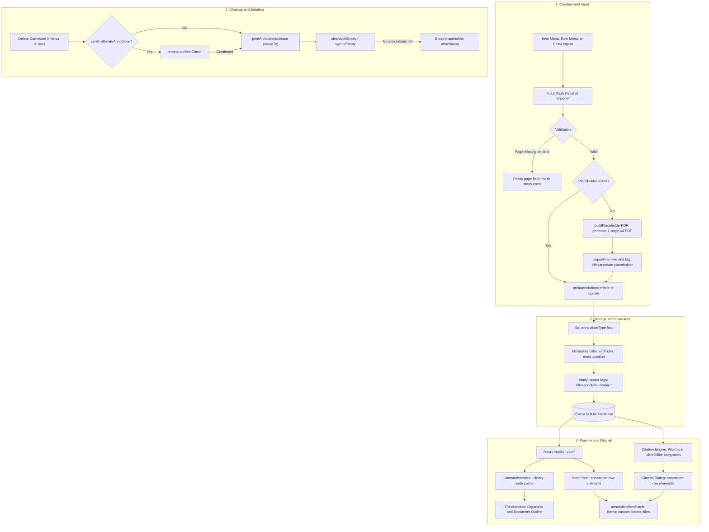

A printed or physical source — such as a printed law commentary, monograph, journal volume, or archival record — has no digital document file attached. By design, Zotero refuses to store an annotation whose direct parent is a regular bibliographic title item: an `annotation` item is accepted only under a file attachment with an `attachmentReaderType` (`pdf`, `epub`, `snapshot`), and attempting to save an annotation directly under a regular item (or a linked-URL attachment) throws an unrecoverable exception (Zotero 10.0.5, `xpcom/data/item.js:2246–2259`, documented in [docs/anchors.md](../../docs/anchors.md)).

FlexAnnotate resolves this architectural constraint by generating a minimal, valid one-page PDF — known as the **placeholder attachment** — attached to the title item. All print annotations for that work are parented to this placeholder attachment. Consequently, print annotations become first-class Zotero annotations:
- They sync seamlessly across devices via Zotero Sync.
- They are indexed library-wide by FlexAnnotate's `AnnotationIndex` and surface within the Organizer and document outlines.
- They appear in the item pane's annotation list alongside digital annotations.
- They can be cited in word processors (Word, LibreOffice) via standard citation dialogs using custom CSL locators (such as page, paragraph, column, or margin numbers).
- They share the same locator input mask, locator tag mechanics, and `<annotation-row>` rendering used for digital PDF/EPUB annotations.

## Module Architecture

The print annotation subsystem spans core logic, UI panels, menu bindings, reader popup enhancements, and custom element prototype patching:

| Module | Responsibility |
| --- | --- |
| [placeholder.ts](../../src/features/print/placeholder.ts) | Placeholder attachment lifecycle (generation, detection, target resolution, empty sweeping, grace period) |
| [printAnnotations.ts](../../src/features/print/printAnnotations.ts) | CRUD operations for print annotations, field validation, locator tags, and delete confirmation |
| [dialog.ts](../../src/features/print/dialog.ts) | XUL `<panel>` input mask with tag chips, § section autocomplete, and locator selectors |
| [menus.ts](../../src/features/print/menus.ts) | Item context menu entries in `#zotero-itemmenu` with dynamic selection-based visibility |
| [annotationRowMenu.ts](../../src/features/print/annotationRowMenu.ts) | Context menu for `<annotation-row>` elements in the right-hand item pane |
| [annotationRowPatch.ts](../../src/features/print/annotationRowPatch.ts) | Patches `AnnotationRow.prototype.render` via `assignChecked` to format custom locators and manage passage goto buttons |
| [logic/printAnnotation.ts](../../src/features/print/logic/printAnnotation.ts) | Pure rules: color normalization, sort index generation, passage detection, and PDF byte compilation |
| [logic/printMenuState.ts](../../src/features/print/logic/printMenuState.ts) | Pure state machine determining item context menu entry visibility |
| [core/printDialog.ts](../../src/core/printDialog.ts) | Pure dialog rules: layout dimensions, field visibility, focus order, and save data construction |
| [core/locator.ts](../../src/core/locator.ts) | Pure locator tag resolution order and sparse tag diffing |
| [reader/labelPopup.ts](../../src/features/reader/labelPopup.ts) | Enhancement of Zotero's reader `.label-popup` with locator selectors and radio guards |
| [core/labelPopup.ts](../../src/core/labelPopup.ts) | Pure decision rules for reader page label and locator popups |

`printMenus`, `annotationRowMenu`, `placeholderCleanup`, and `annotationRowPatchFeature` are registered as features in [src/features/registry.ts](../../src/features/registry.ts) and started/attached via [src/hooks.ts](../../src/hooks.ts). `printMenus` and `annotationRowMenu` attach DOM elements and listeners per main window via `addToWindow` and clean them up via `removeFromWindow`. `placeholderCleanup` is a global background service that listens to `item: delete` Notifier events. In addition, `annotationRowPatch` registers as a `DialogInjector` to format annotation rows within the Word and LibreOffice citation dialogs.

The public API is exposed to tests and external consumers as `addon.api.print` (`placeholder`, `printAnnotations`, `dialog`, `menus`, `annotationRowPatch`). Pure rules in `logic/` and `core/` contain no Zotero globals and are covered by Node unit tests in `test-unit/`.

## End-to-End Workflow & Lifecycle

The following diagram illustrates the creation, storage, indexing, display, and cleanup pipeline for print annotations:



_Lifecycle of a print annotation from creation and placeholder synthesis through database persistence, Notifier indexing, multi-surface presentation, and automatic placeholder cleanup._

### Workflow for Physical Works Without Digital PDFs

1. **Creating Print Annotations**:
   - The user selects a regular bibliographic item (or an existing placeholder attachment) in Zotero's library tree.
   - The context menu displays **"Add Print Annotation…"** (or **"Add Annotation…"** if the item possesses a digital file attachment).
   - Clicking opens the XUL input panel. The user selects a locator (defaulting to the document default, e.g., Randnummer/`margin` or `paragraph`), enters the mandatory pinpoint number in the page field, enters quotation text, adds comments, picks a highlight color, and selects or types tags.
   - On save, `placeholder.ensure()` locates or generates the placeholder PDF, sets `annotationType = "highlight"`, sets mock PDF geometry `{ pageIndex: 0, rects: [[0, 0, 0, 0]] }`, derives `annotationSortIndex` from the page number, persists tags, and saves the item. The item tree expands the attachment so the new annotation is immediately visible.

2. **Editing Annotations**:
   - Right-clicking an annotation in the library tree or in the right-hand item pane offers **"Edit Annotation…"**.
   - For a single annotation, the panel opens pre-filled with the existing locator, page label, comment, and tags (displayed as interactive chips). The type dropdown is locked (`disabled = true`) because Zotero restricts type mutation to switches between highlight and underline.
   - When editing multiple selected annotations, the dialog forces the `locator` view and hides the page label field, allowing bulk locator re-assignment.

3. **Deleting Annotations**:
   - Deleting via the context menu invokes `eraseWithConfirm()`. Because Zotero deletes annotations permanently without trash or undo support, FlexAnnotate prompts the user for confirmation with a "Do not ask again" checkbox.
   - If confirmed, the annotation is erased within a transaction (`annotation.eraseTx()`), and `cleanUpIfEmpty()` immediately checks whether the parent placeholder should be removed.

## The Placeholder Attachment Lifecycle

The placeholder attachment satisfies Zotero's database constraints without requiring an actual digital copy of the physical work. Its lifecycle is managed by [placeholder.ts](../../src/features/print/placeholder.ts):

### Runtime PDF Generation

Rather than shipping a static PDF file as an extension asset, [buildPlaceholderPDF()](../../src/features/print/logic/printAnnotation.ts) dynamically compiles a minimal, valid A4 PDF into a `Uint8Array`. Generating the PDF at runtime is strictly required by the Zotero extension environment:
1. `Zotero.Attachments.importFromFile()` requires a physical filesystem path.
2. Inside an installed XPI package, the extension's root URI is a `jar:` URI (`jar:file:///...`), which cannot be passed as a file path to `importFromFile()`.
3. The generated PDF incorporates an explicit Catalog (`/Type /Catalog`), Pages hierarchy (`/Type /Pages /Kids [3 0 R] /Count 1`), single Page object (`MediaBox [0 0 595 842]`), and a calculated cross-reference (`xref`) table with exact 10-digit byte offsets. This ensures `pdf.js` parses the file cleanly without triggering repair passes or console warnings.

```typescript
const tmpPath = PathUtils.join(Zotero.getTempDirectory().path, FILENAME);
await IOUtils.write(tmpPath, buildPlaceholderPDF());
creating++;
try {
  const attachment = await Zotero.Attachments.importFromFile({
    file: tmpPath,
    parentItemID: item.id,
    title: getString("placeholder-title"),
    contentType: "application/pdf",
  });
  attachment.addTag(TAG, 1);
  await attachment.saveTx();
  recentlyUsed.set(attachment.id, Date.now());
  return attachment;
} finally {
  creating--;
  await IOUtils.remove(tmpPath, { ignoreAbsent: true });
}
```

### Detection by Tag vs. Title

- **Detection is strictly tag-based**: `isPlaceholder(item)` checks that the item is an attachment (`item.isAttachment()`) and possesses the automatic tag `#flexannotate-placeholder` (type 1 tag).
- **Titles are frozen at creation**: When imported, the placeholder's title is set from the localized `placeholder-title` string ("FlexAnnotate: Print Annotations"). Checking tags instead of titles guarantees that user language changes or title edits never break attachment identification.

### Target Attachment Resolution

`annotationTarget(work, preferred)` determines which attachment should receive a new annotation:
1. If the user explicitly right-clicked an attachment under the work that can hold annotations (`canHoldAnnotations`, i.e., file attachment with an `attachmentReaderType`), that attachment is returned.
2. Otherwise, an existing placeholder attachment under the work (`find(work)`) is returned.
3. Otherwise, the first real annotatable attachment under the work is returned.
4. If none exist, `null` is returned, causing `ensure(work)` to create a new placeholder attachment.

### Single-Attachment Invariant & `ensure()`

- `find(item)`: Iterates through the child attachments of a bibliographic title item and returns the first attachment matching `isPlaceholder()`.
- `ensure(item)`: Returns an existing placeholder or calls `create(item)`. Every annotation write routes through `ensure()`, guaranteeing that a title item owns at most one placeholder attachment shared across all its print annotations. Calling `create()` on a non-regular item throws an error.

### Automatic Cleanup & Concurrency Grace Protection

When all annotations are deleted from a physical work, retaining an empty placeholder dummy attachment is undesirable. FlexAnnotate provides dual cleanup mechanisms:

1. **Direct Cleanup (`cleanUpIfEmpty`)**:
   Invoked immediately by `printAnnotations.erase()`. It erases the placeholder attachment via `attachment.eraseTx()` only when three conditions hold:
   - The attachment is identified as a placeholder (`isPlaceholder()`).
   - The `extensions.zotero.flexannotate.keepEmptyPlaceholders` preference (default `false`, defined in [addon/prefs.js](../../addon/prefs.js)) is false.
   - No child annotations remain on the attachment (`attachment.getAnnotations().length === 0`).

2. **Background Sweeper Service (`placeholderCleanup` & `sweepEmpty`)**:
   Zotero's native annotation deletions (pressing `Delete` in the library item tree or reader pane) bypass `printAnnotations.erase()`. The `placeholderCleanup` background feature registers a `Zotero.Notifier` observer for `item: delete` events. When an item is deleted, it schedules `sweepEmpty()` debounced by 500ms.
   - `sweepEmpty()` queries the database for all items bearing the `#flexannotate-placeholder` tag (`SELECT itemID FROM itemTags WHERE tagID=?`) and deletes those without annotations.

3. **Concurrency and Grace Period Protection**:
   A race condition could occur if a placeholder is created by `ensure()` or Citavi import, but before the initial annotation is written, a delete event triggers `sweepEmpty()`. To prevent deleting newly created placeholders before their annotations are saved (which would cause "Parent item not found" crashes):
   - **`creating` counter**: Tracks active `create()` operations. `sweepEmpty()` yields and reschedules for 500ms if `creating > 0`.
   - **`recentlyUsed` map & `GRACE_MS = 3000`**: Tracks timestamps of placeholders handed out by `ensure()` or `create()`. Any placeholder created within the last 3 seconds is skipped during cleanup and rescheduled for sweeping after the grace period expires.

## Annotation Field Invariants & Data Constraints

Zotero enforces rigid validation checks when committing `annotation` items to the database (`xpcom/data/item.js:4487-4555`). [printAnnotations.ts](../../src/features/print/printAnnotations.ts) structures all operations around these invariants:

| Zotero Invariant | Implementation Mechanism in `printAnnotations.ts` |
| --- | --- |
| `annotationType` must precede all other fields | `create()` assigns `annotation.annotationType = type` before touching text, comment, or color; assigning other fields first causes Zotero to throw. |
| `annotationText` permitted only for `highlight` and `underline` | `supportsText(type)` returns true only for `highlight` and `underline`. For other types (e.g., `note`), supplied quote text is folded into `annotationComment` separated by a blank line (`\n\n`) to prevent silent data loss. |
| `annotationPosition` required for PDF child annotations | Mocked as `{ pageIndex: 0, rects: [[0, 0, 0, 0]] }` serialized to JSON, satisfying Zotero's schema despite the absence of digital bounding boxes. |
| `annotationSortIndex` requires format `/^\d{5}\|\d{6}\|\d{5}$/` | `buildSortIndex(pageLabel)` extracts the first contiguous digit run from the page label, zero-padded to five digits and clamped to 99999 (e.g., "Rn. 12" $\to$ `00012|000000|00000`). Labels lacking digits (e.g., Roman numerals like "XIV") sort at 99999. |
| `annotationColor` requires lowercase `/#[a-f0-9]{6}/` | `normalizeColor()` trims whitespace, converts to lowercase, and falls back to `#ffd400` if invalid. |
| `annotationPageLabel` stores empty string as `null` | Zotero saves `pageLabel || null`. Reading back an unset label yields `null`, handled with `|| ""` fallback guards. |

### Update and Deletion Boundaries

- `update(annotation, data)`: Accepts `PrintAnnotationUpdate`, which strictly omits `type` and `tags`. Zotero restricts type mutation to switches between `highlight` and `underline`, so arbitrary type changing is prevented. Tags are manipulated exclusively through locator APIs and tag chip edits.
- **Sort Index Protection**: When updating a page label, `update()` recalculates `annotationSortIndex` **only if** the parent attachment is a FlexAnnotate placeholder (`isPlaceholder(annotation.parentItem)`). For native annotations under real PDFs, the sort index encodes document coordinate order and must not be overwritten.
- `erase(annotation)`: Deletes the annotation item within a transaction (`annotation.eraseTx()`) and immediately calls `cleanUpIfEmpty()` on the parent attachment.

## Locator Tag System

Because Zotero annotations store page information as a plain text string (`annotationPageLabel`), FlexAnnotate persists citation locator semantics (such as paragraph, column, chapter, or margin) as tags on items and attachments ([src/core/locator.ts](../../src/core/locator.ts)):

### Tag Resolution Order

When resolving an annotation's citation type, `getLocator(annotation)` checks in sequence:
1. An explicit annotation tag: `#flexannotate-locator-<type>`
2. The parent attachment's default tag: `#flexannotate-default-locator-<type>`
3. The fallback ground state: `"page"`

Supported locator types include standard CSL locator terms (`chapter`, `column`, `figure`, `folio`, `issue`, `line`, `note`, `opus`, `page`, `paragraph`, `part`, `section`, `sub-verbo`, `verse`, `volume`) plus `"margin"` (Randnummer), which is standard in legal citations. Legacy or unknown tags are ignored.

### Sparse Tag Mutations

- `locatorTagChanges()`: Avoids redundant tags. An annotation receives an explicit `#flexannotate-locator-<type>` tag only if its locator differs from `page` or if the document's default locator differs from `page`.
- `setDefaultLocator(attachment, locator)`: Sets `#flexannotate-default-locator-<type>` on an attachment. Before switching the document default, it iterates across all existing child annotations and **freezes** any annotation lacking an explicit tag to the old default. This guarantees that changing a document default never alters past citations retroactively. Setting the default to `page` strips the default tag entirely.

## The Locator Input Mask: XUL Panel Architecture

The input mask enables creating print annotations, editing existing annotations, and assigning locators to both print and native annotations.

### Host Platform Constraints

Under Zotero 10, XUL elements parse only within privileged chrome document contexts. Third-party plugins cannot register `chrome://` URI protocols, and calling `openDialog()` with `file://` or `jar://` URIs produces blank, unprivileged windows ([docs/architecture.md](../../docs/architecture.md), Pitfall 5).

To overcome this, [dialog.ts](../../src/features/print/dialog.ts) implements the mask as a XUL `<panel id="flexannotate-print-annotation-panel">` injected directly into the main window document via `win.MozXULElement.parseXULToFragment()`. `build(win)` constructs the panel once per window, and `win.MozXULElement.insertFTLIfNeeded()` loads localization bundles into main and reader windows.

### Per-Window State Ownership

Module instances are singletons per application session, but Zotero windows open and close independently. Storing dialog state on module variables causes cross-window leaks. The panel's active state (`mode`, `view`, `item`, `attachment`, `annotation`, `annotations`, `requirePage`) is held in a private `WeakMap<Element, PanelState>` keyed by the panel's DOM element.

### Opening and Initialization

Both `open(win, parentItem)` and `openForEdit(win, annotations, options)` must `await ensureLocatorsReady()` before rendering. This ensures `Zotero.Styles.init()` has finished. The locator menu builds its labels via `Zotero.Cite.getLocatorString()`, which depends on `Zotero.Styles.locales`. Opening the panel before styles are initialized would leave the locator menu empty until the next application restart.

### Modes and Views

The dialog supports three views defined in [src/core/printDialog.ts](../../src/core/printDialog.ts):

| View | Visible Groups | Dimensions | Primary Focus |
| --- | --- | --- | --- |
| `full` | Locator, Type/Color, Quote Text, Comment, Tags | 440px (min 380, max 480) | Page field (for print) or Comment (for native) |
| `comment` | Comment only | 380px (min 340, max 420) | Comment textarea |
| `locator` | Locator and Page | 320px (min 280, max 360) | Locator dropdown |

- **Create Mode**: Opened via `open(win, parentItem, preferred)`. Type dropdown is enabled (defaults to `highlight`), locator defaults to the document's default locator, and `requirePage` is set to `true`.
- **Edit Mode**: Opened via `openForEdit(win, annotations, { view })`. Type dropdown is locked (`disabled = true`) because Zotero forbids arbitrary type modification. When editing multiple annotations simultaneously, the dialog forces the `locator` view and hides the page label field, applying bulk locator updates.
- **Page Requirement Guard**: `requirePage` is true for print sources (`placeholder.isPlaceholder(...)`) because print citations rely exclusively on page numbers. Native annotations have digital documents, so page labels are optional.
- **Controls & Menus**:
  - *Quotation Text*: Automatically disabled and dimmed (`opacity: 0.5`) when the type is not `highlight` or `underline`.
  - *Color Palette*: Populated from `Zotero.Annotations.COLORS` (Zotero 10.x) with an 8-color fallback. Menuitem labels are set via `Zotero.getString()` rather than Fluent attributes, ensuring the XUL `<menuitem>` label attribute displays properly.
  - *Default Locator Checkbox*: Checked and locked if the selected locator is already the document default (`defaultCheckboxState`).

### Tag Chips Interface & Autocomplete

The tag entry area within the `full` view provides an interactive tag-chip editing interface:
- **Tag Box Container**: An HTML `div` (`#flexannotate-dialog-tag-box`) wraps the tags and contains an `<editable-text id="flexannotate-dialog-tags" fieldname="tag">` input element.
- **Tag Chips**: Tags added to the annotation appear as inline chips (`<span data-tag="...">`) styled with rounded pill backgrounds. Each chip displays the tag name (with ellipsis and tooltip) and a clickable removal button (`×`). Empty strings and duplicate tags are discarded automatically.
- **Existing Tag Population**: When opening the dialog to edit a single annotation, `editableTags()` extracts existing tags, excluding internal system tags starting with `#flexannotate-`, and displays them as chips. Removed chips delete the tag upon saving.
- **Autocomplete Integration**: The tag field registers with Mozilla's autocomplete system using XPCOM search `"zotero"` and target popup `#PopupAutoComplete` (or injects `<panel is="autocomplete-richlistbox-popup" id="flexannotate-autocomplete-popup">` if opened in a window lacking Zotero's default popup). It passes `searchParam` containing `fieldName: "tag"`, `libraryID`, `itemID`, `contextItemID: state.item?.id`, and `labelMax: 60`.
- **Section (§) Autocomplete Suggestions**: When the user enters the section symbol (`§`), FlexAnnotate's [tagSuggest](organizer.md) service intercepts the query. It resolves the outline headings of the work (`contextItemID`) and library, presenting hierarchical section headings formatted with localized category headers ("In Outline of this Work", "In Library Outlines"). Selecting a heading or pressing Enter completes the tag and converts it into a chip.
- **Keyboard Navigation in the Tag Field**:
  - Typing text and pressing `Enter` or clicking an autocomplete suggestion invokes `addChip()`, adding the chip and clearing the input.
  - Pressing `Enter` in an empty tag field commits the entire dialog via `accept()`.
  - Pressing `Tab` while text is typed confirms the chip and keeps focus inside the tag input, allowing rapid multi-tag entry.
  - Clicking outside the field (`focusout`) automatically turns any pending text into a chip.

### Keyboard & Save Handling

- **Tab Traversal**: `Tab` cycles through visible, enabled form controls with wrap-around using `nextFocusIndex`.
- **Enter Handling**: `Enter` accepts and saves the panel, except when navigating within an open menupopup or inside multiline textareas (where `Enter` creates a line break and `Ctrl+Enter` / `Cmd+Enter` saves).
- **Escape**: Closes the panel via `panel.hidePopup()`.
- **Commit Sequence**: `accept()` constructs save data using `buildSaveData()`. If a required page label is missing, it returns `null`, leaving the panel open and refocusing the page input. If the "use as default" checkbox is checked, the document default is updated *before* saving annotations, ensuring `applyLocatorTag()` applies tags consistently. A successful save triggers the `afterSave` hook, allowing reader windows to refresh automatically.

## Context Menu Integration

FlexAnnotate integrates with two distinct context menu surfaces in Zotero's main window:

### 1. Item Context Menu (`#zotero-itemmenu`)

Menu items are appended directly to `#zotero-itemmenu` as DOM elements ([src/features/print/menus.ts](../../src/features/print/menus.ts)):
- `flexannotate-itemmenu-separator`: Separator element
- `flexannotate-add-print-annotation`: "Add Print Annotation…" / "Add Annotation…"
- `flexannotate-itemmenu-edit`: "Edit Annotation…"
- `flexannotate-itemmenu-delete`: "Delete Annotation"

#### Why DOM Elements Instead of `Zotero.MenuManager`
FlexAnnotate deliberately avoids `Zotero.MenuManager` for the item tree context menu:
1. Zotero's `buildItemContextMenu()` function exits early for annotation selections (`zoteroPane.js:4680`), returning before `Zotero.MenuManager.updateMenuPopup()` runs (`:4685`). Consequently, a MenuManager entry's visibility callback never fires for annotations, causing menu entries to freeze in incorrect states.
2. Zotero's menu rebuild mechanism only clears its own `zotero-locate` items, preserving third-party DOM elements.
3. Attaching native DOM elements and registering a `popupshowing` event listener ensures the menu re-evaluates visibility dynamically on every open based on `ZoteroPane.getSelectedItems()`.

The visibility logic is defined as a pure function in [src/features/print/logic/printMenuState.ts](../../src/features/print/logic/printMenuState.ts):
- **Add**: Visible when exactly one regular title item OR one child attachment under a regular title item is selected. When the target has a real file attachment, its label is dynamically changed to "Add Annotation…"; otherwise, it displays "Add Print Annotation…".
- **Edit**: Visible when exactly one annotation is selected (disabled if the annotation is read-only).
- **Delete**: Visible when exactly one editable annotation is selected (applies to both print and native annotations).
- **Separator**: Visible if either Add or Edit is visible.
- **Multi-item / Mixed Selections**: All entries hidden.

`updateVisibility(doc, items)` is exported directly, allowing integration tests to verify menu visibility states without requiring simulated mouse clicks.

### 2. Annotation Row Context Menu (`annotationRowMenu.ts`)

In the right-hand item pane, Zotero renders child annotations as custom `<annotation-row annotation-id="…">` elements (`attachmentAnnotationsBox.js:134`). Zotero provides no native context menu for these rows, and the elements are destroyed and recreated whenever the selection changes.

[annotationRowMenu.ts](../../src/features/print/annotationRowMenu.ts) addresses this by registering a single `contextmenu` event listener at the **document level in the capture phase**:
1. When a right-click occurs, `event.target.closest("annotation-row")` resolves the target row and extracts its `annotation-id`.
2. It constructs and opens a custom `<menupopup id="flexannotate-annotation-popup">` at the cursor coordinates.
3. The annotation ID is written to a `data-flexannotate-annotation-id` attribute on the popup element itself, ensuring commands resolve the correct item even in multi-window setups.
4. "Edit" is displayed for all annotations (disabled if read-only); "Delete" is displayed for all editable annotations (hidden if read-only).

### Delete Confirmation Dialog (`eraseWithConfirm`)

Because Zotero permanently deletes annotations from the SQLite database via `annotation.eraseTx()` with neither a trash bin nor undo support, both context menu delete commands invoke `eraseWithConfirm(win, annotation)`:
- Prompts the user via `Services.prompt.confirmCheck()` with the localized title `annotation-delete-title` and warning message `annotation-delete-confirm`.
- Includes a "Do not ask again" checkbox (`annotation-delete-dont-ask`). Checking it updates the preference `extensions.zotero.flexannotate.confirmDeleteAnnotation` to `false`.
- If the preference is false, deletions execute immediately without prompting.

## Annotation Row Patches (`annotationRowPatch.ts`)

In both the main window item pane and the word processor citation dialog, Zotero renders child annotations using the custom `<annotation-row>` element. In standard Zotero (10.0.5, `elements/annotationRow.js:93-94`), `AnnotationRow.prototype.render` constructs the row title by hardcoding the localized string for "Page" concatenated with `pageLabel`:

```javascript
// Native Zotero logic in elements/annotationRow.js
this._title.textContent = Zotero.getString('pdfReader.page') + ' ' + pageLabel;
```

When an annotation uses a custom locator (such as a legal Randnummer/margin number, an Opus number, or a paragraph), Zotero's hardcoded prefix misleadingly labels the item as "Page 318" instead of "Randnummer 318" or "Opus 42".

[annotationRowPatch.ts](../../src/features/print/annotationRowPatch.ts) intercepts this rendering to replace the title with FlexAnnotate's resolved locator term and inject reader passage navigation buttons.

### Patch Mechanism via `assignChecked`

The patch wraps `AnnotationRow.prototype.render` using [`assignChecked`](../../src/shared/patch.ts) to guarantee safe property replacement without silent failures:

```typescript
// src/features/print/annotationRowPatch.ts
export function patchAnnotationRow(win: Window): boolean {
  if (!win || installed.has(win)) return true;

  // Trigger lazy custom element definition if needed
  if (!win.customElements?.get("annotation-row")) {
    const doc = win.document as any;
    if (typeof doc?.createXULElement === "function") {
      doc.createXULElement("annotation-row");
    } else if (typeof doc?.createElement === "function") {
      doc.createElement("annotation-row");
    }
  }

  const proto = win.customElements?.get("annotation-row")?.prototype;
  if (!proto || typeof proto.render !== "function") return false;

  const native = proto.render;
  const patched = function (this: Element) {
    native.call(this);
    try {
      updateAnnotationRowTitle(this);
      updateGotoButton(this);
    } catch (e) {
      ztoolkit.log("annotationRow title update failed:", e);
    }
  };

  if (!assignChecked(proto, "render", patched)) return false;
  installed.set(win, { native, patched });

  // Update already rendered rows in the document
  for (const row of win.document.querySelectorAll("annotation-row")) {
    try {
      updateAnnotationRowTitle(row);
      updateGotoButton(row);
    } catch { /* ignore */ }
  }
  return true;
}
```

### Title Formatting Logic

`updateAnnotationRowTitle(row)` inspects the row's backing item `row._annotation` and target element `row._title || row.querySelector(".title")`:
1. **Guard clauses**: Aborts if the row has no annotation or if `ann.isAnnotation()` is false.
2. **Default Locator Guard**: Retrieves the locator via `getLocator(ann)`. If `locator` is undefined or equal to `DEFAULT_LOCATOR` (`"page"`), the row keeps Zotero's native title text unchanged.
3. **Label Resolution**: When a custom locator is present (`locator !== DEFAULT_LOCATOR`), [locatorLabelText()](../../src/features/reader/logic/readerLocator.ts) resolves the localized display string:
   - Queries `Zotero.Cite.getLocatorString(locator)` first.
   - Falls back to localized extension strings (`reader-locator-page`, `reader-locator-margin`, `reader-locator-opus`) via `getString()`.
   - Falls back to the capitalized locator identifier.
4. **Title Construction**: Calls `formatAnnotationTitle(label, ann.annotationPageLabel)` to produce formatted strings such as `"Randnummer 318"` or `"Opus 42"`.

### Goto Button (`↗`) & Omission for Print Annotations

In standard Zotero, double-clicking an annotation in the item pane opens the parent attachment. To facilitate rapid navigation directly to the highlighted text passage, `updateGotoButton(row)` appends a `span.flexannotate-goto` button (`↗`) to the `.head` container of the row:
- Clicking the button calls `Zotero.Reader.open(ann.parentID, { annotationID: ann.key })`, which activates or reuses open reader tabs and jumps directly to the annotation's passage coordinates (`xpcom/reader.js:2917`).
- **Omission for Print Annotations**: A physical source has no digital file or text passage. `hasPassage(ann.annotationPosition)` inspects the serialized position JSON:
  ```typescript
  export function hasPassage(position: string): boolean {
    try {
      const { rects } = JSON.parse(position);
      return !Array.isArray(rects) || rects.some((r: number[]) => r.some((n) => n !== 0));
    } catch {
      return false;
    }
  }
  ```
  If `isPlaceholder(ann.parentItem)` is true, or if `hasPassage()` returns false (such as print annotations with mock rectangles `[[0, 0, 0, 0]]`), `updateGotoButton()` removes any existing goto button and returns immediately. Print annotations never display a misleading navigation button.

### Restoration & Unpatching

`unpatchAnnotationRow(win)` safely restores native behavior:
1. Retrieves `{ native, patched }` from `installed: WeakMap<Window, { native, patched }>`.
2. Checks if another plugin has patched `proto.render` after FlexAnnotate (`proto.render !== entry.patched`); if so, leaves the foreign patch intact to prevent breaks.
3. Restores `proto.render` using `assignChecked(proto, "render", native)`.
4. Iterates across all `<annotation-row>` elements in `win.document`, removes `.flexannotate-goto` elements, and invokes `render?.()` to re-render standard native titles.

### Lifecycle Registration in `src/hooks.ts` and `src/features/registry.ts`

`annotationRowPatch` participates in two distinct lifecycle systems:

1. **Main Window Lifecycle (`addToWindow` / `removeFromWindow`)**:
   Registered as `annotationRowPatchFeature` in `globalFeatureEntries`. During application startup, `onMainWindowLoad(win)` runs `await addToWindow(features, win)`. When a main window closes, `onMainWindowUnload(win)` invokes `removeFromWindow(features, win)`.

2. **Citation Dialog Injection (`DialogInjector`)**:
   Because word processor integration (Word, LibreOffice) opens the citation dialog in a separate chrome window (`chrome://zotero/content/integration/citationDialog.xhtml`), main window listeners do not capture citation dialog `<annotation-row>` elements. `annotationRowPatch` registers as a dialog injector in `dialogInjectorEntries`:
   ```typescript
   {
     name: "annotationRowPatch",
     inject: patchAnnotationRow,
     detach: unpatchAnnotationRow,
   }
   ```
   The `citationDialog` service watches for new citation dialog windows, waits for `DIALOG_STATE.loaded`, and executes `inject(win)`. When the dialog window unloads or the extension shuts down, `detach(win)` restores the prototype.

## Reader Page Label Locator Popups

When working inside Zotero's built-in PDF/EPUB reader, page numbers and locators are edited through the reader's native page label popup (`.label-popup` in `reader.js`). FlexAnnotate hooks into this popup ([src/features/reader/labelPopup.ts](../../src/features/reader/labelPopup.ts) and [src/core/labelPopup.ts](../../src/core/labelPopup.ts)):

1. **DOM Injection**: When `.label-popup` opens, `enhanceLabelPopup()` injects a custom locator selector row and a "use as default" checkbox before the dialog's radio group.
2. **Renumbering Constraints**: Zotero's native popup provides linear renumbering modes ("from this page forward", "all pages") and an auto-detect checkbox. These options assume standard sequential pagination. In `core/labelPopup.ts`, `isPageLocator(locator)` checks whether the chosen locator is `"page"`. If a non-page locator is chosen (such as `"margin"` or `"paragraph"`):
   - Linear renumbering radios (`from`, `all`) are disabled and dimmed (`setRadioEnabled(radio, false)`).
   - The auto-detect checkbox column is hidden (`display: none`).
   - The radio selection defaults to `single` or `selected` via `preferredRadio()`, preventing corruption of paragraph or margin numbering sequences.
3. **Application**: Page labels are applied only when targeting a unique annotation (`shouldSetPageLabel`), and locator changes update the annotation and attachment defaults using `planApply()`.

## Ecosystem Integration

Print annotations are fully integrated across FlexAnnotate and Zotero:

### Zotero Pipeline Parity
Because print annotations are real `annotation` items attached to a valid PDF, Zotero's core storage, search, and sync engines process them identically to native highlights. Changes trigger standard `Notifier` events (`item: add`, `modify`, `trash`).

### Outline Tracking and the Organizer
FlexAnnotate's [AnnotationIndex](organizer.md) maintains an in-memory, library-wide cache of all annotations, updating incrementally from `Notifier` events. Print annotations are ingested into this index alongside digital annotations. They appear in the Organizer tree, can be structured into hierarchical document outlines (`docOutline`), and support navigation links back to the parent item.

### Word Processor Citations
During citation generation in Microsoft Word or LibreOffice, Zotero formats citations using CSL processors. Print annotations supply their `annotationPageLabel` and tag-based locators (such as `paragraph` or `margin`), allowing physical commentaries and books to be cited with accurate pinpoint locators.

### Citavi Project Import
During migration from Citavi ([src/features/citavi/citaviPrintQuotes.ts](../../src/features/citavi/citaviPrintQuotes.ts)), quotations linked to physical books without attached files are converted into print annotations. Citavi import invokes `printAnnotations.create()` to create the placeholder attachment and populate print annotations, deduplicating against existing entries.

## Focused Tests

The print annotations subsystem is thoroughly verified through unit and integration suites:

- [test-unit/printAnnotation.test.ts](../../test-unit/printAnnotation.test.ts): Unit tests for pure rules:
  - `annotationColors`: Validates Zotero's palette array and falls back to standard 8 colors on malformed input.
  - `buildSortIndex`: Tests numeric sorting of digit runs ("Rn. 12" $\to$ `00012`), sorting labels without digits at 99999 ("XIV"), and clamping values over 99999.
  - `normalizeColor`: Verifies trimming, case folding, and hex validation.
  - `hasPassage`: Validates detection of non-empty rectangles versus placeholder mock coordinates (`[[0,0,0,0]]`).
  - `buildPlaceholderPDF`: Verifies valid `%PDF-1.4` headers, trailer dictionary, and that computed `xref` offsets align with object byte positions.
  - `supportsText`: Confirms text quotation support is restricted to `highlight` and `underline`.
- [test-unit/printDialog.test.ts](../../test-unit/printDialog.test.ts): Unit tests for dialog layout, field visibility, `buildSaveData`, `defaultCheckboxState`, and `nextFocusIndex`.
- [test-unit/printMenuState.test.ts](../../test-unit/printMenuState.test.ts): Validates the context menu visibility matrix across regular, attachment, native annotation, print annotation, multi-selection, and empty states.
- [test-unit/locator.test.ts](../../test-unit/locator.test.ts): Tests locator resolution precedence and sparse tag diffing.
- [test/print.test.ts](../../test/print.test.ts): Integration tests running inside Zotero:
  - Creates placeholder attachment and first print annotation.
  - Reuses existing placeholder for subsequent annotations on the same item.
  - Retains placeholder while annotations remain.
  - Erases placeholder when its final annotation is deleted.
  - Preserves empty placeholders when `keepEmptyPlaceholders` is set to `true`.
- [test/printDialog.test.ts](../../test/printDialog.test.ts): Integration tests exercising the XUL panel:
  - Creating annotations from user input and verifying database commit via `Notifier`.
  - Missing page label on print sources keeps the dialog open without saving.
  - Type menu remains enabled on creation and disabled on edit.
- [test/printMenus.test.ts](../../test/printMenus.test.ts): Integration tests verifying that context menu DOM elements are appended once, update visibility based on selection, ask for deletion confirmation unless disabled by preference, and detach cleanly upon `removeFromWindow()`.
- [test/annotationRowPatch.test.ts](../../test/annotationRowPatch.test.ts): Integration tests verifying `<annotation-row>` title label patching:
  - Confirms setting a custom locator tag (such as `#flexannotate-locator-opus`) causes the rendered row title to display the localized locator label ("Opus 318").
  - Verifies annotations with standard `"page"` locators retain default row title text without custom locator strings.

## Related Pages

- [Data Model](../architecture/data-model.md) — Persistent tag schema (`#flexannotate-placeholder`, locator tags) and Zotero field rules.
- [Patching Architecture](../architecture/patching.md) — Prototype patching via `assignChecked`, `CitationDialogWatcher`, and host environment safeguards.
- [Organizer](organizer.md) — Cross-paper annotation indexing, outline tracking, library-wide browsing, and section (§) tag suggestions.
- [Citavi Import](citavi-import.md) — Converting Citavi quotation cards into print annotations via placeholder attachments.
- [Reader Integration](reader.md) — Reader page label popup enhancements, custom locator menus, and the `afterSave` refresh hook.
- [Zotero Internals](../integrations/zotero-internals.md) — Underlying Zotero architecture, XUL panel constraints, and private API contracts.
