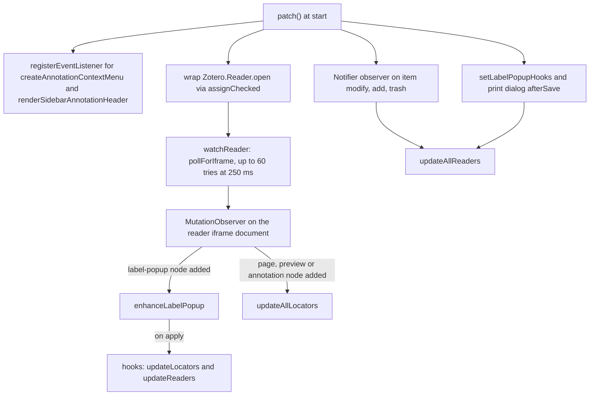
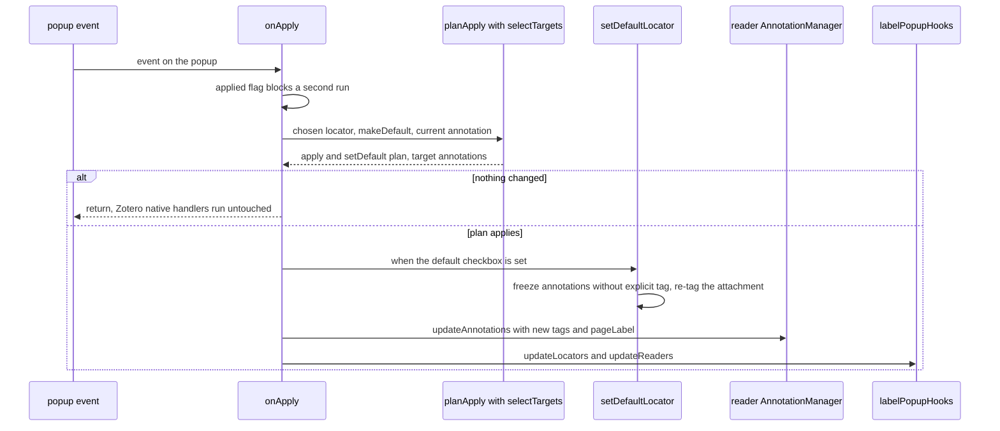

Zotero's reader (supporting PDF, EPUB, and web snapshots) is where native annotations live. The reader provides narrow official plugin hooks — `Zotero.Reader.registerEventListener` for a small set of events and `Zotero.Reader.open` to open documents. It lacks native APIs to append custom menu entries to an annotation, relabel the "Page" line of an annotation header, or customize the page-number popup.

FlexAnnotate extends all three surfaces so native annotations can carry structured citation locators (such as margin numbers, paragraphs, sections, or opus designations) in addition to traditional page numbers. The underlying persisted tag scheme aligns with the citation schema detailed in [Data model](../architecture/data-model.md).

The reader functionality is split cleanly between pure logic modules (Node-testable, with no DOM or Zotero dependencies) and Zotero-facing integration modules:

| Module | Architectural Role & Responsibilities |
| --- | --- |
| [src/core/locator.ts](../../src/core/locator.ts) | Pure locator primitives: prefix constants, fallback locator list, tag parsing (`locatorOf`), tag delta calculation (`locatorTagChanges`), and citation place formatting (`formatLocator`). |
| [src/features/reader/logic/readerLocator.ts](../../src/features/reader/logic/readerLocator.ts) | Pure reader display logic: in-memory tag parsing (`explicitLocatorFromTags`) and display label resolution chain (`locatorLabelText`). |
| [src/core/labelPopup.ts](../../src/core/labelPopup.ts) | Pure page-label popup decision logic: `planApply`, `selectTargets`, `defaultCheckboxState`, `preferredRadio`, and label gating (`shouldSetPageLabel`). |
| [src/features/reader/readerMenu.ts](../../src/features/reader/readerMenu.ts) | Zotero reader integration: lifecycle hooks (`patch`/`unpatch`), `createAnnotationContextMenu` and `renderSidebarAnnotationHeader` handlers, `Zotero.Reader.open` wrapping, reader iframe `MutationObserver`, and locator DOM refresh. |
| [src/features/reader/labelPopup.ts](../../src/features/reader/labelPopup.ts) | Reader iframe DOM enhancement for the page-number popup (`.label-popup`): locator selection dropdown, per-document default checkbox, radio mode gating, and persistence. |


_Registration installs reader listeners, refresh triggers, and the reader watcher; the watcher's MutationObserver drives both popup enhancement and locator refresh._

---

## Locator Parsing, Formatting, and Page Mapping

Because Zotero annotations natively store only a numeric or alphanumeric page string in their `pageLabel` field, citation locator types are persisted through tags. The core parsing, calculation, and formatting logic lives in [src/core/locator.ts](../../src/core/locator.ts) and [src/features/reader/logic/readerLocator.ts](../../src/features/reader/logic/readerLocator.ts).

### Tag Prefixes and Fallback Types

The locator system relies on standardized prefix constants:
- `LOCATOR_PREFIX = "#flexannotate-locator-"`: Stamped onto individual annotation items (as automatic tags with type `1`).
- `DEFAULT_LOCATOR_PREFIX = "#flexannotate-default-locator-"`: Stamped onto parent attachment items to define the fallback locator type for all annotations within that document.
- `DEFAULT_LOCATOR = "page"`: The canonical baseline locator type.

When Zotero's localized label registry (`Zotero.Cite.labels`) is unavailable (for example in standalone unit test environments or before style locales load), `FALLBACK_LOCATORS` provides standard CSL citation types:
```typescript
export const FALLBACK_LOCATORS = [
  "page", "chapter", "section", "paragraph",
  "verse", "line", "figure", "note", "column", "folio"
];
```

### Parsing and Tag Delta Calculation

The locator type of an annotation is resolved in priority order by `locatorOf(annotationTags, attachmentTags)`:
1. An explicit tag on the annotation beginning with `LOCATOR_PREFIX` (e.g., `#flexannotate-locator-paragraph` yields `"paragraph"`).
2. The attachment-level default tag beginning with `DEFAULT_LOCATOR_PREFIX` (e.g., `#flexannotate-default-locator-section` yields `"section"`).
3. The baseline default, `"page"`.

When an annotation's locator is updated, `locatorTagChanges(annotationTags, attachmentTags, type)` calculates the minimal tag mutations required:
- **Removal**: All existing tags starting with `LOCATOR_PREFIX` are slated for removal.
- **Sparse Tagging Invariant**: If both the target `type` and the parent document's default are `"page"`, no tag is added (`add: []`), avoiding database clutter for standard page annotations.
- **Explicit Override**: If the target `type` differs from `"page"`, or if the document default is non-page and an explicit `"page"` locator is selected, an automatic tag (`{ tag: "#flexannotate-locator-" + type, type: 1 }`) is added.

### Formatting Citation Places

The helper `formatLocator(shortLabel, place)` constructs user-facing citation strings (e.g. `"S. 22"` or `"¶ 14"`):
- If `place` is empty or undefined, it returns `""` immediately.
- If `place` is present, it filters non-empty components between `shortLabel` and `place` and joins them with a single space.

### In-Memory Tag Extraction in the Reader

When annotations are updated in the reader UI, Zotero persists them to the SQLite database asynchronously. To prevent visible UI lag or stale reads, `getAnnotationLocator()` checks the reader's in-memory data store first using `explicitLocatorFromTags(tags, knownLabels)`.

This pure helper handles polymorphic tag representations:
- Tags may be plain string elements (`"#flexannotate-locator-section"`) or object structures (`{ name: "..." }` or `{ tag: "..." }`).
- Any tag matching `LOCATOR_PREFIX` is parsed to extract the locator type.
- The extracted type is accepted only if it is included in `knownLabels` (typically `Zotero.Cite.labels`) or matches the custom `"margin"` locator (Randnummer), which lacks a CSL counterpart. Unrecognized tags are ignored and return `null`.

### Display Label Resolution and Fallback Cascade

The display string for a locator is produced by `locatorLabelText(locator, cite, labels)`:
1. **Page Default**: If `locator` is undefined, empty, or `"page"`, `cite("page")` is queried; if undefined, `labels.page` (localized Fluent string `reader-locator-page`) is returned.
2. **CSL Label Lookup**: For other locators, `cite(locator)` queries `Zotero.Cite.getLocatorString(locator)`. If Zotero returns a localized label, it is used directly.
3. **Dedicated Fallbacks**: If `cite(locator)` returns `undefined` (which occurs in fresh Zotero profiles before `Zotero.Styles.locales` finishes loading):
   - `"margin"` falls back to `labels.margin` (`reader-locator-margin`).
   - `"opus"` falls back to `labels.opus` (`reader-locator-opus`).
4. **Capitalized Identifier**: Any other unrecognized locator falls back to capitalizing its first letter (e.g. `"figure"` becomes `"Figure"`).

---

## Reader Context Menu Registrations

FlexAnnotate integrates into the PDF reader's annotation context menu via `Zotero.Reader.registerEventListener`:

```typescript
zr.registerEventListener("createAnnotationContextMenu", handler, config.addonID);
```

### Context Menu Construction

When a user right-clicks an annotation in the reader, the `createAnnotationContextMenu` event fires. FlexAnnotate inspects the selected annotation IDs (`params.ids`):
- **Single Annotation Selection**:
  - The reader's in-memory annotation state (`_state.annotations`) is checked for existing text in `comment`.
  - If a non-empty comment exists, the menu offers **Edit Comment…** (`reader-comment-edit`); otherwise, it offers **Add Comment…** (`reader-comment-add`).
  - Clicking this command opens the print annotation dialog in `"comment"` view.
- **Single or Multi-Selection**:
  - The menu always appends **Set Locator…** (`reader-locator-set`).
  - For single annotations, it opens the dialog in `"locator"` view; for multiple annotations, `editView` is forced to `"locator"`, suppressing the individual page field.

### Defensive Annotation Resolution (`openDialog`)

Opening the edit dialog requires resolving main-process `Zotero.Item` instances from reader-reported IDs:
1. `internals(reader).itemID` identifies the parent attachment item.
2. The attachment's annotations (`attachment.getAnnotations()`) are filtered by the keys provided by the reader.
3. If keys do not match directly (as reader internal IDs and database keys can diverge), `Zotero.Items.getByLibraryAndKey(attachment.libraryID, key)` resolves items by library and key.
4. The dialog opens in the reader's dedicated sub-window (`_window`) if available, falling back to `Zotero.getMainWindow()`. All errors are caught and logged via `defaultLogger`, ensuring context menu failures never crash Zotero's reader UI.

---

## Reader UI State Isolation Without Global Mutation

Zotero reader instances are created and torn down dynamically as users open and close tabs or separate reader windows. A major architectural requirement is keeping FlexAnnotate's reader state isolated without polluting global modules or mutating internal reader objects.

FlexAnnotate achieves this through specific isolation mechanisms:

### 1. `WeakSet` Instance Tracking
Module-level tracking uses `const watchedReaders = new WeakSet<ReaderInstance>()`. Rather than assigning boolean flags or monkey-patching properties onto foreign Zotero reader instances, the `WeakSet` tracks observed readers without preventing garbage collection when tabs or reader windows close.

### 2. Isolated `MutationObserver` Instances
Each reader iframe document receives its own `MutationObserver`, tracked in a module-level `observers = new Set<MutationObserver>()`. When `unpatch()` runs during plugin shutdown, `disconnectObservers()` iterates through the set, disconnecting each observer individually inside `try/catch` wrappers and clearing the set.

### 3. Re-entrancy Guard for DOM Synchronization
When updating locator labels in the reader DOM (such as `pageEl.firstElementChild.textContent = labelText`), these writes mutate the DOM tree that the reader's `MutationObserver` watches. To prevent recursive observation loops:
```typescript
let updatingLocators = false;

function updateAllLocators(reader: ReaderInstance, doc: Document): void {
  if (!reader || !doc) return;
  updatingLocators = true;
  try {
    updatePageElements(reader, doc);
    updateAnnotationCards(reader, doc);
    updatePopup(reader, doc);
  } finally {
    updatingLocators = false;
  }
}
```
The observer callback checks `if (updatingLocators) return;` at entry, isolating plugin-initiated DOM updates from user or Zotero mutations.

### 4. DOM Markers Instead of Component Mutation
The enhanced page-label popup injects DOM elements directly into Zotero's `.label-popup` container, marking the injected section with `.flexannotate-locator-section`. Idempotency checks simply inspect `popup.querySelector(".flexannotate-locator-section")`. If present, injection aborts immediately, eliminating the need for reader-level state flags.

### 5. Clean Reader Reset on Teardown
On `unpatch()`, `resetOpenReaders()` queries all active readers via `Zotero.Reader._readers`. For each open iframe document, it removes all injected `.flexannotate-locator-section` elements and restores all `.page[id^="page_"]` labels back to the default localized "Page" string.

---

## Watching Readers: The `Zotero.Reader.open` Wrapper

`Zotero.Reader.open` is the primary entry point when a document reader opens. Because Zotero does not emit a generic "reader opened" event, `readerMenu` wraps `Zotero.Reader.open` using [`assignChecked`](../architecture/patching.md):

```typescript
const wrapper = async function (this: unknown, ...args: unknown[]) {
  const reader = await original.apply(this, args);
  if (reader) {
    watchReader(reader);
  }
  return reader;
};
```

1. **Idempotent Installation**: If `assignChecked(Zotero.Reader, "open", wrapper)` fails, `origOpen` rolls back to `null` and logs an error.
2. **Iframe Polling (`pollForIframe`)**: Immediately after `open()` resolves, the reader iframe DOM is not yet populated. The watcher polls every 250 ms (up to 60 attempts):
   - If `internals(reader)._isTabClosed` is set, polling aborts immediately.
   - Once `iframeWindow.document.body` is available, `attachObserver(reader, iframeWindow)` registers the `MutationObserver`.
3. **Initial Synchronization**: Immediately upon attaching the observer, `updateAllLocators(reader, doc)` runs across all existing rendered annotations.
4. **DOM Scanning (`scanAddedNode`)**: The observer checks added nodes for `.label-popup` (triggering `enhanceLabelPopup`) and watched classes (`page`, `preview`, `annotation`), triggering `updateAllLocators`.

---

## Page-to-Label Mapping and Synchronized Surfaces

FlexAnnotate updates locator labels across three distinct reader surfaces:
1. **Sidebar Annotation Header**: Handled by the `renderSidebarAnnotationHeader` event listener (`onSidebarAnnotationHeader`), modifying `doc.getElementById("page_" + annId)`. It writes `textContent` only if the string differs, minimizing DOM churn.
2. **Rendered Page Elements & Cards**: Handled by `updatePageElements` and `updateAnnotationCards`, querying `.page[id^="page_"]` and `.annotation[data-id]`.
3. **In-Page Floating Popup**: Handled by `updatePopup`, querying `.annotation-popup` and resolving the active annotation ID via `.editor[id]`, `data-id`, or reader state (`primaryViewAnnotationPopup` / `secondaryViewAnnotationPopup`).

All surfaces are refreshed together across all active readers via `updateAllReaders()` whenever:
- `Zotero.Notifier` detects `item` events (`modify`, `add`, `trash`) under ID `"flexannotate-reader"`, firing immediately and scheduled again at 100 ms to catch asynchronous SQLite flushes.
- The print dialog's `afterSave` hook fires.
- The page-label popup completes an apply operation.

---

## The Page-Label Popup Enhancement

Zotero's native page-number popup (`.label-popup`) allows renumbering annotations. FlexAnnotate enhances this popup with locator type controls:


_The apply flow: the plan gates everything, the default is written before annotations, and the primary write path goes through the reader's annotation manager._

### Injected Controls
- **Locator Select**: Built with `buildLocatorOptions` over `Zotero.Cite.labels` (or `FALLBACK_LOCATORS`), sorted alphabetically by localized label.
- **Document Default Checkbox**: Allows marking the selected locator as the attachment default. `defaultCheckboxState(value, docDefault)` checks and disables the box if the locator is already the document default; `"page"` is never locked because it is the baseline state.
- **Insertion Point**: Injected before Zotero's `fieldset.radio` renumber row, before `.row.buttons`, or appended to the popup container.

### Renumber Radio Gating
Zotero's linear renumber modes (`from`, `all`) and its "Automatically detect" checkbox assume sequential pagination. Applying them to margin numbers or paragraphs corrupts document numbering.
- When any locator other than `"page"` is selected, `setRadioEnabled` dims and disables the linear radio buttons (`opacity: 0.4`, `pointer-events: none`) and unchecks/hides the auto-detect controls.
- The radio selection reverts to `preferredRadio` (`single` before `selected`).
- Because Zotero re-renders its popup UI asynchronously, radio gating is reapplied after a tick (`setTimeout 0`) and again after 50 ms.

### Target Selection and Write Strategy
When the user submits via the "Update" button or Enter key:
1. **Single-shot Guard**: An `applied` flag prevents double-submission if both click and keyboard handlers fire.
2. **Plan Evaluation**: `planApply()` evaluates changes. If neither the locator nor the default changed, the plugin exits completely, allowing Zotero's native SQLite handlers to proceed without write contention.
3. **Freezing Prior Defaults**: If setting a new document default, `printAnnotations.setDefaultLocator()` runs **first**. It tags all existing annotations that lack an explicit locator tag with the previous default (`#flexannotate-locator-<prevDefault>`), ensuring older annotations are not retroactively modified.
4. **Target Selection (`selectTargets`)**:
   - `page`, `from`, and `all` apply document-wide only when the locator is `"page"`.
   - For all other locator types, only the current annotation (or explicit multi-selection) is modified.
   - `shouldSetPageLabel` ensures that custom page strings are applied only if a single annotation is targeted or the mode is `single`, preventing accidental bulk stamping of one number across different pages.
5. **Persistence Paths**:
   - **Primary Path**: If the reader's internal annotation manager is accessible (`getAnnotationManager`), updates are submitted via `am.updateAnnotations(updates)`. This updates reader memory and lets Zotero persist tags and labels atomically through `onSaveAnnotations`. Concurrently, `printAnnotations.applyLocatorTag()` updates the main-process `Zotero.Item`.
   - **Fallback Path**: If the annotation manager cannot be reached, the main-process `Zotero.Item` is updated directly and persisted via `saveTx()`.

---

## Reader Internals and Hook Indirections

Zotero does not expose TypeScript definitions or stable public APIs for reader internals. FlexAnnotate accesses them defensively:

### Reader Internals Traversal
`getAnnotationManager(reader)` retrieves the reader's annotation manager by walking four alternative accessor paths:
```typescript
return (
  r._internalReader?._annotationManager ||
  r._iframeWindow?.wrappedJSObject?._reader?._annotationManager ||
  r._iframeWindow?._reader?._annotationManager ||
  r._annotationManager ||
  null
);
```
The `wrappedJSObject` traversal is necessary because Firefox/Gecko security wrappers (Xray wrappers) can restrict access to JavaScript objects created inside the iframe window.

### Hook Indirections to Cut Import Cycles
To prevent circular module dependencies, FlexAnnotate employs callback slots:
- **`setLabelPopupHooks`**: `readerMenu.ts` imports `labelPopup.ts` to call `enhanceLabelPopup`. In turn, `labelPopup.ts` requires `updateAllLocators`, `updateAllReaders`, and `getAnnotationManager`. Instead of a reverse import, `labelPopup.ts` defines `LabelPopupHooks` and a module variable set via `setLabelPopupHooks()`. `readerMenu.patch()` installs these callbacks, and `unpatch()` clears them with `setLabelPopupHooks(null)`. Call sites use optional chaining (`hooks?.updateLocators(...)`) to gracefully handle teardown.
- **Print Dialog `afterSave`**: `src/features/print/dialog.ts` exposes `setAfterSave()`. During `patch()`, `readerMenu` registers `() => updateAllReaders()`, allowing print dialog saves to refresh reader locators without coupling feature lifecycles.

---

## Test Coverage and Verification

The reader subsystem is tested across two levels:

### Unit Tests (Node Test Runner)
- **[test-unit/locator.test.ts](../../test-unit/locator.test.ts)**:
  - Defaulting of empty tags to `"page"`.
  - Priority of annotation tags over attachment default tags in `locatorOf`.
  - Delta generation in `locatorTagChanges` (no tags for default page; automatic tag creation and old tag removal for custom locators; explicit `#flexannotate-locator-page` when document default is non-page).
  - Formatting rules in `formatLocator`.
- **[test-unit/readerLocator.test.ts](../../test-unit/readerLocator.test.ts)**:
  - Tag parsing from strings and objects in `explicitLocatorFromTags`.
  - Rejection of unknown labels and acceptance of `"margin"`.
  - Fallback label resolution chain in `locatorLabelText` (CSL string -> Fluent page/margin/opus -> capitalized identifier).
- **[test-unit/labelPopup.test.ts](../../test-unit/labelPopup.test.ts)**:
  - Locator dropdown sorting in `buildLocatorOptions`.
  - Checkbox lock states in `defaultCheckboxState`.
  - Execution planning in `planApply`.
  - Target selection matrix across radio modes (`single`, `selected`, `page`, `from`, `all`) in `selectTargets`.
  - Guard logic in `shouldSetPageLabel`.

### Integration Tests (Zotero XPCOM Environment)
- **[test/readerMenu.test.ts](../../test/readerMenu.test.ts)**:
  - Verifies registration and unregistration lifecycle via `addon.api.reader.readerMenu`.
  - Asserts that `patch()` registers exactly one listener in `Zotero.Reader._registeredListeners` for `createAnnotationContextMenu`.
  - Confirms idempotency (second `patch()` does not register duplicate listeners).
  - Verifies that `unpatch()` completely unregisters the listener.

### Untested Boundaries
Because the test profile cannot reliably launch PDF documents in automated test environments, DOM-dependent reader behaviors are not covered by automated end-to-end integration tests:
- Context menu DOM insertion and command dispatch.
- Iframe DOM injection and popup visual formatting (anchored against Zotero 10.0.5 selectors documented in [docs/anchors.md](../../docs/anchors.md)).
- MutationObserver trigger cycles and re-entrancy suppression.
- End-to-end persistence through `AnnotationManager.updateAnnotations`.

---

## Related Documentation

- [Print Annotations](print-annotations.md) — The dialog interface opened by the reader context menu and the underlying `setDefaultLocator` / `applyLocatorTag` storage functions.
- [Item Organizer](organizer.md) — How locators are displayed and managed in document item lists and organizer views.
- [Zotero Internals & Extension Points](../integrations/zotero-internals.md) — Architectural overview of XPCOM extension mechanisms, reader events, and reader DOM structures.
- [Data Model](../architecture/data-model.md) — The full citation locator tag format and attachment inheritance hierarchy.
- [Prototype Patching](../architecture/patching.md) — Safe method wrapping and restoration via `assignChecked`.
- [Feature Lifecycle & Registry](../architecture/feature-lifecycle.md) — How `readerMenu` hooks into FlexAnnotate's ordered feature lifecycle.
