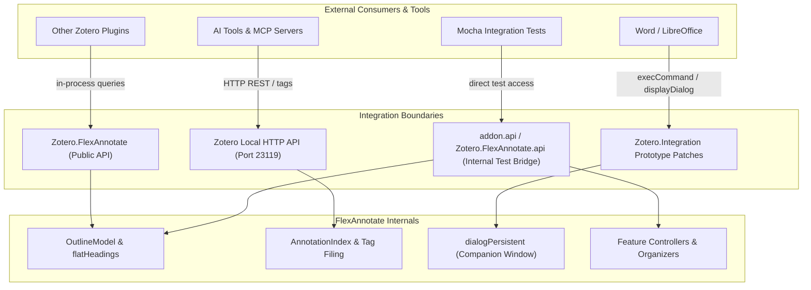
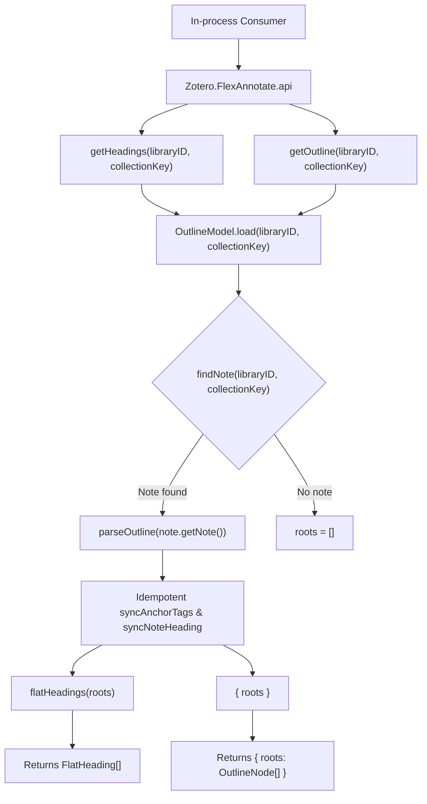
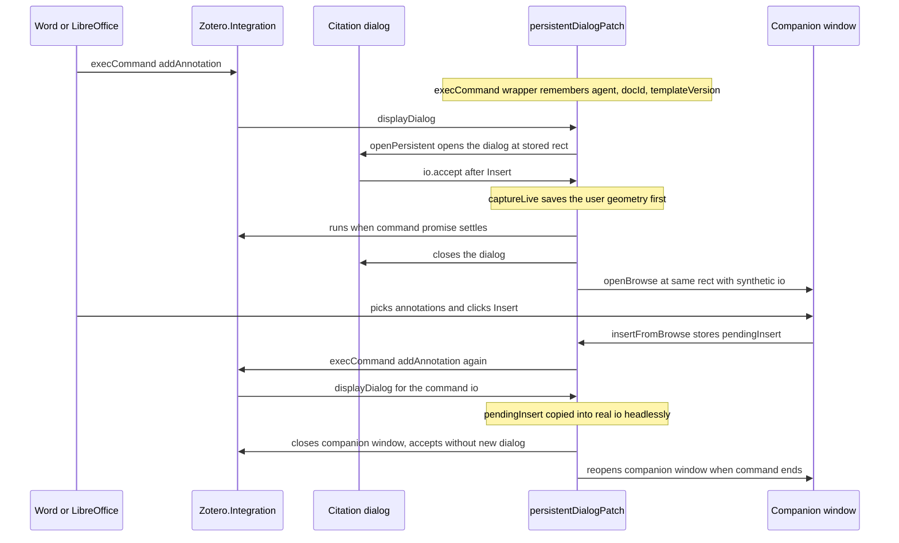

FlexAnnotate exposes multiple outward-facing surfaces designed for distinct integration boundaries. The public `Zotero.FlexAnnotate` namespace lets other Zotero plugins and in-process tools query the organizer outline hierarchy with derived decimal numbering; the internal `addon.api` bridge exposes internal feature modules and lifecycle controllers on the plugin instance for Mocha integration testing and development automation; the §-tag assignment contract in [docs/ai-integration.md](../../docs/ai-integration.md) defines how external AI tools and Model Context Protocol (MCP) servers read and file annotations via Zotero's local HTTP API; `zotero://` deep links navigate from any surface back to specific annotations or items in Zotero; and the Word/LibreOffice persistent citation dialog boundary monkey-patches Zotero's integration runtime so companion browse windows can stay open alongside word processors.

All outward surfaces adhere to a common architectural stance: FlexAnnotate adds no external HTTP server, no custom IPC bridge, and no proprietary AI models. The public namespace degrades gracefully to empty collections on error, the AI contract operates entirely through standard Zotero tags and local HTTP endpoints, deep links use standard Zotero URL schemes, and integration monkey-patches restore native Zotero behavior on teardown (see [Prototype patching](../architecture/patching.md)).



_The four distinct integration boundaries: in-process public namespace, internal test bridge, HTTP tag contract for AI/MCP tools, and word processor integration patches._

---

## The Public Zotero.FlexAnnotate Namespace

[src/features/organizer/externalApi.ts](../../src/features/organizer/externalApi.ts) exposes the official, versioned plugin-to-plugin interface. It mounts an API object on the global `Zotero` namespace under `Zotero.FlexAnnotate` so any in-process consumer — such as another Zotero plugin or an AI assistant extension running in the main process — can read the organizer outline and its computed decimal numbers without needing to parse outline notes or calculate numbering themselves.

### Methods and Data Shapes

The public interface defines two query methods and metadata properties:

```ts
export interface ExternalApi {
  /** Contract version consumers can check before relying on fields. */
  apiVersion: number;
  /** The installed plugin id, so consumers can detect which install responds. */
  pluginID: string;
  /**
   * Get the flat outline headings (with decimal number, path, depth, tag) for
   * a library. Pass a top-level collection key to pick a collection tree;
   * omit it (null) for the library tree.
   */
  getHeadings(
    libraryID: number,
    collectionKey?: string | null,
  ): Promise<FlatHeading[]>;
  /**
   * Get the raw outline tree. Primarily for consumers that want to traverse
   * the hierarchy themselves instead of the flattened list.
   */
  getOutline(
    libraryID: number,
    collectionKey?: string | null,
  ): Promise<{ roots: OutlineNode[] }>;
}
```

| Member | Type / Signature | Description |
| --- | --- | --- |
| `apiVersion` | `number` | Version of the contract (`EXTERNAL_API_VERSION = 1`). Incremented only when breaking changes occur so consumers can verify compatibility. |
| `pluginID` | `string` | The configured extension ID (`"flexannotate@justanotherjurastudent.github.io"`). Lets consumers verify which addon provides the namespace. |
| `getHeadings(libraryID, collectionKey?)` | `(number, string \| null \| undefined) => Promise<FlatHeading[]>` | Resolves the outline tree and flattens it depth-first into an array of `FlatHeading` objects with decimal numbering and breadcrumb paths. |
| `getOutline(libraryID, collectionKey?)` | `(number, string \| null \| undefined) => Promise<{ roots: OutlineNode[] }>` | Resolves the outline tree and returns the hierarchical `OutlineNode` forest for callers performing custom traversals. |

#### FlatHeading Data Shape

`getHeadings()` produces an array of `FlatHeading` objects defined in [src/features/organizer/logic/flatHeadings.ts](../../src/features/organizer/logic/flatHeadings.ts):

```ts
export interface FlatHeading {
  id: string;      // Storage id of the node in the outline tree
  title: string;   // Heading title (without the "§" prefix)
  num: string;     // Decimal outline number, e.g. "1.2.3" (derived on the fly, never stored)
  path: string;    // Breadcrumb path, e.g. "Hauptteil > Analyse", in outline order
  depth: number;   // Tree depth (0 for a top-level heading)
  tag: string;     // Backing Zotero tag items are filed under ("§" + title.trim())
}
```

#### OutlineNode Data Shape

`getOutline()` exposes the tree structure defined in [src/features/organizer/logic/outline.ts](../../src/features/organizer/logic/outline.ts):

```ts
export interface OutlineNode {
  id: string;
  title: string;
  children: OutlineNode[];
}
```

### Outline Numbering, Paths, and Citation Metadata

1. **Derived decimal numbering (`num`):** Outline numbers (`"1"`, `"2.1"`, `"2.2.1"`) are never written to the outline storage note. They are calculated dynamically by `numbering(roots)` in `src/features/organizer/logic/outline.ts`. This guarantees that external callers always observe the identical numbering displayed in the three-column organizer window.
2. **Breadcrumb paths (`path`):** Because `OutlineNode` objects do not store parent references, `pathsFromRoots(roots)` generates a complete map of node IDs to breadcrumbs in a single depth-first pass. Sibling titles are joined by ` > ` (e.g. `"Einleitung"`, `"Hauptteil > Streitstand > Ansichten"`).
3. **Citations & Filed Items:** While `getHeadings` returns structural heading metadata, the underlying model in [src/features/organizer/outlineModel.ts](../../src/features/organizer/outlineModel.ts) maps filed items (`FiledItem`) to formatted citation strings via `citationFor(item)` in [src/features/organizer/citation.ts](../../src/features/organizer/citation.ts). `citationFor` queries `Zotero.QuickCopy` using the user's active citation style, falling back cleanly to `Author (Year). Title` when the citation engine is unavailable:
   - Annotations cite their parent regular item (`paper ? citationFor(paper) : rec.parentTitle`).
   - Standalone notes cite their first related regular item (`citationFor(rel)`).
   - Sources cite the regular item directly (`citationFor(item)`).
4. **Active session cited status:** For word processor integration, `addon.api.cited` ([src/features/organizer/logic/cited.ts](../../src/features/organizer/logic/cited.ts)) manages a session store (`CitedStore = Record<string, Record<string, number>>`, mapping `sessionID -> annotationID -> workID`). This tracks which annotations are already cited in an open document without requiring repeated round-trip document inspections.



_Outline loading and flattening pipeline for the public Zotero.FlexAnnotate namespace._

### Lifecycle and Safe Registration

The public API is managed by the `externalApiFeature` in [src/features/registry.ts](../../src/features/registry.ts), started via `startAll(features)` during `onStartup` and stopped via `stopAll(features)` in `onShutdown` in [src/hooks.ts](../../src/hooks.ts):

- **Idempotency and Conflict Detection:** `installExternalApi()` checks whether `Zotero.FlexAnnotate` is already present. If present and provided by another plugin (checked via `existing.pluginID !== addon.data.config.addonID`), it logs an explicit error via `Zotero.logError` rather than silently ignoring or overwriting the object. Two plugins will never collide over the namespace without surfacing a diagnosis.
- **Clean Teardown:** `uninstallExternalApi()` checks `current?.api?.pluginID === addon.data.config.addonID` before executing `delete (Zotero as any)[EXTERNAL_NAMESPACE]`. If another plugin has taken over the namespace after FlexAnnotate shut down, its registration is left intact.
- **Graceful Failure Degradation:** Both `getHeadings()` and `getOutline()` wrap `OutlineModel.load()` in `try/catch` blocks. If an error occurs, they log diagnostic details via `Zotero.debug("[FlexAnnotate] <method> failed: ...")` and return empty fallback shapes (`[]` or `{ roots: [] }`) instead of rejecting. External callers never receive an unhandled rejection and can safely fall back to their own default behavior.

---

## The Internal addon.api for Testing and Automation

FlexAnnotate runs a comprehensive two-tier testing suite: Node.js unit tests for pure logic and Mocha integration tests inside a live Zotero instance (see [Testing Strategy](../testing/strategy.md)). Integration tests running inside Zotero cannot use direct ES module imports (`import ... from "./feature"`) because production modules depend on initialized runtime singletons (`ztoolkit`, `Zotero`, and the `addon` global). Directly importing modules in tests would instantiate them without initialized globals.

To solve this, [src/hooks.ts](../../src/hooks.ts) constructs `addon.api` during `onStartup()`. This object is mounted on the plugin instance and exposed globally via `(Zotero as any).FlexAnnotate.api` (configured by `config.addonInstance` in [src/index.ts](../../src/index.ts)). Mocha test files (such as [test/features.test.ts](../../test/features.test.ts)) reach all plugin subsystems through a single helper:

```ts
const api = () => (Zotero as any)[config.addonInstance].api;
```

### addon.api Member Inventory

`addon.api` exposes internal controllers, pure logic modules, and lifecycle testing hooks across the entire plugin:

| Namespace / Member | Underlying Module | Purpose in Testing & Automation |
| --- | --- | --- |
| `organizerData` | [src/features/organizer/panel/organizerData.ts](../../src/features/organizer/panel/organizerData.ts) | Loading annotation rows (`loadAnnotationRows`), modifying annotations (`saveAnnotation`), multi-item tag filing (`fileMany`, `unfileMany`), and checking outline notes (`isOutlineNote`). |
| `outline` | [src/features/organizer/logic/outline.ts](../../src/features/organizer/logic/outline.ts) | Pure tree operations: `makeNode`, `locate`, `parseOutline`, `serializeOutline`, `numbering`, `flatten`, and `headingTag`. |
| `flatHeadings` | [src/features/organizer/logic/flatHeadings.ts](../../src/features/organizer/logic/flatHeadings.ts) | Pure heading flattening (`flatHeadings`) and breadcrumb generation (`pathsFromRoots`). |
| `outlineModel` | [src/features/organizer/outlineModel.ts](../../src/features/organizer/outlineModel.ts) | `OutlineModel` static methods for loading trees (`load`, `loadTreeOnly`), persisting notes (`save`), locating outline notes (`findNote`), and synchronizing anchor tags (`syncAnchorTags`). |
| `organizerStrings` | [src/features/organizer/strings.ts](../../src/features/organizer/strings.ts) | Localization string resolver (`tr`). |
| `externalApi` | [src/features/organizer/externalApi.ts](../../src/features/organizer/externalApi.ts) | Lifecycle test hooks: `install` (`installExternalApi`) and `uninstall` (`uninstallExternalApi`). |
| `OrganizerFactory` | [src/features/organizer/panel/organizer.ts](../../src/features/organizer/panel/organizer.ts) | Organizer window controller, inspecting `lastState` (`node`, `noteID`, `saveLog`), window open/close automation. |
| `organizerView` | [src/features/organizer/panel/organizerView.ts](../../src/features/organizer/panel/organizerView.ts) | DOM rendering and event bindings for the organizer window. |
| `docImport` | [src/features/organizer/doc/docImport.ts](../../src/features/organizer/doc/docImport.ts) | DOCX / ODT document outline import engine. |
| `docExport` | [src/features/organizer/doc/docExport.ts](../../src/features/organizer/doc/docExport.ts) | DOCX / ODT document outline export engine. |
| `docOutline` | [src/features/organizer/logic/docOutline.ts](../../src/features/organizer/logic/docOutline.ts) | Pure document outline hierarchy validation and parsing. |
| `organizerToolbar` | [src/features/organizer/toolbarButton.ts](../../src/features/organizer/toolbarButton.ts) | Main toolbar button registration and click handling. |
| `toolsMenu` | [src/features/organizer/toolsMenuFallback.ts](../../src/features/organizer/toolsMenuFallback.ts) | Tools menu fallback item registration. |
| `openTarget` | [src/features/organizer/openTarget.ts](../../src/features/organizer/openTarget.ts) | Deep-link resolution: `openRow` (navigating PDF reader to annotation) and `activateMainWindow`. |
| `tagSuggest` | [src/features/organizer/tagSuggest.ts](../../src/features/organizer/tagSuggest.ts) | Reader tag autocomplete suggestions based on outline headings. |
| `cited` | [src/features/organizer/logic/cited.ts](../../src/features/organizer/logic/cited.ts) | Document citation tracking: `parseStore`, `record`, and `activeIds`. |
| `dialogCited` | [src/features/organizer/citationDialog/dialogCited.ts](../../src/features/organizer/citationDialog/dialogCited.ts) | Citation dialog cited status tracking and collection remembrance (`rememberCollection`). |
| `CitationDialogPatch` | [src/features/organizer/citationDialog/dialogOutline.ts](../../src/features/organizer/citationDialog/dialogOutline.ts) | Citation dialog outline view inspector (`viewOf`). |
| `persistentDialog` | [src/features/organizer/citationDialog/dialogPersistent.ts](../../src/features/organizer/citationDialog/dialogPersistent.ts) | Persistent companion dialog test harness and state controls (see dedicated section below). |
| `modeSelector` | [src/features/citeOnly/modeSelector.ts](../../src/features/citeOnly/modeSelector.ts) | Citation dialog mode selector UI injection hooks. |
| `registry` | [src/features/registry.ts](../../src/features/registry.ts) | Feature registration table, active dialog injectors, and global features. |
| `gates` | [src/features/gates.ts](../../src/features/gates.ts) | Feature gating and runtime preferences checks (`isFeatureEnabled`). |
| `featureLifecycle` | [src/shared/feature.ts](../../src/shared/feature.ts) | Feature lifecycle controls: `startAll`, `stopAll`, `addToWindow`, `removeFromWindow`. |
| `citeOnly` | [src/features/citeOnly/integrationPatch.ts](../../src/features/citeOnly/integrationPatch.ts) | Citation-only integration patch controller (`patch`, `isPatched`). |
| `reader` | [src/features/reader/readerMenu.ts](../../src/features/reader/readerMenu.ts) | Reader context menu registration (`readerMenu`). |
| `citavi` | [src/features/citavi/citaviImport.ts](../../src/features/citavi/citaviImport.ts) | Citavi import subsystem: `importer` (`CitaviImport`), `feature`, `importPrintQuotes`, `linkContributions`. |
| `print` | [src/features/print/](../../src/features/print/) | Print annotation subsystem: `placeholder`, `printAnnotations`, `dialog`, `menus`, and `annotationRowPatch`. |

---

## Outline Tree Model & JSON Storage Schemas

An outline tree is stored as JSON inside a standalone Zotero note tagged `★outline`. Both in-process consumers and external AI tools must adhere to the same schema and resolution rules.

### Storage Note Identification and Scope Rules

- **Library Tree:** Tagged `★outline` with no `#flexannotate-outline-<key>` tag. Covers works not assigned to collections.
- **Collection Tree:** Tagged `★outline` and `#flexannotate-outline-<collectionKey>`. The key (not the database ID) is used because it persists across sync cycles and library migrations. Covers a top-level collection and its subcollections.
- **Disambiguation (`pickNewest`):** When multiple candidate notes exist (e.g. following a sync conflict), `pickNewest` ([src/features/organizer/logic/outline.ts](../../src/features/organizer/logic/outline.ts)) selects the note with the latest `dateModified`. Ties are broken by the higher item ID. Tree selection is strictly deterministic.
- **Idempotent Repair on Load:** Loading via `OutlineModel.load` executes `syncAnchorTags` (anchoring each heading's `§` tag onto the outline note itself) and `syncNoteHeading` (updating the localized `<h1>` scope name in the note body). Older notes created prior to these features are automatically repaired when opened.

### The LATTICE-OUTLINE-V1 Storage Format

The note body contains a localized `<h1>` header, an HTML preview list for glancing at the tree in Zotero, and a `<pre><code>` block containing the JSON payload:

```html
<h1>📚 FlexAnnotate — Gliederung — Strafrecht BT</h1>
<ul><li>Einleitung</li><li>Hauptteil<ul><li>Streitstand</li></ul></li></ul>
<pre><code>LATTICE-OUTLINE-V1
{"v":1,"roots":[{"id":"k3x90","title":"Einleitung","children":[]},{"id":"k3x9a","title":"Hauptteil","children":[{"id":"k3x9b","title":"Streitstand","children":[]}]}]}</code></pre>
```

When Zotero saves notes, it may normalize `<pre><code>...</code></pre>` to `<pre>...</pre>`. The parser `parseOutline` accepts both closing tags and reads only the JSON immediately following the `LATTICE-OUTLINE-V1` sentinel; the `<h1>` and readable `<ul>` are ignored on read.

### Outline JSON Schema

The JSON payload adheres to the `LATTICE-OUTLINE-V1` specification:

```json
{
  "$schema": "http://json-schema.org/draft-07/schema#",
  "title": "LatticeOutlineV1",
  "type": "object",
  "required": ["v", "roots"],
  "properties": {
    "v": {
      "type": "integer",
      "enum": [1],
      "description": "Outline format version; must be 1"
    },
    "roots": {
      "type": "array",
      "items": { "$ref": "#/definitions/OutlineNode" },
      "description": "Top-level root headings of the outline"
    }
  },
  "definitions": {
    "OutlineNode": {
      "type": "object",
      "required": ["id", "title", "children"],
      "properties": {
        "id": {
          "type": "string",
          "description": "Unique identifier for this node within the tree"
        },
        "title": {
          "type": "string",
          "description": "Heading title without the § prefix; unique across the tree (case-insensitive), non-empty, no line breaks"
        },
        "children": {
          "type": "array",
          "items": { "$ref": "#/definitions/OutlineNode" },
          "description": "Subheadings nested under this node"
        }
      }
    }
  }
}
```

#### Tree Invariants and Tag Anchoring
- **Dynamic Numbering:** Outline numbers like `"1"`, `"2.1"`, `"2.1.1"` are computed dynamically for display and are never written to the outline JSON.
- **Heading Tags:** Every node corresponds to a Zotero tag: `"§" + node.title.trim()`.
- **Anchor Tags:** `OutlineModel.save()` and `OutlineModel.load()` call `syncAnchorTags` to attach all heading `§` tags directly to the `★outline` note itself. This ensures tags exist in Zotero's database so the PDF reader's tag autocomplete suggests them immediately when typing `§`, even before any annotation has been filed.
- **Storage Note Exclusion:** Outline notes (`isOutlineNote`) are strictly excluded from item counts in `gather()` and `buildCountMap()` and never count as filed items.

---

## The §-tag Assignment Contract for AI Tools & MCP Servers

FlexAnnotate contains no built-in artificial intelligence or external network listeners. Instead, [docs/ai-integration.md](../../docs/ai-integration.md) defines a contract for external AI tools, background scripts, and Model Context Protocol (MCP) servers. The contract specifies how an external agent reads the outline tree and assigns annotations using Zotero's built-in local HTTP API.

### Version Support and Local HTTP API Setup

External AI integration requires Zotero's local HTTP API server (running by default on `127.0.0.1:23119` per preference `extensions.zotero.httpServer.port`):

- **Zotero 10+ required for writes:** Local API write support (`PATCH`, `POST`, and local authentication) was introduced in Zotero 10.0.
- **Zotero 8+ required for reading annotations:** Zotero 7.x local API queries cannot filter by `itemType=annotation` and lack attachment fulltext endpoints.
- **API Activation:** The local API is disabled by default; users enable it via `extensions.zotero.httpServer.localAPI.enabled`.

| Capability / Endpoint | Zotero 7.x | Zotero 8.x | Zotero 9.x | Zotero 10.x |
| --- | --- | --- | --- | --- |
| Query annotations by exact `§` tag | No | Yes | Yes | Yes |
| Fetch attachment annotations (`/children`) | No | Yes | Yes | Yes |
| Attachment fulltext search (`/fulltext`) | No | Yes | Yes | Yes |
| Local HTTP writes (`PATCH`, batch `POST`, auth) | No | No | No | Yes |

### Guidelines for External AI Tooling

1. **Read-Only Outline Notes:** External tools must treat `LATTICE-OUTLINE-V1` outline notes as **strictly read-only**. Headings must never be created, renamed, or deleted via tag manipulation; heading hierarchy belongs entirely to the user inside the organizer window.
2. **Collection Tree Scope Requirement:** Tools must require a `collection` parameter:
   - Walk subcollections up to the top-level main collection key.
   - Use the note tagged `★outline` and `#flexannotate-outline-<collectionKey>`. If none exists, report that no outline tree exists and halt; **never fall back to the library tree or another collection**.
   - Assign only annotations whose parent item belongs to that main collection or one of its descendants.
3. **Multi-Heading Assignment:** Annotations may be assigned to multiple headings by attaching multiple `§` tags. Tools should choose the most specific heading that fits (`itemsUnder` by default rolls child heading items into parent views).
4. **Tag Hygiene:**
   - Only assign headings that exist in the active tree (unmatched `§` tags appear as orphans).
   - Leave non-heading tags alone (especially `#flexannotate-*`).
   - Remove `§` tags only upon an explicit unassign request.
   - Never rename or delete annotations.

### HTTP Endpoints and Write Mechanics

```http
GET /api/users/0/items?tag=%E2%98%85outline&itemType=note
GET /api/users/0/items?itemType=annotation&limit=100&start=0
GET /api/users/0/items/<attachmentKey>/children?itemType=annotation
GET /api/users/0/items?itemType=annotation&tag=%C2%A7Introduction
GET /api/users/0/items/<attachmentKey>/fulltext
```

Writing assignments:
- `PATCH /api/users/0/items/<annotationKey>` with the full `tags` array (existing tags plus new `§` tags) returns `204 No Content`.
- `POST /api/users/0/items` batches up to 50 items (exceeding 50 returns `413 Payload Too Large`).
- Requests must include the item's current `version` (`If-Unmodified-Since-Version`); stale versions return `412 Precondition Failed`.
- Requests require a `Zotero-Server-ID` header (read from `GET /api/`) and an authorized `Zotero-API-Key` obtained via `POST /api/local/authorize` with `{ "appName": "<toolName>" }`.
- Requests with browser `User-Agent` or `Origin` headers must supply `Zotero-Allowed-Request: 1`.

### Recommended MCP Tools and Workflow

[docs/ai-integration.md](../../docs/ai-integration.md) outlines standard MCP tools:

| Tool | Input | Output |
| --- | --- | --- |
| `outline_get` | `collection` (key) | Array of `{ title, path, depth }` for all tree nodes |
| `annotations_list` | `collection`, `unassignedOnly` | Array of text, comment, page, type, color, work, `§` tags, key |
| `annotation_context` | `annotationKey` | Fulltext around the annotation |
| `annotations_assign` | `collection`, `assignments: [{ key, headings }]`, `dryRun` | `{ assigned, skipped, unknownHeadings }` |
| `annotations_unassign` | `collection`, `assignments: [{ key, headings }]` | Removed tags per annotation |

---

## Deep Links: openTarget and zotero:// URLs

[src/features/organizer/openTarget.ts](../../src/features/organizer/openTarget.ts) navigates from organizer rows back to items within Zotero, serving as the canonical navigation model for deep links:

- **Annotations:** Navigated via `Zotero.Reader.open(attachmentID, { annotationID: row.key })`. Supplying the `annotationID` causes Zotero's PDF reader to select an existing tab, focus it, and jump to the exact location of the annotation without opening duplicate tabs.
- **Works / Regular Items:** Selected in the main window item tree via `ZoteroPane.selectItem(row.id)`.
- **Window Activation:** Because the organizer runs in its own window, `activateMainWindow()` brings Zotero's main window to the foreground using `Utilities.Internal.activate(win)` (with a standard `focus()` fallback).

### URL Format

The library prefix segment is determined by `uriLibraryPrefix` in [src/features/organizer/annotationIndex.ts](../../src/features/organizer/annotationIndex.ts): `"library"` for the user's personal library, or `"groups/<id>"` for group libraries:

- **PDF Annotation Link:** `zotero://open-pdf/<prefix>/items/<attachmentKey>?annotation=<key>`
- **Item / Note Link:** `zotero://select/<prefix>/items/<key>`

These deep links are embedded into exported documents and notes, allowing users to jump directly from external text documents back into Zotero's reader.

---

## The Word/LibreOffice Boundary: Persistent Citation Dialog

When inserting citations from Word (`WinWord`, `MacWord`) or LibreOffice Writer (`LibreOffice`), Zotero's native integration opens and closes a modal citation dialog for every insertion. The persistent dialog feature in [src/features/organizer/citationDialog/dialogPersistent.ts](../../src/features/organizer/citationDialog/dialogPersistent.ts) keeps a companion window ("Blätterfenster") open alongside the word processor for rapid, consecutive citing.

### Architecture and Lifecycle

Persistent dialog integration is split into focused modules under `src/features/organizer/citationDialog/`:
- `persistentState.ts`: shared runtime state, preferences, and agent filters.
- `persistentPinning.ts`: geometry pinning during load phases and saved rect preferences.
- `persistentWindow.ts`: window lifecycle (`openPersistent`, `openBrowse`, `insertFromBrowse`).
- `persistentPatches.ts`: integration method monkey-patching.
- `persistentFeature.ts`: startup, teardown, and atomic patch coordination.
- `persistentTestHooks.ts`: test hooks for automated test runners.
- `dialogOutlineLayout.ts`: three-column layout and responsive narrow-view styling.

1. **Version Gate:** `persistentSupported()` checks for `Zotero.Integration.Interface.prototype.addAnnotation`. This method exists in Zotero 9 and 10, but is absent in 7.x/8.x. On unsupported versions, no patches are applied and the feature remains hidden.
2. **Atomic Patching:** `patchDisplayDialog`, `patchExecCommand`, and `patchInterfaceMethods` wrap native integration functions via `assignChecked`. If any core patch fails to install, all are rolled back immediately (`state.alive = false`), leaving Zotero in a clean native state. `patchProgressBar` suppresses orphan progress dialogs.
3. **Agent Allow-List:** `isPersistentAgent` permits `WinWord`, `LibreOffice`, and `MacWord`. The `http` agent (Google Docs) is explicitly excluded because re-running commands from a browse window leaves HTTP response callbacks stale and causes the server to hang.



_The companion window cycle: real command execution, companion window reopening, and headless insertion via synthetic CitationEditInterface._

### The Browse Window Cycle

- **First Insert:** A native request from the word processor opens the dialog via `openPersistent()`. When the user accepts an insertion, `wrapPersistentAccept` records the live window geometry (`captureLive`), allows the native command to settle, closes the initial dialog, and opens a fresh companion window via `openBrowse()`.
- **Synthetic IO:** The companion window is an instance of `citationDialog.xhtml` powered by a synthetic `CitationEditInterface` (`isAddingAnnotations = true`, with no bound document; see `makeBrowseIo`). It renders the full citation dialog UI (including collections, annotations, and the outline view; see [Organizer](../features/organizer.md)).
- **Headless Insertion:** Because the dialog UI tears down when `accept()` is called, inserting from the browse window triggers `insertFromBrowse()`. This re-invokes `integ.execCommand(agent, "addAnnotation", docId, templateVersion)` using the captured command parameters. The patched `displayDialog()` then injects `pendingInsert` directly into the command's real `io` without displaying a modal window, after which the browse window re-opens at the same coordinates.

### Geometry Management and Teardown

- **Feature Normalization:** `normalizePersistentOptions` ([src/features/organizer/logic/persistentOptions.ts](../../src/features/organizer/logic/persistentOptions.ts)) strips `popup`, `alwaysRaised`, and `centerscreen` from window features, adds `dialog=no` and `resizable=yes`, and translates coordinates into device pixels (adjusting for `devicePixelRatio`).
- **Load-time Pinning (`pinRect`):** Zotero repeatedly resizes dialog windows during load. `pinRect` runs a 20 ms timer holding target dimensions: position is pinned during the load phase (up to 1500 ms), and size is held until the first foreign resize event, capped at 30 adjustments to prevent oscillation.
- **Narrow Layout:** `relaxDialogMinWidth` sets `libraryLayout.MIN_WIDTH = 360` px and adds `#citation-dialog { min-width: 0 !important; }`, allowing narrow side-by-side positioning.
- **Persistence:** Coordinates survive restarts via `extensions.flexannotate.persistentWindowRect` (debounced to 500 ms and flushed on stop). `parseStoredRect` validates coordinates, falling back to defaults if dimensions fall below 320×300 px.
- **Teardown & Failure Handling:** `stop()` restores all monkey-patched methods, flushes preferences via `flushStoredRect()`, clears `pendingInsert`/`lastCommand`, and closes any active browse window. If `openPersistent` fails before a window opens, it falls back cleanly to the native `displayDialog`; if it fails after a window opens, it suppresses duplicate dialog openings. Single-window close without accept resolves the pending request promise Zotero waits on. Mid-dialog enabling via `activatePersistentOnOpenDialog()` arms a running native dialog without reopening it.

---

## Persistent Dialog Layout Inspection & Test Hooks

Automated test runners ([test/persistentLayout.test.ts](../../test/persistentLayout.test.ts) and [test/features.test.ts](../../test/features.test.ts)) drive and inspect the persistent companion window through dedicated test hooks and state query methods exposed on `addon.api.persistentDialog`.

### Test Hooks Contract

[src/features/organizer/citationDialog/persistentTestHooks.ts](../../src/features/organizer/citationDialog/persistentTestHooks.ts) and [src/features/organizer/citationDialog/dialogPersistent.ts](../../src/features/organizer/citationDialog/dialogPersistent.ts) provide the programmatic entrypoints:

```ts
export interface PersistentDialogApi {
  feature: Feature;                           // Feature lifecycle controller (start/stop)
  readPref: () => boolean;                    // Reads extensions.flexannotate.persistentCitationDialog
  writePref: (v: boolean) => void;            // Writes persistent citation dialog preference
  getWindow: () => Window | null;             // Active companion window (or null if closed)
  normalizeOptions: typeof normalizePersistentOptions; // Feature string builder
  rememberCommand: (ref: CommandRef | null) => void;   // Pre-arms lastCommand without running Word
  lastCommand: () => CommandRef | null;       // Currently remembered CommandRef
  setPendingInsert: (p: PendingInsert | null) => void; // Pre-arms pending headless insertion
  patchExec: () => boolean;                   // Installs execCommand patch
  unpatchExec: () => void;                    // Removes execCommand patch
  openBrowse: (rect?: { x: number; y: number; w: number; h: number }) => Window; // Opens companion window directly
  makeBrowseIo: (command?: string, type?: string | null) => any; // Creates synthetic CitationEditInterface
  activateOnOpenDialog: () => void;           // Arms a running native dialog mid-flight
  supported: (win?: Window) => boolean;       // Queries runtime version and agent support
  patchInterface: () => boolean;              // Installs Interface.prototype patches
  unpatchInterface: () => void;               // Removes Interface.prototype patches
  rememberCollection: (win: Window) => void;  // Remembers active collection/tab
}
```

### Layout Inspection Contract

Automated runners inspect the companion window layout and state using standard DOM contracts and layout invariants defined in [src/features/organizer/citationDialog/dialogOutlineLayout.ts](../../src/features/organizer/citationDialog/dialogOutlineLayout.ts):

1. **Load Phase Readiness:** Tests poll `(win as any).DIALOG_STATE?.loaded` to ensure Zotero's asynchronous initialization and initial resize cycle have settled.
2. **View Toggling:** The outline view is activated by querying and clicking `win.document.getElementById("flexannotate-toggle")`.
3. **Container Presence & Native Element Hiding:**
   - Injected style `#flexannotate-dialog-style` hides native containers: `#zotero-collections-tree`, `#zotero-items-tree`, `#annotations-list-wrapper`, `#annotations-sidebar-filter-wrapper`, `#annotations-message`, and `#annotations-list collapsible-section`.
   - Injected layout containers: `#flexannotate-outline-tree` (in `#collections-tree-container`), `#flexannotate-list-pane` (in `#item-tree-container`), and `#flexannotate-preview` (in `#annotations-sidebar`).
4. **Item Verification:** Rendered annotation rows are queried via `#flexannotate-list-pane [data-ann-id]`, preview action buttons via `#flexannotate-show-place`, and inserted bubble chips via `#bubble-input .bubble`.
5. **Narrow Layout Breakpoint (< 750 px):**
   - When docked alongside word processors, `relaxDialogMinWidth` sets `libraryLayout.MIN_WIDTH = 360` and injects `#flexannotate-persistent-style` (`#citation-dialog { min-width: 0 !important; }`), marking the root element with attribute `flexannotate-persistent`.
   - `@media (max-width: 750px)` reorganizes the three columns: `#library-trees` switches to `flex-direction: column !important`, `#collections-tree-container` locks to a height of 130 px, `#collections-tree-divider` is hidden (`display: none`), `#item-tree-container` fills remaining vertical space, and `#sidebar` is capped to a maximum height of 30% with scroll.

---

## Testing & Verification

- **Node.js Unit Tests:**
  - [test-unit/flatHeadings.test.ts](../../test-unit/flatHeadings.test.ts) verifies depth-first tree flattening, derived decimal numbering (`"1"`, `"2.1"`, `"2.2.1"`), depth calculation, breadcrumb path generation, and empty outline handling.
- **Mocha Integration Tests (Live Zotero Instance):**
  - [test/features.test.ts](../../test/features.test.ts) drives end-to-end integration through `addon.api`. It validates that `openRow` invokes `Reader.open` with `{ annotationID: ann.key }`, exercises the persistent dialog lifecycle (dialog closing, browse window reopening, headless command execution, and window coordinate preservation), verifies single-close promise resolution, and validates `activateOnOpenDialog` for arming running dialogs.
  - [test/persistentLayout.test.ts](../../test/persistentLayout.test.ts) tests the companion window layout across 7 size breakpoints (from 1100×700 down to 360×500 and docked 700×300), verifying loaded geometry, toggle switching, annotation row rendering, and automated PNG visual capture.
