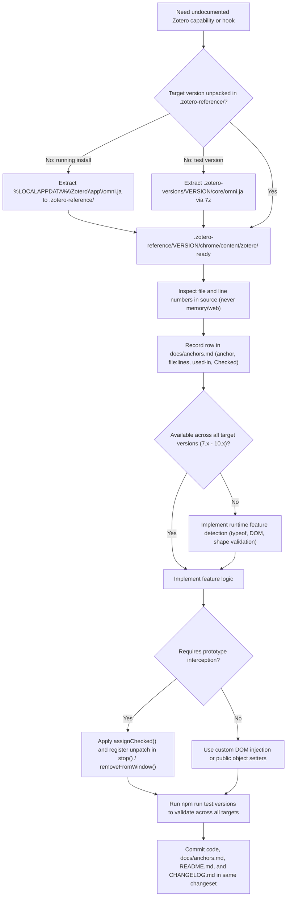

FlexAnnotate integrates with Zotero at key junctures where no public plugin API exists — annotation field validation, the citation-insertion branch of the word processor integration session, dialog DOM structures, `MenuManager`, `FilePicker`, and custom element rendering. It supports Zotero 7.0 through 10 with a single codebase ([AGENTS.md](../../AGENTS.md)). Two fundamental engineering rules make this cross-version compatibility safe ([AGENTS.md](../../AGENTS.md), "Zotero-Interna nur gegen den Quellcode prüfen" and "Weitere Zotero-Versionen"):

1. **Zotero internals are verified only against source code, never from memory.** The sole source of truth is the unpacked Zotero tree under `.zotero-reference/<version>/`, regenerated directly from `omni.ja` when needed.
2. **Missing capabilities are handled by runtime feature detection, not by comparing version numbers.** The codebase runs uniformly on 7.x through 10.x, automatically adapting to available APIs and degrading gracefully where older versions lack specific capabilities.

Every internal lookup is recorded in [docs/anchors.md](../../docs/anchors.md) along with the verified version and source line numbers. The `.zotero-reference/` and `.zotero-versions/` directories themselves are excluded from the repository index by [`.gitignore`](../../.gitignore) and [`.openwikiignore`](../../.openwikiignore) ("Unpacked Zotero source reference (large, lookup-only)") — this page documents the architecture, logging policies, feature detection mechanisms, and compatibility fallbacks governing those internals.

## The `.zotero-reference/` trees: verifying internals against `omni.ja`

Zotero packages its frontend, data layer, and integration logic into an optimized archive named `omni.ja`. Because internal methods, properties, and file structures evolve across major releases without public changelog entries, guessing behavior from memory or reading third-party documentation risks severe regressions.

FlexAnnotate maintains gitignored look-up reference trees for all supported major and minor versions ([AGENTS.md](../../AGENTS.md)):

- **Present reference trees:** `7.0.32`, `8.0.4`, `9.0.6`, `10.0.1`, `10.0.5`. These directories are listed in [`.gitignore`](../../.gitignore) under "Entpackter Zotero-Quellcode (Nachschlagewerk)" alongside `*.exe`.
- **Anchor paths:** All file paths recorded in [docs/anchors.md](../../docs/anchors.md) are relative to `chrome/content/zotero/` of the unpacked `omni.ja` archive (e.g. `xpcom/integration.js`, `elements/annotationItemsPane.js`, `elements/annotationRow.js`, `integration/citationDialog.js`, `xpcom/annotations.js`).
- **Wiki indexing boundary:** Wiki pages treat the unpacked reference trees as external look-up material. Code is never quoted verbatim from the reference trees into repository files or wiki documentation; instead, the corresponding anchor row (file, line range, and verified version) is cited.

### Anchor verification workflow against unpacked trees

The repository strictly enforces a systematic verification lifecycle whenever integrating with undocumented Zotero APIs or updating supported versions ([AGENTS.md](../../AGENTS.md)):


*Workflow for verifying undocumented Zotero internals against unpacked reference trees and maintaining the anchor audit ledger.*

#### Step 1: Source acquisition and unpacking
Internals are never inspected on GitHub `main` or third-party forks when local builds exist. The source must come directly from the `omni.ja` bundle:
- **Running installation:** For the active developer environment (per-user installation under `%LOCALAPPDATA%\Zotero`), [AGENTS.md](../../AGENTS.md) specifies the exact extraction procedure:
  ```powershell
  $dst = "$env:TEMP\zotero-omni"
  Copy-Item "$env:LOCALAPPDATA\Zotero\app\omni.ja" "$dst.zip" -Force
  Expand-Archive "$dst.zip" $dst   # Source code under $dst\chrome\content\zotero
  ```
- **Portable test versions:** For non-installed versions (7.0.32, 8.0.4, 9.0.6), `omni.ja` is obtained directly from `.zotero-versions/<version>/core/omni.ja` (see [Test versions](#test-versions-zotero-versions-and-npm-run-testversions) below) and unpacked into `.zotero-reference/<version>/`.

#### Step 2: Line inspection and anchor logging
Developers identify the exact file relative to `chrome/content/zotero/` and record the current line numbers in [docs/anchors.md](../../docs/anchors.md). The entry includes:
- Plain description of the hook or invariant.
- Path and line numbers in the reference tree.
- Consuming source files in `src/`.
- Concrete version in the *Checked* (*Geprüft*) column.

#### Step 3: Capability gating and graceful fallback
If the symbol, property, or DOM structure is absent in earlier versions, developers create a feature gate (e.g. `typeof ... === "function"` or `doc.getElementById(...)`) rather than a version check. If the capability is missing, the feature either provides an alternative implementation (e.g., direct XUL injection) or quietly suppresses the interface.

#### Step 4: Multi-version test verification
All changes are validated across the test suite using `npm run test:versions`. Tests expecting missing features skip conditionally using capability checks, ensuring clean runs across all versions.

#### Step 5: Atomic changeset delivery
Documentation, anchor log rows, and code changes are committed together in the same changeset ([AGENTS.md](../../AGENTS.md), [Conventions & constraints](../conventions.md)).

---

## The anchor log policy: `docs/anchors.md`

[docs/anchors.md](../../docs/anchors.md) is the **mandatory ledger of every attachment point to an undocumented Zotero internal**. Whenever a feature touches an unexported function, modifies a native prototype, queries an internal DOM node, or inspects unexposed preferences, it must be documented.

The anchor table uses a four-column structure:

| Column | Content | Example |
| --- | --- | --- |
| *Anchor* | Plain-language description of the internal capability or constraint | `Zotero.MenuManager.registerMenu / unregisterMenu(key)` |
| *File (lines)* | Relative path under `chrome/content/zotero/` and line numbers in the reference tree | `xpcom/pluginAPI/menuManager.js 824, 833` |
| *Used in* | Plugin source files that consume or depend on the internal | `src/utils/menu.ts` |
| *Checked* | Exact version(s) against which the anchor was actively verified | `10.0.5` |

### Strict semantics of the *Checked* (*Geprüft*) column

The header of [docs/anchors.md](../../docs/anchors.md) establishes strict verification semantics:

- `10.0.5` — The internal was inspected directly in `.zotero-reference/10.0.5/` on 2026-10-09, and the recorded line numbers reflect the 10.0.5 code.
- `10.0.6 (Quelle: app/omni.ja)` — The internal was verified directly against the installed application `omni.ja` archive for 10.0.6.
- `10.0.1, not re-checked` (`10.0.1, nicht neu geprüft`) — The lookup was verified against version 10.0.1 and has **not yet been re-verified** against 10.0.5 or subsequent builds.
- `Zotero source on GitHub (main); not checked against local reference` — The behavior was verified only against Zotero's upstream repository on GitHub, not against an unpacked local `omni.ja` tree.
- `not checked` (`nicht geprüft`) — Used for behaviors deduced from error signatures and commits (e.g., selection of a new note opening the note editor, derived from commit `736657e`) rather than verified line-by-line in source.
- Feature sections with uniform lookup states carry their own scope notes; for instance, the persistent citation window section explicitly states that all its entries were inspected in 10.0.5.

### Newly tracked anchors

As the codebase evolves, newly tracked internals are catalogued in [docs/anchors.md](../../docs/anchors.md):

1. **`AnnotationRow.prototype.render()` (`elements/annotationRow.js` lines 90–95, verified in 10.0.5):**
   - *Internal behavior:* Zotero's native `<annotation-row>` custom element hardcodes the title of the annotation row to `pdfReader.page + ' ' + pageLabel` (lines 93–94).
   - *FlexAnnotate usage:* [`src/features/print/annotationRowPatch.ts`](../../src/features/print/annotationRowPatch.ts) intercepts `proto.render` via `assignChecked` so that rows display FlexAnnotate's resolved locator (e.g. "Randnummer 318" or "Opus 42") instead of a hardcoded "Page" prefix.
2. **`IOManager.toggleDialogMode(newMode)` (`integration/citationDialog.js` lines 1316–1340, verified in 10.0.6):**
   - *Internal behavior:* Toggles the Word citation dialog between Quick Copy list mode (`currentLayout.type === "list"`) and classic hierarchical library tree mode (`"library"`).
   - *FlexAnnotate usage:* [`src/features/organizer/citationDialog/dialogOutline.ts`](../../src/features/organizer/citationDialog/dialogOutline.ts) awaits `IOManager.toggleDialogMode("library")` when the outline view is enabled to switch the dialog from list mode to classic tree view, which is required for outline navigation.
3. **`IOManager.addItemsToCitation(items, options)` (`integration/citationDialog.js` lines 1391–1425, verified in 10.0.6):**
   - *Internal behavior:* Zotero's internal routine on `IOManager` to insert regular bibliographic items/works into the active Word citation session.
   - *FlexAnnotate usage:* [`src/features/organizer/citationDialog/dialogOutlineRender.ts`](../../src/features/organizer/citationDialog/dialogOutlineRender.ts) checks if the dialog is in citation mode (`dialog-type === "citation"`) and invokes `(win as any).IOManager.addItemsToCitation(works)` for selected regular items, distinguishing work insertions from annotation insertions (which inject an `<annotation-row>` with `action="plus"` into `#annotations-list`).

### Version-pinned line drift

Internal line numbers in Zotero fluctuate significantly between releases. FlexAnnotate pins line numbers to specific versions to prevent stale assumptions:

- **Annotation field rules (`xpcom/data/item.js`):** In 10.0.1, field validation rules (`annotationType`, `annotationText`, color, sort index) stood roughly 24 lines earlier than in 10.0.5 (lines 4511–4547).
- **Note editor saving (`xpcom/editorInstance.js`):** `EditorInstance._save` begins at line 933 in 7.0.32, shifts to line 1071 in 8.0.4 and 9.0.6, and moves to line 1149 in 10.0.5.
- **File content reading (`xpcom/file.js`):** `Zotero.File.getContentsAsync` moved from line 218 in 7.0.32 to line 225 in 10.0.5.
- **Stable lines:** Identical line ranges across versions are rare exceptions (e.g. `modules/filePicker.mjs` lines 50–51, 62, 81, 93, 101 remained unchanged from 7.0.32 through 10.0.5) and are explicitly highlighted as such.

### Documentation discipline and patch policy

Repository rules dictate that **documentation ships in the same changeset as code** ([AGENTS.md](../../AGENTS.md), "Doku im selben Änderungssatz"; [Conventions & constraints](../conventions.md)). Any pull request or commit that introduces a new internal dependency must update `docs/anchors.md`, `README.md`, and `CHANGELOG.md` concurrently.

The log also codifies FlexAnnotate's prototype patching boundaries:
- The **Word citation dialog's core integration logic receives zero prototype patches**. The plugin interacts with citation session controllers (`CitationEditInterface`, `IOManager`) via public APIs, property setters (such as `items` on `<annotation-items-pane>`), and standard DOM event injection.
- Where prototype patches are unavoidable (`_insertCitingResult`, `Translate.Import.translate`, `Zotero_File_Interface` methods, `Reader.open`, and custom element rendering in `AnnotationRow.prototype.render`), they must use the `assignChecked` primitive from [`src/shared/patch.ts`](../../src/shared/patch.ts) and be restored in `stop()` or `removeFromWindow()` (see [Prototype patching](../architecture/patching.md)).

---

## Feature detection and central feature gates

FlexAnnotate strictly forbids branching on `Zotero.version` or comparing SemVer strings in application code.

### Why hardcoded version checks fail

1. **Point releases and branch backports:** Upstream features or bug fixes are frequently backported to minor releases or patch builds. A check such as `if (version >= "9.0.0")` breaks if Zotero backports an API to 8.1 or delays a feature until 9.0.2.
2. **Custom and development builds:** Beta releases, release candidates, and source builds may report non-standard version strings (e.g. `10.0-beta.1` or `7.0.0-dev`), causing version string parsers to fail.
3. **Forward compatibility:** When a new major release (such as Zotero 11) appears, hardcoded version ranges (e.g. `version.startsWith("10")`) fail immediately, requiring emergency maintenance even when the underlying API is completely untouched.

### The feature-detection principle

By testing for the **presence and validity of the required capability directly**, the plugin achieves true forward and backward compatibility. If a capability is present, FlexAnnotate consumes it; if it is missing, the plugin either executes an alternative codepath or suppresses the feature cleanly without runtime errors.

### Central feature switches (`src/features/gates.ts`)

In addition to dynamic capability detection, FlexAnnotate centralizes all feature toggles in [`src/features/gates.ts`](../../src/features/gates.ts):

- **Two gate categories:**
  1. *Lifecycle & dialog-injector gates:* Evaluated at startup by `src/features/registry.ts` to control active global features and citation dialog injectors.
  2. *Runtime sub-feature gates:* Polled on demand via `isFeatureEnabled(name)` during rendering and user actions (e.g., `narrowDialogLayout`, `citedTracking`, `footnoteJump`, `docImport`).
- **Dependency declarations (`requires`):** Coupled features define parent gates via `requires`. For example, `toolsMenuFallback` requires `organizer`, and `organizerToolbarButton` requires `organizer`. Disabling a base gate automatically deactivates all dependent features.
- **Emergency hotfix overrides:** Any gate can be turned off without releasing an addon update by setting the hidden boolean preference `extensions.flexannotate.gate.<name>` to `false` in `about:config`. Runtime gates take effect immediately on the next render/action; lifecycle gates take effect on Zotero restart. Overrides can only disable, never force-enable.

| Gate | Capability check | Target versions | Fallback / Behavior | Implementation |
| --- | --- | --- | --- | --- |
| Color palette | `Array.isArray(Zotero.Annotations.COLORS)` with valid entries | Zotero 10.x only | Fallback to hard-coded `STANDARD_COLORS` array | [`annotationColors()`](../../src/features/print/logic/printAnnotation.ts) |
| Tools menu | `typeof Zotero.MenuManager?.registerMenu === "function"` | Missing in 7.0.32 | Append direct XUL `menuitem` to `#menu_ToolsPopup` | [`toolsMenuFallback`](../../src/features/organizer/toolsMenuFallback.ts) |
| Dialog annotations mode | `#annotations-sidebar` present in dialog DOM | Missing prior to 9.x | Skip mode selector injection; return early | [`modeSelector.injectModeSelector`](../../src/features/citeOnly/modeSelector.ts) |
| Persistent citation dialog | `typeof Integration.Interface.prototype.addAnnotation === "function"` & supported platform | Present in 9.x/10.x, missing in 7.x/8.x | Suppress persistent window; outline hides toggle switch | [`persistentSupported(win)`](../../src/features/organizer/citationDialog/persistentWindow.ts) |
| Dialog layout switching | `typeof IOManager?.toggleDialogMode === "function"` | Present in 9.x/10.x | Automatically switch from list mode to classic library tree mode | [`enable()`](../../src/features/organizer/citationDialog/dialogOutline.ts) |
| Work insertion into citation | `typeof IOManager?.addItemsToCitation === "function"` | Present in 9.x/10.x | Insert selected bibliographic items directly into citation session | [`insert()`](../../src/features/organizer/citationDialog/dialogOutlineRender.ts) |
| Dialog three-column layout | `#collections-tree-container` & `#item-tree-container` | Present in 9.x/10.x | Injects three-column view and handles narrow view below 750px | [`applyLayout()`](../../src/features/organizer/citationDialog/dialogOutlineLayout.ts) |
| Annotation row title | `typeof customElements.get("annotation-row")?.prototype?.render === "function"` | Present across 7.x–10.x | Intercept render to substitute custom locator label | [`patchAnnotationRow()`](../../src/features/print/annotationRowPatch.ts) |
| Test suite gating | Source contains `annotations-sidebar` | Missing prior to 9.x | Mark Mocha tests as `pending` via `this.skip()` | [`hasAnnotationDialog()`](../../test/helpers.ts) |

---

## Concrete fallback implementations

### 1. `annotationColors()` — the palette that only exists on 10

Zotero 10 defines `Zotero.Annotations.COLORS` as an array of `[l10nKey, hex]` pairs in `xpcom/annotations.js` (lines 40–53). Zotero 7, 8, and 9 do not expose this property.

In [`src/features/print/logic/printAnnotation.ts`](../../src/features/print/logic/printAnnotation.ts), FlexAnnotate handles this cleanly:

```ts
export const STANDARD_COLORS: [string, string][] = [
  ["general-yellow", "#ffd400"],
  ["general-red", "#ff6666"],
  ["general-green", "#5fb236"],
  ["general-blue", "#2ea8e5"],
  ["general-purple", "#a28ae5"],
  ["general-magenta", "#e56eee"],
  ["general-orange", "#f19837"],
  ["general-gray", "#aaaaaa"],
];

export function annotationColors(zoteroColors?: unknown): [string, string][] {
  const valid =
    Array.isArray(zoteroColors) &&
    zoteroColors.length > 0 &&
    zoteroColors.every(
      (pair) =>
        Array.isArray(pair) &&
        pair.length === 2 &&
        typeof pair[0] === "string" &&
        /^#[0-9a-f]{6}$/i.test(String(pair[1])),
    );
  return valid ? (zoteroColors as [string, string][]) : STANDARD_COLORS;
}
```

- **Defensive shape validation:** Because `zoteroColors` originates outside the extension, `annotationColors` validates that every element is a two-item tuple containing a string and a `#rrggbb` hex value. If the property is missing, empty, or malformed, it falls back to `STANDARD_COLORS`.
- **Untyped access:** [`src/features/print/dialog.ts`](../../src/features/print/dialog.ts) reads `(Zotero.Annotations as unknown as { COLORS?: unknown }).COLORS` deliberately untyped, because the official `zotero-types` package does not declare it.
- **Localization key resolution:** In Zotero 7.x, colors used legacy dot-separated property keys in `zotero.properties` (`general.yellow`...`general.gray`), whereas Zotero 8+ uses hyphenated Fluent keys in `zotero.ftl` (`general-yellow`...`general-gray`). The `colorLabel()` helper in `dialog.ts` tests both key formats (`nameKey` then `nameKey.replace("-", ".")`) before falling back to the raw key string.
- **Testing:** Unit-tested in [`test-unit/printAnnotation.test.ts`](../../test-unit/printAnnotation.test.ts) without Zotero dependencies, validating valid passthrough, `undefined` fallback, and rejection of malformed structures (`[]`, `"x"`, missing hex codes, non-string keys).

### 2. `toolsMenuFallback` — manual XUL injection for Zotero 7

In Zotero 8.0 and later, plugins register top-level menu entries using `Zotero.MenuManager.registerMenu()`. In Zotero 7.0.32, `Zotero.MenuManager` does not exist ([docs/anchors.md](../../docs/anchors.md)).

FlexAnnotate wraps `MenuManager` in [`src/utils/menu.ts`](../../src/utils/menu.ts), which checks `typeof Zotero.MenuManager?.registerMenu === "function"` and acts as a silent no-op when absent. To ensure Zotero 7 users can still access the Organizer, [`src/features/organizer/toolsMenuFallback.ts`](../../src/features/organizer/toolsMenuFallback.ts) provides a dedicated fallback:

- **Detection gate:** `needed()` checks:
  ```ts
  function needed(): boolean {
    return typeof (Zotero as any).MenuManager?.registerMenu !== "function";
  }
  ```
- **Dual-guard against duplication:** If `needed()` returns false, or if `#flexannotate-tools-organizer` already exists in the document, `addToWindow()` exits immediately. This prevents duplicate menu items when `MenuManager` is present or if `addToWindow()` is called repeatedly.
- **Direct DOM creation:** On Zotero 7, it locates `<menupopup id="menu_ToolsPopup">` and creates a XUL element:
  ```ts
  const item = doc.createXULElement("menuitem") as HTMLElement;
  item.id = MENU_ITEM_ID;
  item.setAttribute("label", getString("outline-menu-label", "label"));
  item.setAttribute("class", "menuitem-iconic");
  ```
- **Fluent XUL quirk:** The label must be set directly via `setAttribute("label", ...)` rather than Fluent's `data-l10n-id`. In XUL, Fluent assigns text via `textContent`, but native XUL `<menuitem>` elements only render text stored in their `label` attribute.
- **Window lifecycle:** Click listeners are tracked per window using a `WeakMap<MainWindow, () => void>`, allowing `removeFromWindow()` to detach the event listener and remove the DOM element cleanly upon window closing or addon shutdown.
- **Integration testing:** [`test/toolsMenu.test.ts`](../../test/toolsMenu.test.ts) asserts that the fallback item is present under `#menu_ToolsPopup` when `MenuManager` is absent, and asserts that exactly zero items exist when `MenuManager` is present (verifying that `MenuManager` owns the entry).

### 3. `modeSelector` — gating on citation dialog annotations mode

The citation dialog is an independent window loaded by the Word processor integration. Between major releases, Zotero renamed the dialog file:
- **Zotero 7.x:** `chrome/content/zotero/integration/addCitationDialog.xhtml`
- **Zotero 8.x, 9.x, 10.x:** `chrome/content/zotero/integration/citationDialog.xhtml`

Furthermore, Zotero introduced the dual mode architecture (`dialog-type="annotations"`, containing `#annotations-sidebar` and `#annotations-list`) only in Zotero 9.x. Zotero 8.0.4 has the new file name but completely lacks the annotations sidebar.

[`src/features/citeOnly/modeSelector.ts`](../../src/features/citeOnly/modeSelector.ts) uses DOM inspection to gate injection:

```ts
export function injectModeSelector(win: Window): void {
  const doc = win.document;
  if (doc.querySelector(`.${ROW_CLASS}`)) return;
  // Zotero 8 lacks the annotation mode in citation dialog (added in 9.x)
  if (!doc.getElementById("annotations-sidebar")) return;
  ...
}
```

- **Dynamic visibility tracking:** The mode selector injects into `#settings-popup .popup` and `#itemDetails .popup`. Because Zotero toggles elements with `[data-dialog-type]` attributes only during its internal mode transitions — and FlexAnnotate injects after this initial pass — `trackDialogType()` attaches a `MutationObserver` to watch the root element's `dialog-type` attribute and update selector visibility dynamically.

### 4. `persistentSupported(win)` — keep-open window suppression on 7 and 8

FlexAnnotate's keep-open companion window feature reopens the citation dialog as a persistent browsing window after each citation insertion. This functionality requires Zotero's internal `addAnnotation` command on `Integration.Interface.prototype` (located at `integration.js:781` in versions 9 and 10), which does not exist in Zotero 7 and 8.

In [`src/features/organizer/citationDialog/persistentWindow.ts`](../../src/features/organizer/citationDialog/persistentWindow.ts) (re-exported via [`dialogPersistent.ts`](../../src/features/organizer/citationDialog/dialogPersistent.ts)):

```ts
export function persistentSupported(win?: Window): boolean {
  if (!isFeatureEnabled("persistentDialogPatch")) return false;
  const versionOk =
    typeof (Zotero as any).Integration?.Interface?.prototype?.addAnnotation ===
    "function";
  if (!versionOk) return false;
  if (!win) return true;
  if (browseWindows.has(win)) return true;
  if (windowAgents.has(win)) {
    return isPersistentAgent(windowAgents.get(win));
  }
  if (state.activeAgent !== null) {
    windowAgents.set(win, state.activeAgent);
    return isPersistentAgent(state.activeAgent);
  }
  if (state.lastCommand !== null) {
    return isPersistentAgent(state.lastCommand.agent);
  }
  return true;
}
```

- **Patch suppression:** In `persistentFeature.ts` (`persistentDialogPatch.start()`), if `!persistentSupported()`, the feature aborts installation immediately without patching `displayDialog`, `execCommand`, or interface methods.
- **UI toggle suppression:** In [`src/features/organizer/citationDialog/dialogOutline.ts`](../../src/features/organizer/citationDialog/dialogOutline.ts), the outline view calls `persistentSupported(win)`:
  ```ts
  const supported = persistentSupported(win);
  ...
  pcb.hidden = plabel.hidden = !supported;
  ...
  wrapB.hidden = !supported;
  ```
  On Zotero 7 and 8 (or unsupported agents like Google Docs/http), the persistent toggle switches are completely hidden both in the sidebar row and in the settings popup (`#settings-popup`). The feature degrades gracefully without error logs or broken interface components.

### 5. `dialogOutlineLayout.ts` — three-column outline layout and narrow viewport adaptation

The outline view in the citation dialog replaces Zotero's native two-column layout with a three-column outline structure:

- **Hiding native containers:** [`src/features/organizer/citationDialog/dialogOutlineLayout.ts`](../../src/features/organizer/citationDialog/dialogOutlineLayout.ts) injects an inline `<style>` element that sets `display: none !important;` on native elements listed in `NATIVE_HIDE`: `zotero-collections-tree`, `zotero-items-tree`, `annotations-list-wrapper`, `annotations-sidebar-filter-wrapper`, and `annotations-message`.
- **Injecting outline containers:** It creates replacement containers for the outline tree (`TREE_ID`), list pane (`LIST_ID`), and preview pane (`PREVIEW_ID`) inside Zotero's `#collections-tree-container` and `#item-tree-container`.
- **Narrow layout below 750 px:** If the runtime feature gate `isFeatureEnabled("narrowDialogLayout")` is enabled, `LAYOUT_CSS` includes a media query `@media (max-width:750px)` that reorganizes the dialog into a vertical stack for persistent companion windows (`#citation-dialog[flexannotate-persistent]`). Collections tree container collapses to 130 px height, the divider is hidden, and the item tree fills the remaining space with the sidebar capped at 30% window height.

### 6. `patchAnnotationRow()` — custom locator labels in native rows

Zotero's native `<annotation-row>` element displays an unconfigurable title computed as `pdfReader.page + ' ' + pageLabel` in `elements/annotationRow.js` (lines 90–95). For legal documents, margin numbers, or opus references, this produces inaccurate labels like "Seite 318" instead of "Randnummer 318".

In [`src/features/print/annotationRowPatch.ts`](../../src/features/print/annotationRowPatch.ts):

```ts
export function patchAnnotationRow(win: Window): boolean {
  if (!win || installed.has(win)) return true;
  try {
    if (!win.customElements?.get("annotation-row")) {
      const doc = win.document as any;
      if (typeof doc?.createXULElement === "function") doc.createXULElement("annotation-row");
      else if (typeof doc?.createElement === "function") doc.createElement("annotation-row");
    }
    const customClass = win.customElements?.get("annotation-row");
    const proto = customClass?.prototype;
    if (!proto || typeof proto.render !== "function") return false;

    const native = proto.render;
    const patched = function (this: Element) {
      native.call(this);
      try {
        updateAnnotationRowTitle(this);
        updateGotoButton(this);
      } catch (e) {
        ztoolkit.log("annotationRow title update failed:", e);
      }
    };

    if (!assignChecked(proto, "render", patched)) return false;
    installed.set(win, { native, patched });

    for (const row of win.document.querySelectorAll("annotation-row")) {
      try {
        updateAnnotationRowTitle(row);
        updateGotoButton(row);
      } catch {}
    }
    return true;
  } catch (e) {
    return false;
  }
}
```

- **Pre-instantiation defense:** In citation dialogs and reader windows, `win.customElements` may not register `<annotation-row>` until the first instance is created. `patchAnnotationRow` attempts `doc.createXULElement("annotation-row")` to ensure the constructor is defined before prototype lookup.
- **Non-destructive title updating:** `updateAnnotationRowTitle(row)` reads `_annotation`, resolves the locator via `getLocator(ann)`, checks for non-default locators (`locator !== DEFAULT_LOCATOR`), and sets `.title` text using `formatAnnotationTitle(locatorLabelText(...), ann.annotationPageLabel)`. It also appends a jump-to-source arrow (`updateGotoButton(row)`) in the row header.
- **Restoration lifecycle:** When `unpatchAnnotationRow(win)` runs, `assignChecked(proto, "render", entry.native)` restores the original method, and existing `<annotation-row>` elements are re-rendered to clear custom overrides.

### 7. `IOManager` citation integration in the outline view

The Word processor citation dialog coordinates views and session insertion through an undocumented `IOManager` controller defined in `integration/citationDialog.js` ([docs/anchors.md](../../docs/anchors.md)):

- **Layout mode toggling (`IOManager.toggleDialogMode`):** When the outline view is enabled in [`src/features/organizer/citationDialog/dialogOutline.ts`](../../src/features/organizer/citationDialog/dialogOutline.ts), FlexAnnotate checks whether the dialog was launched in Quick Copy list mode:
  ```ts
  if (w.currentLayout?.type === "list" && w.IOManager?.toggleDialogMode) {
    await w.IOManager.toggleDialogMode("library");
  }
  ```
  Switching to `"library"` activates the hierarchical collection tree, which the outline view uses to render chapter categories and item groups.
- **Citation insertion (`IOManager.addItemsToCitation`):** In [`src/features/organizer/citationDialog/dialogOutlineRender.ts`](../../src/features/organizer/citationDialog/dialogOutlineRender.ts), `insert(win, ids)` checks the active dialog mode:
  ```ts
  const isCitation = (doc.documentElement?.getAttribute("dialog-type") ||
    (win as any).DIALOG_STATE?.type) === "citation";
  if (isCitation) {
    const works = ids
      .map((id) => Zotero.Items.get(id) as Zotero.Item | false)
      .filter((item): item is Zotero.Item => !!item && (item as any).isRegularItem?.());
    if (!works.length) return;
    const add = (win as any).IOManager?.addItemsToCitation;
    if (typeof add !== "function") {
      ztoolkit.log("flexannotate dialog: IOManager.addItemsToCitation missing");
      return;
    }
    await add.call((win as any).IOManager, works);
    return;
  }
  ```
  If the dialog is in citation mode, work items are routed directly to `addItemsToCitation(works)`. In annotation mode (`dialog-type === "annotations"`), annotations are inserted instead by dynamically appending an `<annotation-row action="plus">` into `#annotations-list` and clicking its plus button, triggering Zotero's internal click-bubbling handler (`citationDialog.js:811-818`).

### 8. Test suite detection: `hasAnnotationDialog()`

FlexAnnotate's test suite adheres to the same feature-detection discipline as the runtime code. Rather than inspecting `Zotero.version` in test hooks, [`test/helpers.ts`](../../test/helpers.ts) inspects the dialog source directly:

```ts
export function hasAnnotationDialog(): boolean {
  try {
    const src = Zotero.File.getContentsFromURL(
      "chrome://zotero/content/integration/citationDialog.xhtml",
    );
    return src.includes("annotations-sidebar");
  } catch {
    return false;
  }
}
```

Tests requiring the annotations mode (such as [`test/modeSelector.test.ts`](../../test/modeSelector.test.ts) and dialog-related suites in `test/features.test.ts`) call `hasAnnotationDialog()` inside their `before()` hooks:

```ts
before(function () {
  if (!hasAnnotationDialog()) this.skip();
});
```

Skipped tests are reported as `pending` by Mocha. The version runner records them as expected capability skips rather than test failures.

---

## Catalogued version differences

[docs/anchors.md](../../docs/anchors.md) doubles as the repository's compatibility ledger across major versions:

| Internal area | Zotero 7.x | Zotero 8.x | Zotero 9.x | Zotero 10.x | Handling in FlexAnnotate |
| --- | --- | --- | --- | --- | --- |
| **Citation dialog file** | `integration/addCitationDialog.xhtml` | `integration/citationDialog.xhtml` (no annotations mode) | `integration/citationDialog.xhtml` (annotations mode introduced) | Same as 9.x | URL watcher detects either file; `#annotations-sidebar` gates injection; `hasAnnotationDialog()` gates tests. |
| **`Zotero.Annotations.COLORS`** | Missing | Missing | Missing | Present in `xpcom/annotations.js` (lines 40–53) | `annotationColors()` validates array shape; falls back to `STANDARD_COLORS`. |
| **`Zotero.MenuManager`** | Absent (`registerMenu` not defined) | Present | Present | Present | `menu.ts` wrapper feature-detects; `toolsMenuFallback` injects XUL `<menuitem>` only when absent. |
| **`Integration.Interface.prototype.addAnnotation`** | Absent | Absent | Present (`integration.js:781`) | Present (`integration.js:781`) | `persistentSupported(win)` checks presence; persistent toggle hidden on 7 and 8. |
| **`AnnotationRow.prototype.render()`** | Present (hardcoded "Page X") | Present (hardcoded "Page X") | Present (hardcoded "Page X") | Present (`elements/annotationRow.js:90–95`) | `patchAnnotationRow()` wraps `proto.render` via `assignChecked` to substitute custom locator titles. |
| **`IOManager.toggleDialogMode`** | Absent | Absent | Present (`citationDialog.js`) | Present (`citationDialog.js:1316–1340`) | `dialogOutline.ts` checks presence before awaiting mode switch to `"library"`. |
| **`IOManager.addItemsToCitation`** | Absent | Absent | Present (`citationDialog.js`) | Present (`citationDialog.js:1391–1425`) | `dialogOutlineRender.ts` checks presence before invoking insertion for regular work items. |
| **Color localization keys** | `general.yellow`...`general.gray` in `zotero.properties` | `general-*` in `zotero.ftl` | `general-*` in `zotero.ftl` | `general-*` in `zotero.ftl` | `colorLabel()` queries `nameKey` then `nameKey.replace("-", ".")`. |
| **`FilePicker.init()` signature** | Passes `parentWindow` directly | Passes `parentWindow.browsingContext` | Passes `parentWindow.browsingContext` | Passes `parentWindow.browsingContext` | Code uses Zotero's `modules/filePicker.mjs` wrapper unchanged; difference stays internal to Zotero. |
| **EPUB packaging helper** | `EPUB.jsm` | `EPUB.mjs` | `EPUB.mjs` | `EPUB.mjs` | Import anchor documents the transition from JSM to ES modules. |
| **Note editor saving (`_save`)** | Line 933 (`setNote` line 954) | Line 1071 (`setNote` line 1092) | Line 1071 (`setNote` line 1092) | Line 1149 (`setNote` line 1177) | Anchor log documents exact line drift; `skipSelect` prevents selection side effects. |

---

## Test versions: `.zotero-versions/` and `npm run test:versions`

To verify compatibility across all supported versions without contaminating local operating system installations, FlexAnnotate employs portable standalone test installations.

### Procurement

Additional Zotero versions are maintained as **unpacked installers, never installed system-wide**, in `.zotero-versions/<version>/` (gitignored under "Entpackte Zotero-Versionen nur fuer Kompatibilitaetstests (nicht installiert)").

The procurement workflow from [docs/testing.md](../../docs/testing.md):

```powershell
$v = "9.0.6"
Invoke-WebRequest "https://download.zotero.org/client/release/$v/Zotero-${v}_x64_setup.exe" -OutFile "$env:TEMP\zotero-$v-setup.exe"
7z x "-o.zotero-versions/$v" "$env:TEMP\zotero-$v-setup.exe"
# Application binary lands at .zotero-versions/9.0.6/core/zotero.exe
```

The repository has verified versions: `7.0.32`, `8.0.4`, `9.0.6`, alongside the installed `10.0.5`/`10.0.6` against which active development occurs. The unpacked `.zotero-versions/<version>/core/omni.ja` file also serves as the source for generating `.zotero-reference/<version>/` trees.

### Automated multi-version runner

[`npm run test:versions`](../../scripts/run-versions.mjs) executes the Mocha integration test suite across all discovered versions:

1. **Target discovery:** The runner detects the active installation (reading `%LOCALAPPDATA%\Zotero\app\application.ini` with fallback paths in `Program Files`) plus every `zotero.exe` under `.zotero-versions/*/core/`. Specific targets can be filtered with `--versions 10.0.6,9.0.6`.
2. **Fresh profile per version:** The runner forcefully deletes `.scaffold/test/profile` before launching each Zotero instance. While the standard test scaffold only cleans the database directory, deleting the entire profile ensures startup caches and extension registries do not bleed across versions (preventing order-dependent failures where 8.0.4 failed when run immediately after 7.0.32).
3. **Skip parsing and result accounting:** The runner parses stdout from each run. It extracts passed/failed counts from the "Test run completed" line and tallies skipped tests from `pending` lines.
4. **Exit status:** The runner prints a structured summary table (`version / passed / failed / pending / exit`) and exits with status code `1` if any version fails or yields an incomplete run.
5. **README matrix derivation:** The compatibility matrix published in `README.md` is **derived strictly from automated `npm run test:versions` runs**, never from subjective recall ([AGENTS.md](../../AGENTS.md)). Whenever a fallback is altered or a new version is validated, the matrix is refreshed from fresh test execution.

---

## Related pages

- [Prototype patching](../architecture/patching.md) — The `assignChecked` contract, expando swallow defenses, and restoration lifecycle.
- [Feature lifecycle](../architecture/feature-lifecycle.md) — Window hooks, dialog injectors, and feature activation sequence.
- [External integrations](external-api.md) — The complementary integration boundary for external HTTP endpoints and reader bridging.
- [Testing strategy](../testing/strategy.md) — The comprehensive testing pyramid, isolation policies, and test scaffolds.
- [Testing commands & runners](../testing/commands-and-runners.md) — Detailed execution flags, environment variables, and profiling for `test:zotero` and `test:versions`.
- [Conventions & constraints](../conventions.md) — Documentation synchronization rules, isolation constraints, and naming standards.
- [Cite-only mode](../features/cite-only.md) — The mode selector integration and the patched Word citation flow.
- [Organizer](../features/organizer.md) — The Organizer UI, Tools menu integration, and persistent citation dialog workflows.
