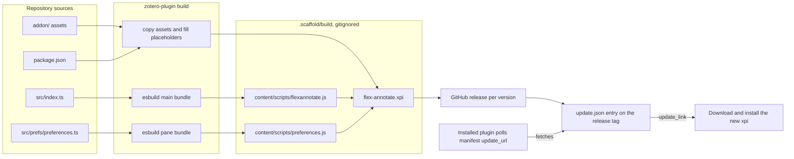

Everything about how FlexAnnotate is built, packaged, and shipped is configured in [zotero-plugin.config.ts](../../zotero-plugin.config.ts): it declares source roots, the output staging directory, the plugin identity, update feed templates, build-time constant substitutions, and two distinct esbuild bundles. The `zotero-plugin build` command assembles the static `addon/` assets along with both compiled bundles into `.scaffold/build` and archives the directory as `flex-annotate.xpi`. Development runs execute through `zotero-plugin serve` using environment variables defined in `.env`. Neither build outputs nor environment files are treated as sources of truth: `.scaffold/`, `build/`, `*.xpi`, and `.env` are gitignored and excluded by [.openwikiignore](../../.openwikiignore), so build behavior is documented strictly from the configuration and scripts that produce them.

## Build → release → update flow


*Figure: End-to-end pipeline from source files and esbuild bundling to XPI packaging, GitHub release, and manifest update polling.*

The package metadata and configuration in [package.json](../../package.json) supply the build constants; `src/index.ts` and `src/prefs/preferences.ts` compile into the two required bundles; and all static assets under `addon/` are copied while substituting compile-time placeholders (`__name__`). Automated releases publish the `.xpi` per version tag and update the feed under the `release` tag, which installed plugin instances query via the `update_url` declared in their manifest.

## The build definition

[zotero-plugin.config.ts](../../zotero-plugin.config.ts) defines the complete build configuration via `defineConfig`:

- **`source: ["src", "addon"]` and `dist: ".scaffold/build"`**: The source roots and staging target. Running `npm run build` produces `.scaffold/build/flex-annotate.xpi` ([AGENTS.md](../../AGENTS.md)). The directory also hosts ephemeral test profiles (`.scaffold/test/`) and UI screenshots (`.scaffold/screenshots/`); the entire `.scaffold/` directory is disposable.
- **Identity declarations**: Sourced directly from `pkg.config` in [package.json](../../package.json):
  - `name`: `FlexAnnotate`
  - `id`: `flexannotate@justanotherjurastudent.github.io`
  - `namespace`: `flexannotate` (matches `addonRef`)
  - `instance`: `FlexAnnotate`
  - `prefix`: `extensions.flexannotate` (declared in `pkg.config.prefsPrefix` and echoed in `build.prefs.prefix`).
  The `config` object is also spread into `build.define`, allowing values to be accessed both as TypeScript imports (`import pkg from "./package.json"`) and as preprocessor-substituted constants.
- **`updateURL`**: A templated URL resolved at build time:
  `https://github.com/{{owner}}/{{repo}}/releases/download/release/update-beta.json` when `pkg.version` contains a hyphen (prerelease), or `…/update.json` for stable releases. The `{{owner}}` and `{{repo}}` placeholders are resolved from `package.json`'s `repository.url` (`justanotherjurastudent/zotero_FlexAnnotate`). The built manifest receives this through `__updateURL__`, meaning installed versions check the GitHub release tag directly without an intermediate update server.
- **`xpiDownloadLink`**: The download template `https://github.com/{{owner}}/{{repo}}/releases/download/v{{version}}/{{xpiName}}.xpi`, where `{{xpiName}}` resolves to `flex-annotate`. Entries in [updates.json](../../updates.json) match this structure.
- **`build.assets: ["addon/**/*.*"]`**: Directs the scaffold to copy all static files under `addon/` into `.scaffold/build`—including `manifest.json`, `bootstrap.js`, `prefs.js`, preference pane XHTML, icons, CSS, and Fluent locale trees—while replacing defined tokens.
- **`build.define`**: Merges `pkg.config` with `author`, `description`, `homepage`, `buildVersion` (`pkg.version`), and `buildTime` (using scaffold placeholder `{{buildTime}}`). These tokens appear in source files as `__token__` placeholders:
  - `addon/manifest.json` consumes `__addonName__`, `__buildVersion__`, `__description__`, `__homepage__`, `__author__`, `__addonID__`, and `__updateURL__`.
  - [addon/bootstrap.js](../../addon/bootstrap.js) consumes `__addonRef__` and `__addonInstance__`.
  - [addon/content/preferences.xhtml](../../addon/content/preferences.xhtml) links its localization via `__addonRef__-preferences.ftl` and `__addonRef__-features.ftl`.
- **`test.waitForPlugin`**: Declared as `() => Zotero.FlexAnnotate.data.initialized`. This flag is set in [src/hooks.ts](../../src/hooks.ts) at the conclusion of `onStartup`, after initialization promises resolve, locales initialize, `addon.api` is attached, preference panes register, and `startAll(features)` completes. The automated test runner polls this predicate before executing assertions.
- **`logLevel: "trace"`**: Available (commented out) in `zotero-plugin.config.ts` for debugging placeholder replacement and XPI zip packaging.

## The two esbuild bundles

The `build.esbuildOptions` array in [zotero-plugin.config.ts](../../zotero-plugin.config.ts) defines two distinct bundles. Both configure `bundle: true`, enable `minify: true`, and specify **`target: "firefox140"`**, targeting the modern Gecko engine underlying Zotero. The same bundles run across all supported Zotero releases (7.0.32, 8.0.4, 9.0.6, and 10.0.5/10.0.6) without per-version compilation variations.

| Bundle | Entry point | Output path | Environment & globals |
| ------ | ----------- | ----------- | --------------------- |
| Main bundle | `src/index.ts` | `.scaffold/build/addon/content/scripts/flexannotate.js` | Receives `__env__` from `process.env.NODE_ENV` (stored as `addon.data.env`). Installs `addon` and `ztoolkit` onto `_globalThis`. |
| Preferences bundle | `src/prefs/preferences.ts` | `.scaffold/build/addon/content/scripts/preferences.js` | Self-contained sandbox script for Zotero's preferences window. Operates without plugin globals. |

### Why preferences require an isolated bundle

Zotero loads preference pane scripts into an isolated sandbox window scope where only standard Zotero globals (`Zotero.*`), `window`, and `document` exist. Plugin globals instantiated by the main bundle (such as `addon` or `ztoolkit`) are **not** in scope (annotated in `zotero-plugin.config.ts`: `"Pane-Scripts laufen ohne Plugin-Globals"`).

The script is registered via the `scripts` property of `Zotero.PreferencePanes.register` in [src/hooks.ts](../../src/hooks.ts). Because it cannot access the main runtime's memory, any shared pure logic—such as [buildLocatorOptions](../../src/core/labelPopup.ts) and the feature gate hierarchy—must be imported and bundled directly into `preferences.js`.

Within the pane, [src/prefs/preferences.ts](../../src/prefs/preferences.ts):
1. Sets up the dual-tab switching logic (`setupTabs()`).
2. Populates Citavi locator `<menupopup>` elements with localized style names via `fillLocatorMenus()`, awaiting `Zotero.Styles.init()`.
3. Evaluates feature flags and engine capabilities via `applyFeatureVisibility()`, hiding unsupported controls (e.g., hiding persistent citation dialog options when `Zotero.Integration` lacks `addAnnotation`).
4. Generates the feature switches dynamically and synchronizes checkbox states on document load.
5. Captures window lifecycle through the document-level capture-phase `load` event.

### Startup cache invalidation

The main bundle is loaded in [addon/bootstrap.js](../../addon/bootstrap.js) using `Services.scriptloader.loadSubScriptWithOptions` with `{ target: ctx, ignoreCache: true }`, ensuring code changes take effect immediately on reload.

In contrast, Zotero loads preference pane scripts through Gecko's startup cache without the `ignoreCache` flag. When editing `preferences.ts` during local development, developers must start Zotero once with the **`-purgecaches`** command-line flag; otherwise, the runtime continues executing the stale cached bytecode (documented as pitfall 4 in [docs/architecture.md](../../docs/architecture.md)).

## Preferences panel architecture

The extension's configuration UI is registered in [src/hooks.ts](../../src/hooks.ts) via `Zotero.PreferencePanes.register`:

```typescript
Zotero.PreferencePanes.register({
  pluginID: addon.data.config.addonID,
  src: `chrome://${addon.data.config.addonRef}/content/preferences.xhtml`,
  scripts: [
    `chrome://${addon.data.config.addonRef}/content/scripts/preferences.js`,
  ],
  label: addon.data.config.addonName,
  image: `chrome://${addon.data.config.addonRef}/content/icons/icon.svg`,
});
```

The pane markup in [addon/content/preferences.xhtml](../../addon/content/preferences.xhtml) declares an isolated `<linkset>` linking both `__addonRef__-preferences.ftl` and `__addonRef__-features.ftl`.

### Dual-tab layout

The preference panel is divided into two tabs defined in `preferences.xhtml`:
- `#flexannotate-tabs`: An ARIA `tablist` container containing two tab buttons:
  - `#flexannotate-tab-options`: Labeled via `prefs-tab-options` ("Settings" / "Einstellungen"), controlling `#flexannotate-panel-options`.
  - `#flexannotate-tab-features`: Labeled via `prefs-tab-features` ("Features on/off" / "Funktionen an/aus"), controlling `#flexannotate-panel-features`.
- Tab navigation is handled in [src/prefs/preferences.ts](../../src/prefs/preferences.ts): `setupTabs()` binds click handlers and left/right arrow key navigation, updating `aria-selected`, `tabindex`, inline border styling, and toggling the `hidden` attribute of each panel.

### Tab 1: Settings (`#flexannotate-panel-options`)

The "Settings" / "Einstellungen" tab provides static declarative XUL controls organized into groupboxes:
1. **Citing** (`prefs-citing-heading`):
   - `citationOnly`: Toggles whether inserting an annotation emits only the citation locator rather than the complete text.
   - `persistentCitationDialog`: Keeps the citation dialog open across citations.
2. **Printing & Deletion** (`prefs-print-heading`):
   - `keepEmptyPlaceholders`: Prevents placeholder attachment deletion when its last annotation is removed.
   - `confirmDeleteAnnotation`: Prompts for confirmation before deleting annotations from the context menu.
3. **Annotation View & Outline** (`pref-section`):
   - `showWorksInAnnotationView` and `showCommentInOrganizerRows`: Display works or comments within item rows.
   - `outlineTagSuggest`: Menulist controlling heading tag auto-suggestions (`all`, `typed`, `tree`, `off`).
4. **Citavi Import & Locator Mappings** (`prefs-citavi-heading`):
   - `citaviImport`, `citaviKeepNotes`, and `citaviLinkContributions`.
   - Five Citavi locator menulists (`citaviLocatorPage`, `citaviLocatorColumn`, `citaviLocatorParagraph`, `citaviLocatorMargin`, and `citaviLocatorOther`), each containing an empty `<menupopup>` populated dynamically by `fillLocatorMenus()`.

**Dynamic visibility (`applyFeatureVisibility()`)**:
Controls in the options tab are automatically shown or hidden depending on whether their backing feature gate is enabled in [src/features/gates.ts](../../src/features/gates.ts) and supported by the current Zotero runtime. For example, `flexannotate-pref-persistent-citation-dialog` is hidden if `isFeatureEnabled("persistentDialogPatch")` is false or if `Zotero.Integration.Interface.prototype.addAnnotation` is missing (as in Zotero 7/8). When all controls in a `<groupbox>` are inactive, the entire groupbox is hidden.

### Tab 2: Features on/off (`#flexannotate-panel-features`) and hierarchy

The "Features on/off" / "Funktionen an/aus" tab allows users to toggle individual features or entire feature subsystems. Its container `<html:div id="flexannotate-features">` is populated programmatically by `buildFeatureRows()` from the `FEATURE_GROUPS` configuration in [src/prefs/featureGroups.ts](../../src/prefs/featureGroups.ts).

```
Feature Group Hierarchy (FEATURE_GROUPS)
├── index ("Foundation" / "Grundlage")
│   ├── [Main] annotationIndex
│   ├── outlineAnchorTags (requires annotationIndex)
│   └── outlineScopeHeading (requires annotationIndex)
├── organizer ("Organizer")
│   ├── [Main] organizer
│   ├── organizerToolbarButton (requires organizer)
│   ├── toolsMenuFallback (requires organizer)
│   ├── collectionMenu (requires organizer)
│   └── orphanTags (requires organizer)
├── dialog ("Citation dialog" / "Zitierdialog")
│   ├── [Main] citationDialog
│   ├── outlineView (requires citationDialog)
│   ├── citedTracking (requires citationDialog)
│   ├── footnoteJump (requires citationDialog)
│   ├── dialogShowPlace (requires citationDialog)
│   ├── persistentDialogPatch (requires citationDialog)
│   └── narrowDialogLayout (requires citationDialog)
├── citeonly ("Citation-only citing" / "Nur-Nachweis-Zitieren")
│   ├── [Main] citeOnlyPatch
│   └── modeSelector (requires citeOnlyPatch)
├── print ("Print annotations" / "Print-Annotationen")
│   ├── [Main] printMenus
│   └── annotationRowMenu (requires printMenus)
├── rows ("Annotation rows" / "Annotationszeilen")
│   └── [Main] annotationRowPatch
├── reader ("Reader")
│   ├── [Main] readerMenu
│   └── readerLabelPopup (requires readerMenu)
├── tags ("Tags")
│   └── [Main] tagSuggest
├── citavi ("Citavi import" / "Citavi-Import")
│   ├── [Main] citaviImport
│   ├── citaviPrintQuotes (requires citaviImport)
│   └── citaviLinks (requires citaviImport)
└── api ("Interface for other plugins" / "Schnittstelle für andere Plugins")
    └── [Main] externalApi
```

Key structural invariants and behaviors of the features tab:
- **Main switches and indentation**: The first gate in each `FeatureGroup` serves as the group's main switch, rendered in **bold** (`fontWeight: "600"`). Subsequent gates within the group are indented by 24px (`marginInlineStart = "24px"`).
- **Preference storage**: Feature switches map to `extensions.flexannotate.gate.<gateName>`. When checked (enabled), the preference is deleted via `Zotero.Prefs.clear(key, true)` to restore the default enabled state, ensuring only explicit switch-offs remain saved in user preferences. When unchecked, it writes `false` via `Zotero.Prefs.set(key, false, true)`.
- **Cascading dependencies**: If a prerequisite gate in a gate's `requires` array is disabled, the child checkbox is automatically disabled (`disabled = true`). An explanatory label is displayed below the row (`prefs-features-needs`, formatted with `{ names }`).
- **Restart requirement**: Gates requiring a Zotero restart to re-hook or detach (listed in `RESTART_GATES`, such as prototype patches) display a restart notice (`prefs-features-restart`).
- **Hidden gates**: Gates listed in `HIDDEN_GATES` (`docImport`, `docExport`, `noteExport`, `citeprocResetFix`, `placeholderCleanup`) are omitted from the features tab because they are either button-triggered actions covered by the organizer main switch, code-level version workarounds, or already controlled by an explicit setting on the options tab.
- **Unit test validation**: `test-unit/featureTexts.test.ts` validates that every gate in `gates.ts` belongs to exactly one group in `FEATURE_GROUPS` or `HIDDEN_GATES`, that group headings exist, and that all shown gates have complete Fluent labels and descriptions in both English and German.

## Localization architecture

<!-- openwiki: broken internal link [../../addon/locale/en-US] file "../../addon/locale/en-US" does not exist. Fix the href or restore the target, then delete this comment. -->
<!-- openwiki: broken internal link [../../addon/locale/de] file "../../addon/locale/de" does not exist. Fix the href or restore the target, then delete this comment. -->
FlexAnnotate maintains localized user-facing strings concurrently in two language directories: [addon/locale/en-US](../../addon/locale/en-US) and [addon/locale/de](../../addon/locale/de).

| Locale file | Purpose | Loading mechanism |
| ----------- | ------- | ----------------- |
| `addon.ftl` | Shared notifications, progress window texts, general add-on strings. | Inserted into every Zotero window during `onMainWindowLoad` via `win.MozXULElement.insertFTLIfNeeded()`. |
| `mainWindow.ftl` | Main window menu items, reader menu actions, annotation context menu labels. | Inserted into every Zotero window during `onMainWindowLoad` via `win.MozXULElement.insertFTLIfNeeded()`. |
| `preferences.ftl` | Labels, descriptions, and headings for the static settings on Tab 1 of the preferences pane. | Loaded directly by the preferences XHTML fragment through its `<linkset>`. |
| `features.ftl` | Titles (`.label`), descriptions, tab names (`prefs-tab-options`, `prefs-tab-features`), and dependency/restart messages for Tab 2 of the preferences pane. | Loaded directly by the preferences XHTML fragment through its `<linkset>`. |

### The Organizer localization exception

The organizer window does not use Fluent `.ftl` files because it builds its entire DOM dynamically in JavaScript. Instead, its UI strings are maintained in [src/features/organizer/strings.ts](../../src/features/organizer/strings.ts), which defines parallel German (`de`) and English (`en`) dictionaries inspected at window render time.

## What ships: the `addon/` directory

### `manifest.json` and `strict_max_version` rules

[addon/manifest.json](../../addon/manifest.json) is a WebExtension Manifest V2 specification file containing placeholder macros. Its core configuration is the `applications.zotero` block:

```json
{
  "manifest_version": 2,
  "name": "__addonName__",
  "version": "__buildVersion__",
  "applications": {
    "zotero": {
      "id": "__addonID__",
      "update_url": "__updateURL__",
      "strict_min_version": "7.0",
      "strict_max_version": "10.*"
    }
  }
}
```

**`strict_max_version` is mandatory on Zotero 10.** In Zotero 10, any extension manifest omitting `strict_max_version` is rejected and silently dropped during manifest parsing without descriptive error messages (verified on 10.0.1 across multiple plugins; pitfall 9 in [docs/architecture.md](../../docs/architecture.md)). Although the preference `extensions.strictCompatibility` defaults to `false` in Zotero's developer settings, `zotero-plugin-toolkit` sets `addon.strictCompatibility` to true for release builds, enforcing compatibility bounds at runtime.

The project rule ([AGENTS.md](../../AGENTS.md), conventions) dictates that when a new Zotero major version is released:
1. Increment `strict_max_version`.
2. Run the multi-version test suite against the new target (`npm run test:versions`).
3. Only after verification passes should the bound be widened in version control.

### `bootstrap.js`

[addon/bootstrap.js](../../addon/bootstrap.js) is minimal and templated:
- Registers the chrome content mapping: `__addonRef__` → `rootURI/content/`.
- Prepares the sandbox context `{ rootURI }` with `_globalThis`, the global root where the main bundle attaches `addon` and `ztoolkit`.
- Loads `content/scripts/__addonRef__.js` using `loadSubScriptWithOptions` with `ignoreCache: true`.
- Relays Zotero lifecycle notifications (`startup`, `shutdown`, `install`, `uninstall`) to `Zotero.FlexAnnotate.hooks`.
- Handles `shutdown` optimizations: exits immediately without teardown when the reason is `APP_SHUTDOWN` (avoiding redundant cleanup during application termination), but executes full unregistration and chrome handle disposal on explicit addon disable or upgrade.

### `prefs.js` default preferences

[addon/prefs.js](../../addon/prefs.js) registers default preference keys under the `extensions.flexannotate.*` branch:
- `showWorksInAnnotationView`, `showCommentInOrganizerRows`
- `dialogOutlineView`, `dialogOutlineCollection`
- `citedAnnotations`, `citationOnly`
- `persistentCitationDialog`, `persistentWindowRect`, `keepEmptyPlaceholders`, `confirmDeleteAnnotation`
- `outlineTagSuggest` (default `"all"`)
- `citaviImport`, `citaviKeepNotes`, `citaviLinkContributions`
- Five Citavi locator mapping defaults (`citaviLocatorPage`, `citaviLocatorColumn`, `citaviLocatorParagraph`, `citaviLocatorMargin`, `citaviLocatorOther`), with `citaviLocatorMargin` defaulting to `"paragraph"`.

These preference names hold user configuration and are **never renamed** ([Conventions & constraints](../conventions.md)). [src/utils/prefs.ts](../../src/utils/prefs.ts) interfaces with them via `config.prefsPrefix`.

### `content/` assets

- [addon/content/preferences.xhtml](../../addon/content/preferences.xhtml) provides the preference pane UI fragment registered at `chrome://flexannotate/content/preferences.xhtml`. It declares an isolated `<linkset>` referencing `__addonRef__-preferences.ftl` and `__addonRef__-features.ftl`, declarative `data-l10n-id` and `preference` attributes, and five empty `<menupopup>` targets filled dynamically by the preferences script.
- `addon/content/icons/` contains `icon.svg` (used for 48px/96px manifest entries, preference pane branding, and `ProgressWindow` icons via `ztoolkit.ProgressWindow.setIconURI`), `organizer.svg`, and context-menu SVG icons.
- `addon/content/zoteroPane.css` contains an unused styling template class (`.makeItRed`) leftover from the scaffold initialization.

## TypeScript verification setup

Type verification uses a dual-configuration architecture reflecting Zotero's differing runtime scopes:

```
tsconfig.json (root)         test/tsconfig.json
────────────────────         ──────────────────
extends: sandbox/            extends: mainWindow/
scope: src, typings, test-unit scope: ../typings, ../src, test/
validates: pure logic,       validates: integration tests,
           sandbox runtime              Mocha runner, DOM,
           & Node unit tests            Zotero mainWindow globals
```

1. **Root configuration ([tsconfig.json](../../tsconfig.json))**:
   - Extends `"zotero-types/entries/sandbox/"`.
   - Targets `src`, `typings`, and `test-unit` while excluding `build` and `addon`.
   - Enforces sandbox scoping: mainWindow globals and DOM elements are not assumed to exist, ensuring pure logic modules in `src/features/*/logic/` remain clean and testable under Node.js.
   - Sets `noEmit: true`, `allowImportingTsExtensions: true`, and `rewriteRelativeImportExtensions: true`, enabling explicit `.ts` import specifiers in source files.
2. **Test configuration ([test/tsconfig.json](../../test/tsconfig.json))**:
   - Extends `"zotero-types/entries/mainWindow/"`.
   - Targets `test/`, `../typings`, and `../src`.
   - Includes type definitions for `mainWindow`, `mocha`, and `node` (`types: ["zotero-types/entries/mainWindow", "mocha", "node"]`).
   - Validates integration tests running directly inside Zotero's live window with full access to `window`, `document`, and Mocha test globals (`describe`, `it`, `before`, `after`).
   - Also specifies `allowImportingTsExtensions: true` and `rewriteRelativeImportExtensions: true`.

The `typecheck` script in [package.json](../../package.json) runs both checks in sequence:
```bash
tsc --noEmit && tsc -p test/tsconfig.json --noEmit
```
Furthermore, `npm run build` chains compilation with type verification (`zotero-plugin build && npm run typecheck`), guaranteeing that no build artifact is produced if either configuration fails type checking.

## Updates and release distribution

[updates.json](../../updates.json) at the repository root defines the update catalog fetched by installed plugins from GitHub releases. Newest versions are ordered first (2.0.0, 1.2.0, 1.1.0, 1.0.0), each declaring:
- `version`: The semantic release version.
- `update_link`: Absolute URL to the `.xpi` artifact on the release tag (e.g. `https://github.com/justanotherjurastudent/zotero_FlexAnnotate/releases/download/v2.0.0/flex-annotate.xpi`, matching the `xpiDownloadLink` template).
- `applications.zotero`: Compatibility boundaries (`strict_min_version: "7.0"`, `strict_max_version: "10.*"`).
- `update_hash`: SHA-512 checksum verifying package integrity for modern releases.

When Zotero checks for updates, it requests the URL resolved from the manifest's `update_url`. Because `updateURL` in `zotero-plugin.config.ts` points to the `release` tag on GitHub (`.../releases/download/release/update.json`), the update manifest is delivered statically via GitHub Releases without custom server infrastructure.

## Packaging and development commands

The project scripts in [package.json](../../package.json) govern building, packaging, testing, and running the add-on:

| Command | Action | Output / Description |
| ------- | ------ | -------------------- |
| `npm run build` | `zotero-plugin build && npm run typecheck` | Assembles `.scaffold/build/`, compiles both esbuild bundles, copies assets with placeholder substitution, packages `.scaffold/build/flex-annotate.xpi`, and validates both TypeScript targets. |
| `npm run release` | `zotero-plugin release` | Creates a release artifact and publishes to GitHub Releases (invoked in release workflow). |
| `npm start` | `zotero-plugin serve` | Launches Zotero with the development profile configured in `.env`, watching for source changes. |
| `npm run verify` | `npm run lint:check && npm run build && npm run test:unit && npm run test:zotero` | Pre-commit gate running linting, compilation, Node unit tests, and Zotero integration tests. |
| `npm run test:unit` | `node --test "test-unit/*.test.ts"` | Fast pure-logic unit test runner (no Zotero instance required). |
| `npm run test:zotero` | `node scripts/run-zotero-tests.mjs` | Automated Mocha integration test runner executed inside a headless Zotero window. |
| `npm run test:versions` | `node scripts/run-versions.mjs` | Multi-version integration test runner across all supported Zotero releases. |

### Development environment: `.env`

Local development with live reloading via `npm start` (`zotero-plugin serve`) relies on path configuration in `.env` (gitignored), which developers initialize from [.env.example](../../.env.example):

| Variable | Purpose |
| -------- | ------- |
| `ZOTERO_PLUGIN_ZOTERO_BIN_PATH` | Path to the Zotero binary (e.g. `C:\\Program Files\\Zotero\\zotero.exe` with escaped backslashes on Windows, or `/Applications/Zotero.app/Contents/MacOS/zotero` on macOS). |
| `ZOTERO_PLUGIN_PROFILE_PATH` | Path to a dedicated development profile directory (created via `zotero -p`). |
| `ZOTERO_PLUGIN_DATA_DIR` | Optional custom data directory; left empty to run with default profile data. |
| `ZOTERO_PLUGIN_KILL_COMMAND` | Optional command to terminate running instances; platform defaults are built into `zotero-plugin`. |
| `GITHUB_TOKEN` | Required only when generating releases locally; allows the scaffold to create releases and upload `.xpi` assets. |

Alternatively, developers managing multiple plugins can configure `ZOTERO_PLUGIN_ZOTERO_BIN_PATH` and `ZOTERO_PLUGIN_PROFILE_PATH` as system environment variables. The integration test runners also consume these variables ([Testing commands & runners](../testing/commands-and-runners.md)), with custom kill scripts ensuring only the test runner instance is terminated.

## Quality gates and CI

The verification sequence configured in [package.json](../../package.json) enforces code quality across multiple stages:

- `npm run lint:check`: Executes `prettier --check . && eslint .` using `@zotero-plugin/eslint-config` (with `no-unused-vars` disabled for `*.ts` files). `npm run lint:fix` formats code in-place.
- `npm run build`: Executes `zotero-plugin build` followed immediately by `npm run typecheck`, producing `.scaffold/build/flex-annotate.xpi`.
- `npm run verify`: The complete pre-commit gate, running `lint:check`, `build`, `test:unit`, and `test:zotero` sequentially.

### GitHub Actions workflows

1. **Continuous Integration ([.github/workflows/ci.yml](../../.github/workflows/ci.yml))**:
   Triggers on pushes and pull requests targeting `main`. Runs three concurrent jobs:
   - `lint`: Verifies formatting and lint rules.
   - `build`: Compiles the extension and uploads `.scaffold/build` as the `build-result` workflow artifact.
   - `test`: Executes the automated test suite.
2. **Release ([.github/workflows/release.yml](../../.github/workflows/release.yml))**:
   Triggers exclusively on tag pushes matching `v**`. Delegates execution to the reusable workflow `zotero-plugin-dev/workflows/.github/workflows/release-plugin.yml@master` with:
   - `build: "npm run build"`
   - `release: "npm run release"`
   - Configured with `contents: write`, `issues: write`, and `pull-requests: write` permissions, and `secrets: inherit`.
3. **Dependency updates ([.github/dependabot.yml](../../.github/dependabot.yml))**:
   Schedules weekly npm dependency updates, grouping minor and patch version bumps together.

## Release rules and constraints

Project operational constraints from [AGENTS.md](../../AGENTS.md) govern all versioning and release actions:
- **Authorization**: Never push, release, or create git tags without explicit instruction.
- **Commit formatting**: Use Conventional Commits (`feat:`, `fix:`, `docs:`, `refactor:`, `test:`, `chore:`).
- **Documentation co-location**: Documentation must ship within the same changeset as code changes:
  - `README.md` and `CHANGELOG.md` updated for every user-facing change.
  - `docs/anchors.md` updated with file line numbers and Zotero versions whenever hooking new Zotero internal methods.
  - `docs/architecture.md` updated whenever new edge cases or architectural pitfalls are discovered.
- **Changelog maintenance**: [CHANGELOG.md](../../CHANGELOG.md) adheres to Keep a Changelog and Semantic Versioning. The upstream Lattice changelog is preserved unmodified in [docs/lattice-changelog.md](../../docs/lattice-changelog.md).

## Related pages

- [Architecture & Module Layout](../architecture/overview.md) — Internal module architecture, layer separation, and component structure.
- [Feature Lifecycle & Registry](../architecture/feature-lifecycle.md) — The `onStartup` sequence, feature registration, and the `waitForPlugin` lifecycle hook.
- [Conventions & Constraints](../conventions.md) — Stable preference naming, tag identifiers, and commit guidelines.
- [Quickstart](../quickstart.md) — Getting started with development and common workflows.
- [Testing Commands & Runners](../testing/commands-and-runners.md) — Detailed documentation of the unit, Zotero integration, and multi-version test suites.
