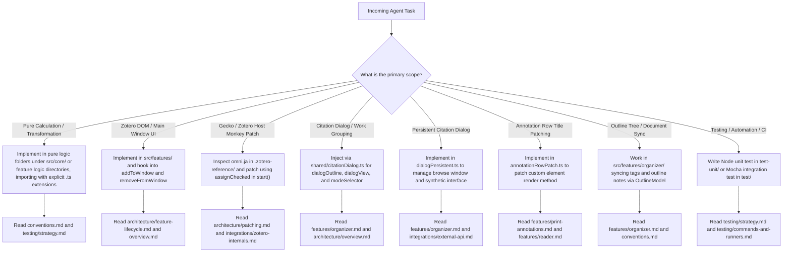

# Quickstart & Task-Routing Guide

FlexAnnotate is a TypeScript-based Zotero plugin (`flexannotate@justanotherjurastudent.github.io`, AGPL-3.0-or-later) built with `zotero-plugin-scaffold` and developed against Zotero 10.0.5/10.0.6 while actively supporting Zotero 7.0 through 10. The plugin overhauls annotation management in Zotero by introducing editable locators and comments across reader and item views, an outline-based annotation organizer (forked from Lattice), citation-only insertion for Word and LibreOffice ("Nur-Nachweis-Zitieren"), annotations for printed media without digital attachments via placeholder PDFs, persistent citation dialog companion workflows ("Blätterfenster"), work and annotation grouping under outline headings, and a secondary import pass for Citavi knowledge items.

This document serves as the primary task-routing hub and operational entrypoint for autonomous coding agents and human engineers. It establishes mandatory safety invariants, architectural layering rules, cross-version requirements, and direct pathways to specialized wiki documentation for every engineering task.

---

## Essential Safety Rules & Non-Negotiable Constraints

Agents operating in this repository must adhere strictly to five foundational constraints established in `AGENTS.md` and `docs/architecture.md`. Violating these rules risks corrupting user data or breaking Zotero host stability.

```
+-----------------------------------------------------------------------------------------+
|                                    NON-NEGOTIABLE RULES                                 |
+-----------------------------------------------------------------------------------------+
| 1. NEVER touch production Zotero or Word (isolated profiles only).                     |
| 2. NEVER monkey-patch without assignChecked (verify identity, roll back on teardown).   |
| 3. KEEP pure logic isolated in logic/ or core/ (no Zotero globals, explicit .ts).       |
| 4. BIND window state to DOM elements or WeakMaps (never to module-level variables).     |
| 5. ACCESS plugin internals in integration tests exclusively via addon.api.              |
+-----------------------------------------------------------------------------------------+
```

### 1. Production Environment Isolation
- **No Production Access**: Never run tests, scripts, or build commands against user libraries, personal profiles, or running Word/LibreOffice instances.
- **Isolated Scaffold Profile**: Integration tests execute exclusively within the dedicated profile path `.scaffold/test/`.
- **Targeted Process Termination**: The test process killer (`scripts/kill-test-zotero.ps1`) inspects process command lines using WMI/CIM and forcefully terminates only `zotero.exe` instances whose command lines contain the full path to `.scaffold/test`. User Zotero processes are never touched.
- **Clean Profile per Version**: When testing multi-version compatibility (`npm run test:versions`), the runner script (`scripts/run-versions.mjs`) deletes `.scaffold/test/profile` before each version invocation to prevent startup cache, extension registry, or version marker pollution across Zotero versions.

### 2. Verified Prototype Patching via `assignChecked`
- **Silent Failures in Gecko**: Assigning to non-writable properties throws in strict mode or silently fails outside it. Furthermore, assigning across Mozilla chrome/XUL boundaries can trap properties in an Xray expando, disappearing upon subsequent read-backs.
- **The `assignChecked` Guard**: All prototype and host object modifications must use `assignChecked(target, name, value)` from `src/shared/patch.ts`. It executes the assignment in a `try/catch` block and checks strict identity read-back (`obj[name] === value`).
- **Teardown Symmetry**: Every patch applied during `start()` or `addToWindow()` must be restored to its original reference during `stop()` or `removeFromWindow()`.
- **Anchored Research**: Patches must be grounded in verified Zotero source code extracted from `omni.ja` (referenced under `.zotero-reference/<version>/`) and documented with file and line anchors in `docs/anchors.md`. CommonJS modules loaded via `require()` run in sandboxes with frozen `exports` and cannot be patched.

### 3. Pure Logic Separation
- **No Ambient Host Dependencies**: Pure business logic (data transformations, locator calculations, XML parsers, sort index generation) must live in `src/features/<feature>/logic/` or `src/core/` (if shared across multiple features).
- **Prohibited Host Globals**: Pure logic files must never import or reference Zotero globals (`Zotero`, `Services`, `ztoolkit`, `window`, `document`).
- **Explicit Imports**: Module imports within pure logic files must include explicit `.ts` extensions (for example, `import { buildSortIndex } from "./sortIndex.ts"`).
- **Node-Testable**: Every pure logic file must be covered by fast, deterministic unit tests in `test-unit/` executed via the native Node.js test runner (`npm run test:unit`).

### 4. Window State Isolation
- **Singleton Bundles vs. Multi-Window DOM**: In Zotero's architecture, extension code bundles exist once per process, whereas main windows, reader tabs, and citation dialogs exist independently.
- **State Attachment**: Never store window-specific UI state, interaction flags, or selection indices on module singletons. Attach state directly to DOM elements (as expandos or attributes) or store them in a per-window `WeakMap<Window, State>`.

### 5. Test Surface Access via `addon.api`
- **Runtime Environment Sandbox**: Extension modules require ambient globals (such as `ztoolkit`) injected during plugin startup in the main window.
- **No Direct Module Imports in Integration Tests**: Mocha integration tests in `test/` running inside real Zotero instances must never import runtime modules directly. Instead, they interact with plugin state and features via the structured `addon.api` exposed on plugin startup in `src/hooks.ts` (assigned across lines 141–190).

---

## Core System Architecture & Lifecycle

FlexAnnotate enforces a strict downward dependency hierarchy. Features depend on `core`, `shared`, and `utils`, but `core` and `shared` never depend on features. The plugin entrypoint `src/hooks.ts` acts as the single composition root.

```
src/hooks.ts (Composition Root & addon.api Exposure)
   |
   +---> src/features/ (print, citeOnly, citavi, reader, organizer)
   |        |
   |        +---> <feature>/logic/ (Pure logic, Node-testable, no Zotero globals)
   |
   +---> src/shared/ (feature registry, assignChecked, citationDialog watcher)
   |
   +---> src/core/ (Shared pure logic: locators, print dialog logic, label popups)
   |
   +---> src/utils/ (locale, preferences, menu wrappers, ztoolkit setup)
   |
   +---> src/prefs/ (Preference pane scripts; bundled independently)
```

### Feature Lifecycle Contract
Features implement the `Feature` interface (`src/shared/feature.ts`):
- `start?(): void | Promise<void>`: Process-level initialization (prototype patching, notifier observers, menu registration via `Zotero.MenuManager`).
- `stop?(): void`: Process-level teardown (restoring patched methods, detaching observers, closing standalone organizer windows, unregistering menus).
- `addToWindow?(win: _ZoteroTypes.MainWindow): void | Promise<void>`: Window-level UI attachment (DOM injection, toolbar buttons, item-menu entries, window event listeners).
- `removeFromWindow?(win: _ZoteroTypes.MainWindow): void`: Window-level UI cleanup (removing injected DOM nodes, cleaning window listeners).

The registry runners (`startAll`, `stopAll`, `addToWindow`, `removeFromWindow`) execute hooks sequentially. Startup runs in forward order; shutdown runs in reverse order. Every invocation is wrapped in error-handling guards that log failures without aborting remaining features.

### Composition Root & Dialog Injectors in `src/hooks.ts`
`src/hooks.ts` registers citation dialog injectors and manages feature initialization:
- **Citation Dialog Injectors** (lines 67–77): Registered with `citationDialog.registerDialogInjector` in order of execution:
  1. `modeSelector`: Mode selection ("Einfügen als") in Word/LibreOffice dialogs.
  2. `outlineView`: Outline tree rendering, search syncing, and work/annotation grouping.
  3. `annotationRowPatch`: Dynamically updates `<annotation-row>` title headers to reflect custom locators.
- **Feature Array** (lines 83–129): Contains process and window lifecycle entries for `organizer`, `organizerToolbarButton`, `toolsMenuFallback`, `collectionMenu`, `citationDialog`, `persistentDialogPatch`, `citeOnlyPatch`, `readerMenu`, `citaviImport`, `annotationIndex`, `externalApi`, `printMenus`, `annotationRowMenu`, and `annotationRowPatch`.
- **`addon.api` Exposure** (lines 141–190): Exposes internal feature modules, models, and test hooks on `addon.api` during `onStartup()`, ensuring Mocha integration tests can verify internal behavior safely without module bundling collisions.

### Native Data Model
FlexAnnotate avoids proprietary database files or hidden metadata stores. All user data is stored within native Zotero entities to guarantee full synchronization across devices and data preservation if the plugin is uninstalled:
- **Placeholders**: Generated 1-page PDF attachments marked with tag `#flexannotate-placeholder`.
- **CSL Locators**: Custom annotation tags `#flexannotate-locator-<type>` and attachment defaults `#flexannotate-default-locator-<type>`.
- **Outline Headings**: Tags formatted as `§<Heading Title>` on annotations, parent items, and outline notes.
- **Outline Trees**: Standalone Zotero notes tagged with `★outline` containing JSON trees prefixed by `LATTICE-OUTLINE-V1`. Collection-scoped outlines add `#flexannotate-outline-<collectionKey>`.
- **Preferences**: Stable persistent keys under `extensions.flexannotate.` in `addon/prefs.js`.

---

## Task-Routing Decision Flowchart

When beginning a task, consult this decision tree to determine which code layer, testing environment, and documentation guide to use:


*Decision tree routing tasks to code locations, architectural constraints, and documentation.*

---

## Comprehensive Task-Routing Matrix

Use this matrix to navigate between common engineering objectives, code ownership boundaries, verification commands, and detailed wiki guides:

| Engineering Task | Primary Source Files | Key Interfaces / Conventions | Verification Commands | Wiki Navigation Link |
| :--- | :--- | :--- | :--- | :--- |
| **Add / Edit Business Logic** | `src/features/<feature>/logic/`, `src/core/` | Pure functions without host globals, explicit `.ts` imports | `npm run test:unit` | [Conventions & Constraints](conventions.md)<br/>[Testing Strategy & Environments](testing/strategy.md) |
| **Main Window UI / Menus** | `src/features/print/menus.ts`, `src/features/organizer/toolbarButton.ts`, `src/utils/menu.ts` | Idempotent DOM injection in `addToWindow`, expando cleanup in `removeFromWindow` | `npm run test:zotero` | [Feature Lifecycle & Registry](architecture/feature-lifecycle.md)<br/>[Architecture & Module Layout](architecture/overview.md) |
| **Host Monkey-Patching** | `src/shared/patch.ts`, `src/features/citeOnly/integrationPatch.ts`, `src/features/citavi/citaviImport.ts` | Always use `assignChecked`, anchor in `docs/anchors.md`, symmetric teardown | `npm run test:zotero` | [Prototype Patching & Safe Modification](architecture/patching.md)<br/>[Zotero Internals & Version Compatibility](integrations/zotero-internals.md) |
| **Citation Dialog & Work Grouping** | `src/shared/citationDialog.ts`, `src/features/organizer/dialog/dialogOutline.ts`, `src/features/organizer/logic/dialogView.ts`, `src/features/citeOnly/modeSelector.ts` | Inject via `registerDialogInjector`; support grouping annotations and works (`buildWorkDialogSections`), parent work tag inheritance (`effectiveTags`), search mirroring, and narrow layout | `npm run test:unit`<br/>`npm run test:zotero` | [Organizer & Outline View](features/organizer.md)<br/>[Architecture & Module Layout](architecture/overview.md) |
| **Persistent Citation Dialog ("Blätterfenster")** | `src/features/organizer/dialog/dialogPersistent.ts`, `src/features/organizer/logic/persistentOptions.ts`, `src/features/organizer/logic/persistentRect.ts` | Reopen unmanaged companion browse window post-insert, manage synthetic `CitationEditInterface`, track geometry via `pinRect`, relax min-width (<750px) via `relaxDialogMinWidth` | `npm run test:zotero` | [Organizer & Outline View](features/organizer.md)<br/>[External API & Cross-Plugin Communication](integrations/external-api.md) |
| **Annotation Row Title Patching** | `src/features/print/annotationRowPatch.ts`, `src/features/reader/logic/readerLocator.ts`, `src/hooks.ts` | Patch `AnnotationRow.prototype.render` via `assignChecked` in main windows and citation dialogs; replace hardcoded page labels with localized locator strings (e.g. "Randnummer 318") | `npm run test:unit`<br/>`npm run test:zotero` | [Print Annotations](features/print-annotations.md)<br/>[Reader Integrations & Locators](features/reader.md)<br/>[Prototype Patching & Safe Modification](architecture/patching.md) |
| **Print Annotations & Placeholders** | `src/features/print/placeholder.ts`, `src/features/print/printAnnotations.ts`, `src/features/print/dialog.ts` | PDF reader type enforcement, sort index clamping (`00000\|000000\|00000`), `#flexannotate-placeholder` attachment lifecycle | `npm run test:unit`<br/>`npm run test:zotero` | [Print Annotations](features/print-annotations.md)<br/>[Architecture & Module Layout](architecture/overview.md) |
| **Reader Integration & Locators** | `src/features/reader/readerMenu.ts`, `src/features/reader/logic/readerLocator.ts`, `src/core/labelPopup.ts` | Context menu locator switching, page number synchronization, and popup formatting | `npm run test:unit`<br/>`npm run test:zotero` | [Reader Integrations & Locators](features/reader.md)<br/>[Conventions & Constraints](conventions.md) |
| **Citavi Import Processing** | `src/features/citavi/citaviImport.ts`, `src/features/citavi/citaviPrintQuotes.ts`, `src/features/citavi/citaviLinks.ts` | Second-pass execution in `finally` of file interface, quote deduplication, related item linking | `npm run test:unit`<br/>`npm run test:zotero` | [Architecture & Module Layout](architecture/overview.md)<br/>[Conventions & Constraints](conventions.md) |
| **Organizer & Outline Sync** | `src/features/organizer/outlineModel.ts`, `organizerTree.ts`, `docImport.ts`, `docExport.ts` | Tag synchronization (`§Title`), single-instance window factory, `LATTICE-OUTLINE-V1` note sentinel, collection-scoped trees | `npm run test:unit`<br/>`npm run test:zotero` | [Organizer & Outline View](features/organizer.md)<br/>[Conventions & Constraints](conventions.md) |
| **External Plugin API** | `src/features/organizer/externalApi.ts`, `src/hooks.ts` | Expose read-only outline tree at `Zotero.FlexAnnotate`, manage lifecycle hooks, expose test bridge on `addon.api` | `npm run test:zotero` | [External API & Cross-Plugin Communication](integrations/external-api.md) |
| **Localization & Preferences** | `addon/locale/{de,en-US}/`, `addon/content/preferences.xhtml`, `src/prefs/preferences.ts` | Maintain German and English FTL files simultaneously; preference menulist lifecycle with capture-phase listener | `npm run build`<br/>`npm run lint:check` | [Conventions & Constraints](conventions.md)<br/>[Architecture & Module Layout](architecture/overview.md) |
| **Zotero Compatibility** | `src/features/organizer/toolsMenuFallback.ts`, `src/features/print/logic/printAnnotation.ts`, `scripts/run-versions.mjs` | Feature detection over version comparison; verify across versions 7.0, 8.0, 9.0, and 10.0 | `npm run test:versions` | [Zotero Internals & Version Compatibility](integrations/zotero-internals.md)<br/>[Test Commands & Automation Scripts](testing/commands-and-runners.md) |
| **Test Commands & Verification** | `scripts/run-versions.mjs`, `scripts/kill-test-zotero.ps1`, `test/`, `test-unit/` | Dual test runners (Node unit tests vs. in-process Mocha), targeted process termination, clean test profile per version | `npm run verify` | [Test Commands & Automation Scripts](testing/commands-and-runners.md)<br/>[Testing Strategy & Environments](testing/strategy.md) |

---

## Essential Commands & Workflow Cheatsheet

Coding agents should use the following standard commands during development, validation, and verification:

### Verification Pipeline
```bash
# Run the complete verification suite (Prettier, ESLint, dual tsc, Node tests, Zotero tests)
npm run verify
```

### Targeted Testing
```bash
# Fast Node.js unit tests for pure logic (< 1 second)
npm run test:unit

# Run Node.js unit tests with code coverage analysis
npm run test:unit:coverage

# Run Zotero integration tests in isolated .scaffold/test/ profile (~15 seconds)
npm run test:zotero

# Filter Zotero integration tests by pattern
npm run test:zotero -- --grep "citeOnly"

# Run integration suite across all installed/downloaded versions (7.0, 8.0, 9.0, 10.0)
npm run test:versions

# Filter multi-version runs by version and test title
node scripts/run-versions.mjs --versions 10.0.6,9.0.6 --grep "organizer"
```

### Build & Linting
```bash
# Compile bundle and run dual TypeScript checks (source and test tsconfig)
npm run build

# Check code formatting (Prettier) and linting (ESLint)
npm run lint:check

# Auto-fix formatting and linting errors
npm run lint:fix

# Generate updated documentation screenshots
npm run screenshots:docs
```

---

## Working Conventions & Commit Rules

1. **Language Policy**:
   - Comments, commit messages, agent notes, and end-user documentation must be written in German.
   - Code identifiers, variable names, function names, and technical log statements must be written in English.
   - `docs/architecture.md` is maintained in English as the authoritative technical reference.
2. **Dual-Locale Maintenance**: Any change to user-facing strings must be applied synchronously to both German (`addon/locale/de/*.ftl`) and English (`addon/locale/en-US/*.ftl`) localization files. Organizer window strings live in `src/features/organizer/strings.ts`.
3. **Identifier Stability**: Persistent preference keys (`extensions.flexannotate.*`) and tag formats (`#flexannotate-*`, `§Title`, `★outline`) store live user data and must never be arbitrarily renamed.
4. **Third-Party Attribution**: The Organizer component is a derived fork of Lattice (`birugit`, AGPL-3.0-or-later). License headers, copyright notices, and provenance entries in `NOTICE.md` must be strictly maintained.
5. **Git Operations**: Agents must never push branches, create tags, or initiate releases unless explicitly instructed by the user. Commits must follow Conventional Commits formatting (`feat:`, `fix:`, `docs:`, `refactor:`, `test:`, `chore:`).
