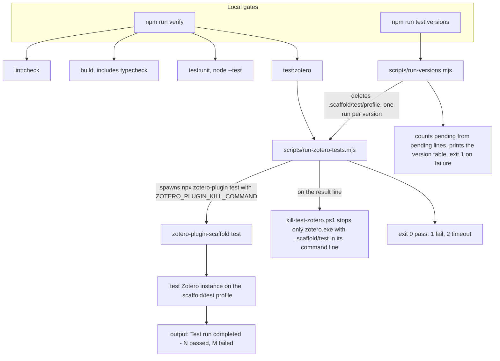

FlexAnnotate has two test tiers and a layer of custom runners around
`zotero-plugin-scaffold`. Pure logic in `src/**/logic/` and `src/core/` is tested
with Node's built-in test runner in `test-unit/` — no Zotero instance is required.
Everything that depends on real Zotero runtime behavior (items, tags, menus,
windows, and prototype patches) runs as Mocha integration tests in `test/` inside
an actual Zotero instance.

The raw scaffold command `zotero-plugin test` starts that instance but keeps it
alive indefinitely after tests finish. To make unattended execution possible,
custom Node runner scripts under `scripts/` wrap the scaffold: they watch stdout
and stderr for the completion summary, stop only the isolated test process, and
translate test outcomes into standard process exit codes and multi-version
summary tables. Both Zotero test tiers operate inside an isolated profile under
`.scaffold/test/` using synthetic data; productive user libraries and Microsoft
Word sessions are never touched. Architectural boundaries between Node unit
tests and Zotero integration tests are detailed in
[Testing Strategy](strategy.md).



The local test gates and how the custom runners chain to the scaffold test instance.

## The npm script map

The project defines npm scripts in [package.json](../../package.json) covering
unit testing, single-version and multi-version Zotero integration testing,
screenshot generation, code style, and build verification:

| Command | Underlying Action | Purpose |
| --- | --- | --- |
| `npm run test:unit` | `node --test "test-unit/*.test.ts"` | Executes Node tests of pure business and outline logic without launching Zotero |
| `npm run test:unit:coverage` | `node --test --experimental-test-coverage "test-unit/*.test.ts"` | Same unit test suite with Node's native code coverage reporting |
| `npm run test:unit:repeat` | `node scripts/repeat-unit-tests.mjs` | Executes the unit suite 10 times consecutively to verify determinism and catch flakiness |
| `npm run test:zotero` | `node scripts/run-zotero-tests.mjs` | Runs the Mocha integration suite in `test/` within an isolated Zotero instance (~15 s) |
| `npm run test:versions` | `node scripts/run-versions.mjs` | Runs the Zotero integration suite sequentially across installed and unpacked Zotero versions (7–10) |
| `npm run screenshots` | `node scripts/run-zotero-tests.mjs --screenshots` | Runs integration tests with screenshot capture enabled, saving PNGs to `.scaffold/screenshots/` |
| `npm run screenshots:docs` | `node scripts/docs-screenshots.mjs` | Executes `screenshots` and copies the curated PNG files into `docs/img/` |
| `npm run lint:check` | `prettier --check . && eslint .` | Validates formatting rules (80-character line width, 2 spaces) and linting constraints |
| `npm run lint:fix` | `prettier --write . && eslint . --fix` | Automatically formats files and fixes fixable lint errors |
| `npm run typecheck` | `tsc --noEmit && tsc -p test/tsconfig.json --noEmit` | Typechecks sandbox typings (`src`, `typings`, `test-unit`) and test typings (`test/`) |
| `npm run build` | `zotero-plugin build && npm run typecheck` | Bundles the add-on via `esbuild` to `.scaffold/build/` and runs full typechecking |
| `npm run verify` | `npm run lint:check && npm run build && npm run test:unit && npm run test:zotero` | Mandatory local gate combining linting, compilation, unit tests, and integration tests |
| `npm run test` | `zotero-plugin test` | Direct scaffold runner invoked by continuous integration workflows |

Build configuration, packaging artifacts, and release workflows are documented
in [Build, Packaging & Release](../operations/build-and-release.md).

## Process management and runner wrapping

The raw command `zotero-plugin test` launches an automated Zotero instance and
logs `Test run completed - …`, but the child Zotero instance and the scaffold
process remain open until manually terminated. Unattended executions (such as
scripts or local gate checks) would hang indefinitely without reporting an exit
code.

The Node wrapper script [run-zotero-tests.mjs](../../scripts/run-zotero-tests.mjs)
(`npm run test:zotero`) solves this by managing the lifecycle of the test run:

- **Result detection:** It spawns `npx zotero-plugin test` and tees stdout and
  stderr chunks to the console while accumulating the output text. It monitors
  the accumulated text with the regular expression `/Test run completed - ([^\n]*)/`.
- **Selective teardown:** When the completion line is matched, it triggers the
  configured `ZOTERO_PLUGIN_KILL_COMMAND` to terminate the test instance.
- **Exit code contract:**
  - `0`: Zero failed tests reported on the summary line.
  - `1`: One or more test failures, or the child process terminated without
    producing a completion summary line.
  - `2`: The run exceeded the configured timeout.
  The termination function `finish()` is idempotent (guarded by a `done` flag),
  executes the kill command first, and delays `process.exit` by 300 ms to allow
  standard streams to flush.
- **Hard execution timeout:** If no completion line appears, the runner aborts
  after `FLEXANNOTATE_TEST_LIMIT_MS` milliseconds (defaults to `240000`, or 4
  minutes). This accommodates older Zotero installations (such as 7.x) which
  execute the 100+ test suite noticeably slower.

### Binary discovery and environment configuration

When launching Zotero, `run-zotero-tests.mjs` configures the execution
environment:

- **Binary discovery:** If the environment variable
  `ZOTERO_PLUGIN_ZOTERO_BIN_PATH` is set, it takes precedence. Otherwise, the
  script tests for existing `zotero.exe` executables in standard Windows
  locations:
  1. `%LOCALAPPDATA%\Zotero\zotero.exe`
  2. `%ProgramFiles%\Zotero\zotero.exe`
  3. `%ProgramFiles(x86)%\Zotero\zotero.exe`
  If none of these files exist on disk, it falls back to the first candidate path.
- **CLI flags:**
  - `--screenshots`: Ensures the target directory `.scaffold/screenshots`
    exists and sets `FLEXANNOTATE_SCREENSHOTS=1` along with
    `FLEXANNOTATE_SCREENSHOT_DIR` in the child environment.
  - `--grep <pattern>`: Sets `FLEXANNOTATE_GREP` to filter executed tests by
    substring match against test titles.
- **Plugin readiness barrier:** In [zotero-plugin.config.ts](../../zotero-plugin.config.ts),
  the scaffold defines:
  ```typescript
  test: {
    waitForPlugin: `() => Zotero.FlexAnnotate.data.initialized`,
  }
  ```
  This flag is set to `true` in [src/hooks.ts](../../src/hooks.ts) at the very
  end of `onStartup`, guaranteeing that test suites only begin running once all
  plugin features, preference panes, and window hooks are initialized.
- **Profile isolation:** The test instance runs on a dedicated profile under
  `.scaffold/test/` (scaffold HTTP port 23124) with its own isolated database.
  All test items, linked PDF attachments, and annotations are created
  synthetically via [test/helpers.ts](../../test/helpers.ts) and removed via
  `cleanup()` in test `after` hooks. Integration tests access the add-on
  strictly through `addon.api` (exposed on `Zotero.FlexAnnotate.api`), never
  importing internal modules directly, as internal modules depend on the
  `ztoolkit` global initialized only by the running add-on.

### Process isolation: scripts/kill-test-zotero.ps1

The process termination command configured via `ZOTERO_PLUGIN_KILL_COMMAND` is
[kill-test-zotero.ps1](../../scripts/kill-test-zotero.ps1). It guarantees that a
developer's productive Zotero session is never disturbed:

1. It resolves the full absolute path of the `.scaffold\test` profile directory.
2. It queries running processes matching `Name='zotero.exe'` via
   `Get-CimInstance Win32_Process`.
3. It filters for processes whose `CommandLine` property contains the
   `.scaffold\test` path marker.
4. It issues `taskkill /PID <ProcessId> /T /F` against only those matching PIDs,
   forcefully stopping the test instance and any spawned child processes.
5. Processes using standard user profile directories are ignored, and the script
   always returns exit code `0`.

## Multi-version testing: `npm run test:versions`

Compatibility across multiple major Zotero releases (Zotero 7, 8, 9, and 10)
is verified locally using [run-versions.mjs](../../scripts/run-versions.mjs).
The runner executes `run-zotero-tests.mjs` against each target version in
succession and aggregates results into a console table.

### Target discovery and version procurement

The runner builds its target list from two sources:

1. **Installed Zotero:** Parsed from the `Version=` line in
   `%LOCALAPPDATA%\Zotero\app\application.ini` (falling back to Program Files
   locations, or labelled `"installed"` if unreadable). For this run, the script
   deletes `ZOTERO_PLUGIN_ZOTERO_BIN_PATH` from the environment so the wrapper's
   default binary discovery resolves the system installation.
2. **Additional Zotero versions:** The script inspects `.zotero-versions/` and
   registers every binary found at `.zotero-versions/<version>/core/zotero.exe`,
   sorted lexicographically. For these runs, `ZOTERO_PLUGIN_ZOTERO_BIN_PATH` is
   explicitly pointed to the executable.

Binaries in `.zotero-versions/` are unpacked installer archives rather than full
system installations. To procure a specific version for testing, download the
installer and extract it using 7-Zip:

```powershell
$v = "9.0.6"
Invoke-WebRequest "https://download.zotero.org/client/release/$v/Zotero-${v}_x64_setup.exe" -OutFile "$env:TEMP\zotero-$v-setup.exe"
7z x "-o.zotero-versions/$v" "$env:TEMP\zotero-$v-setup.exe"
# Application executable resides at .zotero-versions/9.0.6/core/zotero.exe
```

The CLI supports filtering: `--versions 10.0.6,9.0.6` selects specific targets,
and `--grep <pattern>` forwards a title filter to all version runs via
`FLEXANNOTATE_GREP`.

### Profile reset between versions

Between version runs, `run-versions.mjs` forcefully removes the directory
`.scaffold/test/profile` (`rmSync(testProfile, { recursive: true, force: true })`).

The scaffold runner only clears the *data* directory between runs, leaving the
profile directory intact. If the profile were retained across different Zotero
major versions, the new version would inherit the startup cache, extension
registry, and version markers of the preceding version. This previously caused
order-dependent test failures (e.g., Zotero 8.0.4 failing only when executed
immediately after Zotero 7.0.32). Removing `.scaffold/test/profile` ensures an
isolated, pristine profile for every run. Only the project-internal test profile
is deleted.

### Result parsing and pending count calculation

Zotero's summary line (`Test run completed - N passed, M failed`) reports only
passed and failed tests; it omits skipped tests entirely. To capture test skips:

- `passed` and `failed` are extracted from the summary line using
  `match(/(\d+) passed/)` and `match(/(\d+) failed/)`.
- `pending` is counted by matching all individual skip notices in stdout:
  `out.match(/^\s*ℹ .* pending\s*$/gm)`.

Each run produces a table row:

```text
version             passed  failed  pending  exit
10.0.6 (installed)  102     0       7        0   
9.0.6               102     0       7        0   
8.0.4               74      0       35       0   
7.0.32              76      0       33       0   
```

The script exits with code `0` if all versions completed with `failed === 0` and
`exit === 0`. If any version experienced test failures or exited abnormally, it
exits with `1`. Pending tests alone do not fail a run.

### Runtime feature detection for skips

Tests skip dynamically based on runtime feature detection, never by hardcoding
version checks:

- **Annotations mode in citation dialog (Zotero 9+):**
  `hasAnnotationDialog()` in [test/helpers.ts](../../test/helpers.ts) fetches
  `chrome://zotero/content/integration/citationDialog.xhtml` via
  `Zotero.File.getContentsFromURL` and checks for the substring
  `annotations-sidebar`. Zotero 8 ships the XHTML file without this sidebar, and
  Zotero 7 names the file `addCitationDialog.xhtml`. Suites testing the
  annotation citation dialog mode (such as [modeSelector.test.ts](../../test/modeSelector.test.ts)
  and parts of [features.test.ts](../../test/features.test.ts)) call
  `if (!hasAnnotationDialog()) this.skip();` in their `before` hooks.
- **Tools menu DOM fallback (Zotero 7):**
  In [toolsMenu.test.ts](../../test/toolsMenu.test.ts), tests gate in reverse:
  the DOM fallback tests run only when `Zotero.MenuManager.registerMenu` is
  absent. When running on Zotero 8+, `Zotero.MenuManager` owns the menu item, and
  fallback DOM manipulation tests call `this.skip()`.
- **Screenshot suites:**
  The suites in [screenshots.test.ts](../../test/screenshots.test.ts) and the
  layout verification suite in [persistentLayout.test.ts](../../test/persistentLayout.test.ts)
  skip unless `FLEXANNOTATE_SCREENSHOTS=1` is present. During standard
  `test:versions` runs, these tests always register as `pending`.
- **Operating-system file locks:**
  File locking tests in [docImport.test.ts](../../test/docImport.test.ts) and
  [docExport.test.ts](../../test/docExport.test.ts) create exclusive file handles
  via Windows `kernel32!CreateFileW`. In environments where `ctypes` or Windows
  APIs are unavailable (such as Linux CI runners), the tests invoke `this.skip()`
  rather than failing.

### Verified version baseline

As recorded in [docs/testing.md](../../docs/testing.md) (2026-10-13), all 223
pure-logic unit tests pass under Node. The Zotero integration suite results
across tested versions are:

| Version | Passed | Pending | Failed | Notes |
| --- | --- | --- | --- | --- |
| **10.0.6 (installed)** | 102 | 7 | 0 | Full feature set active |
| **9.0.6** | 102 | 7 | 0 | Full feature set active |
| **8.0.4** | 74 | 35 | 0 | Annotation dialog mode skipped (`hasAnnotationDialog` false) |
| **7.0.32** | 76 | 33 | 0 | Uses DOM fallback for Tools menu; citation dialog mode skipped |

Per [AGENTS.md](../../AGENTS.md), compatibility tables in project documentation
must be derived solely from `npm run test:versions` runs and never reconstructed
from memory.

## Running test subsets

During active development, executing entire suites on every change is
unnecessary. Subsets can be run selectively:

### Node unit tests

To filter unit tests by name pattern, pass `--test-name-pattern` to `node`:

```bash
node --test --test-name-pattern=persistent "test-unit/*.test.ts"
```

The `--test-name-pattern` argument must precede the glob pattern; passing it via
`npm run test:unit -- --test-name-pattern=...` causes npm to place the flag after
the glob, which Node interprets as an additional file name.

Individual test files can be executed directly:

```bash
node --test test-unit/persistentRect.test.ts
```

### Zotero integration tests

To filter Zotero tests by title:

```bash
npm run test:zotero -- --grep "persistent"
```

The runner stores the string in `process.env.FLEXANNOTATE_GREP`. When
[test/helpers.ts](../../test/helpers.ts) loads before test execution, it reads
`Services.env.get("FLEXANNOTATE_GREP")` and invokes `mocha.grep(grepPattern)`.
Mocha filters by matching substrings against full test titles (`describe` block
plus `it` label).

To run subsets across multiple versions:

```bash
npm run test:versions -- --versions 10.0.6,9.0.6 --grep "browse"
```

Common grep filter strings for the persistent citation dialog include:

| Filter Pattern | Target Tests |
| --- | --- |
| `persistent` | Initial dialog launch after restart, geometry restoration, mode switches |
| `browse` | Browse window navigation and item insertion |
| `stored rect` | Window coordinates and dimensions persistence |
| `reopen` | Consecutive opening and closing behavior |
| `switch` | Mode selector transitions |
| `wide window` | Three-column layout rendering after restart and opening |

Subset filtering is strictly an interactive development tool. Prior to
committing code, both `npm run verify` and `npm run test:versions` must be
executed cleanly without arguments.

## Screenshot pipeline and documentation curation

Visual verification and README documentation assets are managed by an automated
screenshot pipeline.

### Screenshot capture mechanics

Executing `npm run screenshots` sets `FLEXANNOTATE_SCREENSHOTS=1` and points
`FLEXANNOTATE_SCREENSHOT_DIR` to `.scaffold/screenshots/`. In
[test/screenshot.ts](../../test/screenshot.ts), the helper function
`screenshot(win, fileName, opts)` captures the target window or DOM element:

1. It determines element boundaries using `getBoundingClientRect()` (supporting
   `clipRight` and `scale` options).
2. It allocates an HTML `<canvas>` element and accesses its 2D context.
3. It calls `ctx.drawWindow(win, x, y, w, h, "rgb(255,255,255)", opts.flags ?? 0)`.
   `drawWindow` is a privileged, chrome-only Gecko API unavailable to standard
   web content.
4. It exports image bytes via `canvas.toBlob(...)` and writes the PNG file using
   `IOUtils.write`.

`drawWindow` renders the Gecko window itself, but native OS widgets, popups, and
XUL `<panel>` elements are drawn by separate native window layers and cannot be
captured by `drawWindow`. For menus (such as the settings popup in
[persistentLayout.test.ts](../../test/persistentLayout.test.ts)), the test
writes `menu-geometry.json` containing exact window coordinates, device pixel
ratio, and bounding boxes next to the image file, pausing for external OS screen
capture. All screenshot captures execute inside the test profile using synthetic
data.

### Documentation image curation: scripts/docs-screenshots.mjs

The script [docs-screenshots.mjs](../../scripts/docs-screenshots.mjs)
(`npm run screenshots:docs`) maintains the images embedded in the project
README:

1. It executes `npm run screenshots` via `spawnSync`. If the run fails, it
   aborts immediately.
2. It verifies the existence of the nine curated PNG images in
   `.scaffold/screenshots/`:
   - `organizer.png`
   - `citation-dialog.png`
   - `citation-dialog-native.png`
   - `citation-dialog-place.png`
   - `citation-dialog-search.png`
   - `preferences.png`
   - `main-window.png`
   - `toolbar.png`
   - `import-preview.png`
3. It copies the curated images into `docs/img/`.
4. It issues a console warning for any image file exceeding 250 KB to prevent
   repository bloat.
5. If any curated file is missing or the test run exited non-zero, it exits with
   status `1`.

Per repository guidelines in [AGENTS.md](../../AGENTS.md), images in `docs/img/`
must never be edited by hand; they are updated exclusively by running
`npm run screenshots:docs`.

## Microsoft Word integration smoke testing

Integration between Zotero and Microsoft Word can be verified using the ad-hoc
PowerShell script [word-smoke.ps1](../../scripts/word-smoke.ps1):

1. **Process isolation:** It queries existing Word process IDs:
   `Get-Process WINWORD`.
2. **Hidden COM instance:** It instantiates Word via COM automation
   (`New-Object -ComObject Word.Application`), setting `$word.Visible = $false`
   and `$word.DisplayAlerts = 0`.
3. **Collision guard:** It confirms that the newly spawned Word PID did not reuse
   an existing Word instance. If an existing instance was reused, the script
   throws an error and terminates immediately.
4. **Template verification:** It inspects `$word.Templates` to confirm that
   `Zotero.dotm` is loaded in Word's global template registry.
5. **Deterministic cleanup:** In a `finally` block, it calls `$word.Quit(0)` and
   releases the COM object via `[Marshal]::ReleaseComObject`. Because hidden Word
   COM instances can remain running as background processes, it forcefully
   terminates (`Stop-Process -Id <PID> -Force`) only the specific process IDs
   spawned by the script.

The script does not open or alter documents, leaves existing user Word sessions
untouched, and is run ad hoc when diagnosing Word add-in loading issues.

## Determinism checks and the verify gate

To detect non-deterministic test behavior and flakiness in pure logic,
[repeat-unit-tests.mjs](../../scripts/repeat-unit-tests.mjs) (`npm run test:unit:repeat`)
runs `npm run test:unit` repeatedly in a loop (defaults to 10 iterations,
configurable via `TEST_REPEAT_COUNT`). It aborts immediately with the failing
child exit code upon the first failure.

### The verify gate

The command `npm run verify` defines the required local gate before submitting
changes:

```bash
npm run verify
```

It chains four operations sequentially:
1. `npm run lint:check` (validates Prettier code style and ESLint rules)
2. `npm run build` (bundles add-on code via `zotero-plugin-scaffold` and runs
   `tsc --noEmit` across both sandbox and test `tsconfig` configurations)
3. `npm run test:unit` (executes pure-logic Node tests)
4. `npm run test:zotero` (executes the full Mocha integration suite in Zotero)

In addition to `verify`, a clean run of `npm run test:versions` without arguments
is required before finishing any pull request or release.

In continuous integration ([.github/workflows/ci.yml](../../.github/workflows/ci.yml)),
the test job executes the raw command `npm run test` (`zotero-plugin test`) on an
Ubuntu runner. The custom wrapper scripts (`run-zotero-tests.mjs`,
`kill-test-zotero.ps1`, `run-versions.mjs`) are specifically designed for local
Windows development environments to provide process isolation, automatic cleanup,
multi-version execution, and actionable exit codes.

## Related pages

- [Testing Strategy](strategy.md) — Architectural separation between Node logic tests and Zotero integration tests
- [Zotero Internals & Versioning](../integrations/zotero-internals.md) — Compatibility shims, anchor logging, and runtime feature detection
- [Build, Packaging & Release](../operations/build-and-release.md) — Build lifecycle, TypeScript configuration, XPI bundling, and CI workflows
