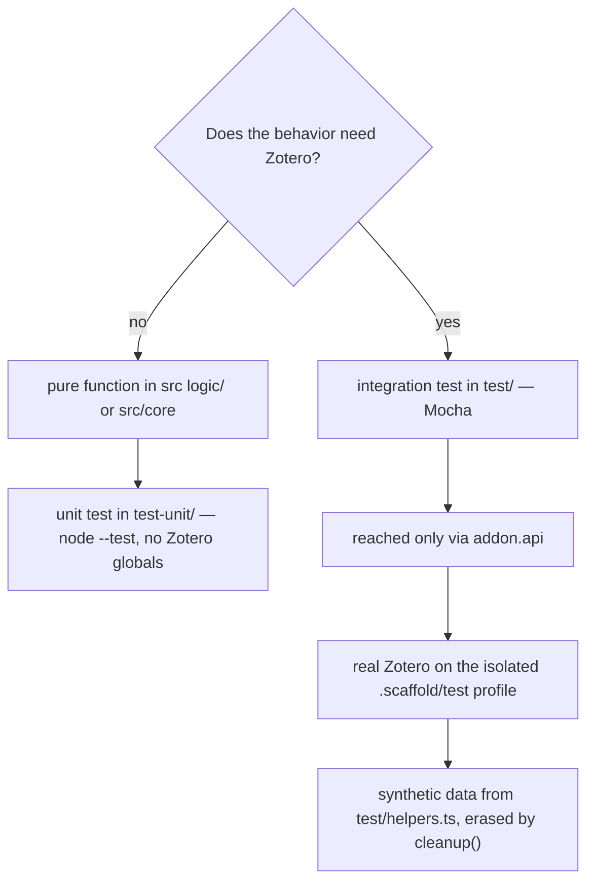

FlexAnnotate keeps two test tiers strictly apart, and the split follows one
question: *does the behavior need Zotero?* Pure logic — outline trees,
decimal numbering, locators, Citavi page ranges, dialog view models, works
grouping, and the feature registry — runs under Node's built-in test runner,
with no Zotero anywhere in the process. Everything that touches Zotero —
items, tags, menus, windows, custom element prototype patches — runs as Mocha
tests inside a real Zotero instance that zotero-plugin-scaffold launches on an
isolated profile. Both tiers use synthetic data only, and neither ever touches
the user's own Zotero, its library, or a running Word instance.

The decision rule that places every test in one of the two tiers.

## Tier 1 — Node unit tests of pure logic

`npm run test:unit` runs `node --test "test-unit/*.test.ts"` — Node's runner
executes TypeScript directly (Node 24), which is why the pure-logic imports
carry an explicit `.ts` suffix. The modules under test are the Zotero-free
zones (`src/features/<feature>/logic/`, `src/core/`, plus
`src/shared/feature.ts`); none of them may reference a Zotero global, or the
tier would not run in plain Node. Tests use `node:test` with
`node:assert/strict` — a completely separate test harness from the Mocha + chai
stack used in the Zotero integration tier. `npm run test:unit:coverage` adds
`--experimental-test-coverage`; `npm run test:unit:repeat` runs the suite 10× to
verify determinism and catch flakiness (runner mechanics detailed on
[Test commands & runners](commands-and-runners.md)).

The unit suite mirrors the pure zones one-to-one:

- **Outline and headings core:** Tree operations, decimal numbering, the
  `LATTICE-OUTLINE-V1` serialization round-trip, grouping items under headings,
  Zotero note normalization ([test-unit/outline.test.ts](../../test-unit/outline.test.ts)),
  `flatHeadings` ([test-unit/flatHeadings.test.ts](../../test-unit/flatHeadings.test.ts)),
  and `.docx`/`.odt` import and export parsing ([test-unit/docOutline.test.ts](../../test-unit/docOutline.test.ts),
  [test-unit/docExport.test.ts](../../test-unit/docExport.test.ts)).
- **Dialog view models and works grouping:**
  [test-unit/dialogView.test.ts](../../test-unit/dialogView.test.ts) tests pure
  view partitioning in `src/features/organizer/logic/dialogView.ts`. It pins
  `buildDialogSections` (grouping annotations under outline headings, with
  unassigned annotations landing in the trailing "no category" bucket where
  `node === null`), `effectiveTags` (merging an annotation's own tags with its
  parent work's tags without duplicates when work items are displayed),
  `nodeCounts` (computing distinct item counts per heading recursively
  including subheadings), and `buildWorkDialogSections` (grouping works/regular
  items by their outline tags and placing unassigned works in the no-category
  section).
- **Reader locator and title formatting:**
  [test-unit/readerLocator.test.ts](../../test-unit/readerLocator.test.ts) tests
  pure locator logic in `src/features/reader/logic/readerLocator.ts`. It pins
  `explicitLocatorFromTags` (extracting locator types from `#flexannotate-locator-*`
  tag strings or tag objects `{ name }` / `{ tag }`, recognizing known labels,
  always accepting `margin`, and returning `null` for unknown or missing tags),
  `locatorLabelText` (resolving locator labels via Zotero's citation label
  function with fallback to translated labels or capitalized identifiers), and
  `formatAnnotationTitle` (formatting title strings such as `"Randnummer 318"` or
  `"Seite -"` when page labels are empty or missing).
- **Citavi and cite-only logic:** Citavi page range parsing (`parsePageRange`),
  duplicate and keyword handling ([test-unit/citavi.test.ts](../../test-unit/citavi.test.ts)),
  and cite-only item mapping ([test-unit/citeOnly.test.ts](../../test-unit/citeOnly.test.ts)).
- **Printing and selection models:** The core `locator` and `labelPopup` modules,
  print placeholder and sort-index construction, the print menu state machine,
  organizer selection, collection scoping, and cited state.
- **Persistent dialog and feature registry:** Persistent-dialog options and
  stored-rect parsing ([test-unit/persistentRect.test.ts](../../test-unit/persistentRect.test.ts),
  [test-unit/persistentOptions.test.ts](../../test-unit/persistentOptions.test.ts)),
  and the Feature registry itself (`test-unit/feature.test.ts`, verifying
  reverse-order shutdown and error isolation across independent features).

## Tier 2 — Zotero integration tests

`npm run test:zotero` starts a real Zotero instance through zotero-plugin-scaffold
and executes the Mocha suite in `test/` inside it. The scaffold gates on
`() => Zotero.FlexAnnotate.data.initialized`, which
[src/hooks.ts](../../src/hooks.ts) sets at the end of `onStartup` — tests only
start once the plugin is fully initialized, and
[test/startup.test.ts](../../test/startup.test.ts) asserts the plugin instance
exists at all.

**The plugin is reached only through `addon.api`.** Every test file resolves it
as `(Zotero as any)[config.addonInstance].api`
([test/features.test.ts](../../test/features.test.ts)); direct imports of
plugin modules are forbidden because those modules depend on the `ztoolkit`
global, which only exists through the running plugin — importing them into the
test bundle would exercise a separate copy, not the active plugin
([test/citeOnly.test.ts](../../test/citeOnly.test.ts) states this in its
header). `addon.api` is assembled in `onStartup` ([src/hooks.ts](../../src/hooks.ts))
and exposes one sub-object per feature area (`organizerData`, `outline`,
`flatHeadings`, `outlineModel`, `organizerStrings`, `externalApi`,
`OrganizerFactory`, `docImport`, `docExport`, `docOutline`, `organizerToolbar`,
`toolsMenu`, `openTarget`, `cited`, `CitationDialogPatch`, `persistentDialog`,
`modeSelector`, `citeOnly`, `reader`, `citavi`, `print`), ensuring tests
exercise the exact integration surface available to consumers.

The Mocha suite covers:

- **Startup and preferences:** Plugin initialization, feature registry
  orchestration, and preferences pane registration ([test/preferences.test.ts](../../test/preferences.test.ts)).
- **Print annotations and custom element row patching:** Placeholder lifecycle,
  input mask, and item menus ([test/print.test.ts](../../test/print.test.ts),
  [test/printDialog.test.ts](../../test/printDialog.test.ts),
  [test/printMenus.test.ts](../../test/printMenus.test.ts)). Furthermore,
  [test/annotationRowPatch.test.ts](../../test/annotationRowPatch.test.ts)
  tests the prototype patch applied to `<annotation-row>` custom elements in
  live Zotero windows: when an annotation item has an explicit locator tag (e.g.
  `#flexannotate-locator-opus`) and page label `"318"`, setting `row.annotation`
  dynamically rewrites `row._title.textContent` to include the resolved locator
  label and page number (such as `"Opus 318"`), whereas annotations with default
  page locators retain standard page presentation.
- **Citation mode and cite-only patch:** The cite-only patch toggle and
  citation result transformation ([test/citeOnly.test.ts](../../test/citeOnly.test.ts)),
  along with the mode selector dropdown in the citation dialog
  ([test/modeSelector.test.ts](../../test/modeSelector.test.ts)).
- **Citavi import:** Real item creation, tag parsing, duplicate checking, and
  print quotation linking ([test/citavi.test.ts](../../test/citavi.test.ts)).
- **Menu integrations:** Reader-menu registration and deregistration
  lifecycle ([test/readerMenu.test.ts](../../test/readerMenu.test.ts)), and the
  tools-menu fallback mechanism ([test/toolsMenu.test.ts](../../test/toolsMenu.test.ts)).
- **Organizer end-to-end:** Data management and filing, the organizer window
  (tree selection, drag-and-drop, keyboard navigation, tabs), the toolbar
  button ([test/toolbarButton.test.ts](../../test/toolbarButton.test.ts),
  [test/organizer.test.ts](../../test/organizer.test.ts)), and the citation-dialog
  view with search, green cited-checks, and "Zitatstelle anzeigen"
  ([test/features.test.ts](../../test/features.test.ts)). Outline file import
  runs against real `.docx`/`.odt` ZIP fixtures ([test/docImport.test.ts](../../test/docImport.test.ts));
  its pure parsing logic is pinned separately in `test-unit/docOutline.test.ts`.

Integration tests drive real Zotero windows instead of stubbing the DOM:
helpers dispatch synthetic `MouseEvent` and `KeyboardEvent` instances (`click`,
`key`) on the live document and poll conditions with `waitFor`/`waitForAsync`
(default 8 s, 25 ms steps). Assertions inspect real Zotero state afterwards —
item tags via `getTags()`, the outline note via `getNote()`, and window
geometry via `getBoundingClientRect()`.

## The isolated-profile safety model

The test Zotero runs on an isolated scaffold profile under `.scaffold/test/`
(its own data directory; the scaffold's default port 23124). The productive
Zotero, its library, and Word are never started or touched — the Zotero binary
is launched with the test profile, so nothing the tests do can reach the
user's data.

- **Teardown kills only the test instance.** The wrapper sets
  `ZOTERO_PLUGIN_KILL_COMMAND` to
  [scripts/kill-test-zotero.ps1](../../scripts/kill-test-zotero.ps1), which
  resolves the absolute `.scaffold\test` marker, enumerates `zotero.exe`
  processes via `Win32_Process`, and `taskkill /T /F`s exactly those whose
  command line contains the marker. The user's own Zotero runs with a
  different profile, so its command line never matches and it is left alone;
  the script always exits 0.
- **A fresh profile per Zotero version.** `npm run test:versions`
  ([scripts/run-versions.mjs](../../scripts/run-versions.mjs)) deletes
  `.scaffold/test/profile` before *every* run. The scaffold clears only the
  *data* directory, so a kept profile would carry the startup cache and
  extension registry of the previous version and made runs order-dependent
  (8.0.4 failed only directly after 7.0.32). Only this project-internal
  profile folder is ever deleted — never a productive profile.
- **The Word side has its own smoke test.** Because the Zotero tier never
  starts Word, [scripts/word-smoke.ps1](../../scripts/word-smoke.ps1) is the
  only automated Word check: it starts its own hidden Word instance via COM,
  refuses to continue if Word reused an existing instance, requires
  `Zotero.dotm` among the loaded templates, and in a `finally` block quits
  only that instance and force-stops only the PIDs it started. It opens no
  document and is not wrapped by any npm script.

## Synthetic data helpers

All test data is synthetic and created by
[test/helpers.ts](../../test/helpers.ts), so suites never depend on library
contents:

- `makeWork(title)` — a book item in the user library with a **fresh creator
  per work**: Zotero purges orphaned creators on erase, so a cached creator ID
  would otherwise be "not found" in the next suite.
- `makePdfAttachment(parent)` — a minimal `%PDF-1.4` file in the temp
  directory, *linked* to the parent via `Zotero.Attachments.linkFromFile`.
- `makeAnnotation(att, text, page, index)` — a highlight annotation with page
  label, sort index `00000|<index>|00000`, and a fixed position JSON.
- `cleanup()` — erases everything the helpers created, in reverse order
  (children go with their parents), tolerating items already removed with a
  parent.

Tests that change preferences save the old value in `before` and restore it in
`after` (e.g. [test/print.test.ts](../../test/print.test.ts)), and files or
notes created outside the helpers are erased in the same hooks — the test
profile must stay as the next suite expects it.

## Subset selection

While developing, run a slice of the suite; a selection is only a development
tool — before finishing, always run `npm run verify` and a full
`npm run test:versions` without arguments.

- **Zotero tests by title:** `npm run test:zotero -- --grep "persistent"`.
  The wrapper stores the pattern in `FLEXANNOTATE_GREP`
  ([scripts/run-zotero-tests.mjs](../../scripts/run-zotero-tests.mjs));
  [test/helpers.ts](../../test/helpers.ts) reads it at test-file load time and
  passes it to `mocha.grep`, so the full title (`describe` + `it`) is matched
  as a substring. Without a pattern everything runs.
- **Unit tests by name:** `node --test --test-name-pattern=persistent "test-unit/*.test.ts"` — the option must precede the file glob, otherwise node reads it as a file name, which is why this is not expressed as `npm run test:unit -- …`. By file: `node --test test-unit/persistentRect.test.ts`.
- **Version subsets:** `npm run test:versions -- --versions 10.0.6,9.0.6 --grep "browse"`.

The grep patterns that slice the persistent-citation-dialog suites (`persistent`,
`browse`, `stored rect`, `reopen`, `switch`, `wide window`) are tabulated on
[Test commands & runners](commands-and-runners.md).

## Where new tests go

The standing rule: **new logic lands first as a pure function with a unit
test; only behavior that cannot be verified without Zotero gets an
integration test, written over `addon.api` exclusively.** Concretely:

1. Write the logic in `src/features/<feature>/logic/` (or `src/core/` when
   several features need it) with no Zotero globals and `.ts`-suffixed
   imports, and pin it in `test-unit/`. For instance, locator extraction, label
   fallbacks, and title construction live in `src/features/reader/logic/readerLocator.ts`
   and are tested in [test-unit/readerLocator.test.ts](../../test-unit/readerLocator.test.ts),
   while section and works grouping logic lives in `src/features/organizer/logic/dialogView.ts`
   and is tested in [test-unit/dialogView.test.ts](../../test-unit/dialogView.test.ts).
2. Only the Zotero-facing shell (items, tags, menus, windows, patches) gets a
   Mocha test in `test/`, resolved through `(Zotero as any)[config.addonInstance].api`.
   For example, live patching of the `<annotation-row>` custom element's
   title attribute across Zotero windows lives in `src/features/print/annotationRowPatch.ts`
   and is tested in [test/annotationRowPatch.test.ts](../../test/annotationRowPatch.test.ts).
3. A prototype patch additionally needs evidence — a test or a source anchor
   in `docs/anchors.md` (see [Prototype patching](../architecture/patching.md)).

`test-unit/feature.test.ts` is the precedent for the first step applied to
plumbing: the Feature registry is tested in Node because it is importable
without Zotero globals, even though its consumers only run inside Zotero.

## What is deliberately not automated

Documented limits ([docs/testing.md](../../docs/testing.md), "Grenzen") that
agents must not mistake for coverage:

- **Reader window UI.** The reader context menu, page-number popup, and
  locator display are not tested — only that the reader menu registers and
  unregisters its listener (via `Zotero.Reader._registeredListeners`), because
  the test profile has no reliably openable PDF.
- **A real Word run.** The path "Word button → citation dialog → insert" needs
  the user's running Zotero and would touch its library. Instead, the citation
  dialog is tested with the real Zotero window and a dialog object built like
  in `Zotero.Integration.Session.cite`; only `word-smoke.ps1` touches Word.
- **The real Citavi translator.** Tests use synthetic fixtures; the
  `PageRange` format (`<os>`/`<nt>` markup) is proven only against fixtures.
- **Dark mode.** Toolbar/menu icon and reader-popup rendering is verified by
  code review only.
- **Intermediate Zotero versions.** The suite has run on 7.0.32, 8.0.4,
  9.0.6, and 10.0.5/10.0.6 only; patch versions in between are untested.
- **Citation dialog before Zotero 9.** The annotation mode does not exist
  there; the tests for it are *skipped*, not passing.
- **Native dialogs.** The outline import passes its file directly to
  `docImport.importFromFile` (with a stubbed `confirm`); the native
  `FilePicker` and the preview dialog are not automated. The print item-menu
  tests likewise pass the selection directly to `updateVisibility` because
  item-tree rows are not reliably selectable.

Skips are **feature-detected at runtime**, never decided by comparing version
numbers, and appear as pending in the `test:versions` table without failing
it: `hasAnnotationDialog()` reads
`chrome://zotero/content/integration/citationDialog.xhtml` and checks for
`annotations-sidebar` (the annotation mode exists from Zotero 9; 8.x ships the
file without the mode, 7.x names it `addCitationDialog.xhtml`), and the
tools-menu tests skip their command/removal cases once
`Zotero.MenuManager.registerMenu` exists. Screenshot suites skip unless
`FLEXANNOTATE_SCREENSHOTS=1` is set, and the locked-file import/export tests
skip where `ctypes` is unavailable (non-Windows). Screenshots themselves are
part of the Zotero tier and share its isolation: the helper renders windows
with the chrome-only `CanvasRenderingContext2D.drawWindow`, which captures
only the window itself — popups and menus are separate native widgets and
never appear, which is one reason popup rendering and dark mode stay outside
automated verification.

Recorded state (2026-10-13, `npm run test:versions`, per
[docs/testing.md](../../docs/testing.md)): 223 unit tests, all passing; the
Zotero suite green on 10.0.6 and 9.0.6 (102 passed, 7 pending each), 8.0.4
(74/35), and 7.0.32 (76/33). The large pending counts below Zotero 9 come from
the missing annotation mode.

## Related pages

- [Architecture overview](../architecture/overview.md) — high-level system decomposition, module layering rules, and build pipeline
- [Test commands & runners](commands-and-runners.md) — the npm script map, the wrapper mechanics, kill script, version matrix, and screenshot pipeline
- [Feature lifecycle & registry](../architecture/feature-lifecycle.md) — the `addon.api` surface and the startup order the tests gate on
- [Prototype patching](../architecture/patching.md) — the evidence rule for patches and the `assignChecked` contract
- [Conventions & constraints](../conventions.md) — pure-logic placement, `.ts` imports, and the language split the test files follow
